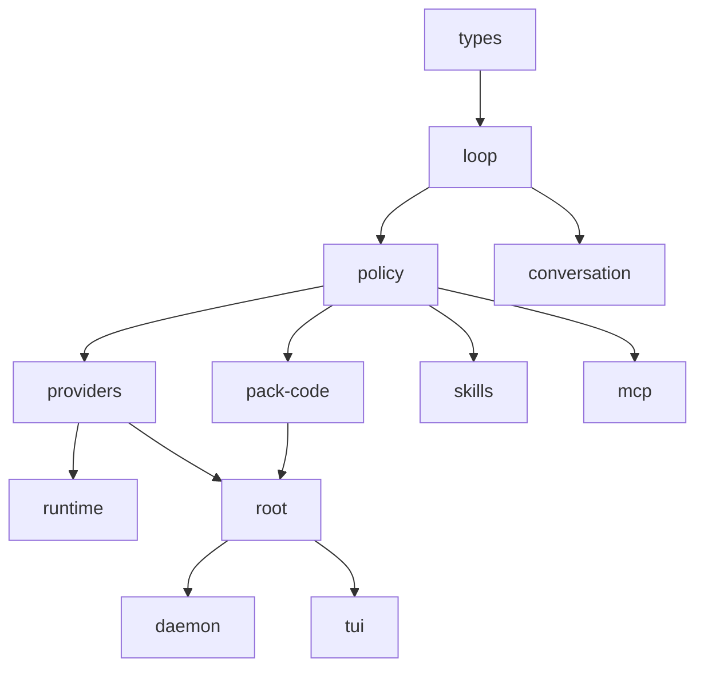
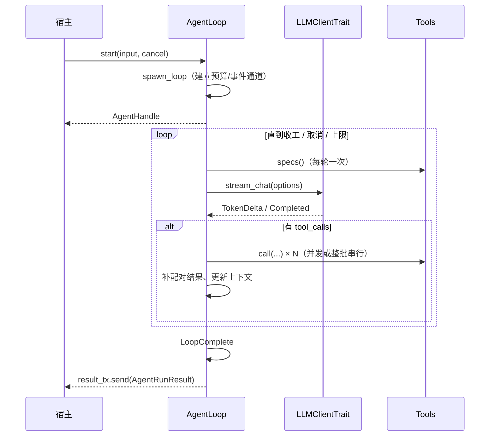

# Thunder 架构

> 版本 0.6.0 · 快照 `main@e66338b` · 12 个 crate
>
> 本文只描述**当前**代码。权限与审批的细节在 [`permission-structure.md`](permission-structure.md)；
> 0.5 → 0.6 的破坏性变更在 [`migration-0.6.md`](migration-0.6.md)。

## 0. 一句话

内核是一个**只认两个接缝**的循环（`Tools` 执行工具、`LLMClientTrait` 拿流），
所有产品意见——工具、审批、提示词、观察者——都在宿主里，以四个显式列表装配。

```
thunder-tui / thunder-daemon / thunder-runtime
        │  持有：ToolRegistry + ToolExecutor + gate + ui + Assembly
        ▼
thunder-agent-root        ← 宿主装配（Assembly / StandardHostBuilder / 内置 sections·packs·observers）
        │
        ▼
thunder-agent-policy      ← AgentTool / ToolExecutor 漏斗 / gate / ui / read_only / trace / registry_tools
        │
        ▼
thunder-agent-loop        ← 循环 / 上下文 / 压缩 / 流 / 缓存 / seam / scratchpad
        │
        ▼
thunder-agent-types       ← 纯 wire：message / event / error / tool / policy 声明 / scope / trace 记录
```

---

## 1. 工作区

### 1.1 crate 清单

行数统计：各 crate `src/` 下的 `.rs` 文件（不含 `tests/`、`examples/`），2026-10-21。

| Crate | 目录 | 文件 | 行数 | 角色 |
|---|---|---:|---:|---|
| `thunder-agent-types` | `thunder-agent-types` | 9 | 1,480 | 纯 wire 类型，无内部依赖 |
| `thunder-agent-loop` | `thunder-agent-loop` | 31 | 6,331 | 内核：循环、上下文、压缩、流、缓存、`seam` |
| `thunder-agent-policy` | `thunder-agent-policy` | 13 | 4,525 | 策略层：工具执行漏斗、gate、UI、拦截器、只读判据 |
| `thunder-agent-pack-code` | `thunder-agent-pack-code` | 11 | 2,764 | 可选能力包：fs / shell / search + `CodeScope` |
| `thunder-agent-providers` | `thunder-agent-providers` | 13 | 3,286 | 模型目录 + 进程内流式 HTTP |
| `thunder-agent-skills` | `thunder-agent-skills` | 7 | 1,318 | Skill 解析、注册、目录注入 |
| `thunder-agent-mcp` | `thunder-agent-mcp` | 11 | 2,101 | MCP 客户端 / 传输 / 工具桥接 |
| `thunder-agent-root` | `thunder-agent-root` | 26 | 10,857 | 宿主装配 + 内置 sections / packs / observers |
| `thunder-agent-daemon` | `thunder-agent-daemon` | 7 | 4,268 | NDJSON sidecar |
| `thunder-agent-runtime` | `thunder-agent-runtime` | 4 | 1,072 | JSONL 无头运行时（宿主执行工具） |
| `thunder-conversation` | `thunder-agent-core/conversation` | 11 | 2,050 | 会话存储（内存 / 文件系统） |
| `thunder-tui` | `thunder-agent-core/tui` | 25 | 14,284 | 终端 UI |

合计 **54,336 行**。

### 1.2 依赖方向（硬约束）

| Crate | 依赖的内部 crate |
|---|---|
| `types` | — |
| `loop` | `types`（`policy` 只在 `[dev-dependencies]`） |
| `policy` | `types`、`loop`（为 loop 的 `Tools` 接缝提供参考实现） |
| `pack-code` | `types`、`policy`、`loop` |
| `providers` | `types`、`policy`、`loop` |
| `skills` | `types`、`policy`、`loop` |
| `mcp` | `types`、`policy`、`loop` |
| `conversation` | `loop` |
| `runtime` | `types`、`policy`、`loop`、`providers` |
| `root` | `types`、`policy`、`loop`、`pack-code`、`providers` |
| `daemon` | `types`、`policy`、`loop`、`providers`、`skills`、`mcp`、`conversation`、`root` |
| `tui` | `types`、`policy`、`loop`、`pack-code`、`providers`、`skills`、`mcp`、`conversation`、`root` |

> `root` 的 `conversation` / `skills` / `mcp` 是可选 feature（默认全开）；上表只列必需依赖。

两条不能破的规则：

1. **内核不依赖任何宿主**，也不依赖 `pack-code`。它只认识 `types` 与自己的 `Tools` 接缝。
2. **`policy → loop` 的方向是"策略层实现内核接缝"**，不是内核反向依赖策略。`loop` 的 `Cargo.toml` 里 `policy` 只在 dev-dependencies。



### 1.3 构建与门禁

```bash
cargo fmt --all -- --check
cargo clippy --workspace --all-targets --features thunder-agent-daemon/testing-mock -- -D warnings
cargo test --workspace
```

CI（`.github/workflows/ci.yml`）跑这三条，外加版本一致性检查。工具链固定在 `rust-toolchain.toml`（1.98.0）。

---

## 2. 内核：`thunder-agent-loop`

### 2.1 模块地图

| 路径 | 作用 |
|---|---|
| `loop_engine/engine.rs` | `AgentLoop`、`spawn_loop`、主循环、`Emitter`、三个事件 sink、`AgentRunResult` |
| `loop_engine/handle.rs` | `AgentHandle`：`start` 之后宿主拿到的一切（事件流、取消、steer、join） |
| `loop_engine/event_stream.rs` | `EventBudget`（字节配额）与 `EventStream`（消费即归还） |
| `loop_engine/gate.rs` | `CompletionGate`：模型不再调工具时，判定"能不能收工" |
| `loop_engine/guard.rs` | 循环内的重复/错误熔断（与策略层的 `Guard` 不是同一个东西） |
| `seam.rs` | `Tools` / `ToolsFactory` / `ToolSpec` / `ToolCallContext` / `ToolOutcome` / `RunContext` |
| `core/` | `ContextBuffer`（消息与图片）、`pause`、`steer`、`paths`（数据根）、`token_estimator`、`utf8`、`state` |
| `pruning/` | `strategy`（何时压缩）、`checkpoint`（唯一压缩策略）、`error_detector`（溢出自愈） |
| `stream/` | `LLMClientTrait`、`LLMStreamChunk`、`ChatRequestOptions` |
| `cache/` | `cache/mod.rs`（缓存统计）、`warmer.rs`（缓存保温） |
| `tools/scratchpad.rs` | 超长输出落盘（宿主注册表也用它） |
| `types/` | `AgentConfig`、`LoopStatus`、事件/工具类型的内核侧视图 |

### 2.2 装配：`AgentLoop`

```rust
let agent = AgentLoop::new(config)
    .with_custom_client(client)              // Arc<dyn LLMClientTrait>
    .with_tools(tools)                       // Arc<dyn Tools>：整张工具表由宿主给
    // 或 .with_tools_factory(factory)       // 每次 run 拿 RunContext，构造 per-run Tools
    .with_completion_gate(gate, rounds)      // 可选：收工判定
    .with_summary_limit(Arc<Semaphore>)      // 可选：与其它 agent 共享压缩并发预算
    .with_pause_gate(pause_gate)
    .with_steer_queues(steer_queues);

let mut handle = agent.start(input, Some(cancel))?;
```

`AgentHandle`：

| 方法 | 语义 |
|---|---|
| `take_events() -> Option<EventStream>` | 取走事件流；之后 `AgentLoop::run` 这类便捷路径拿不到第二条 |
| `join() -> AgentRunResult` | 等**结果**就绪；不保证事件流已排空（宿主自行 `take_events` 排空后再 join，或按 `run()` 的写法先 spawn 排空） |
| `cancel()` | 只影响这一个 run |
| `steer(msg)` / `follow_up(msg)` | 在轮次边界插入用户输入 |

一次 `start` 只允许一个 in-flight run：第二次 `start` 返回 `AlreadyRunning`。

### 2.3 `Tools` 接缝

内核不持有工具表，只通过两个方法要东西：

```rust
pub trait Tools: Send + Sync {
    fn specs(&self) -> Vec<ToolSpec>;                       // 每轮一次，顺序即请求里的顺序
    fn call<'a>(&'a self, call: &'a ToolCall, ctx: ToolCallContext<'a>)
        -> BoxFuture<'a, ToolOutcome>;
}
```

- `ToolSpec { definition, concurrency }`：`Concurrency::Sequential` 会让**整批**调用串行（简单、可预测；不是"仅该调用排队"）。
- `ToolCallContext`：`tool_call_id` / `turn` / `route` / `cancel` / `timeout` / `events: Option<Arc<dyn ToolEventSink>>`。
- `ToolsFactory::for_run(&RunContext)`：宿主在这里拿到本次运行的两个 sink（业务事件、trace），构造 per-run 的 `Tools`。`StaticToolsFactory`（policy crate）是参考实现；`NoTools` 是不装工具时的默认。
- 取消/超时之后，内核仍为每条已宣告的调用补一条结果（**配对不变量**），宿主不会因为少一条结果而让下一轮请求非法。

**`specs()` 的稳定性是契约**：顺序稳定、只在显式跃迁时变化（进出 plan、pack 启停、用户禁用）。它进的是模型请求前缀，一变就击穿 provider 侧 prompt cache。

### 2.4 一次 run 的流程



### 2.5 `AgentRunResult` 与 `FinishReason`

`AgentRunResult { agent_id, final_content, messages, raw_messages, stats, finish_reason }`。

`FinishReason`：`Done` / `MaxTurnsExceeded` / `BudgetExceeded` / `Cancelled` / `Error`。

- `messages` 是权威转录（宿主应替换自己那份，而不是拼接）。
- `raw_messages` 只在发生 checkpoint 压缩时出现（压缩前的原始转录）。
- `stats`：轮数、token 明细、工具执行次数与耗时。

### 2.6 事件模型与字节预算

```rust
pub struct ObservedEvent { agent_id: String, event: AgentEvent, timestamp_ms: u64 }
```

`AgentEvent` 变体：`TurnStart`、`TokenDelta`、`ReasoningDelta`、`ToolCallChunk`、`ToolCallReady`、`ToolExecStart`、`ToolExecResult`、`ToolTrace`、`TelemetryNotice`、`TurnEnd`、`LoopComplete`、`ContextCompacted`、`SteerAccepted`、`Error`、`Custom`、`GateResult`。

投递：

| 类别 | 策略 |
|---|---|
| 微增量（`TokenDelta` / `ReasoningDelta` / `ToolCallChunk`） | `try_send`；队列满即丢，计 `micro_deltas`，**绝不阻塞循环** |
| 结构化事件 | 先 `reserve` 字节配额，再 `send`，5 秒期限；失败计 `structural` 并告警 |

**字节预算**（`AgentConfig::max_event_bytes`，默认 8 MiB）：`EventBudget` 是以字节计的 `Semaphore`；生产者在入队前 `reserve(event.approx_bytes())`，`EventStream::recv` 消费时归还。单个事件大于整个预算时直接丢弃（永远装不下；截断会改写宿主自己的内容）。因此内存上界是**一个明确的数**，不是 `512 × 单事件大小`。

`Custom { kind, payload }` 是工具/宿主向宿主发业务事件的信封，内核不解释 `kind`。随仓的 kind：`file_change`（pack）、`mode_changed`（mode）、`metrics_update`（metrics）、`agent_status`（status）。

### 2.7 上下文与压缩

触发：`estimated > max_context_tokens - reserve_tokens`（默认 128k − 16k，保留最近 20k）。

| 机制 | 行为 |
|---|---|
| **checkpoint 压缩**（唯一策略） | 切点不落在 tool result 上；旧区域序列化后交给 `Summarizer` 做一次 LLM 调用（首次 `INITIAL_*`，有旧摘要时 `UPDATE_*` 迭代合并）；成功后用一个 `context_checkpoint` 消息替换区间 |
| **并发上限** | `ContextPruningConfig::max_concurrent_summaries`（默认 2）。许可覆盖整个重试对；`ThunderRoot` 为所有 run 共享同一个 `Arc<Semaphore>`，因为多个 agent 往往同时越过阈值 |
| **紧急裁剪** | 摘要不可用/失败且仍超硬窗口时，原子丢弃最老完整轮次；正常路径不触发 |
| **溢出自愈** | 从 provider 报错里解析真实窗口上限，更新后重压缩重试（最多 2 次） |
| **流恢复** | 工具参数中断 → 让模型重发；正文中断 → 拼接续写（保留末尾锚点）；首 token 前中断 → 干净重试 |

摘要请求：`cache_retention = "none"`、`session_id = None`、`thinking_level = None`；`finish_reason == "length"` 或空输出视为失败。

### 2.8 缓存保温

`cache/warmer.rs`：只在**本轮确实命中缓存**时重新调度；刷新时延 = TTL × 90%（至少留 10s）；经济性闸门 `expected = probability × miss_cost − warm_cost ≥ $0.05`；空转概率 0.15、空转上限 30 分钟；模型必须在 `models.json` 同时声明 `promptCache` 与 `cost`；`replay_safe = false` 的模型永不调度。

### 2.9 控制原语

- **pause**：工具边界处的协作停顿；`cancel` 优先于 `pause`。
- **steer / follow-up**：只在轮次边界插入（工具执行中绝不打断）；`SteerAccepted` 事件告知宿主。
- **配对不变量**：取消或超时后，每条已宣告的 `tool_call` 都有对应结果，且顺序保留。

---

## 3. `thunder-agent-types`：wire 类型

9 个模块，无内部依赖：

| 模块 | 内容 |
|---|---|
| `message.rs` | `ChatMessage`（system / user / assistant / tool）、`ToolCall` |
| `event.rs` | `AgentEvent`、`ObservedEvent`、`AgentStats`、`TurnStats`、`FinishReason`、`EventDropCounters`、`approx_bytes` |
| `tool.rs` | `ToolDefinition`、`ToolExecutionResult`、`ProgressReporter`、`ToolEventSink` |
| `policy.rs` | `ToolEffect`（Read / Write / Exec / Other / PlanArtifact）、`Caller`、`describe_call` |
| `scope.rs` | `Scope`（InScope / OutOfScope / Unknown）、`ToolScope` |
| `trace.rs` | `ToolTrace`、`ToolTraceSink`、脱敏后的记录结构 |
| `error.rs` / `notice.rs` / `lib.rs` | 错误、通知、导出 |

`ObservedEvent::approx_bytes()` 是廉价估算（不做序列化）：帧头 + 各变体里可能变大的字段。

---

## 4. `thunder-agent-policy`：策略层

内核刻意不包含的一切：工具抽象、执行漏斗、审批、只读判据、trace、拦截器。

### 4.1 工具与拦截器

```rust
pub trait AgentTool: Send + Sync {
    fn definition(&self) -> ToolDefinition;
    fn effect(&self) -> ToolEffect { /* 按名字推断的默认值 */ }
    fn concurrency(&self) -> Concurrency { … }
    async fn execute(&self, args: Value, ctx: &ToolExecutionContext) -> Result<String, String>;
}

pub trait ToolPlugin: Plugin {           // 同一工具同时出现在两种注册表里时使用
    fn definition(&self) -> ToolDefinition;
    async fn execute(&self, args: Value, ctx: &ToolExecutionContext) -> Result<CallToolResult, String>;
}

pub trait InterceptorPlugin: Plugin {    // 洋葱：pre 按 priority 降序，post 逆序
    fn priority(&self) -> i32 { priority::NORMAL }   // 500
    async fn pre_execute(...) -> Result<PreExecutionVerdict, String>;
    async fn post_execute(...);
}
```

`priority` 常量：`CRITICAL_GUARD = 1000`、`SECURITY_POLICY = 800`、`GOVERNANCE_MODE = 500`、`NORMAL = 500`、`OBSERVABILITY = 100`。

`ToolExecutionContext` 携带：`tool_call_id`、`turn`、`route`、`cancellation_token`、`effect`、`event_sink`、`ui`、`sub_invoker`、`call_chain`、`progress_reporter`、`caller`。

### 4.2 `ToolExecutor::run_tool`：唯一漏斗

```
取消检查
  → 解析参数（原样给工具；脱敏副本进 trace）
  → 作用域分类 scope_of(...)
  → Guard::check(...)                    ← 谁都不能跳过的地板
  → gate.decide(&request)                ← 宿主裁决：Allow / AllowByRule / Deny / Ask
      ├─ Ask → 渲染对话框（HostUi）→ 答案回写 gate（可记规则）
      └─ Deny → 带出口的拒绝文案
  → interceptor.pre_execute（priority 降序）
  → ToolRegistry::execute_tool_call      ← 超时、sanitize、scratchpad、截断
  → interceptor.post_execute（逆序）
  → trace 发布（恰好一条，没有早退路径能跳过）
```

- **guard 先于 gate**：gate 只能收紧，不能放宽。无 gate = 全部放行（headless 宿主的选择）。
- **参数解析失败不是绕过 guard 的路**：注册表用同一份字符串，解析失败在工具之前就报错。
- `run_tool` 没有 early return；记录在 `dispatch` 返回后统一收口——"每次调用恰好一条 trace"是结构性的。

### 4.3 `ToolRegistry`

- `BTreeMap` 而非 `HashMap`：工具定义每轮序列化进请求，顺序稳定是 prompt cache 的前提前提。
- 每次调用：超时（默认 30s，调用点传 `request_timeout_ms`）、`sanitize` 后处理、超过 `scratchpad.threshold_bytes`（16 KB）落盘并返回句柄、否则 head/tail 截断到 `max_output_bytes`（64 KB）。
- `register` / `register_plugin` / `get` / `get_definitions`。

### 4.4 gate / UI / guard / read_only

| 模块 | 内容 |
|---|---|
| `gate.rs` | `ToolGate`、`GateVerdict`、`ApprovalPrompt { title, detail, allow_always }`、`ApprovalAnswer`、选项常量 `ALLOW_ONCE` / `ALLOW_ALWAYS` / `DENY` / `DENY_WITH_REASON` |
| `ui.rs` | `HostUi`（`request` / `notify` / `set_status`）、`UiRequest`（Select / Review / Input / Confirm / Editor）、`UiResponse`、`NullHostUi` |
| `guard.rs` | 危险命令地板：`rm -rf /`、凭据读取等；与模式无关，任何 gate 之前 |
| `read_only.rs` | plan 模式的"这条命令改不了任何东西"判据：一条命令、只读动词、无凭据操作数；`call_is_read_only(args)` |
| `plugin.rs` | `Plugin`（id/description）、`ToolPlugin`、`InterceptorPlugin`、`PreExecutionVerdict`、`CallToolResult`、优先级常量 |
| `invoke.rs` | `ToolInvoker` / `ExecutorToolInvoker`：反向 RPC（工具里再调工具），走同一漏斗并带 `caller` |
| `trace.rs` | `TraceInterceptor`（把 trace 交给 `ToolTraceSink`） |
| `sanitizer.rs` | 工具输出后处理（控制字符、超大行等） |
| `tool_policy.rs` | `ToolExecutionContext`、`SubToolInvoker` |

### 4.5 `registry_tools`：参考 `Tools` 实现

```rust
let tools = plain_tools(vec![...], 64 * 1024, timeout);
// 或
let factory = StaticToolsFactory::new(registry, executor);
agent.with_tools_factory(Arc::new(factory));
```

`StaticToolsFactory::for_run` 把本次运行的 trace sink 装进共享 executor，并返回**持有该 generation** 的 `RegistryTools`；`RegistryTools::drop` 清掉自己那一份。并发运行共享一个 executor 时，只有安装者能清。

---

## 5. `thunder-agent-root`：宿主装配

### 5.1 四个契约 + `RunEnv`

```rust
pub struct RunEnv {
    pub session_id: String, pub workspace: Option<PathBuf>, pub route: Option<String>,
    pub prompt: Option<String>, pub ui: Arc<dyn HostUi>, pub cancellation: CancellationToken,
}

pub trait PromptSection { fn id(&self) -> &str; fn order(&self) -> i32 { 100 } fn render(&self) -> Option<String>; }
pub trait Observer {
    fn id(&self) -> &str;
    fn on_event<'a>(&'a self, event: &'a AgentEvent, env: &'a RunEnv) -> BoxFuture<'a, ()>;
    fn on_finish<'a>(&'a self, result: &'a AgentRunResult, env: &'a RunEnv) -> BoxFuture<'a, ()>;
}
pub trait Prepared { fn id(&self) -> &str; fn prepare<'a>(&'a self, env: &'a RunEnv) -> BoxFuture<'a, Result<(), String>>; }
pub struct ToolPack { pub id: String, pub tools: Vec<Arc<dyn AgentTool>>, pub tool_plugins: Vec<Arc<dyn ToolPlugin>> }
```

`Assembly`：`prompt(base)`（按 `order` 拼接、跳过空段）、`tools()` / `tool_plugins()`、`dispatch_event` / `dispatch_finish`、`without_disabled(&HashSet)`、`ids()`、`has_pack(id)`、`prepare(&RunEnv)`。

**为什么观察者是异步且带 `env`**：conversation 要把整轮写回磁盘（`tokio::sync::RwLock`），而多会话并发时实例不能记住"上次是哪个 session"。

### 5.2 `ThunderRoot` 与一次执行

```rust
let root = StandardHostBuilder::new(store)
    .build(ThunderRoot::new(config).with_workspace(ws));

let mut handle = root.execute(prompt, RootRunOptions { mode, mode_plugin, ui, route, .. }).await?;
if let Some(mut events) = handle.take_events() { /* 转发给 UI */ }
let result = handle.join().await?;
```

`execute` 的装配序列：

1. 取 prompt（`Text` 原样；`Messages`/`Buffer` 取最后一条 user，否则 `"General task"`）
2. `ThunderConfig::load(workspace)`
3. session id（缺省 `sess_<ms>_<seq>`）+ route id（`run_{session}_{seq}`）
4. mode：复用宿主传入的 `ModePlugin`（会话级规则与模式切换得以保留），否则新建；`set_mode` + `bind_session`
5. `self.assembly.clone()` 上追加 mode 的 `PromptSection` 与 `ToolPack`；宿主未注入时追加默认 metrics / status
6. `without_disabled(plugins.disabled)`
7. `mode_plugin.prepare(&env)` → `assembly.prepare(&env)`
8. `PluginContext`（工具执行期上下文）+ tool slot
9. `ToolRegistry` / `ToolExecutor`：注册 `assembly.tools()`、`assembly.tool_plugins()`、loader 的声明式插件与拦截器；mode 同时作为 `ToolGate` 与 `InterceptorPlugin` 安装
10. `agent.with_tools_factory(StaticToolsFactory::new(registry, executor))`
11. `agent.start(...)` → `RootRunHandle { handle, assembly, ctx, env }`

`RootRunHandle::take_events` 是事件代理：

- 每条事件先 `assembly.dispatch_event(&event, &env)`，再透传给宿主；
- 相关事件之后追加 `metrics_update`（每帧）与 `agent_status`（`seq` 变了才发）；
- 同时 `select!` status 的 `watch` 变化：**宿主驱动的等待（审批/暂停）在没有任何内核事件时也能被看见**；
- 流结束（发送端全部释放）时发出 `dispatch_drained` oneshot，`join` 等它——保证 `on_finish` 看到的是完整事件。

### 5.3 `StandardHostBuilder`

默认装配：

| 组件 | 形态 | 说明 |
|---|---|---|
| conversation | section + prepared + observer | 会话持久化；无 user turn 不落盘 |
| memory | section + prepared + pack | `THUNDER.md` / `memory/*.md` / `local` / 配置附加；`memory_write` 工具 |
| skills | section + prepared + pack | 技能目录进提示词；`load_skill` / `list_skills` |
| web | prepared + pack | `web_fetch` / `web_search`，后端在 prepared 里按配置解析 |
| mcp | section + prepared + pack | 连接工作区声明的 server，桥接工具 |
| metrics | prepared + observer | tokio/s、token、缓存命中率、上下文占用 |
| agent_status | prepared + observer | 当前 phase/tool/turn，仅跃迁时发布 |
| mode | section + pack + prepared + gate/interceptor | 四档模式、`write_plan` / `exit_plan_mode`、规则 |

宿主专属能力在 `build` 之后追加，例如 daemon 的 `ask_user`：

```rust
root.with_pack(ToolPack::new("ask_user").with_tool(Arc::new(tool)))
```

### 5.4 内置组件的要点

| 组件 | 要点 |
|---|---|
| `memory` | 文件读取**一次/运行**并缓存，保证提示词前缀稳定；`@import` 限深 5、总量 256 KB；写工具 jail 在 `<ws>/.thunder/` |
| `skills` | 120s TTL 的默认目录缓存；目录按 name 排序（前缀稳定）；技能描述截断到 100 字符 |
| `web` | `fetch` 走 provider 的 utility model 摘要；`search` 支持 DeepSeek 与免费引擎；后端选择在 `prepare` 里完成 |
| `mcp` | 连接池在工作区声明层面；工具名 `mcp_<server>_<tool>` |
| `mode` | 四档矩阵见 `permission-structure.md`；plan 模式不查规则、不提供 "always allow" |
| `metrics` | 生成时钟只计解码；TTFT 与工具耗时进各自字段 |
| `status` | 终态在 `LoopComplete` 落定（不能放 `on_finish`：那时事件已排空）；`awaiting_user` / `paused` 由宿主补报 |
| `conversation` | turn 级检查点落盘；`on_finish` 补写没有 `turn_end` 的最后一轮 |

---

## 6. 能力包：`thunder-agent-pack-code`

**可选**：内核与 `root` 都不强制依赖它（`root` 依赖它是因为 `StandardHostBuilder` 默认提供编码工具；一个不需要工具的宿主编译时可以不引）。

| 工具 | 作用 |
|---|---|
| `read_file` | 流式读取，支持 `offset` / `limit`；无分页的大文件拒绝（单次 10 MiB / 流式 512 KiB 上限） |
| `write_file` | 原子写（临时文件 + `sync_all` + rename），同一物理路径有进程内互斥锁 |
| `ls` | 目录列举（上限 1000 条） |
| `find` | 按名字/类型/时间查找（上限 1000 条 / 50 KiB） |
| `grep` | 基于 `grep-searcher`，尊重 ignore 规则（上限 100 条 / 50 KiB） |
| `bash` | 通过 `ShellConfig` 选程序，`-c` 执行；Unix 下自成进程组，超时/取消杀整组；输出缓冲 1 MiB |

`CodeScope`：把路径分类为 `InScope` / `OutOfScope` / `Unknown`——它只**分类**，裁决在 gate。

`ShellConfig`：`detect()` 优先 `$SHELL`（仅 sh/bash/zsh/dash/ksh/ash 且存在），否则 `/bin/sh`；`BashTool::with_shell` 可钉死。工具名仍是 `bash`。

环境消毒：剥离疑似凭据的环境变量（`*_KEY` / `*_TOKEN` / `*_SECRET` / `*_PASSWORD` / `*_AUTH` / `AWS_*` 等），可用 `THUNDER_ENV_PASSTHROUGH` 放行。

---

## 7. 模型层：`thunder-agent-providers`

- `ProviderRegistry`：从 `models.json` / `auth.json` / 配置链加载；`ModelRef` 是 `provider/id`。
- `client_for(spec, timeout)`：按 API 方言构造 `RpiAiClient`（OpenAI chat/Responses、Anthropic、DeepSeek 等）。
- 流式解析、重试与错误分类、思考档位、`prompt_cache_warm` 推导、元数据缓存。
- `catalog.rs` 负责目录合并；`auth.rs` 负责密钥层；`probe.rs` / `oneshot.rs` 是一次性探测与单次调用。

---

## 8. MCP：`thunder-agent-mcp`

| 组件 | 内容 |
|---|---|
| `transport/stdio.rs` | 进程 + 帧读写；pending 表按 request id 多路复用 |
| `client.rs` | `initialize`（10s 手摇）、`tools/list`（游标分页，最多 32 页）、`tools/call`、`ping` |
| `manager.rs` | 每 server 一个 `Arc<McpClient>`；配置发现与连接 |
| `tool_bridge.rs` | `McpToolBridge`：暴露名 `mcp_<server>_<tool>`，同时实现 `ToolPlugin` 与 `AgentTool` |
| `server.rs` | 进程内 MCP server（测试/嵌入） |

**帧上限**：`max_frame_bytes`（默认 4 MiB）在**读取过程中**生效——超限帧的剩余字节被消费后丢弃，不会进堆；因为请求 id 在被丢弃的部分里，读取任务清空 pending 表让在途请求立即失败，连接继续可用。`oversized_frames()` 是计数。

**请求时限**：`timeout_ms`，默认 120s；`0` 表示显式不设限。

**进程生命周期**：`kill_on_drop(true)`，`Child` 由 transport 持有；`close()` 先 `kill` 再 `wait`，幂等。

---

## 9. 技能：`thunder-agent-skills`

- `parser.rs`：front-matter（name / description / …）+ 正文。
- `loader.rs`：单文件与目录扫描；按扩展名收 `.md`，跳过 `.git` / `target`，**跳过 `README*`**；解析失败只警告并继续；跨路径去重（先到先得）。
- `registry.rs`：`Arc<RwLock<HashMap>>`，`list` / `list_sync` 按 name 排序。
- `tools.rs`：`load_skill` / `list_skills`。
- 技能目录由 root 的 `SkillsPlugin` 渲染进提示词，位置稳定。

---

## 10. 会话：`thunder-conversation`

`ConversationStore` 两种实现：`MemoryConversationStore`、`FsConversationStore`（原子写 + 临时文件）。

门禁：**没有 user turn 的会话不落盘**（连目录都不建）。写入按 turn 增量检查点；`on_finish` 补写没有 `turn_end` 的最后一轮。标题由独立的小请求生成（失败不影响会话）。

---

## 11. 终端界面：`thunder-tui`

- 两种拓扑：`AutoRouter`（默认，`ThunderRoot` + `StandardHostBuilder`）与 `SingleAgent`（不建 root，手装精简 registry——**能力更少**，见下）。
- 事件循环：`AppEvent::{Agent, AgentFinished, …}`；`run_id` 防止上一轮的迟到结果污染新会话。
- 状态：同一 `StatusPlugin` 实例翻译成 OSC 7501；metrics 走状态栏。
- 斜杠命令：`ALL_COMMANDS` 共 31 条（含别名）；`/topology`、`/mode`、`/think`、`/roots` 等。
- 输入/渲染：`ui/` 下的 chat / markdown / 输入框 / 命令补全 / picker / 侧栏 / 时间轴。
- `run_single_agent` 与 `run_root_agent` 的差别是真实存在的：前者没有 memory / skills / MCP / web / conversation / metrics / status。

---

## 12. Sidecar：`thunder-agent-daemon`

- NDJSON：一帧一行，请求/响应 + 异步事件；`PROTOCOL_VERSION = 3`。
- 每个 task 构造独立 `ThunderRoot`（共享 metrics / status 实例），`!headless` 时追加 `ask_user` pack。
- 模式：客户端 `set_mode`、run 选项、`exit_plan_mode` 批准三条路都经 `set_mode_announcing`，只播报真实变化。
- `TaskCompleted.active_plugins` 现在是 `assembly.ids()`（section / pack / observer 的并集）。
- 数据根由 `THUNDER_CONFIG_DIR` 整体重定向；`mcp_plugins` 池按工作区复用。
- 测试目录 3 个集成测试：真实二进制 IPC、模式协议、数据根隔离。

---

## 13. 无头运行时：`thunder-agent-runtime`

JSONL 协议：宿主发 `Run` / `ToolResult` / `GateResult` / `Cancel`，运行时回 `Event` / `ToolCall` / `GateRequest` / `Done`。

- `RemoteTool`：声明给模型，`execute` 把调用转成事件并在 oneshot 上等宿主答话；pending 表按 **`(run_id, call_id)`** 索引。
- `RemoteGate`：收工判定同样交给宿主；等待时监听取消。
- 它**不装任何工具**：这是"聊天型 runtime"的定义，工具执行权在宿主。

---

## 14. 横切

### 14.1 配置分层

| 层 | 位置 |
|---|---|
| 用户级 | `~/.thunder/config.json`（可被 `THUNDER_CONFIG_DIR` 重定向） |
| 项目级 | `<workspace>/.thunder/config.json` |
| 记忆 | `~/.thunder/THUNDER.md`、`<ws>/.thunder/THUNDER.md`、`<ws>/.thunder/memory/*.md`、`THUNDER.local.md`、`agent.memory.files[]` |

`plugins.disabled` 是工具/组件的唯一减法；`system_prompt_file` 只允许工作区内相对路径。

### 14.2 权限

工具调用只有一条路：`ToolExecutor::run_tool`。守卫（地板）→ 宿主 gate（模式）→ 弹窗（fail-closed）→ 拦截器 → 注册表。细节见 [`permission-structure.md`](permission-structure.md)。

### 14.3 失败方向

统一原则：**无法证明安全时问；问不到时拒绝**。无 `HostUi` = 弹窗被取消 = 拒绝；无 gate = 放行（headless 的显式选择）；守卫在任何模式之前，任何 gate 都不能放宽它。

### 14.4 测试

| 层 | 代表测试 |
|---|---|
| 内核 | `unit_contract_test`、`cancel_continuity_test`、`steer_test`、`pause_gate_test`、`checkpoint_compaction_test`、`event_budget_test`、`compaction_concurrency_test`、`run_lifecycle_test` |
| 策略 | `approval_detail_test`、`read_only` 单测、`trace_test` |
| 宿主 | `plan_mode_test`、`mode_matrix_test`、`host_parity_test`、`mcp_pack_parity_test`、`agent_status_stream_test` |
| 能力包 | `code_tools_test`、`guard_test`、`path_scope_test`、`end_to_end_test` |
| MCP | `stdio_lifecycle_test`（真实子进程：存活、超时、超限帧） |
| 宿主外壳 | daemon 3 个、tui 22 个、conversation 6 个、providers 2 个 |

### 14.5 扩展点

| 想加什么 | 怎么做 |
|---|---|
| 提示词片段 | 实现 `PromptSection` → `ThunderRoot::with_section` |
| 一组工具 | `ToolPack::new(id).with_tool(...)` → `with_pack` |
| 事件观察者 | 实现 `Observer`（异步、带 `RunEnv`）→ `with_observer` |
| 按运行准备 | 实现 `Prepared` → `with_prepared` |
| 新的裁决 | 实现 `ToolGate` → `ToolExecutor::with_tool_gate` |
| 新的交互面板 | 实现 `HostUi` → `ThunderRoot::with_host_ui` / `RootRunOptions::ui` |
| 新的模型方言 | 在 `providers` 里加 client 与 catalog 条目 |
