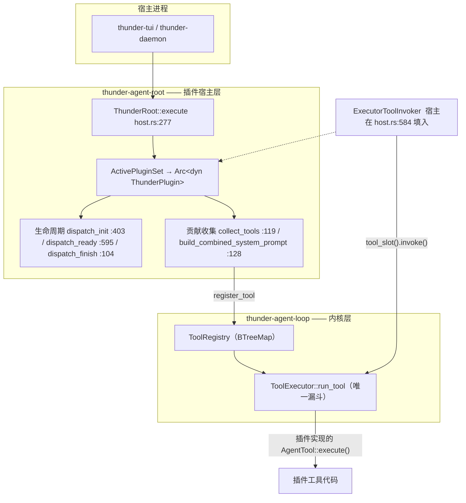

# Thunder 架构详解

> 版本：0.5.0（`Cargo.toml:17`）｜代码基线：`76353a6`（2026-10-13）｜上一版 0.4.0 的迁移说明见 `docs/migration-0.4.md`
> 本文是**代码事实文档**：所有结论都对应到具体 `文件:行`。与 `docs/permission-structure.md`（权限专项）和 `docs/migration-0.4.md`（迁移说明）互补。

---

## 0. 一句话架构

Thunder 是**一个单 Agent 闭环内核 + 一个微内核宿主 + 若干可插拔能力包**组成的 Rust Cargo Workspace：

```
┌────────────────────────────────────────────────────────────────────────┐
│  宿主层（Host / B 侧）                                                  │
│  thunder-tui（交互终端）   thunder-agent-daemon（STDIO sidecar）        │
│  thunder-agent-runtime（JSONL 无头运行时）                              │
└───────────────┬────────────────────────────────────────────────────────┘
                │ 只通过 start / join / cancel / events 驱动
┌───────────────▼────────────────────────────────────────────────────────┐
│  thunder-agent-root —— 微内核宿主：插件选择 → 装配 → 起跑              │
└───────────────┬────────────────────────────────────────────────────────┘
                │ AgentLoop::new().with_*().start()
┌───────────────▼────────────────────────────────────────────────────────┐
│  thunder-agent-loop —— Agent A：单任务原子闭环                          │
│  LLM 流式推理 → 工具并发执行 → 上下文压缩 → 循环守卫 → LoopComplete     │
└───────────────┬────────────────────────────────────────────────────────┘
                │ 三个具名接缝（全部由宿主注入）
   ┌────────────┼────────────┬─────────────────┬──────────────────┐
   ▼            ▼            ▼                 ▼                  ▼
LLMClientTrait  ToolScope   ToolGate      ToolTraceSink     HostUi
（providers）   （pack-code）（root/mode）  （root/daemon）   （tui/daemon）
```

核心不变量：**内核不知道什么是"工作区"、什么是"用户可以接受的风险"**。前者由 `ToolScope` 注入，后者由 `ToolGate` 注入（`types/scope.rs:1-18`、`types/gate.rs:1-22`）。

> 版本说明：`thunder-agent-mcp` 的 stdio 传输曾有一个**阻断级缺陷**（server 在 spawn 返回瞬间被 SIGKILL），已在本次修改中修复并添加真实子进程回归测试——见 [§15.2.1](#1521-已修复stdio-server-曾被瞬间杀死)；仍未修的项见 [§18.5](#185-已知功能缺陷)。

---

## 1. 工作区总览

### 1.1 包清单与体量

| Crate | 目录 | 源文件 | 源码行数 | 角色 |
|---|---|---|---|---|
| `thunder-agent-loop` | `thunder-agent-loop` | 41 | 9,740 | Agent 内核（A） |
| `thunder-agent-pack-code` | `thunder-agent-pack-code` | — | 4,387 | 编码能力包：6 工具 + `CodeScope` |
| `thunder-agent-providers` | `thunder-agent-providers` | 15 | 3,669 | 模型目录 + 进程内流式 HTTP |
| `thunder-agent-runtime` | `thunder-agent-runtime` | 4 | 898 | JSONL 无头运行时 |
| `thunder-agent-skills` | `thunder-agent-skills` | 8 | 1,498 | Skill 解析与注册 |
| `thunder-agent-mcp` | `thunder-agent-mcp` | 11 | 1,521 | MCP 客户端 |
| `thunder-agent-root` | `thunder-agent-root` | 33 | 7,290 | 微内核宿主 |
| `thunder-agent-daemon` | `thunder-agent-daemon` | 10 | 5,071 | STDIO sidecar |
| `thunder-conversation` | `thunder-agent-core/conversation` | 16 | 2,666 | 会话存储 |
| `thunder-tui` | `thunder-agent-core/tui` | 44 | 18,194 | 终端 UI |

工作区合计约 **58,400 行 Rust**（`Cargo.toml:3-14` 定义 10 个成员）。

### 1.2 依赖方向（硬约束）

```
tui ─┐
     ├─► root ─► loop ◄─ providers
daemon┘        ▲  ▲
runtime ───────┘  │
                  ├── pack-code ──► loop
                  ├── skills ─────► loop
                  ├── mcp ────────► loop
                  └── conversation ► loop
```

- 全部使用 **path 依赖**，`[workspace.dependencies]` 统一版本（`Cargo.toml:30-64`）。
- `thunder-agent-loop` **不依赖任何宿主**；`ARCHITECTURE.md:90-97` 把它写成契约："A never imports B"。
- `thunder-agent-root` 的 `conversation` / `skills` / `mcp` 是**可选特性**，默认全开（`thunder-agent-root/Cargo.toml` 的 `[features]`）。

### 1.3 构建与门禁

| 项 | 值 | 来源 |
|---|---|---|
| Rust | 1.80+（workspace）／CI pin 1.98.0 | `Cargo.toml:19`、`.github/workflows/ci.yml` |
| `unsafe_code` | **deny**（全工作区） | `Cargo.toml:69-70` |
| clippy | `all = warn`，`too_many_arguments` / `type_complexity` / `result_large_err` allow | `Cargo.toml:72-77` |
| release profile | `opt-level=3` + `lto="fat"` + `codegen-units=1` + `strip` | `Cargo.toml:79-83` |
| `tui-dev` profile | 继承 release，关 LTO、16 CGU、incremental（TUI 迭代用） | `Cargo.toml:90-96` |
| CI 步骤 | fmt --check → clippy -D warnings → check → `./test.sh` | `.github/workflows/ci.yml` |
| 测试特性 | 一律带 `--features thunder-agent-daemon/testing-mock` | `test.sh`、`ci.yml` |

脚本入口：`./run.sh`（TUI，默认 release）、`./daemon.sh`（daemon，debug）、`./test.sh`（`cargo test --workspace --no-fail-fast`）。

---

## 2. 内核：`thunder-agent-loop`

### 2.1 模块地图

| 文件 | 行 | 职责 |
|---|---|---|
| `src/lib.rs` | 71 | `prelude` 导出全部稳定 API |
| `loop_engine/engine.rs` | 1709 | `AgentLoop`：装配、`start`/`run`、主循环、结算 |
| `loop_engine/handle.rs` | 151 | `AgentHandle`：join / cancel / events / status |
| `loop_engine/gate.rs` | 69 | `CompletionGate`：完成判定接缝 |
| `loop_engine/guard.rs` | 158 | `LoopGuard`：重复动作 / 连续错误熔断 |
| `loop_engine/hooks.rs` | 31 | `AgentEventDispatcher`：broadcast 旁路 |
| `tools/executor.rs` | 930 | `ToolExecutor`：**唯一工具执行入口** + trace 闭环 |
| `tools/registry.rs` | 214 | `ToolRegistry`：BTreeMap 注册表、超时、截断、scratchpad |
| `tools/guard.rs` | 437 | `Guard`：内核地板（危险命令 / 关键路径） |
| `tools/trace.rs` | 595 | `ToolTrace` 模型 + 脱敏 |
| `tools/scratchpad.rs` | 277 | 超大输出落盘 + manifest |
| `tools/sanitizer.rs` | 124 | ANSI / 二进制污染清理 |
| `tools/notice.rs` | 93 | `SystemNotice`：面向模型的遥测块 |
| `pruning/strategy.rs` | 193 | `ContextPruner`：检查点压缩 + 紧急裁剪 |
| `pruning/checkpoint.rs` | 614 | 摘要提示词、切点选择、`Summarizer` |
| `pruning/error_detector.rs` | 133 | 从供应商报错里解析真实窗口上限 |
| `cache/warmer.rs` | 396 | Prompt Cache 保温 |
| `core/context.rs` | 197 | `ContextBuffer`：带 token 记账的消息向量 |
| `core/steer.rs` | 286 | `SteerQueues` / `PendingQueue` |
| `core/pause.rs` | 110 | `PauseGate` |
| `core/state.rs` | 129 | `AgentStateTracker` / `LoopStatus` |
| `core/paths.rs` | 152 | 用户数据根解析（`THUNDER_CONFIG_DIR`） |
| `core/token_estimator.rs` | 81 | 零分配 token 估算 |
| `core/images.rs` | 184 | 图片 magic-byte 校验 + base64 |
| `core/utf8.rs` | 60 | 安全切片 / 截断 |
| `types/*` | ~1,700 | 配置、事件、消息、工具、gate、scope、policy、ui、invoke |

### 2.2 装配：`AgentLoop`

```rust
pub struct AgentLoop {
    id: String,
    config: AgentConfig,
    llm_client: Arc<dyn LLMClientTrait>,        // 默认 UnconfiguredLLMClient
    tool_registry: ToolRegistry,                 // BTreeMap，顺序稳定
    tool_executor: ToolExecutor,                 // 注册表快照 + 四个接缝
    event_dispatcher: AgentEventDispatcher,      // broadcast(128)，有损旁路
    scratchpad: ScratchpadManager,
    running: Arc<AtomicBool>,                    // 单任务闸门
    status: Arc<AtomicU8>,                       // LoopStatus
    pause_gate: Arc<PauseGate>,
    steer_queues: Arc<SteerQueues>,
    tool_gate: Option<Arc<dyn ToolGate>>,        // None = 除守卫外全放行
    host_ui: Option<Arc<dyn HostUi>>,            // None = 一切 Ask 拒绝
    completion_gate: Option<Arc<dyn CompletionGate>>,
    max_gate_rounds: usize,                      // 默认 3
    trace_sink: Option<Arc<dyn ToolTraceSink>>,
    tool_scope: Option<Arc<dyn ToolScope>>,      // None = 一切 Unknown
}
```
（`loop_engine/engine.rs:47-94`）

建造器方法：`with_id` / `with_custom_client` / `register_tool` / `with_tool_gate(gate, ui)` / `with_tool_scope` / `with_trace_sink` / `with_completion_gate(gate, max_rounds)` / `with_pause_gate` / `with_steer_queues` / `with_tool_executor`。

**`refresh_executor()`（`engine.rs:199-220`）是装配的关键**：executor 持有注册表快照，任何"后注册"都必须重建，否则新工具/新 gate 不生效。`register_tool`、`with_tool_gate`、`with_tool_scope`、`with_trace_sink`、`with_id` 都调用它。

### 2.3 生命周期契约

| 规则 | 实现 |
|---|---|
| 一个 `AgentLoop` 同时只能跑一个任务 | `running.swap(true, SeqCst)` → `AgentError::AlreadyRunning`（`engine.rs:309-313`） |
| 并行 = 再 `new` 一个实例 | `tests/unit_contract_test.rs:95` |
| 事件带 `agent_id` 以便解复用 | `ObservedEvent`（`types/event.rs:52-60`） |
| 事件流可靠（背压、不静默丢弃） | 每 run 一条 `mpsc::channel(512)`（`engine.rs:316`） |
| `run()` = `start` + 排空事件 + `join` | `engine.rs:337-347` |
| 释放句柄**不**取消任务 | `handle.rs:14-15` 注释；须显式 `cancel()` |
| panic 也要清忙标志 | `RunningGuard::drop`（`handle.rs:137-151`） |

### 2.4 主循环（`spawn_loop` → `tokio::spawn`）

一轮（turn）的完整序列，按代码顺序：

```
loop {
  1. max_turns 检查            → FinishReason::MaxTurnsExceeded        engine.rs:471
  2. cancel_token 检查          → FinishReason::Cancelled               engine.rs:479
  3. LoopGuard::is_circuit_broken → FinishReason::Error（连续工具失败）  engine.rs:485
  4. LoopGuard::is_repetition_limit_exceeded → Error（重复调用）        engine.rs:502
  5. 快照 raw_log（首次压缩前）                                         engine.rs:518
  6. pruner.prune(...)          → 事件 ContextCompacted                 engine.rs:521
  7. max_tokens_budget 检查      → FinishReason::BudgetExceeded          engine.rs:545
  8. tracker.next_turn() + 事件 TurnStart                                engine.rs:558
  9. 排空 steer/follow_up 队列 → push 进上下文 + 事件 SteerAccepted      engine.rs:581-613
 10. ┌ 内层流式循环 ───────────────────────────────────────────────┐
     │ llm_client.stream_chat(ChatRequestOptions)                    │
     │   ├ Err + 上下文溢出 + retry<2 → update_max_tokens + 压缩 + 重试 │
     │   ├ Err + 网络握手失败 + retry<max_stream_retries → 指数退避重试 │
     │   └ Err 其它 → 事件 Error → break                             │
     │ 消费 LLMStreamChunk：                                          │
     │   Token → TokenDelta；ReasoningToken → ReasoningDelta          │
     │   ToolCallChunk → ToolCallChunk（标记 had_tool_chunks）        │
     │   Completed{...} → 暂存 completed_chunk                        │
     │   Err → 溢出/中断分类                                           │
     └───────────────────────────────────────────────────────────────┘
 11. 流中断三分支恢复（Scenario A/B/C）                                 engine.rs:790-854
 12. 注入的续写提示词从上下文尾部弹出，保持历史洁净                     engine.rs:860-862
 13. 取消 → 保留 partial answer → Cancelled                            engine.rs:864
 14. token 记账 + 回退估算（completion/prompt/reasoning/tps）           engine.rs:920-1005
 15. Prompt Cache 保温调度（每轮替换上一代）                            engine.rs:972-993
 16. push assistant 消息 + 事件 TurnEnd                                 engine.rs:1008-1038
 17. 无工具调用 → 队列 → CompletionGate → Done / retry / fail            engine.rs:1040-1164
 18. 有工具调用 → 状态 ExecutingTools                                   engine.rs:1166
 19. 逐个发 ToolCallReady / ToolExecStart                              engine.rs:1169-1192
 20. PauseGate 检查（工具边界，绝不打断在途工具）                       engine.rs:1196-1208
 21. ToolExecutor::execute_all(...)  ← 并发 join_all                   engine.rs:1210
 22. 逐结果：统计 / 熔断记账 / 重复告警 / 截断诊断 → 事件 ToolExecResult │
     + TelemetryNotice → push tool 消息                                 engine.rs:1220-1288
 23. 状态回到 Running，下一轮
}

结算（settle）：
  A. 非 Done 时修补悬空 tool_call（dangling_tool_calls）→ 补 CANCELLED_TOOL_RESULT  engine.rs:1302-1336
  B. Cancelled 时把 partial answer 写回 transcript                                engine.rs:1338-1349
  C. 终态 LoopStatus::Completed/Aborted/Failed                                     engine.rs:1352-1358
  D. clear_run_trace()                                                             engine.rs:1362
  E. cache::warmer::mark_idle(session_id)                                          engine.rs:1366
  F. scratchpad.cleanup()（仅 auto_cleanup）                                        engine.rs:1381
  G. 事件 LoopComplete + oneshot 回传 AgentRunResult                               engine.rs:1387-1406
```

### 2.5 `AgentRunResult`：宿主拿到的产物

```rust
pub struct AgentRunResult {
    pub agent_id: String,
    pub final_content: Option<String>,
    pub messages: Vec<ChatMessage>,        // LLM 实际看到的投影（含检查点摘要）
    pub raw_messages: Option<Vec<ChatMessage>>, // 仅发生压缩时：压缩前原始轨迹
    pub stats: AgentStats,
    pub finish_reason: FinishReason,
}
```
（`engine.rs:26-40`）

`raw_messages` 的存在是显式设计："原始历史从不被静默销毁"（`engine.rs:34-37`）。宿主持久化 `messages` 即可续跑（`ARCHITECTURE.md:30-31`）。

### 2.6 `FinishReason`

| 值 | 触发 |
|---|---|
| `Done` | 模型不再调用工具且队列空、gate 通过 |
| `MaxTurnsExceeded` | `config.max_turns`（默认 50） |
| `BudgetExceeded` | `config.max_tokens_budget` |
| `Cancelled` | 取消令牌 |
| `Error` | 熔断、重复上限、流错误、gate `Fail` |
（`types/event.rs:41-49`）

---

## 3. 工具执行：单一漏斗

### 3.1 唯一入口 `ToolExecutor::run_tool`

`run_tool`（`tools/executor.rs:249-281`）**没有任何 early return**：全部判定搬进私有 `dispatch`，由它填 `&mut TraceDraft`。于是"每次调用必然留下且只留下一条 trace"是**结构性的**，不是约定（`executor.rs:241-248`）。

`dispatch` 的判定顺序（`executor.rs:287-389`）：

| # | 步骤 | 代码 | 结果 |
|---|---|---|---|
| 1 | **取消** | `:296` | `Decision::Cancelled` → `cancelled_refusal` |
| 2 | 参数解析 + **脱敏** | `:301-309` | 畸形参数 → `Value::Null`，照常走完 |
| 3 | **作用域** `ToolScope::scope_of` | `:311` | 无 scope → `Scope::Unknown` |
| 4 | **守卫** `Guard::check` | `:314` | `Decision::Deny{by: Guard}` → `guard_refusal` |
| 5 | **判定** `ToolGate::decide` | `:331-341` | 无 gate → `Allow` |
| 6 | **弹窗**（gate 返回 `Ask`） | `:371` → `ask()` | 超时/无面板/取消/非法答案 → 拒绝 |
| 7 | **执行** | `:400-414` | 直进 `ToolRegistry::execute_tool_call` |
| 8 | **关 trace + 发布** | `run_tool:278-279` | 交给 `ToolTraceSink` |

内核**自己不落盘 trace**：它不知道 store 在哪（`executor.rs:416-420`）。

### 3.2 守卫：内核地板

`Guard::check`（`tools/guard.rs:61-87`）只拒两类：

1. **宿主声明 `Scope::Critical`** → `GuardHit{kind: CriticalPath, pattern:"critical path"}`；
2. **shell 类工具 + 命令命中危险集合** → `GuardHit{kind: DangerousCommand}`。

shell 类判定（`guard.rs:97-106`）：`effect == Exec`，或名字是 `bash|shell|sh|zsh|powershell`。

危险集合**按 token 判定**（`guard.rs:125-180`）：

| 规则 | 判定 |
|---|---|
| `mkfs*` | 首动词以 `mkfs` 开头 |
| `dd if=` | 动词 `dd` 且某 operand 以 `if=` 开头 |
| `rm -rf /` | 动词 `rm` **且**含 `r/R` flag **且**含 `f` flag **且**某 operand 是文件系统根 |
| fork bomb | 去空白后含 `:(){:|:&};:`（唯一保留的文本匹配，`guard.rs:182-191`） |

分词器 `segments`（`guard.rs:200-251`）跟踪引号与转义；`; | & ( ) { } \` > <` 与换行都是简单命令边界；`WRAPPERS`（`sudo doas env command exec nohup nice ionice time stdbuf xargs`，`guard.rs:35-37`）与 `VAR=value` 赋值被跳过。

设计理由写在文件头（`guard.rs:9-27`）：**名单故意很小，绝不靠猜测增长**；匹配 token 而非子串，因为旧实现让 `rm -rf /` 误伤 `rm -rf /tmp/build` 与 `git commit -m "never run rm -rf /"`；**无法解析的一律不在这里拒**，而是升级为 gate 的"问"。

### 3.3 作用域：位置，不是裁决

```rust
pub enum Scope { InScope, OutOfScope, Critical, #[default] Unknown }
pub trait ToolScope: Send + Sync {
    fn scope_of(&self, tool: &str, effect: ToolEffect, arguments: &serde_json::Value) -> Scope;
}
```
（`types/scope.rs:25-73`）

不对称性是设计核心（`types/scope.rs:8-12`）：**作用域只能把 `ask` 放宽成 `allow`，永远不能把 `allow` 收紧成 `deny`**——新增路径启发式最多让人多被问一次，不会造成静默失败。唯一例外是 `Critical`（宿主的"禁区"声明，`scope.rs:31-38`）。

`scope_of` 刻意**不是 async**：它是对内核已持有数据的纯分类（`scope.rs:64-66`）。

### 3.4 Gate：内核唯一的策略钩子

```rust
pub trait ToolGate: Send + Sync {
    fn decide(&self, request: &ToolGateRequest<'_>) -> GateVerdict;   // 每次调用都问，从不缓存
    fn record_answer(&self, request: &ToolGateRequest<'_>, answer: &ApprovalAnswer);
    fn label(&self) -> &str;                                          // 写进 trace 的 mode 字段
}
pub enum GateVerdict { Allow, AllowByRule{rule}, Ask(ApprovalPrompt), Deny{reason} }
```
（`types/gate.rs:52-142`）

两条内核保证（`gate.rs:9-22`）：守卫先跑且不咨询 gate；**弹窗是内核的**——gate 只能说"问"，串行化/超时/无面板处理全在 `ask()` 里。所以 gate 无法把"ask"实现成"allow"，也无法提供内核不认识的脚枪选项。

审批对话框的词汇表也归内核（`gate.rs:144-152`）：`Allow once` / `Always allow` / `Deny` / `Deny with reason`。`Always allow` 仅在 `prompt.allow_always` 为真时提供（`executor.rs:482-495`）。

### 3.5 弹窗：fail-closed 闭环

`ask()`（`executor.rs:432-587`）：

- 串行化：`prompt_lock: Arc<tokio::sync::Mutex<()>>`，与取消令牌 `tokio::select!` 竞速（`:444-455`）；
- 无面板 → `AskAnswer::NoUi` + 拒绝（`:460-467`）；
- 插件调用 → 标题变为 `Plugin <id> requests: ...`（`:473-476`）；
- 答案映射（`:522-582`）：`Allow once`→执行；`Allow always`→`gate.record_answer(AllowAlways)` + 执行；`Deny`→拒绝；`Deny with reason`→再弹 `Input` 追问，原因原文回灌模型；**无答案/集合外答案一律拒绝**；
- 默认超时 **600 秒**（`DEFAULT_APPROVAL_TIMEOUT`，`executor.rs:31`）。

`AskAnswer` 六态（`trace.rs:154-170`）：`allow_once` / `allow_always` / `denied` / `timeout` / `no_ui` / `unrecognised`，**只有前两个是真实的人类批准**。

### 3.6 并发与超时

```rust
pub async fn execute_all(&self, tool_calls: &[ToolCall], turn: usize,
                         cancellation_token: CancellationToken,
                         route: Option<String>, custom_timeout: Option<Duration>)
    -> Vec<ExecutedToolResult>
```
（`executor.rs:610-649`）——`futures_util::join_all` 并发派发，每个都走 `run_tool`，所以并行调用同样被盖章、判定、记录。

超时在 `ToolRegistry::execute_tool_call`（`registry.rs:123-135`）：`tokio::time::timeout(custom_timeout.unwrap_or(default_timeout), tool.execute(...))`，与取消令牌 `select!` 竞速；默认 30s（`registry.rs:24`），内核调用点传 `config.request_timeout_ms`（默认 60s）。

### 3.7 输出后处理链

```
tool.execute → Ok(output)
   → sanitize_tool_output：ANSI 剥离 + 二进制污染检测（>8% 控制字符或含 NUL → 整段替换）   sanitizer.rs:81-88
   → 若 > scratchpad.threshold_bytes(16KB) → 落盘 + 返回句柄消息（truncated=true）        registry.rs:144-165
   → 否则 format_and_truncate：head/tail 截断到 max_output_bytes(64KB)                     registry.rs:176-213
```
`BTreeMap` 而非 `HashMap` 存工具（`registry.rs:12-16`）：工具定义每轮序列化进请求，顺序稳定是 **prompt cache 命中的硬前提**。

### 3.8 trace 模型

```rust
pub const TRACE_SCHEMA: u8 = 1;
pub struct ToolTrace {
    schema, trace_id, session_id, task_id, turn, tool_call_id, tool, caller,
    effect, mode, scope, arguments /*脱敏后*/, decision, guard, answer,
    result: TraceResult { is_error, truncated, original_bytes, result_bytes,
                          output_preview /*2048 字符*/, output_digest },
    redactions: Vec<String>, timing: TraceTiming, started_at_ms, finished_at_ms,
}
pub enum Decision { Allow, AllowByRule{rule}, Asked, Deny{reason, by: DenyBy}, Cancelled }
pub enum DenyBy { Guard, Gate }
```
（`tools/trace.rs:28-215`）

- 记录的是**判定本身**（谁拒的、什么作用域、用户答了什么、答了多久）；
- 脱敏在入口做：密钥键名 + 密钥形态文本 + 文档正文摘要化（`executor.rs:307-309`）；
- `output_digest` 是完整**未脱敏**输出的稳定摘要，足以判断两次调用是否同产物而不留字节（`trace.rs:187-189`）。

两个出口共用一条记录（`engine.rs:1493-1534`）：`AgentEvent::ToolTrace` 给排事件的宿主，`ToolTraceSink` 给不想解析事件的宿主；**内核只序列化、只脱敏一次**。

---

## 4. 上下文管理与 Prompt Cache

### 4.1 压缩触发

`should_compact(estimated) = estimated > max_context_tokens - reserve_tokens`（`pruning/strategy.rs:52-58`）。
默认 `max_context_tokens = 128_000`、`reserve_tokens = 16_384`、`keep_recent_tokens = 20_000`（`types/config.rs:45-56`）。宿主会用模型真实窗口覆盖 `max_context_tokens`（`root/src/host.rs:494`）。

**未越线时 `prune` 是 no-op**——这正是"两次压缩之间请求前缀字节级稳定"（prompt cache 全命中）的实现方式（`strategy.rs:60-78`）。

### 4.2 检查点压缩（唯一策略）

越线后（`strategy.rs:80-142`）：

1. `find_cut_index(context, keep_recent_tokens)` 从尾部回积累 token，取切点；**不落在 tool result 上**（必须与 tool call 同生共死），优先落在下一条 user 消息（轮次边界），不切入 index 0 的系统提示与 index 1 的既有检查点（`checkpoint.rs:159-210`）。
2. `region_floor`：有既有检查点时从 2 开始，否则从 1（`checkpoint.rs:137-147`）。
3. 序列化旧区域（tool result 截 2000 字符、tool args 截 200 字符，`checkpoint.rs:27-28`），机械提取读/写文件清单（按 `ToolEffect` 分类，`checkpoint.rs:306-342`）。
4. `Summarizer::summarize` 一次性 LLM 调用，**首次用 `INITIAL_SUMMARIZATION_PROMPT`，有前一份摘要时用 `UPDATE_SUMMARIZATION_PROMPT`（迭代 UPDATE-merge）**（`checkpoint.rs:38-112,392-427`）。
5. 摘要请求：`cache_retention = Some("none")`（不污染缓存）、`session_id = None`（不做亲和路由）、`thinking_level = None`（`checkpoint.rs:429-444`）；`finish_reason == "length"` 或空输出视为失败。
6. 成功后一次性替换区间为 `checkpoint_message`（`name = "context_checkpoint"`，`checkpoint.rs:23`）；已有检查点时 `replace_at(1, ...)`，否则 `insert_at(region_start, ...)`。

### 4.3 紧急裁剪（安全网）

仅当摘要不可用/失败**且**仍超硬窗口时：`emergency_trim` 原子丢弃最老完整轮次（`strategy.rs:175-192`）。它不是可配置策略，正常路径永不触发。

### 4.4 溢出自愈

`error_detector.rs` 用四条正则从供应商报错里解析真实上限（OpenAI / Anthropic / Range / Generic），命中后 `pruner.update_max_tokens(detected)` 并重压缩重试，**最多 2 次**（`engine.rs:615,647-670`）。流中断还有三分支恢复（`engine.rs:790-854`）：工具参数中断→让模型重发；正文中断→拼接续写（保留末尾 60 字符做锚点）；首 token 前中断→干净重试。

### 4.5 缓存保温

`cache/warmer.rs` 是 pi-coding-agent `CacheWarmer` 的移植：

- 每轮成功后被重新调度（替换上一代），`generation` 递增防串台（`warmer.rs:170-225`）；
- 刷新时延 = `TTL × 90%`，且至少留 10s 余量（`warmer.rs:82-90`）；
- 经济性闸门：`expected = probability × miss_cost − warm_cost`，`≥ $0.05` 才刷（`warmer.rs:98-130`）；
- 空转概率常数 **0.15**，空转时长上限 **30 分钟**（`warmer.rs:39-46`）；
- 模型必须同时在 `models.json` 声明 `promptCache` 与 `cost`，否则保温关闭（`warmer.rs:17-22`）；
- `replay_safe = false`（如 Anthropic 的 budget 参与缓存键）时永不调度（`warmer.rs:62-69,204-206`）。

---

## 5. 控制原语（宿主可持有）

| 原语 | 类型 | 语义 | 检查点 |
|---|---|---|---|
| 取消 | `tokio_util::sync::CancellationToken` | 不可逆 | 每轮开头、流式、工具执行、弹窗 |
| 暂停 | `PauseGate`（`AtomicBool` + `Notify`） | 可恢复 | **工具边界**，绝不打断在途工具（`engine.rs:1194-1208`） |
| 转向 | `SteerQueues::steering` | 本轮工具调用后、下轮请求前进入 | 轮次边界 |
| 追问 | `SteerQueues::follow_up` | 仅当 run 无事可做时进入 | 收尾处 |
| 队列模式 | `QueueMode::All` / `OneAtATime`（默认） | 单轮投递几条 | `steer.rs:44-73` |
| 清队 | `PendingQueue::clear()` | 把文本还给宿主编辑器 | `steer.rs:122+` |

`SteerAccepted` 事件在消息真正进入 transcript 的同一时刻发出，宿主无需猜测（`types/event.rs:141-156`）。`cancel` 与 `pause` 的竞争关系有测试钉住："cancel wins over a pause"（`tests/pause_gate_test.rs:121`）。

---

## 6. 事件模型

```rust
pub struct ObservedEvent { agent_id: String, event: AgentEvent, timestamp_ms: u64 }
```
（`types/event.rs:52-60`）

`AgentEvent` 全部变体（`types/event.rs:62-187`）：`TurnStart`、`TokenDelta`、`ReasoningDelta`、`ToolCallChunk`、`ToolCallReady`、`ToolExecStart`、`ToolExecResult`、`ToolTrace`（boxed）、`TelemetryNotice`、`TurnEnd`、`LoopComplete`、`ContextCompacted`、`SteerAccepted`、`Error`、`Custom`、`GateResult`。

两条投递路径（`engine.rs:1417-1448`）：

| 事件类别 | 通道 | 策略 |
|---|---|---|
| 微增量（`TokenDelta`/`ReasoningDelta`/`ToolCallChunk`） | broadcast + mpsc | `try_send`，**绝不阻塞引擎** |
| 结构化事件（生命周期、trace、业务事件） | broadcast + mpsc | `spawn` + **5 秒** `timeout(send)`，不丢 |

`AgentEvent::Custom { kind, payload }` 是工具/插件向宿主发业务事件的通用信封，内核**不解释** `kind`（`types/event.rs:162-172`）。

---

## 7. 用户数据根与配置分层

`core/paths.rs` 是**唯一**决定 thunder 用户状态位置的地方：

```
解析顺序：$THUNDER_CONFIG_DIR → <home>/.thunder → <temp>/.thunder
```
（`paths.rs:22-25`）

```
<root>/models.json           provider 目录
<root>/auth.json             凭据
<root>/models_metadata.json  元数据缓存（写）
<root>/config.json           用户配置
<root>/mcp.json              MCP servers
<root>/THUNDER.md            用户级长期记忆
<root>/skills/               用户技能
<root>/logs/                 TUI 日志（写）
<root>/scratchpad/           超大工具输出（写）
<root>/conversations/        会话存储（写）
```
（`paths.rs:9-20`）

**刻意不在根下**（用 `real_home_dir()`）：`~/.agents`、`~/.pi`、存 API key 的 shell rc、跨工具 `mcp.json` 位置、shell 路径的 `~` 展开（`paths.rs:27-33`）。宿主想屏蔽跨工具提示面，用 `THUNDER_SKILLS_NO_GLOBAL` / `THUNDER_NO_GLOBAL_INSTRUCTIONS`，**绝不伪造 `HOME`**。

配置优先级：内置默认 → `~/.thunder` → `<ws>/.thunder` → `<ws>/.thunder/*.local.*`（`.thunder/README.md:46-47`）。`.arp/` 属于 `agent-resume-panel`，Thunder 不读（`.thunder/README.md:8-10`）。

---

## 8. 其余 crate（细节见各自小节）

- [`thunder-agent-pack-code`](#9-能力包thunder-agent-pack-code) — 6 个内建工具、`CodeScope`、`FILE_MUTATION_LOCKS`、工程提示词
- [`thunder-agent-providers`](#10-模型层thunder-agent-providers) — `models.json` 目录 + `RpiAiClient` 三种方言
- [`thunder-agent-root`](#11-微内核宿主thunder-agent-root) — 插件选择、四档模式、记忆、配置合并
- [`thunder-agent-daemon`](#12-sidecarthunder-agent-daemon) — NDJSON 协议 2、并发调度、UI 反向 RPC
- [`thunder-agent-runtime`](#13-无头运行时thunder-agent-runtime) — JSONL 协议 2、远程工具、宿主完成判定
- [`thunder-agent-skills`](#14-技能引擎thunder-agent-skills) — SKILL.md 解析、意图触发、TTL 缓存
- [`thunder-agent-mcp`](#15-mcp-客户端thunder-agent-mcp) — stdio JSON-RPC、动态工具桥接
- [`thunder-conversation`](#16-会话存储thunder-conversation) — Fs/内存双模、index.json、多拓扑阶段
- [`thunder-tui`](#17-终端界面thunder-tui) — Ratatui 全宽终端、流式渲染、审批弹窗

---

## 9. 能力包：`thunder-agent-pack-code`

### 9.1 定位

内核不知道"什么是 shell、工作区、文件"（`pack-code/src/lib.rs:3-6`）。装了这个包，`AgentLoop` 才得到：6 个内建工具、`CodeScope`、原子写 + 进程级 per-path 锁、`file_change` 变更上报、工程默认提示词（`lib.rs:7-22`）。

一键安装：`install_code_pack(agent, &CodePackConfig{ register_builtins, apply_default_prompt })`（`pack.rs:37-66`）——它同时装 scope 与工具，因为"问路径"和"不知道路径在哪的内核"是两个不同的问题（`pack.rs:29-31`）。所有工具都 `with_default_cwd(ws)`，相对路径 = 相对工作区。
**注意**：`install_code_pack` 在生产路径上**没有调用方**——`thunder-agent-root/src/host.rs:543-568` 与 TUI 的单 Agent 路径（`tui/src/app.rs:4356-4372`）都是自己逐个 `register_tool` 并把 `CodeScope` 单独装上去；只有 `pack-code/tests/code_tools_test.rs:105` 用这个便捷函数。同样，`CodePackConfig::apply_default_prompt` 声明了但**从未被读取**（`pack.rs:14,21`）——默认提示词实际由宿主显式取用（`root/src/host.rs:410` 的 `DEFAULT_AUTONOMOUS_SYSTEM_PROMPT`）。

### 9.2 工具清单

| 工具 | 文件 | 参数 | 要点 |
|---|---|---|---|
| `read_file` | `builtin/fs.rs:29-111` | `path`, `offset`, `limit` | 单次读取上限 **10 MB**，但该检查只在 `limit.is_none()` 时生效（`:84`）——传任意 `limit` 即绕过；随后仍是整文件 `read_to_string` 再切行（`:93-109`），所以"分块"只限制输出、不限制内存 |
| `write_file` | `builtin/fs.rs:129-429` | `path`, `content` | 原子写 + per-path 锁，见 §9.4 |
| `bash` | `builtin/bash.rs` | `command`, `cwd?`, `timeout_ms?` | 默认超时 **120s**（`:93`），`bash -c`，stdin=null 防交互挂死（`:98`），环境变量脱敏（`:285-299`），Unix 下 `process_group(0)` + 超时 `kill(-pid, SIGKILL)` 杀整组（`:117-118,254-265`） |
| `grep` | `builtin/search.rs` | pattern/path/… | ripgrep 内核**进程内**嵌入（`grep-searcher`+`grep-regex`+`ignore`），非子进程；上限 100 行匹配、单行 500 字符、输出 50 KB（`:20-26`） |
| `find` | `builtin/fs_ext.rs` | pattern/path | `ignore` crate 遍历（.gitignore 感知），上限 1000 条 / 50 KB（`:15-17`） |
| `ls` | `builtin/fs_ext.rs` | path | 每目录上限 1000 条（`:19`） |

`bash` 的环境脱敏（`bash.rs:270-299`）：键名含 `KEY|TOKEN|SECRET|PASSWORD|AUTH|CREDENTIAL` 或以 `AWS_|GITHUB_|OPENAI_|ANTHROPIC_|DEEPSEEK_` 开头的一律 `env_remove`，除非在 `THUNDER_ENV_PASSTHROUGH`（逗号分隔）里显式放行。另外注入 `DEBIAN_FRONTEND=noninteractive`、`CI=true`、`TERM=dumb`、`PAGER=cat`、`GIT_TERMINAL_PROMPT=0`（`:107-111`）。
`CodeScope::new` 的文档写"with the pack's default protections in place"，但构造函数把 `protections`/`write_blocked` 都置空（`scope.rs:96-105`）；保护实际由 `from_agent_config` → `with_thunder_data_root` 施加（`:79-94,135-149`）。文档与实现不符。

### 9.3 `CodeScope`：知识一半

```rust
pub struct CodeScope {
    workspace_root: PathBuf,
    roots: Vec<PathBuf>,        // 视为工作区内的根（含 extra_workspace_roots 与 scratchpad）
    protections: Vec<PathBuf>,  // 双向禁区（凭据库）
    write_blocked: Vec<PathBuf>,// 可读不可写（thunder 数据根）
}
```
（`scope.rs:63-72`）

`from_agent_config`（`:79-94`）的根集合 = workspace_root ∪ `extra_workspace_roots` ∪ `scratchpad.base_dir`（溢出的工具输出要被模型读回，必须算工作区内，`:89-92`）。

`classify(target, effect)` 的顺序（`scope.rs:160-198`）：

```
candidate()：展开 ~ / $HOME / ${HOME}；相对路径按 workspace_root 解析   :202-209
resolve_for_check()：逐段 canonicalize（解符号链接）→ normalize_path    :250-269
  ↓
是 WRITABLE_DEVICES（/dev/null /dev/stdin /dev/stdout /dev/stderr /dev/tty）？ → InScope   :169-172
命中 protections（auth.json / models.json / credentials.json，双向）？      → Critical  :174-176
是写操作？
  ├ 命中 write_blocked（数据根）？                                        → Critical  :178-180
  ├ 任一路径段是 .git？                                                    → Critical  :181-183
  └ 命中 PROTECTED_WRITE_PREFIXES（/etc /dev /proc /sys /boot /bin /sbin
      /usr /var/db /System /Library /Applications …）？                    → Critical  :184-188
在某个 root 前缀下？ → InScope；否则 → OutOfScope（不是拒绝）              :191-197
```

`scope_of` 的硬规则（`:213-227`）：**`Exec` 与 `Other` 一律 `Unknown`**——shell 命令的目标只有运行时才知道，`rm -rf $BUILD_DIR` 的诚实分类就是"本文件无法判断"；`Unknown` 不赚取自动放行，于是它变成一次询问而不是一次静默拒绝。

`resolve_for_check`（`:250-269`）是全仓唯一的符号链接逃逸检查，逐段 canonicalize 已存在前缀、不存在段按字面拼接；`normalize_path`（`:271-286`）做纯词法 `.`/`..` 归一。

### 9.4 原子写与 `FILE_MUTATION_LOCKS`

```rust
static FILE_MUTATION_LOCKS: LazyLock<StdMutex<HashMap<PathBuf, Arc<TokioMutex<()>>>>> = ...;
```
（`builtin/fs.rs:383-384`）

写入流程 `write_cancellable`（`fs.rs:202-265`）：

1. `file_lock_for(&path)` 取该物理路径的 mutex（键为 `lock_key`：能 canonicalize 就用真实路径，否则用"canonicalize 后的父目录 + 文件名"，所以相对/绝对/符号链接父目录的两种拼写不会拿到两把锁，`:418-429`）；
2. `tokio::select!` 竞速：**取消令牌 vs 写入**——承诺是"被取消的 run 让目标要么原样、要么完整写入"（`:209-216`）；
3. `stage_and_commit`：`create_dir_all` → 记录原权限 → 在**目标同目录**建隐藏暂存文件 `.{name}_{pid}_{nanos}.tmp`（同文件系统 ⇒ rename 原子，无跨设备回退问题）→ `write_all` → **`sync_all`（先落盘再改名，否则崩溃后会留下正确命名的空文件）** → 恢复权限 → `rename`（`:266-347`）；
4. `TempFileGuard` 在任何退出路径（含取消时 future 被 drop）删除未提交的暂存文件（`:352-374`）；
5. 写完后 `release_file_lock` 在仍持锁时清理表项，且只在 `Arc::strong_count == 2` 时删除，保证排队中的写者仍持有同一把 mutex（`:404-416`）。

锁是**进程内**的：两个 daemon 或 daemon 与 TUI 之间不通过它协调（`:376-381` 注释）。

### 9.5 变更上报

`file_change.rs` 定义了 wire 契约常量 `FILE_CHANGE = "file_change"`（`:16-17`，**不要改名**）：

- `write_file` 每次写后 `emit_write(sink, path, bytes, is_err)`（`fs.rs:169-176`）；
- `bash` 在**命令前后**各取一次 `git status --porcelain` 快照并差分（`bash.rs:84-87`、`file_change.rs:34-88`）——shell 的文件副作用从参数看不出来，这是唯一仍需要快照的地方；且**无论命令成功与否都上报**（`git add` 后 `git commit` 失败同样移动了工作区，`bash.rs:239-243`）。

内核只是把 `AgentEvent::Custom { kind: "file_change" }` 原样转发（`file_change.rs:8-11`）。

### 9.6 工程默认提示词

`DEFAULT_AUTONOMOUS_SYSTEM_PROMPT`（`prompt.rs:12-19`）很短，核心是"先理解再动手"：一句话能说清就不写计划；只读工具随便用；真实爆炸半径的改动先与用户敲定方案（plan 模式时 harness 强制：`write_plan` → `exit_plan_mode`，批准是唯一出口）；意图不明就问，最多三问、每题带具体选项；结尾给出 2-3 个下一步选项。**计划本身不是提示词要求的阶段，而是用户控制的机制**（`prompt.rs:7-10`）。

### 9.7 已知细节

- `install_code_pack` 在生产路径无调用方；`CodePackConfig::apply_default_prompt` 从未被读取（见 §9.1）。
- `CodeScope::new` 的文档声称带默认保护，实际置空（见 §9.2）。
- 仓库里存在一个 1 字节的被跟踪文件 `thunder-agent-pack-code/x`（`git ls-files` 可见），是测试写入溢出留下的化石，不是有意资产。
- `expand_home`（`scope.rs:288-302`）以 `std::env::var("HOME").ok()?` 开头：**`HOME` 未设置时所有 `~` 路径直接退化为 `Scope::Unknown`**（fail-safe 方向，但意味着一次多余询问）。

---

## 10. 模型层：`thunder-agent-providers`

### 10.1 目录与配置来源

`ConfigSource`（`source.rs:6-63`）只有两级：`thunder_user`（`<数据根>/models.json` + `auth.json`）与 `thunder_project`（`<ws>/.thunder/models.json` + `auth.json`）。`load_merged`（`source.rs:62-82`）按顺序合并，**先到先得**（`entry(id).or_insert(...)`），即用户级 provider 定义优先于项目级。

`ModelsFile` schema（`config.rs:3-117`，camelCase + 多别名）：

```jsonc
{
  "utilityModel": "provider/model-id",   // 别名：utility_model / toolModel / fastModel / namingModel
  "providers": {
    "<provider-id>": {
      "baseUrl": "…", "api": "openai-completions", "apiKey": "…", "headers": {},
      "thinkingLevels": ["off","low","medium","high"], "defaultThinkingLevel": "medium",
      "thinkingLevelMap": { "high": "high" },
      "compat": { "supportsDeveloperRole": true, "supportsReasoningEffort": true,
                  "maxTokensField": "max_tokens", "…": "prompt-cache 相关 flag" },
      "models": [{
        "id": "gpt-4o", "name": "GPT-4o", "reasoning": false,
        "input": ["text","image"],        // 别名 modalities；省略 = 纯文本
        "contextWindow": 128000, "maxTokens": 16384,
        "cost": { "input": 2.5, "output": 10, "cacheRead": 1.25, "cacheWrite": 3.75 },
        "promptCache": { "short": 300, "long": 3600 },
        "thinkingLevelsProbed": false
      }]
    }
  }
}
```

关键默认值：`DEFAULT_SAFE_CONTEXT_WINDOW = 128_000`（`catalog.rs:9`）。`ModelSpec::prompt_cache_warm_settings(thinking)`（`catalog.rs:194`）是保温策略的唯一来源——**必须同时声明 `promptCache` 与 `cost`**，否则 `decide_warming` 直接返回 `Stop("cache economics unavailable")`。

`ProviderRegistry::load_default` / `load_from_sources`（`catalog.rs:359-384`），`probe_unprobed_models`（`:392`）会对未探测模型做能力探测并落盘 `models_metadata.json`（`default_metadata_cache_path`，`:74`）。

### 10.2 `RpiAiClient`：进程内流式传输

```rust
pub struct RpiAiClient { provider: Arc<dyn rpi_ai::Provider>, model: rpi_ai::Model, timeout: Duration }
```
（`client.rs:55-59`）

**三种方言**，其余明确报错（`client.rs:93-107`）：

| `api` | provider 实现 |
|---|---|
| `openai-responses` | `OpenAiResponsesProvider` |
| `openai-completions` | `OpenAiCompletionsProvider` |
| `anthropic-messages` | `AnthropicProvider` |
| 其它（gemini/bedrock/vertex/mistral…） | `Err(unsupported_api_message)` → `"api `{api}` is not streamable by this build; supported: …"`（`convert.rs:168-173`） |

流式实现（`client.rs:130-199`）：`stream_chat` 起一个 tokio task 消费 `AssistantMessageEvent`：

- `TextDelta` → `LLMStreamChunk::Token`；
- `ThinkingDelta` → `LLMStreamChunk::ReasoningToken`；
- **tool-call delta 被刻意丢弃**：消费方约定工具调用在终止事件上整体到达，`LLMStreamChunk::ToolCallChunk` 因此保持未使用（`client.rs:174-176`）；
- `Done` → `Completed{…}`；`Error` → `Err`；
- **流在无终止事件时结束** → 显式报错 `"rpi-ai stream ended without a terminal event (N chars of text received)"`，而不是静默关通道（`client.rs:188-195`）。

通道深度 `CHUNK_CHANNEL = 64`（`client.rs:53`）。

wire 语义（`client.rs:1-19`）：`prompt_tokens` 是**完整** prompt（rpi-ai 的 `input` 只是未缓存部分，缓存桶被折回）；`finish_reason` 沿用旧 bridge 词汇：`toolUse`/`deferred` → `tool_calls`，`length` → `length`，其余 → `stop`。

已知缺口如实上报（`client.rs:14-19`）：`top_p` 在 rpi-ai 无一等字段，只能塞进 `Model::sampling_params`（OpenAI 形状 provider 会合并进请求体，Anthropic provider 忽略该 map）。

请求映射 `build_options`（`client.rs:205-232`）：`thinking_level` → `reasoning`；`cache_retention` 映射 `none`/`short`/`long`（缺省 = short，`:236-243`）；取消令牌**桥接**——因为 rpi-ai 只认自己的 signal，所以起一个 task `await` 调用方的 token 再取消自己的（`:211-218`）。

上下文映射 `build_context`（`client.rs:245+`）：多条 `System` 消息**拼接**成一条 system prompt；`User.parts` 非空时映射为多模态 blocks；`Assistant` 的文本 + tool_calls 映射为 content blocks；空 assistant 消息被丢弃（否则会序列化成空 content 数组）。

### 10.3 `thunder-agent-runtime`：JSONL 无头运行时

二进制 `thunder-runtime`，协议版本 `"2"`（`runtime/src/session.rs:17`）。

**请求**（`protocol.rs:40-106`）：`ping` / `start` / `tool_result` / `gate_result` / `cancel`；全部带可选 `id` 与 camelCase 别名（`runId`、`callId`、`maxTurns`、`thinkingLevel`、`requestTimeoutMs`、`sessionId`）。

**事件**（`protocol.rs:112-158`）：`response` / `observation`（原样转发 `AgentEvent`）/ `tool_call` / `gate_request` / `run_finished`（带完整 `messages` 供宿主持久化）/ `error`。

远程工具 `RemoteTool`（`remote.rs:33-112`）：声明给模型，但 `execute` 不做事——把调用转成 `RuntimeEvent::ToolCall` 发给宿主，然后在 oneshot 上等 `tool_result`。宿主不答（sender 被 drop）→ `Err("the host dropped the tool call without answering")`；宿主已走 → 清理 pending 并 `Err("the host is gone; …")`。

`RemoteGate` 实现 `CompletionGate`：完成判定同样发到宿主（`gate_request`）等 `gate_result`。`parse_effect`（`remote.rs:18-27`）把宿主声明的 `read|write|exec|plan_artifact` 映射到内核 `ToolEffect`，**未声明一律 `Other`（按变更处理）**。

运行器形态：`Runtime`（`session.rs:19-40`）持有 `runs: HashMap<run_id, CancellationToken>`、两个 pending 表，以及一个 `mpsc::UnboundedSender<RuntimeEvent>` → 单一 writer task，保证一帧一行、不交错。

---

## 11. 微内核宿主：`thunder-agent-root`

### 11.1 插件契约

```rust
#[async_trait]
pub trait ThunderPlugin: Send + Sync {
    fn manifest(&self) -> &PluginManifest;
    fn tools(&self) -> Vec<Arc<dyn AgentTool>> { vec![] }
    fn system_prompt_contribution(&self) -> Option<String> { None }   // 同步：提示词装配不能 await
    fn tool_gate(&self) -> Option<Arc<dyn ToolGate>> { None }
    async fn on_init(&self, ctx: &PluginContext) -> Result<(), PluginError>;
    async fn on_run_ready(&self, ctx: &PluginContext) -> Result<(), PluginError>;
    async fn on_event(&self, event: &ObservedEvent, ctx: &PluginContext);
    async fn on_finish(&self, result: &AgentRunResult, ctx: &PluginContext) -> Result<(), PluginError>;
}
```
（`plugin.rs:264-316`）

**生命周期严格顺序**：`on_init`（全部插件）→ 工具注册 → `on_run_ready` → run → `on_finish`，逐插件 `await`，无 per-plugin 超时。调用点只有三处：`host.rs:403`（`dispatch_init`）、`host.rs:595`（`dispatch_ready`）、`host.rs:104`（`dispatch_finish`，在 `RootRunHandle::join` 里，错误被 `let _ =` 吞掉）。

### 11.1.1 「插件执行」到底在哪一层

本仓有三种不同的"插件执行"，分属两层：

| 说法 | 执行位置 | 证据 |
|---|---|---|
| **插件的生命周期回调**（`on_init`/`on_run_ready`/`on_finish`） | `thunder-agent-root`（插件宿主层） | `registry.rs:148-180` 的 `dispatch_*`，由 `host.rs` 调用 |
| **插件贡献的工具被调用** | `thunder-agent-loop`（内核层） | `collect_tools()`（`registry.rs:119-125`）→ `agent.register_tool()`（`host.rs:571-573`）→ `ToolRegistry::execute_tool_call` → `ToolExecutor::run_tool`；插件只提供 `AgentTool` 实现，**调度权、守卫、判定、审批、trace 全在内核** |
| **插件主动发起工具调用**（反向 RPC） | 由内核执行，插件的调用意图经 `ToolInvokerSlot` 进入 | `ExecutorToolInvoker`（`loop/types/invoke.rs:120-238`）由宿主在 `host.rs:584-592` 填槽；`invoke` 最后一行是 `self.executor.run_tool(...)`（`:208`），并带 `caller: Some(plugin_id)`（`:195`） |



两处**已实现但无生产调用方**的接线（"接线存在、无人拉"）：

- `ThunderPlugin::tool_gate()`（`plugin.rs:285`）被 `execute` 忽略——只安装模式插件（`host.rs:532`）。
- `ToolInvoker::invoke` 只有测试调用（`pack-code/tests/plugin_call_tool_test.rs`），没有任何随仓插件使用 `ctx.tool_slot()`。

**`dispatch_event` 已接通**（0.4 起）：`RootRunHandle::take_events`（`host.rs:121`）在宿主的事件接收器前挂了一层代理——每收到一条 `ObservedEvent` 就先 `active_set.dispatch_event(&observed, &ctx).await` 派发给全部活跃插件，再把原事件透传下去，并在指标相关事件后追加一条 `AgentEvent::Custom { kind: "metrics_update" }`。`ConversationPlugin::on_event` 的逐 turn 增量持久化（`conversation.rs:140-143`）因此生效。

`TriggerSpec`（`plugin.rs:25-47`）：`keywords` + `auto_always` + `description_for_llm`；`TriggerSpec::always()` 是常驻基线。

### 11.2 确定性路由

`PluginSelector::select_for_session`（`selector.rs:115`）：

1. **会话锁定**——一条会话的**第一条**消息决定整个会话的插件集，写入 `SelectionCache`；
2. 缓存缺失时 `heuristic_select` 按关键词匹配 `TriggerSpec.keywords`；
3. `keyword_matches`（`selector.rs:195-217`）：ASCII 关键词要求**词边界**（`spec` 不匹配 `specifically`，`mcp` 不匹配 `checksumcp`）；含非 ASCII（CJK）时退回子串匹配。

为什么要会话锁定（`selector.rs:15-19`）：逐消息重选会让 position 0 的合并系统提示与工具集在轮次间漂移，**打穿供应商侧 prompt cache**。`SelectionCache` 是 `Arc` 共享而非裸全局，宿主可注入隔离实例（`:20-25`）。

### 11.3 `ThunderRoot::execute` 装配序列

18 步，逐条对应 `host.rs`：

1. 取 prompt（`Text` 原样；`Messages`/`Buffer` 取最后一条 user，否则字面 `"General task"`）`:282-302`
2. `ThunderConfig::load(workspace)` `:307`
3. session id（缺省 `sess_1`）+ route id（`run_{session}_{seq}`，`RUN_COUNTER` 原子自增）`:309-324`
4. 插件选择（`forced_plugins` 短路，否则会话锁定启发式）`:326-338`
5. `create_active_set` `:347-349`
6. 模式插件解析：复用宿主给的实例（保规则与热切换）或新建，**无条件 `set_mode` + `bind_session`**，再 `active_set.push`（它不在注册表选择里）`:357-376`
7. 构造 `PluginContext`（空 `ToolInvokerSlot`、取消令牌、模式、ui、route、prompt、workspace、scratch）`:388-400`
8. `dispatch_init`（任一插件 `InitFailed` 中止 execute）`:403`
9. 系统提示装配：base → `AGENTS.md`/`CLAUDE.md` 上下文文件（`\n\n### Context Instructions (<path>)\n<content>`）→ 配置的 `systemPromptFile` → `### Workspaces` 块（主工作区 + 引用仓库说明）→ `build_combined_system_prompt` `:406-476`
10. `agent_cfg`：workspace/extra roots、`thunder_cfg.apply_to`（max_turns、thinking_level）、`route`、合并后的 system prompt `:477-489`
11. 模型解析：`resolve_ref` → **把真实窗口写进 `pruning.max_context_tokens`**；无 custom client 时 `client_for(spec, timeout)`；失败只 warn，留给 `UnconfiguredLLMClient` `:491-541`
12. `AgentLoop::new().with_id(format!("root_{session}")).with_tool_scope(CodeScope).with_tool_gate(Some(mode_plugin), Some(ui))` —— **gate 永远安装，包括 yolo** `:520-532`
13. 6 个内建工具（`register_builtins`）逐个 `with_default_cwd(ws)` 后注册 `:543-568`
14. 插件工具注册 `:571-573`
15. **填充 `tool_slot`**：`ExecutorToolInvoker::new(agent.tool_executor().clone())`——必须在所有注册之后快照，且走 funnel 而非裸注册表，所以插件调用同样受守卫/判定/审批/trace 约束 `:584-592`
16. `dispatch_ready` `:595`
17. `with_pause_gate` / `with_steer_queues` `:598-606`
18. `agent.start(input, Some(cancel))` → `RootRunHandle` `:609-621`

`RootRunHandle::join`（`:100-113`）：`handle.join()` → `dispatch_finish`（错误被 `let _ =` 吞掉）→ `RootRunResult`。

### 11.4 四档模式矩阵（`plugins/mode.rs`）

| mode | Read | Write·InScope | Write·OutOfScope/Unknown | Exec | PlanArtifact |
|---|---|---|---|---|---|
| `plan` | Allow | **Deny** | **Deny** | **Ask** | Allow |
| `ask` | Allow | Ask | Ask | Ask | Allow |
| `acceptEdits` | Allow | **Allow** | Ask | Ask | Allow |
| `yolo` | Allow | Allow | Allow | Allow | Allow |

三条承重实现细节：

1. **plan 跳过 allow 规则**：规则查询先于矩阵，但 `if mode != Mode::Plan` 把它挡在 plan 之外（`mode.rs:449-465`）——"更宽松模式里记住的 always allow 不是 plan 模式下写文件的办法"（`mode.rs:20-22`）。
2. **plan 拒绝文案必须给出出口**，否则模型会反复重试（见 `docs/permission-structure.md` §7）。
3. **plan 工具豁免按名字，不按 `ToolEffect`**（`mode.rs:438-447`）——否则任何工具都能自称 `PlanArtifact` 绕过（测试 `a_self_declared_plan_effect_is_not_an_exemption`）。

`Mode::parse`（`mode.rs:91-104`）接受历史名：`ask|default|manual|mutations|writes|always|all` → `Ask`；`acceptedits|accept_edits|shell_only|ask_shell` → `AcceptEdits`；`yolo|never|none|bypass|bypass_permissions|bypasspermissions` → `Yolo`。**`plan` 的语义被修正**（0.3 把它解析成 `never`，与"计划"完全相反）。`Mode::default() == Yolo`（`mode.rs:54-63`）。

### 11.5 `AllowRule` 的窄化

```rust
pub struct AllowRule { pub tool: String, pub arg_prefix: Option<String> }
```
（`mode.rs:165-172`）

`for_call`（`mode.rs:195-226`）**绝不授予"一个工具类"**：

| 工具类型 | 规则形式 | `matches` 逻辑 |
|---|---|---|
| `Exec` | 命令到第一个链接符为止的前缀 | `strip_prefix` 后余下部分**不得含** `; & \| \` > < \n $` |
| 其它（有 `path` 参数） | `path` 本身（文件或整个目录） | `path == prefix \|\| path.starts_with(prefix + "/")` |
| 其它且无 `path` | `None` → **不提供** "Always allow" 选项 | — |

`SHELL_CHAINING = [';','&','|','`','>','<','\n','$']`（`mode.rs:184`）。于是 `git status` 永远不会授权 `git status && rm -rf /`。

### 11.6 plan 模式的两个工具

- `write_plan`（效果 `PlanArtifact`，`:542`）：参数 `{ content }`，整体覆盖写到 `<workspace>/.thunder/plans/<sanitize(session)>.md`（`plan_path`，`:156-162`）。`sanitize_session_id`（`:139-154`）把非 `[A-Za-z0-9._-]` 一律换成 `_`，`""`/`"."`/`".."` 落回 `"session"`——**jail 删除后这是真实注入点**（daemon 的 session_id 来自客户端），测试直接钉住 `../../../etc/evil` 逃不出去。写入复用 `WriteFileTool::write_cancellable`，同一把 per-path 锁与原子语义。
- `exit_plan_mode`（效果 `Read`，`:590-594`）：**忽略模型传来的任何参数**，harness 自己从磁盘读计划。文件缺失/空白 → `is_error` 且**不弹窗**。否则弹 `UiRequest::Review`，四个选项（`:125-128`）：`Yes, and auto-accept edits` / `Yes, but ask before each edit` / `Yes, fully autonomous` / `No, keep planning`。**只有用户的答案能改变模式**，无法识别的答案什么都不翻（`:643-684`）。

### 11.7 记忆与配置

记忆加载顺序（`.thunder/README.md:89-97`、`plugins/memory.rs`）：

1. `<数据根>/THUNDER.md`
2. `<ws>/.thunder/THUNDER.md`
3. `<ws>/.thunder/memory/*.md`（按文件名排序）
4. `<ws>/.thunder/THUNDER.local.md`
5. `config.json` 的 `agent.memory.files[]`

`@path/to/file.md` 导入：相对路径按**导入文件所在目录**解析，越狱防护（必须落在工作区或数据根内）、深度上限 **5**、总量上限 **256 KB**、重复/循环去重（`.thunder/README.md:99-103`）。

**提示缓存稳定性**（`.thunder/README.md:105-109`）：记忆块位于每次请求的 position 0（正是 provider 缓存键控区域），所以**每次 host 初始化只读一次**并缓存；编辑在下次会话生效。`MemoryPlugin::render` 在 `memory.enabled == false` 或没有绑定工作区时返回 `None`。

配置分层（`thunder_config.rs:96-104`）：`$THUNDER_CONFIG_DIR/config.json` → `<ws>/.thunder/config.json` → `<ws>/.thunder/config.local.json`；合并规则是**只在 overlay 声明该字段时才替换**（`:131-148`）；`apply_to` 只改 `max_turns` 与 `thinking_level`。

上下文文件发现（`instructions.rs`）：候选 `AGENTS.override.md` → `AGENTS.md` → `AGENTS.MD` → `CLAUDE.md` → `CLAUDE.MD`（每目录首个命中胜出）；全局目录 `<real_home>/.agents`、`<real_home>/.pi/agent`、`<数据根>`，**只加载第一个命中**；工作区祖先自底向上再反转（最外层在前）；剥离 UTF-8 BOM。开关：`THUNDER_NO_GLOBAL_INSTRUCTIONS` / `THUNDER_SKILLS_NO_GLOBAL`（真值 `"1"`/`"true"`，大小写不敏感）。

### 11.8 trace 收集（宿主侧）

`TraceCollector`（`trace_collector.rs`）：`record(ObservedEvent)` + `record_tool_trace(ToolTrace)`，上限 `MAX_EVENTS = 5000`、`MAX_TOOL_TRACES = 2000`、`MAX_DECISION_RECORDS = 2000`；微增量只计数不保留；**丢弃是自报的**——`dropped_deltas` / `dropped_events` 被计数，`is_complete()` 在任何丢弃后为 false，且淘汰日志本身也有上限（`:111-113,273-280`）。落盘位置由宿主决定：`<store>/<session>/traces/<task_id>.json`，**route 就是 task_id**。

### 11.8.1 遥测插件：`MetricsPlugin`

`MetricsPlugin`（`plugins/metrics.rs`）是常驻基线插件（`baseline_forced_plugins` 固定包含 `metrics`），把**与模型有关的全部遥测**——实时/平均 tok/s、token 明细、prompt cache 命中率、上下文占用、纯解码耗时与工具耗时——从内核搬到插件层：

- **零侵入内核**：它只实现 `ThunderPlugin::on_event`/`on_finish`，不注册工具、不装 gate，事件派发走 `try_send`/`send` 旁路，内核主循环不知道自己被观测。
- **生成时钟只计解码**：收到本轮第一个 `TokenDelta`/`ReasoningDelta` 时开表，`ToolExecStart` 或 `TurnEnd` 时结算并暂停——TTFT（prefill + 排队）与工具执行都不计入分母。
- **一份权威快照**：`MetricsSnapshot`（`metrics.rs`，serde）由 `RootRunHandle::take_events` 随流以 `AgentEvent::Custom { kind: "metrics_update", payload }` 推送；`RootRunHandle::metrics_snapshot()` 与 daemon 的 `get_metrics` 命令可随时读取，trace 文件顶层的 `metrics` 键是同一结构。
- **消费方**：TUI 在 `handle_agent_event` 里反序列化 `metrics_update` 直接刷新状态栏；daemon 随 `observed_event` 一并转发给宿主，并把它写进 trace；桌面面板只渲染，不再自行估算 token 或计时。
- `TraceCollector` 不保留 `metrics_update`：它是从流派生的高频遥测，最终快照已存在 trace 顶层，逐条保留既无信息量又会顶掉真实事件（`trace_collector.rs:59-68`）。

### 11.9 已知细节

- `create_active_set` 迭代 `HashMap`（`registry.rs:76`），插件顺序（进而工具注册顺序与提示块拼接顺序）**跨 `PluginRegistry` 实例不确定**；TUI/daemon 每请求重建 `ThunderRoot`，因此可能逐轮置换提示段顺序。模式插件是显式 `push` 的，所以它的块总在最后。`[INFERENCE]`（单个注册表实例内稳定，实例间受 `RandomState` 影响）
- **两处死接线**（详见 §11.1.1）：`ThunderPlugin::tool_gate()` 在 `execute` 中从未被调用（总是安装模式插件，`host.rs:532`）；`ToolInvoker::invoke` 只有测试调用，无随仓插件使用 `ctx.tool_slot()`。`ActivePluginSet::dispatch_event` 已在 `RootRunHandle::take_events` 接通，不再是死接线。
- `ModePlugin::system_prompt_contribution` 在调用时重读 `self.mode()`，但热切换只对**下一次 run 的提示装配**生效；gate 本身立刻生效（`mode.rs:717-726`）。
- `write_plan` 走原子写，`memory_write` 用普通 `tokio::fs::write`（`mode.rs:561-563` vs `memory.rs:447,451`）。
- `RootRunHandle::join` 吞掉 `dispatch_finish` 错误 ⇒ 会话持久化失败对调用方不可见。
- `RootRunOptions` **没有** `#[non_exhaustive]`：新增字段是下游破坏性变更。
- 缺省 session id 退化（每次新进程都是 `sess_1`），所以宿主被要求自带 id。

---

## 12. Sidecar：`thunder-agent-daemon`

### 12.1 形态与约束

二进制 `thunder-daemon`，**NDJSON over stdio**：stdout 只走协议，所有日志强制 stderr（`main.rs:19-28`）。

```rust
pub const PROTOCOL_VERSION: u32 = 2;
```
（`protocol.rs:13`）

版本与 `CARGO_PKG_VERSION` **是两件事**：后者每次发版都动，前者只在宿主解析的请求/响应形状变化时动——`ping` 同时回 `{pong, version, protocol}`，宿主因此能区分"更新的 thunder"与"回答得不一样的 thunder"（`protocol.rs:6-13`）。

启动参数（`main.rs:32-53`）：`--workspace`/`-w <path>`；`--config-dir <path>`（通过 `set_var(THUNDER_CONFIG_DIR)` 生效，让下面每一层只解析出一个根；缺值 `exit(2)`）；其余 argv 忽略。stdin EOF → `shutdown()` 取消所有存活令牌——**僵尸进程保证**（`main.rs:96-97`、`service.rs:354-359`）。

### 12.2 请求清单（`DaemonRequest`，tag = `method`）

| method | 关键字段 | 效果 |
|---|---|---|
| `ping` | `id` | `{pong:true, version, protocol:2}` |
| `list_models` | `id` | 重载 `ProviderRegistry`，返回模型目录 + `utility_model` |
| `list_conversations` | `id` | `store.list(filter.with_min_turns(1))` |
| `get_conversation` | `session_id` | 会话 JSON |
| `run_task` | `task_id`, `prompt`, `session_id?`, `model?`, `model_descriptor?`, `use_mock?`, `workspace_dir?`, `extra_workspace_dirs?`, `thinking_level?`, `attachments?`, `headless?`, `mode?` | 见 §12.3 |
| `pause_task` / `resume_task` | `task_id` | 翻 `PauseGate`；暂停时额外发 `task_paused` |
| `steer_task` | `task_id`, `message`, `behavior?`, `attachments?` | `behavior` 必须是 `steer`/`follow_up`，**缺失即报错**（不猜） |
| `clear_queue` | `task_id` | 清队并把文本回给客户端 |
| `answer_question` | `question_id`, `answers?`, `cancelled?` | 释放阻塞中的 `ask_user_question` |
| `answer_ui` | `request_id`, `value?`, `confirmed?`, `cancelled?` | 释放 `ui_request` 弹窗 |
| `get_permission_state` | `session_id` | `{mode, rules}` |
| `set_mode` | `session_id`, `mode` | 未知模式 → `success:false` + `unknown mode '…': expected one of plan \| ask \| acceptEdits \| yolo`，**绝不静默回落** |
| `cancel_task` | `task_id` | 移出 `active_tasks` 后 cancel，并记入 `stopping` |
| `reload_integrations` | `id` | 关 MCP 池 + 失效 selection cache（**新名字**：旧 `ReloadPlugins` 的 TS 插件宿主已删） |
| `get_trace` / `list_traces` | `session_id`, `task_id?` | 读 `<store>/<session>/traces/*.json` |
| `generate_title` / `set_conversation_title` | `session_id`, `force?` / `title` | 标题（manual 不被 auto 覆盖；标题截断到 40 **字符**） |
| `get_metrics` | `session_id` | 读共享 `MetricsPlugin` 的最新 `MetricsSnapshot`（未命中 → `success:false`） |

### 12.3 `run_task` 编排

准入优先（`service.rs:1042-1054`）：`concurrency_semaphore.try_acquire_owned()`，**不阻塞**——满了直接回 `"Server busy: maximum concurrent task limit reached"`。上限来自 `THUNDER_MAX_CONCURRENT_TASKS`（默认 **8**，`.max(1)`，`service.rs:241-246`）。

随后依次：`task_id` 重入检查（`"Task '{id}' is already running (conflict)"`）→ session 独占（`stopping` 中的会话回专门的"仍在收尾"错误，否则"忙"；拒绝时**回滚**所有记账）→ `model_descriptor` 构建客户端（失败回滚，含 session 占用）→ 载入会话 → 模型选择优先级 `model` → descriptor 标签 → 会话记录 → 首个可用 → `"openai/gpt-4o"` → **workspace 首绑定不可变**（已有 `conversation.workspace` 胜出；只有 `shared_roots` 合并去重）→ thinking level 四级回退 → 模式（`.thunder/config.json` 的 `agent.default_mode` → 否则 `Mode::default() = Yolo`）→ 附件解析（失败即整请求报错）→ 模态检查（`model_supports_images`）→ 记录用户 turn + `store.save` + ack → `tokio::spawn` 运行体。

运行体（`service.rs:1406-1794`）：`AgentConfig::new(model).with_unlimited_turns()`、`request_timeout_ms = REQUEST_TIMEOUT_MS = 120_000`（`service.rs:24`，与 descriptor 客户端共用同一常量）、`session_id` 做 prompt-cache 亲和 → 组装 `ThunderRoot`（`.with_initial_session_total_tokens(会话累计用量)`）+ `StandardHostBuilder`（`.with_metrics_plugin(共享实例)`）→ `!headless` 时挂 `AskUserPlugin` → `RootRunOptions { route: task_id, ui: host_ui.scoped(task_id, session), mode_plugin, pause_gate, steer_queues, forced_plugins: baseline_forced_plugins(...) }` → `root.execute(...)` → 事件泵（`TraceCollector::record` + 转发 `observed_event`，其中含插件派发与 `metrics_update` 快照 + `SteerAccepted` 时补发队列快照）→ `handle.join()`（返回 `res.metrics`）→ 持久化（含 checkpoint 压缩时的 `save_raw_transcript`）→ 首轮/占位标题时后台生成标题 → 写 trace JSON（顶层 `metrics` 键 + `wall_duration_ms`/`session_total_tokens` 校正）→ 终帧 `task_completed` / `task_failed`（`finish_reason` 仅在确实存在一次 run 时携带）→ 清理五张表。

### 12.4 并发与背压

| 机制 | 实现 |
|---|---|
| 准入 | `Semaphore`（默认 8），`try_acquire_owned` fail-fast；permit 移入 runner 全生命周期 |
| stdout 串行 | 单 `mpsc::channel::<String>(1024)` + 一个 writer task，攒到 **64 KiB** 或通道空时 `write_all` + `flush`（`service.rs:248-267`）；通道满则**await**（生产端阻塞而非丢帧） |
| 取消 | 每任务 `CancellationToken`；`cancel_task` 先移除再 cancel，所以二次取消回 `cancelled:false` |
| 暂停 | 每任务 `PauseGate`，只在**工具边界**生效 |
| 转向 | `active_queues: HashMap<task_id, LiveQueue>`，注入时用**该 run 的** workspace + roots 做附件 jail |
| 会话模式 | `SessionModes`：`HashMap` + `VecDeque`，容量 `MAX_SESSION_POLICIES = 256`，**FIFO 而非 LRU**（复用会话不会因此保命；LRU 会让"忙"永久钉住状态） |
| MCP 池 | 按 canonical workspace 路径键，上限 `MAX_WORKSPACE_MCP = 16`，淘汰时关连接但进行中的 run 仍持 `Arc` |

**已知阻塞点**：`handle_request` 被 stdin 循环**内联 await**（`main.rs:71`），所以 `generate_title`（真实 LLM 调用）与 `reload_integrations` 会阻塞其它请求受理（`run_task` 因为 ack 后即返回，不阻塞）。`[INFERENCE]`

### 12.5 双向交互（UI 反向 RPC）

**`ask_user_question`**（`ask_user.rs`）：id 由 daemon 铸造 `"{task_id}:q{seq}"`（`AtomicU64`，SeqCst），发 `user_question`，然后 `tokio::select!{ biased; 取消 → Err; timeout(1800s, rx) }`。答案渲染成 `Q: …\nA: …`；空对象 → `"User dismissed the question without answering."`；超时返回 Err 并**指导模型按已声明假设继续**。默认超时 **1800s**（是权限弹窗的 30 倍）。

**`HostUi` 弹窗**（`ui.rs`）：id 由 daemon 铸造 `"ui_{pid}_{seq}_{nanos}"`，超时取调用方 `timeout_ms`（否则 `DEFAULT_UI_TIMEOUT = 60s`），发 `ui_request`（flatten `UiRequest` 的内部 `ui` tag），**超时/通道关闭/发送失败一律 `UiResponse::Cancelled`**（fail-closed）。未知/过期 id 的答案被报告 `delivered:false` 且不生效——迟到的答案永远不会落到后来的弹窗上（`ui.rs:17-18,215-228`）。

附件（`attachments.rs`）：路径 jail = workspace ∪ shared roots ∪ **系统临时目录**（剪贴板粘贴），canonicalize + `starts_with`；base64 可带 `data:…;base64,` 前缀；**以嗅探出的 MIME 为准**；上限 `MAX_IMAGES_PER_MESSAGE = 10`、`MAX_IMAGE_BYTES = 5 MiB`（`thunder-agent-loop/src/core/images.rs:15-17`）。

---

## 13. 无头运行时：`thunder-agent-runtime`

二进制 `thunder-runtime`，协议版本 `"2"`（`runtime/src/session.rs:17`），**不持有任何产品状态**：模型、工具、完成判定都由宿主提供（`protocol.rs:1-6`）。

**请求**（tag = `method`，`protocol.rs:48-106`）：

| method | 字段 |
|---|---|
| `ping` | `id` |
| `start` | `run_id`, `model: ModelDescriptor`, `system_prompt?`, `messages[]`, `tools: RemoteToolSpec[]`, `max_turns?`, `temperature?`, `thinking_level?`, `request_timeout_ms?`（默认 60000）, `session_id?`, `gate?: {max_rounds}`（默认 3） |
| `tool_result` | `run_id`, `call_id`, `ok`, `output` |
| `gate_result` | `run_id`, `verdict`（`pass`/`retry`/`fail`）, `feedback?` |
| `cancel` | `run_id` |

字段普遍带 camelCase 别名（`runId`/`callId`/`maxTurns`/`thinkingLevel`/`requestTimeoutMs`/`sessionId`/`maxRounds`）。

**事件**（tag = `type`，`protocol.rs:112-158`）：`response`（带 `version`）、`observation`（原样转发 `AgentEvent`）、`tool_call`、`gate_request`、`run_finished`（带完整 `messages` + `stats` 供宿主持久化）、`error`。

`RemoteToolSpec.effect` 是可选的 `read|write|exec`（`protocol.rs:18-21`）；`parse_effect`（`remote.rs:18-27`）映射到内核 `ToolEffect`，**未声明一律 `Other`（按变更处理）**。

`RemoteTool::execute`（`remote.rs:81-112`）把调用转成 `tool_call` 事件并在 oneshot 上等待：宿主答 `ok:false` → `Err(output)`；宿主 drop 了 sender → `Err("the host dropped the tool call without answering")`；宿主进程没了 → `Err("the host is gone; tool call could not be delivered")`。

`Runtime` 持 `runs: HashMap<run_id, CancellationToken>` 与两张 pending 表，所有输出经单个 `UnboundedSender<RuntimeEvent>` → 一个 writer task（一帧一行，不交错）；关闭时用 `watch` 通道让 writer 排空再退出（`session.rs:19-46`）。

---

## 14. 技能引擎：`thunder-agent-skills`

### 14.1 格式与解析

`Skill`（`types.rs:5-42`）：`name` / `description` / `version?` / `author?` / `tags[]` / `triggers[]` / `prompt_instructions` / `parameters?` / `location?` / `metadata{}`。

`SkillLoader::load_file`（`loader.rs:12-38`）按扩展名分派：`.json` → `parse_json`；`.yaml`/`.yml` → `parse_yaml`；**其余一律按 Markdown**（`SKILL.md` 走这条路）。

Markdown 解析（`parser.rs:28-80`）：以 `---` 开头时取 `\n---` 之前为 YAML frontmatter，`FrontmatterData` 的 `name` 缺省回退到文件名 stem，`description` 缺省回退到正文首行；`tags`/`triggers` 经 `extract_string_list` 支持标量或序列两种写法；**frontmatter 之后的正文就是 `prompt_instructions`**。

`load_dir`（`loader.rs:40+`）用显式栈做递归遍历（非递归 async），坏目录只 warn 不中断。

### 14.2 注册表与工具

`SkillRegistry`（`registry.rs:9-16`）：`Arc<RwLock<HashMap<String, Skill>>>`，`register` / `register_sync`（拿不到写锁就 spawn 一个任务）/ `unregister` / `get` / `contains` / `list_sync`；`from_dir` / `from_default_paths`。

`tools.rs` 把技能变成三个工具：`list_skills` / `load_skill` / `search_skills`（`lib.rs:19`）。

### 14.3 120s TTL 全局缓存

`thunder-agent-root/src/plugins/skills.rs:79-103`：

```rust
static DEFAULT_SKILLS_CACHE: OnceLock<RwLock<Option<(Instant, Vec<Skill>)>>> = ...;
// TTL 硬编码 Duration::from_secs(120)，读锁检查 + 写锁二次检查（double-check）
```

**为什么缓存**：`SkillsPlugin` 是基线常驻插件，而技能目录会被 host 初始化时扫描；逐次扫描会让 position 0 的提示块抖动并打穿 prompt cache。

### 14.4 作为常驻插件的形态

`SkillsPlugin::new()`（`skills.rs:20-38`）显式 `with_triggers(TriggerSpec::always())`——注释直说：关键词在 `spec` 这类通用词上闪烁曾导致逐消息切换插件，破坏缓存前缀。

`system_prompt_contribution`（`skills.rs:116-137`）把技能库渲染成一行一条的目录（每条描述**截到 100 字符**并加省略号），末尾提示"可用 `load_skill` 查看完整指令"——这是把大 playbook 挡在上下文之外、只暴露索引的设计。

`on_init` 的扫描顺序（`skills.rs:139-178`）：全局默认搜索路径（走 120s 缓存）→ 工作区 `<ws>/.agents/skills`、`<ws>/.pi/skills`、`<ws>/skills` → 显式 `search_paths`。

### 14.5 发现与加载的已核实细节

| 事实 | 证据 | 影响 |
|---|---|---|
| **先到先得，不是后到先得** | `load_search_paths` 用 `seen_names.insert(name)` 门禁压入（`loader.rs:114-137`）；而 `default_search_paths_from` 的注释写 "Order mirrors the pre-contract list (later wins)"（`loader.rs:161-162`） | 注释与实现相反。好在列表把**工作区**相对路径排在最前（`.agents/skills` → `.pi/skills` → `skills`，`:158-160`），先到先得恰好等于"工作区覆盖用户级"，与直觉一致 |
| **`node_modules` 会被遍历** | 目录跳过只有 `name_str != ".git" && name_str != "target"`（`loader.rs:72-75`） | 注释声称"Ignore .git, target, or top-level node_modules"（`:72`），但没有对应代码；技能目录下若有 `node_modules`，其中的 `.md` 都会被当技能解析 |
| **任何 `.md` 都是技能** | `load_dir` 按扩展名收 `.md/.markdown/.json/.yaml/.yml`（`loader.rs:81-89`），`load_file` 对 `.md` 一律走 `parse_markdown`（`loader.rs:25-31`） | `SKILL.md` 约定**不被强制**：技能目录里的 `README.md` 会变成一个名为 `README` 的技能并进入系统提示目录 |
| 前端 frontmatter 非必需 | `parse_markdown` 在无 `---` 时用文件名 stem 作 name、正文首行作 description（`parser.rs:30-52`） | 同上：一个普通说明文档能顺利"成为"技能 |

**120s TTL 不在本 crate**：README 把它记在 skills 上，实际实现位于 `thunder-agent-root/src/plugins/skills.rs:79-103`（`OnceLock<RwLock<Option<(Instant, Vec<Skill>)>>>`，**纯时间失效**，无 mtime/内容校验）。

---

## 15. MCP 客户端：`thunder-agent-mcp`

### 15.1 协议实现

`LATEST_PROTOCOL_VERSION = "2024-11-05"`（`protocol.rs:4`）。JSON-RPC 2.0 结构：`JsonRpcRequest` / `JsonRpcNotification` / `JsonRpcResponse` / `JsonRpcErrorDetail`（`protocol.rs:7-65`）。

已实现的方法（`client.rs`）：`initialize`（`:74`）→ `notifications/initialized`（`:110-111`）→ `tools/list`（`:128`）→ `tools/call`（`:165`）→ `ping`（`:194`）→ `close`（`:209`）。

### 15.2 stdio 传输

`StdioTransport::spawn`（`transport/stdio.rs:32-149`）：`Command::new(command).args(args)`，`stdin/stdout/stderr` 全 piped，`kill_on_drop(true)`（`:44`），注入 `config.env`，可设 `cwd`。spawn 出来的 `Child` **被存进结构体**（`child: Arc<Mutex<Option<Child>>>`，`:27`）——`kill_on_drop(true)` 使这个句柄成为 server 的生命周期：持有即存活，drop 即 SIGKILL。见 §15.2.1。

三个 task：写 stdin（`mpsc::channel(64)`）、读 stdout 按行解析并按 `id` 派发到 `pending_requests`（`PendingMap = Arc<StdMutex<HashMap<id, oneshot::Sender<JsonRpcResponse>>>>`，`stdio.rs:27-55`）、以及读 stderr 打日志。`is_alive: Arc<AtomicBool>` 让 manager 跳过死掉的 server。**每个请求都带时限**（默认 120s，可配置）且用 RAII 守卫注销，见 §15.2.2。

### 15.2.1 已修复：stdio server 曾被瞬间杀死

**曾有的缺陷**：`spawn` 对 `Command` 设了 `kill_on_drop(true)`，但 `Child` 只是一个局部变量——`stdin`/`stdout`/`stderr` 被 `.take()` 走后没有任何人持有它，于是函数返回时 `Child` 被 drop，tokio 立刻 SIGKILL 子进程。结构体当时只有 4 个字段（`server_name` / `stdin_tx` / `pending_requests` / `is_alive`），没有 child。

后果链：任何真实 stdio server 都完不成 `initialize`；`send_request` 要么立刻 `McpError::NotConnected`，要么等满 10 秒握手超时；`McpPlugin::on_init` 用 `if let Ok(cfg)` + `let _ =` 吞掉错误、fail-open 到 **0 个工具**（`root/src/plugins/mcp.rs:166-186`），所以故障是静默的。

**根因证据**（当时用 throwaway example 复现，同一 `kill_on_drop(true)` 下只改"是否留住 `Child`"）：

```
[control] child kept alive  -> pid 89020 alive = true     # Child 留着
[subject] pgrep 'sleep 5' right after spawn = ""          # 传输层 spawn 的进程在 t+0 就不存在
[subject] transport.is_alive()             = false        # stdout EOF ⇒ 读取任务把 is_alive 置 false
```

**修复**（`transport/stdio.rs`）：

1. `StdioTransport` 新增 `child: Arc<Mutex<Option<Child>>>`，`spawn` 末尾 `Some(child)` 存入；
2. `close()` 取出句柄并 `Child::kill().await`（发 SIGKILL **并 wait 回收**，返回时不是僵尸），幂等——二次调用是 no-op；
3. 已退出的进程让 `kill()` 返回 `Err`，只 `debug!` 记录，不算关闭失败；
4. 因为句柄现在真的被持有，`kill_on_drop(true)` 恢复了原本的语义：transport 及其所有克隆都被 drop 时，server 也会被关掉。

**回归测试**：新增 `thunder-agent-mcp/tests/stdio_lifecycle_test.rs`（真实 `sh` 子进程扮演 MCP server，非 `MockTransport`）：

| 测试 | 断言 |
|---|---|
| `a_real_stdio_server_survives_spawn_and_serves_requests` | 握手成功；`pgrep` 恰好 1 个 server 进程存活；`tools/list` 返回 1 个工具；`tools/call` 返回 `pong`；连续 `ping` 仍可用；`close()` 后 `is_alive()==false` 且 `pgrep` 归零 |
| `a_configured_server_yields_bridged_tools` | `McpManager::from_config` → `list_servers()` == `["fake"]` → `discover_all_tools()` 得到 `mcp_fake_echo` → `close_all()` 后进程归零 |

`printf` 输出与 `pgrep` 断言让"进程真的活着/真的没了"成为可观测量，而不是只看一个布尔标志。A/B 复核：**原源码下两个测试均失败**（`initialize handshake timed out after 10s`），**修复后 0.11 s 通过**；`cargo fmt --check`、`cargo clippy -- -D warnings`、`./test.sh` 全工作区通过。

### 15.2.2 已修复：请求无超时 + pending 表泄漏

**曾有的缺陷**（与 §15.2.1 同批修掉）：

- `send_request` 在 `rx.await` 上**没有超时**（旧 `stdio.rs:177-182`）：一个只读不回或干脆挂住的 server，会让 `tools/call` 永远等待。
- pending 表只在"发送失败"这一条路径上 `remove`（旧 `:168-184`）；序列化失败的 `?` 早退与（后来才有的）超时路径都不移除 → **每次超时留一条永久 entry**。
- 顺带查出：`McpServerConfig::timeout_ms` 是**死字段**（`config.rs:18` 声明、`:53` 设置，全仓无消费者），所以"已经配了超时"这件事本身也不成立。

**修复**（`transport/stdio.rs`）：

1. `PendingMap` 包装该表（`insert` / `take` / `len` / `clear`），用 `std::sync::Mutex`——表只在同步片段内被持有，从不在 `await` 期间跨持。
2. `PendingEntry` 是 RAII 守卫：`register` 插入，`Drop` 注销。**早退 `return`、`?`、超时、成功**四条出口自动覆盖；成功路径上读取任务已先 `take`，`remove` 幂等，二者不会互踩。
3. `send_request` 用 `tokio::time::timeout(limit, rx)` 包住等待，超时报 `MCP server '<name>' did not answer request '<id>' within <ms>ms`。**超时 ≠ 死亡**：`is_alive` 不变，transport 继续可用。
4. `close()` 同时 `pending_requests.clear()`——server 已走，不会再有回复，丢掉 sender 让每个 waiter 立刻以 "channel dropped" 解开，而不是挂到进程结束。
5. `McpServerConfig::timeout_ms` 接上了：`None` → `DEFAULT_REQUEST_TIMEOUT = 120s`；`Some(0)` → **显式放弃时限**（给合法无上限的工具留口）；`Some(ms)` → 毫秒。
6. 新增诊断接口 `StdioTransport::pending_len()`：静置为 0，只涨不回说明回复在丢。

**回归测试**（追加进 `stdio_lifecycle_test.rs`，server 是"只读不答"的 `sh` 脚本）：

| 测试 | 断言 |
|---|---|
| `a_silent_server_times_out_and_leaves_no_pending_entry` | `timeout_ms=300` 时调用在 5s 内返回 `Err` 且错误含 `did not answer`；`pending_len()==0`；`is_alive()` 仍为真（慢 ≠ 死） |
| `an_explicit_zero_timeout_opts_out_of_the_bound` | `timeout_ms=0` 时 400ms 后请求**仍在飞**（`pending_len()==1`、任务未结束）；`close()` 后 waiter 立刻解开且 `pending_len()==0` |

**为什么没有"修复前失败"的 A/B**：修复前这个测试**不会失败，会挂住**——缺陷本身就是"没有上界"，没有可失败的断言点。旧行为用静态证据钉住：`send_request` 全函数无 `timeout`，且 `timeout_ms` 无消费者（`grep` 可复核）。

### 15.2.3 其它已核实缺口

| 缺口 | 证据 | 影响 |
|---|---|---|
| server→client 请求被丢弃 | 读取任务只 `serde_json::from_str::<JsonRpcResponse>`（`stdio.rs:115`），未知 id 只 `debug!` 后忽略（`:122-127`） | sampling / roots / elicitation 全部不可用 |
| 图片内容被降级为占位符 | `CallToolResult::plain_text` 把 `ToolContent::Image` 渲染成 `[Image: mime]`（`protocol.rs:183-187`），base64 被丢 | MCP 返回的图片永远到不了模型 |
| 桥接工具效果分类靠猜名字 | `McpToolBridge` **没有**覆写 `effect()`（`tool_bridge.rs`），落到 `ToolEffect::of("mcp_x_y")` | 只有名字里含 `exec`/`shell`/`command` 的才是 `Exec`，其余按 `Other`（≈`Write`）判——再叠加 `CodeScope` 对 `Other` 返回 `Unknown`，实际退化为"每次问" |

（`thunder-agent-mcp/tests/mcp_test.rs` 断言的是 `MockTransport` 往返，不覆盖以上任何一条。）

### 15.3 配置发现顺序

`McpConfig::find_and_load_from_workspace`（`config.rs:119-155`）依次尝试：

```
<ws>/.thunder/mcp.json → <ws>/mcp_servers.json → <ws>/.mcp.json → <ws>/claude_desktop_config.json
→ ./mcp_servers.json → ./.mcp.json
→ <数据根>/mcp.json
→ ~/.mcp.json → ~/mcp_servers.json → ~/.cursor/mcp.json → ~/.claude.json
→ ~/Library/Application Support/Claude/claude_desktop_config.json → ~/.config/claude/claude_desktop_config.json
```

**第一个存在且 `mcpServers` 非空的胜出**。thunder 自己的 `mcp.json` 跟随数据根，其余是用户的跨工具文件，仍取真实 HOME（`config.rs:129-131`）。解析兼容两种形状：`{"mcpServers": {…}}` 与裸的 `{"server": {…}}` map（`config.rs:81-98`）。

### 15.4 工具桥接

`McpToolBridge`（`tool_bridge.rs:10-58`）把远程工具包装成内核 `AgentTool`，暴露名为：

```
mcp_<server_name 中 - 换 _>_<tool_name 中 - 换 _>
```
（`tool_bridge.rs:22-27`），描述前缀 `[MCP:<server>] `，参数 schema 直接透传 `input_schema`。

`McpManager::discover_all_tools_timeout`（`manager.rs:93-128`）**每 server 10 秒超时**，超时/报错的 server 只 warn 并跳过，防止一个挂死的 server 阻塞整个 run；`is_alive() == false` 的 server 直接跳过。`close_all` 逐个 `close()`（`manager.rs:156-163`）。

---

## 16. 会话存储：`thunder-conversation`

### 16.1 数据模型

```rust
pub struct Conversation {
    id, title: Option<String>, title_source: Option<String>,   // "auto" | "manual"
    parent_id, system_prompt, model, workspace, shared_roots: Vec<String>,
    thinking_level, status: ConversationStatus,
    messages: Vec<ChatMessage>,
    stages: Vec<StageRecord>, orchestration: Option<OrchestrationMeta>,
    metadata: HashMap<String, serde_json::Value>,
    stats: ConversationStats, created_at_ms, updated_at_ms,
}
```
（`types.rs:79-112`）

`ConversationStats`（`types.rs:20-34`）区分两个 token 量：`total_tokens`（**当前工作上下文的估算**，每次变更重算）与 `total_used_tokens`（**累计 provider 上报用量，含 cache 读写**，只做加法，从不从文本重算）。

### 16.2 持久化门禁（本 crate 最硬的规则）

```rust
async fn save(&self, conversation: &Conversation) -> Result<(), ConversationError> {
    if !conversation.has_user_turns() { return Ok(()); }   // 不落盘，连目录都不建
    ...
}
```
（`store/fs.rs:286-315`、`store/mod.rs:13-20`）

`has_user_turns`（`types.rs:215-219`）**从消息列表推导，而非 `stats.turn_count`**——后者只在 `touch()` 时刷新，可能滞后。宿主可以先塞 system prompt 和一句 assistant 问候，但"还没人对它说过话的会话不是 session"。

### 16.3 磁盘布局与写入协议

```
<root>/                                  root = thunder_subdir("conversations")
  index.json                             HashMap<String, ConversationSummary>
  <conversation-id>/
    conversation.json
    raw_transcript.jsonl                 仅在发生 checkpoint 压缩时
    traces/<task_id>.json                由宿主写入（本 crate 不写）
```
（`store/fs.rs:59-69,128-138`）

每次写都是 **tmp + rename**，tmp 名内嵌 pid + `now_ms()` 保证并发写者不互相踩（`fs.rs:261-263`）。

`persist_index` 是**读-合并-写**（`fs.rs:264-281`）：

1. 重读磁盘 `index.json`（损坏/不可读 → 退化为空 map，只 warn）；
2. `merge_index_maps`：同 id 冲突时 `updated_at_ms` 新的胜出；
3. `prune_missing_dirs`：`conversation.json` 已消失的行删除（**stat 结果不确定时保留该行**——绝不因瞬时文件系统错误销毁条目）；
4. 原子改名写回。

这解决的是经典问题：TUI 与 daemon 共享同一 root，后来的写者若整体覆盖就会让另一进程新建的会话在 `list` 里消失。

`FsConversationStore::new` 对 `ErrorKind::NotFound` **重试 10 次、间隔 10ms**（`fs.rs:19-44`）——`create_dir_all` + `read_dir` 不是原子的，多进程同时为一个全新 root 建 store 时，输家可能观察到瞬时 NotFound。

### 16.4 多拓扑阶段追踪

`OrchestrationTopology { Sequential, Parallel, Delegate }`（`orchestration.rs:5-19`）。`OrchestrationHelper` 提供：

| 函数 | 语义 |
|---|---|
| `create_branch(parent, branch_id, topology, role, agent_id, run_id)` | 派生分支会话，带 `OrchestrationMeta` 与 `parent_id` |
| `record_sequential_stage(conv, role, brief, &AgentRunResult)` | Planner→Coder 式的阶段记录 |
| `merge_parallel_into_parent(parent, run_id, &[(String, AgentRunResult)])` | 生成 `### Parallel Multi-Agent Execution Summary` markdown，每分支一节 + 一条 `StageRecord`，再作为一条 assistant 消息追加 |
| `record_delegated_task(parent, tool_call_id, tool_name, sub_conv_id, &AgentRunResult)` | 委派子会话 |

`StageRecord`（`types.rs:66-77`）记录 `stage_id`（`stage_{n}_{role}`）、`role`、`agent_id`、`task_brief`、`final_content`、turn/tool 计数、时长、`finish_reason`、时间戳。

### 16.5 标题

`provisional_title(prompt)`：`PROVISIONAL_TITLE_CHARS = 30` + **三个 ASCII 点**（`types.rs:640-656`）——刻意用 ASCII 省略号，好让 `is_title_placeholder` 的 `ends_with("...") && len >= 3` 生效。`add_user_message` 另有一条**40 字符且不加省略号**的自动标题路径（`types.rs:221-234`），两者是不同常量。

`is_title_placeholder`（`types.rs:151-162`）：`None` / 空白 / `"new conversation"` / `"untitled"` / 以 `...` 结尾且长度 ≥ 3 的都算可替换。

### 16.6 已知细节

- `compact_history` 是**有损且硬编码**的：保留 system prompt、插入一句固定的英文摘要、保留最后 N 条（`types.rs:395-425`），**不调用模型**。
- 同一 crate 内共存两个 token 估算器：`recalculate_stats` 用 `ContextBuffer::calculate_message_tokens`，`generate_stats_report` 用 `char_count / 3`（`types.rs:471`）。图片按 `mime_type.len() + 24` 计，刻意不数 base64（`types.rs:454-458`）。
- `fork` 设 `title_source = "auto"`，尽管它自己铸造了 `(Fork)` 标题——自动命名器可能覆盖这个标签。`[INFERENCE]`
- `ConversationStatus::{Deleted, Paused}` 存在但无人设置：`delete` 直接删行，`archive` 是唯一改 status 的入口。
- `metadata["tags"]` 是本 crate 唯一会读的 metadata 键（`types.rs:363-372`），用于过滤。

---

## 17. 终端界面：`thunder-tui`

### 17.1 形态

Ratatui 全宽终端，单事件通道驱动的状态机。`App` 有约 70 个 pub 字段（`app.rs:130-287`），核心分组：会话/输入编辑器/运行控制/追踪/渲染开关。

两个执行拓扑（`ExecutionMode`，`app.rs:43-47`，默认 `AutoRouter`）：

| 拓扑 | 路径 |
|---|---|
| `AutoRouter` | `ThunderRoot` + `StandardHostBuilder`（微内核宿主，插件路由） |
| `SingleAgent` | 直接 `AgentLoop` + `CodeScope` + 模式插件作 gate，注册 6 个内建工具 + 模式插件自带工具 |

### 17.2 事件与渲染循环

```
终端线程（阻塞 read）─┐
   tick 任务（50ms）  ─┼─► mpsc::unbounded_channel::<AppEvent>() ─► TuiRunner::run
   agent 事件中继     ─┘
```

`TuiRunner::run`（`runner.rs:70-102`）：

1. `needs_redraw` 为真才 `terminal.draw(...)`；
2. `events.next().await`；`None`（所有 sender 都没了）→ 退出；
3. `dispatch_event`；
4. **再 `try_next()` 批量排空最多 32 个事件**——这就是流式 token 的批处理；
5. `should_quit` → 保存会话后退出。

终端线程是**独立的 OS 线程**（`event.rs:68-104`），阻塞在 `crossterm::event::read()`，所以既不占 tokio worker，也能在按键落下的瞬间被读到；`Interrupted` 重试，其它错误终止。鼠标 `Moved` 事件在读取线程被**合并**（前一个未处理则丢弃），在 `handle_mouse` 里再次只在悬停目标变化时标脏——这是 AnyEvent 鼠标追踪下的已知 CPU 大户。

空闲时 `is_animating()` 为假（未运行、未暂停、无排队、无新鲜状态），所以不重绘；`TranscriptKey` 在空闲时把 spinner 计数清零，好让缓存命中（`chat.rs:186-192`）。

### 17.3 输入优先级阶梯

`handle_key`（`app.rs:1593-1794`）顺序固定：

```
0. pending_question  → handle_question_key（agent 被阻塞在这里）
1. picker.is_open    → picker.handle_key → handle_picker_selection
2. mode == Help      → 自己的滚动键；只有全局键与 Esc 能穿透
3. 全局键：Ctrl+C 中断 / Ctrl+Q 退出 / Ctrl+N 新会话 / Ctrl+P 切拓扑 /
   Ctrl+B 侧栏 / Ctrl+O 展开详情 / Ctrl+L 链接选择器 / Ctrl+H 帮助 /
   Ctrl+T 时间轴 / PageUp·Down ±10 行 / Home·End / Shift·Alt+↑↓ ±1 行 /
   Tab（参数轮转 → 命令补全 → 焦点循环）/ BackTab（参数反向 → 模式轮转）/
   Esc（改名 → 监视焦点 → 选区 → slash 输入 → stop_run）
4. 按焦点分派：handle_input_key / handle_chat_scroll / handle_sidebar_key / handle_monitor_key
```

Enter 的语义（`app.rs:1814-1868`）：`/` 开头先试补全；**运行中 Enter = `Steer`，Alt+Enter = `FollowUp`**；空闲时提交。

### 17.4 一次 run 的完整链路

`submit_prompt`（`app.rs:3988-4092`）：剥离 `/single`、`/auto` 前缀 → 折叠 `pending_images` 进用户 turn → 状态 `Thinking` + `clear_run_state` + `auto_scroll` → 把 model/workspace/thinking/shared_roots 绑到会话 → 判断首轮 → 首轮且标题占位时写 `provisional_title` → `begin_trace(prompt)`（`task_id = run_<now_ms>`）→ `save_and_refresh()` → 新建 `CancellationToken` / `PauseGate` / `SteerQueues` / `metrics.begin_run()` → 分派到 `run_single_agent` 或 `run_root_agent`。

`run_root_agent`（`app.rs:4094-4256`）构造 `AgentConfig`（`with_unlimited_turns`、`session_id = conversation.id` 做缓存亲和、`pruning.max_context_tokens = spec.context_window`、`prompt_cache_warm`），包进 `StandardHostBuilder`，可选挂 `AskUserPlugin`，然后 `RootRunOptions { route: run_id, ui: TuiHostUi, mode_plugin, pause_gate, steer_queues, forced_plugins: baseline_forced_plugins(has_mcp_config) }`。

**route 就是 trace 的 task_id**（`app.rs:4149-4156` 注释）：一次 run 两个名字会导致文件里的 `task_id` 与文件名不符。

`handle_agent_event`（`app.rs:4432-4606`）逐事件映射：

| 事件 | 宿主动作 |
|---|---|
| `TurnStart` | `Thinking`，重置 `open_assistant`/`pending_thinking` |
| `TokenDelta` | `Streaming`，累加 `streaming_delta`，记 live segment |
| `ReasoningDelta` | 累加 `reasoning_delta`，记 live segment |
| `SteerAccepted` | 从宿主自己的 `queued_turns` 找回附件，写入 transcript，刷新队列快照 |
| `ToolCallReady` | `attach_tool_call`（折进本轮 assistant 消息）+ 记 `ActiveToolCall` |
| `ToolExecStart` | `ExecutingTool { name }` |
| `ToolExecResult` | 更新活动调用、`has_tool_result` 去重后写 tool 消息、记 `ToolOutcome` |
| `TurnEnd` | 记 metrics、把 thinking 存进 `run_thinking`（每轮一条）、写 assistant 消息 |
| `Error` | `last_error` + `Error` 状态 |
| `ContextCompacted` | 仅状态提示 |
| `Custom { kind: "metrics_update" }` | 反序列化 `MetricsSnapshot` 直接刷新遥测条（`Metrics::apply_snapshot`）——权威值优先；`/single` 直连路径不建 `ThunderRoot`、收不到该事件，退化为本地计数 |
`handle_agent_finished`（`app.rs:4608-4769`）三分支：取消（保留 partial answer、无错误）、成功（采纳引擎权威消息 + `reattach_run_thinking`）、失败（合成 `❌ …` 消息）。随后无条件清理运行态、`metrics.finish_run`、**加法式**折 `run_stats` 进会话统计、`finalize_trace`。

**thinking 的重新附着**（`app.rs:968-1066,4870-4875`）：引擎的权威消息列表**不带 reasoning**，所以宿主用 assistant 消息的"身份键"（`call:{首个 tool_call_id}` 或 `text:{内容}`）索引 thinking；权威替换后按位置**从尾部对齐**配对，因为引擎重建的正文可能有一个字节的漂移。

### 17.5 渲染模块

| 模块 | 行 | 职责 |
|---|---|---|
| `ui/mod.rs` | 115 | 唯一裁帧处：先问 `footer_height`/`metrics_height`/`input_box_height`，再切 5 段垂直布局；叠加顺序 = 轨道 → footer → picker → question → help |
| `ui/chat.rs` | 941 | transcript：`TranscriptKey` 命中才重建；`Stream` 维护行 + 屏幕行映射 + 链接 span + turn 标记；每帧重发链接 hitbox |
| `ui/markdown.rs` | 1257 | 自研**宽松**渲染器：块级（围栏/ATX 标题/分隔线/引用/表格/列表/段落）+ 行内 `Frag`；**每行恰好一个屏幕行**（换行在这里做，绝不交给 `Paragraph`）；表格列宽上限 40 格 |
| `ui/timeline.rs` | 288 | 右侧悬浮 turn 轨道：宽度 < 100 列时不画；高亮窗口 `rail_window`；悬停浮出单行提示；每帧重发 hitbox |
| `ui/metrics.rs` | 956 | 遥测条：9 类 segment 按重要性贪心打包（**绝不拆开一个 segment**），`bar_height` 用同一算法量高度；上下文占用 ≥ 80% 变红。数值优先取 `MetricsPlugin` 的 `metrics_update` 快照，本地计数仅作无 root 路径的回退 |
| `ui/status_bar.rs` | 469 | 提示框 + 底栏：输入按显式换行与软换行切行（不切宽字符），上限 `MAX_INPUT_ROWS = 6`；底栏**永远画会话行**，瞬时状态叠在它上面 |
| `ui/help.rs` | 553 | 帮助弹窗：`help_lines` 静态表与渲染分离，好让 `help_max_scroll` 用同一段落量高度 |
| `ui/command_popup.rs` | 241 | 斜杠命令补全：命令名补全后若该命令有固定首参，切换为参数候选渲染；上限 8 条 |
| `ui/picker_modal.rs` | 233 | 通用下拉选择器（会话/模型/模式/技能/MCP/trace/链接） |
| `ui/question_modal.rs` | 192 | `ask_user_question` 弹窗：队列感知（标题显示 `已答+1 / 总数`），多选用 `◉/○`，单选 `▶` |
| `ui/header.rs` | 99 | 单行：品牌 + 模型 + 拓扑徽章 + 技能/思考档位 chip + 状态（或 `⏸ PAUSED`） |
| `ui/sidebar.rs` | 105 | 会话列表——**`draw` 从不调用它**（`ui/mod.rs:60-63` 全宽画 transcript）；侧栏开关目前只影响焦点循环 |
| `ui/theme.rs` | 70 | 13 个 `pub Color` 字段，唯一决定颜色的地方 |

### 17.6 斜杠命令（`ALL_COMMANDS`，31 条）

`commands.rs:69-302` 的表（`name` | 别名 | 参数）：

| # | 命令 | 别名 | 参数 |
|---|---|---|---|
| 1 | `resume` | `load_session`,`switch`,`sessions` | `[session_id \| #]` |
| 2 | `help` | `?` | — |
| 3 | `model` | `m` | `[provider/model]` |
| 4 | `topology` | — | `[auto \| single]` |
| 5 | `mode` | — | `[plan \| ask \| acceptEdits \| yolo]` |
| 6 | `think` | `thinking` | `[off \| low \| medium \| high]` |
| 7 | `roots` | `root`,`shared` | `[add <path> \| remove <p\|#> \| clear]` |
| 8 | `ask` | `ask_user` | `[on \| off]` |
| 9 | `pause` | `hold` | — |
| 10 | `unpause` | `go`,`continue` | — |
| 11 | `image` | `attach`,`img` | `<path> [path...]` |
| 12 | `skills` | `skill`,`sk` | `[attach \| load <name> \| show <name> \| off]` |
| 13 | `mcp` | `server`,`tools` | `[list \| servers \| reload]` |
| 14 | `trace` | `traces` | `[list \| <task_id>]` |
| 15 | `rename` | — | `[name \| --auto]` |
| 16 | `prompt` | `prompts`,`template` | `[list \| show <name> \| run <name> [args]]` |
| 17 | `memory` | `mem` | `[list \| show <file>]` |
| 18 | `clear` | `new`,`reset` | — |
| 19 | `config` | `settings`,`cfg` | `[key] [value]` |
| 20 | `compact` | `prune`,`compress` | — |
| 21 | `stats` | `cost`,`tokens`,`usage` | — |
| 22 | `workspace` | `cwd`,`dir` | `[path]` |
| 23 | `export` | `save`,`dump` | `[path]` |
| 24 | `preview` | `md`,`rich` | `[on \| off]` |
| 25 | `links` | `urls`,`files` | — |
| 26 | `queue` | `queued`,`pending` | `[clear \| all \| one]` |
| 27 | `metrics` | `meters` | `[on \| off]` |
| 28 | `timeline` | `rail` | `[on \| off]` |
| 29 | `details` | `verbose` | `[on \| off]` |
| 30 | `health` | `doctor`,`status` | — |
| 31 | `quit` | `exit`,`q` | — |

分类：General / Config / SkillsAndMcp / Session（`commands.rs:2-7`）。`filter_commands` 对首个空白分隔 token 做**前缀**匹配（名字或别名，大小写不敏感）；参数轮转只改**第一个**参数，按字节区间原地替换，后面的自由文本保留。

### 17.7 CLI 与默认值

`--mock` **被显式拒绝**并 `exit(2)`（`main.rs:15-21`）——不能让操作者以为在跑假模型而实际在用真模型；测试缝是 `ClientFactory`。`--workspace <dir>`（非目录 → `exit(2)`）、`--session <id>`、`MODEL`、`THUNDER_WORKSPACE`、`RUST_LOG`。日志写 `<数据根>/logs/tui.log`（默认过滤 `warn`），**打不开日志不影响会话运行**（fail-open）。

默认值（`App::new`）：`temperature = 0.2`、`max_turns = 30`、`request_timeout_ms = 120_000`、tick 50ms、`execution_mode = AutoRouter`、`markdown_enabled = true`、`timeline_visible = true`、`ask_user_enabled = true`、`metrics.enabled = true`、`details_expanded = false`。

---

## 18. 横切关注点

### 18.1 失败方向总表

| 位置 | 方向 | 表现 |
|---|---|---|
| 内核 guard | **fail-closed** | 危险命令 / Critical 路径一律拒，无模式可放宽 |
| 内核 gate 缺席 | **fail-open** | 除 guard 外全放行（无头宿主的契约） |
| 内核弹窗 | **fail-closed** | 无面板/超时/取消/非法答案 → 拒绝 |
| 内核 `ToolScope` 缺席 | **fail-safe** | 一律 `Unknown` → 不赚自动放行 → 变成"问" |
| pack `CodeScope` | **fail-open** | 无法判断 → `Unknown`，绝不猜 |
| root `.thunder/config.json` 损坏 | fail-open | warn 后跳过 |
| root `systemPromptFile` 读不到 | fail-open | 仅 warn |
| root `on_finish` 报错 | fail-open | `let _ =` 吞掉 |
| root 模型解析失败 | fail-open | 留下 `UnconfiguredLLMClient`（下次调用报错） |
| root plan 模式未获批准 | fail-closed | 停在 plan 并返回 `Ok`（不告诉模型重试） |
| daemon UI 弹窗 | **fail-closed** | 超时/关通道/发送失败 → `Cancelled` |
| daemon 附件校验失败 | fail-closed | 整请求报错 + 记账回滚 |
| daemon 未知模式 | fail-closed | 报错并列出合法集合，不回落 |
| conversation 索引损坏 | fail-open | warn + 重建索引 |
| TUI 日志打不开 | fail-open | 会话照跑 |
| TUI 无模型/工作区非法 | fail-closed | `exit(1)` / `exit(2)` |
| TUI 无 LLM 客户端 | fail-closed | 发失败 `AgentFinished` 而不是静默用未配置客户端 |

### 18.2 常量与硬编码限制总表

| 值 | 位置 | 含义 |
|---|---|---|
| `50` | `loop/types/config.rs:131` | 默认 `max_turns` |
| `128_000` | `loop/types/config.rs:48` | 默认 `max_context_tokens` |
| `16_384` | `loop/types/config.rs:33-35` | `reserve_tokens` |
| `20_000` | `loop/types/config.rs:37-39` | `keep_recent_tokens` |
| `4096` | `loop/types/config.rs:41-43` | `summarizer_max_tokens` |
| `3` | `loop/engine.rs:124` | `max_gate_rounds` |
| `512` | `loop/engine.rs:316` | 每 run 事件通道深度 |
| `128` | `loop/hooks.rs:12` | broadcast 旁路容量 |
| `2` | `loop/engine.rs:615` | 上下文溢出自动重试次数 |
| `2` | `loop/types/config.rs:135` | `max_stream_retries` |
| `600s` | `loop/tools/executor.rs:31` | 审批弹窗默认超时 |
| `2048` | `loop/tools/executor.rs:36` | trace 输出预览字符数 |
| `64KB` / `30s` | `loop/tools/registry.rs:24` | 默认输出上限 / 默认超时 |
| `16KB` / `1KB` | `loop/tools/scratchpad.rs:53-54` | 落盘阈值 / 预览字节 |
| `1600` | `loop/core/token_estimator.rs:7` | 单图 token 估算 |
| `2000` / `200` | `loop/pruning/checkpoint.rs:27-28` | 摘要输入的 tool result / args 截断 |
| `0.15` / `$0.05` / `30min` | `loop/cache/warmer.rs:39-46` | 空转概率 / 最小预期节省 / 空转年龄上限 |
| `10` / `3` / `5` / `5` | `loop/types/config.rs:68-77` | LoopGuard 四阈值 |
| `5s` | `loop/engine.rs:1443` | 结构化事件投递超时 |
| `10MB` | `pack-code/builtin/fs.rs:83` | 单次 read_file 上限 |
| `1000` / `50KB` | `pack-code/builtin/fs_ext.rs:15-17` | find 条数 / 输出上限 |
| `100` / `500` / `50KB` | `pack-code/builtin/search.rs:20-26` | grep 匹配数 / 行宽 / 输出上限 |
| `120s` | `pack-code/builtin/bash.rs:93` | bash 默认超时 |
| `10` / `5MiB` | `loop/core/images.rs:15-17` | 单消息图片数 / 单图字节 |
| `8` | `daemon/service.rs:241-246` | 并发任务上限（`THUNDER_MAX_CONCURRENT_TASKS`） |
| `120_000` | `daemon/service.rs:24` | 请求超时（双处一致） |
| `1024` / `64KB` | `daemon/service.rs:248-258` | stdout 通道深度 / 批写阈值 |
| `256` / `16` | `daemon/service.rs:103,327` | 会话模式上限 / MCP 池上限 |
| `1800s` / `60s` | `daemon/ask_user.rs:24` / loop `types/ui.rs:28` | 提问超时 / 弹窗超时 |
| `120s` | root `plugins/skills.rs:88,95` | 技能目录 TTL |
| `5` / `256KB` | root `plugins/memory.rs` | 导入深度 / 渲染预算 |
| `100` | root `plugins/skills.rs:127` | 技能描述截断字符数 |
| `30` / `40` | conversation `types.rs:640,224` | provisional 标题 / 自动标题字符数 |
| `4` | tui `app.rs:3471` | `/compact` 保留消息数（硬编码） |

### 18.3 文档漂移

- `thunder-agent-root/README.md:26,43` 仍写 `with_standard_plugins()` 与 `ScriptPlugin`，0.4 都不存在（TS 插件宿主已删）。
- `KEYBOARD.md:31-33` 记录 `/pipeline`、`/parallel`、`/fanout`，但三者都不在 `ALL_COMMANDS` 也没有执行分支。
- `commands.rs:52` 的注释写"27-command table"，实际 31 条。
- `KEYBOARD.md` 未记录 `Ctrl+B`（侧栏），而 `app.rs:1666` 与 `/help` 都实现了它。
- `providers/README` 的方言表与代码不符（代码只支持三种方言，其它一律报错）。
- daemon 默认 `EnvFilter` 里的 target `thunder_daemon` 与本 crate 名 `thunder_agent_daemon` 不匹配，该 debug 过滤实际不生效。`[INFERENCE]`

### 18.4 已实现但无生产调用方（死接线）

| 接口 | 定义处 | 状态 |
|---|---|---|
| ~~`ActivePluginSet::dispatch_event` → `ThunderPlugin::on_event`~~ | ~~`root/registry.rs:164`~~ | **已接通**：`RootRunHandle::take_events`（`root/host.rs:121`）代理事件流并逐条派发；`ConversationPlugin::on_event` 的逐 turn 增量持久化随之生效 |
| `ThunderPlugin::tool_gate` | `root/plugin.rs:285` | `execute` 忽略它，只装 mode 插件 |
| `ToolInvoker::invoke` / `ExecutorToolInvoker` | `loop/types/invoke.rs:53,120` | 插件反向 RPC 全链路可用且有 trace 测试，但无随仓插件使用；槽位由 `host.rs:584-592` 填充 |
| `install_code_pack` / `CodePackConfig::apply_default_prompt` | `pack-code/pack.rs:14,37` | 仅测试调用；字段从未被读取 |
| `render_sidebar` | `tui/ui/sidebar.rs:9` | `draw` 从不调用 |
以上四项是"接线存在、无人拉"；`thunder-runtime` 是独立二进制、`MemoryConversationStore` 由 TUI 的 `StandardHostBuilder` 正常使用，**不属于**死接线。（`McpServerConfig::timeout_ms` 曾在此列，已在 §15.2.2 接上消费者，移出。）

### 18.5 已知功能缺陷

| 缺陷 | 严重度 | 证据 | 后果 |
|---|---|---|---|
| ~~**stdio MCP server 在 spawn 返回时即被 SIGKILL**~~ | ~~阻断~~ **已修复** | 根因与修复见 §15.2.1；回归测试 `mcp/tests/stdio_lifecycle_test.rs` | 修复前 stdio MCP 完全不可用且静默（`McpPlugin::on_init` fail-open + 测试只用 `MockTransport`） |
| ~~`tools/call` 无超时 + pending 表泄漏~~ | ~~高~~ **已修复** | 根因与修复见 §15.2.2；回归测试 2 条 | 修复前一个不响应的 server 会永久挂住工具调用，且每次超时留一条 pending 残留 |
| 忽略 `nextCursor` | 中 | `protocol.rs:144` 解析、无人读取 | 多页工具列表被截断 |
| MCP 图片内容被丢弃 | 中 | `protocol.rs:183-187` 只渲染 `[Image: mime]` | 视觉结果到不了模型 |
| `read_file` 的 10 MB 上限可被任意 `limit` 绕过 | 中 | `pack-code/builtin/fs.rs:84` | 大文件仍被整读入内存 |
| ~~`ActivePluginSet::dispatch_event` 无调用方~~ | ~~中~~ **已修复** | 根因与修复见 §11.1.1；`RootRunHandle::take_events` 现为唯一派发点 |
| 技能目录会把 `README.md` 当技能加载 | 低 | `skills/loader.rs:81-89,72-75` | 系统提示里出现意外技能条目 |

---

## 19. 验证与测试

### 19.1 门禁

```bash
cargo fmt --all -- --check
cargo clippy --workspace --all-targets --features thunder-agent-daemon/testing-mock -- -D warnings
cargo check --workspace --all-targets --features thunder-agent-daemon/testing-mock
./test.sh          # cargo test --workspace --no-fail-fast --quiet --features .../testing-mock
```

（`.github/workflows/ci.yml`、`test.sh`）`RUSTFLAGS="-D warnings"` 在 CI 里全局生效。

### 19.2 测试分布

| Crate | 集成测试文件 | 覆盖重点 |
|---|---|---|
| loop | 17 个（`tests/*.rs`） | 单元契约（并行/忙/取消隔离）、完整生命周期、流中断三分支、checkpoint 压缩与紧急裁剪、溢出自动修复、pause/steer、trace 的 14 条出口、UTF-8 安全、缓存保温 |
| pack-code | 6 个 | 工具行为、守卫、路径作用域、权限层、插件调用、安全守卫 |
| root | 15 个 | 模式矩阵 15 格、plan 模式端到端、host UI 两阶段、记忆写入 jail、配置分层、选择缓存、无 gate 全放行 |
| daemon | 3 个 | 真实二进制的 IPC（`CARGO_BIN_EXE_thunder-daemon`）、模式协议、数据根隔离 |
| conversation | 6 个 | CRUD/持久化门禁/多拓扑/构造竞态/标题 |
| tui | 20 个 + 模块内单测 | 运行流与控制、命令与补全、chrome、输入框、metrics、滚动、transcript 缓存与顺序、时间轴、markdown、链接、会话生命周期、picker |
| providers | 2 个 | 目录解析、思考档位、compat/cost 透传、保温推导、元数据缓存 |
| skills / mcp / runtime | 各 1-3 个 | 解析/发现/桥接、JSON-RPC 往返、JSONL 协议；**`mcp/tests/stdio_lifecycle_test.rs` 用真实 `sh` 子进程验证 spawn 存活 + close 终止 + 静默 server 超时/不残留** |

### 19.3 关键回归测试（行为契约）

| 测试 | 钉住的性质 |
|---|---|
| `loop/tests/trace_test.rs::every_exit_path_records_a_trace` | 遍历 14 条出口，"每次调用一条 trace"是结构性的 |
| `loop/tests/trace_test.rs::a_trace_cannot_be_disabled` | 记录不可关闭 |
| `loop/tests/unit_contract_test.rs::second_start_on_busy_unit_is_already_running` | 单任务闸门 |
| `loop/tests/cancel_continuity_test.rs::cancelling_at_a_tool_boundary_answers_the_tool_calls` | 取消后不留悬空 tool_call |
| `loop/tests/steer_test.rs::steering_never_interrupts_an_in_flight_tool` | 转向只在轮次边界 |
| `loop/tests/pause_gate_test.rs::cancel_wins_over_a_pause` | 取消优先于暂停 |
| `loop/tests/checkpoint_compaction_test.rs::failed_summarization_falls_back_to_emergency_trim` | 摘要失败仍有安全网 |
| `root/tests/mode_matrix_test.rs::a_rule_does_not_leak_into_plan_mode` | plan 跳过 allow 规则 |
| `root/tests/plan_mode_test.rs::a_hostile_session_id_cannot_escape_the_plans_directory` | session id 消毒是唯一防线 |
| `root/tests/gate_absent_allows_test.rs::without_a_gate_everything_the_guard_allows_runs` | 无 gate 全放行是契约 |
| `pack-code/tests/path_scope_test.rs::a_dangerous_command_is_refused_in_every_mode` | 守卫在 gate 之前 |
| `daemon/tests/thunder_home_isolation_test.rs::daemon_writes_only_under_the_injected_root` | 数据根可被整体重定向 |
| `conversation/tests/durability_test.rs::fs_store_refuses_a_conversation_without_a_user_turn` | 持久化门禁（连目录都不建） |
| `conversation/tests/store_concurrency_test.rs::concurrent_new_on_a_clean_root_succeeds` | 构造竞态重试 |
| `tui/tests/transcript_order_test.rs::thinking_survives_the_authoritative_replacement` | thinking 重新附着 |
| `tui/tests/links.rs::dangerous_schemes_are_rejected` | `javascript:`/`data:` 等被丢弃 |
| `mcp/tests/stdio_lifecycle_test.rs::a_real_stdio_server_survives_spawn_and_serves_requests` | 真实 stdio server 在 spawn 后存活，且 `close()` 真的终止进程（`pgrep` 归零） |
| `mcp/tests/stdio_lifecycle_test.rs::a_silent_server_times_out_and_leaves_no_pending_entry` | 静默 server 不挂住调用（可配置时限），且超时不留 pending 残留 |
| `mcp/tests/stdio_lifecycle_test.rs::an_explicit_zero_timeout_opts_out_of_the_bound` | `timeout_ms = 0` 真的放弃时限；`close()` 释放所有 parked 请求 |

### 19.4 本地验证记录

本文档主体基于静态阅读 + `path:line` 交叉核对，未逐条执行为文档结论而设的测试。

**已实际执行的验证**：

```bash
# ① spawn 即被 SIGKILL（§15.2.1）：A/B
git stash push -- thunder-agent-mcp/src/transport/stdio.rs   # 回到缺陷源码
cargo test -p thunder-agent-mcp --test stdio_lifecycle_test   # → 2 failed（10s 握手超时）
git stash pop                                                 # 恢复修复
cargo test -p thunder-agent-mcp --test stdio_lifecycle_test   # → 2 passed

# ② 超时 + pending 泄漏（§15.2.2）：新增的两条测试
cargo test -p thunder-agent-mcp --test stdio_lifecycle_test   # → 4 passed（0.41s）

# ③ 门禁
cargo fmt --all -- --check                                     # 通过
cargo clippy -p thunder-agent-mcp --all-targets -- -D warnings  # 通过（exit 0）
./test.sh                                                      # 全工作区通过
```

**关于"全工作区通过"的时效性**：本次运行期间，工作树里同时存在**另一批未提交的在制品**（与本轮改动无关的 crate）；它一度让另一个 crate 的 lib 测试失败，等那批文件补完后重跑即全绿。也就是说 `./test.sh` 的结果取决于那一刻整棵树的状态，而 §15.2 的改动本身只落在 `thunder-agent-mcp`。

§18.5 中其余条目仍是**静态阅读得出、尚未修复**，未做运行时复现。

---

## 20. 快速索引：改一处代码该看哪里

| 想做 | 该动 |
|---|---|
| 加一个工具 | 实现 `AgentTool`（`loop/types/tool.rs:196-215`）→ 宿主 `register_tool`；若要特殊效果声明 `effect()` |
| 加一个审批策略 | 实现 `ToolGate`（`loop/types/gate.rs:118-142`），在宿主 `with_tool_gate` 安装 |
| 让某路径免问 | 实现/扩展 `ToolScope`（`loop/types/scope.rs:57-73`），注意它只能放宽 |
| 收 trace 到自定义存储 | 实现 `ToolTraceSink`（`loop/tools/trace.rs`）或排 `AgentEvent::ToolTrace` |
| 加一个插件 | 实现 `ThunderPlugin`（`root/plugin.rs:264-316`）→ `ThunderRoot::with_plugin` |
| 加一个斜杠命令 | `tui/commands.rs:69` 的表 + `tui/app.rs:2965` 的 match（两处都要改） |
| 加一个 UI 模块 | `tui/ui/mod.rs` 的 `draw` 里插一段布局 |
| 换模型方言 | `providers/convert.rs::SUPPORTED_APIS` + `client.rs::with_model` 的 match |
| 换会话存储后端 | 实现 `ConversationStore`（`conversation/store/mod.rs:11-37`） |
| 加一个 MCP 配置位置 | `mcp/config.rs:119-155` 的候选列表 |
