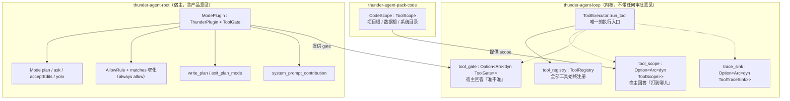
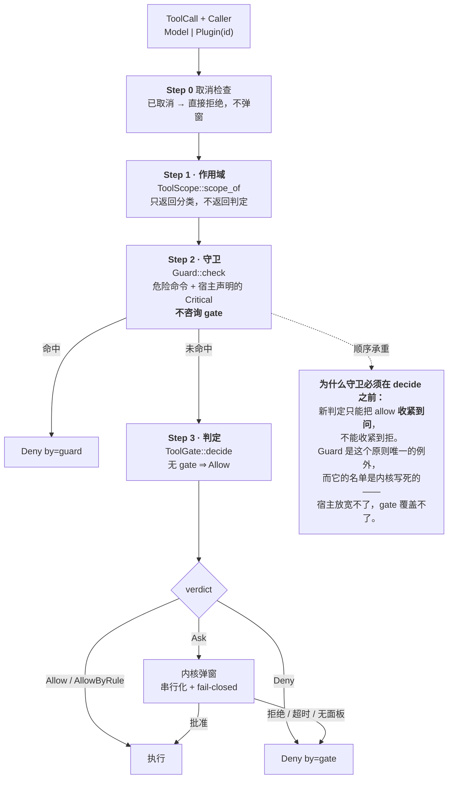
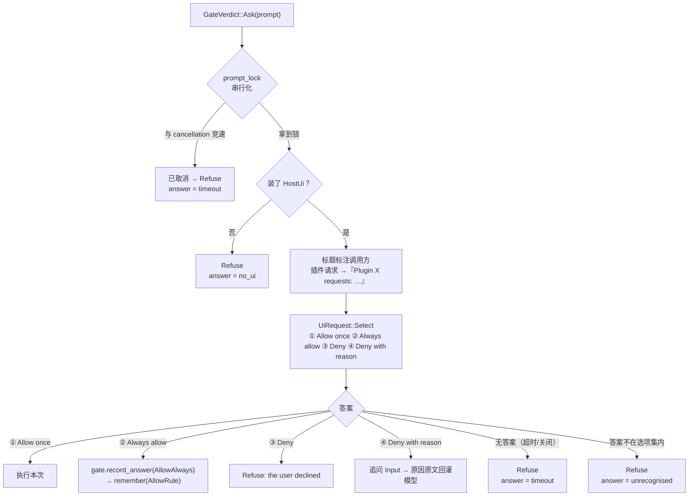
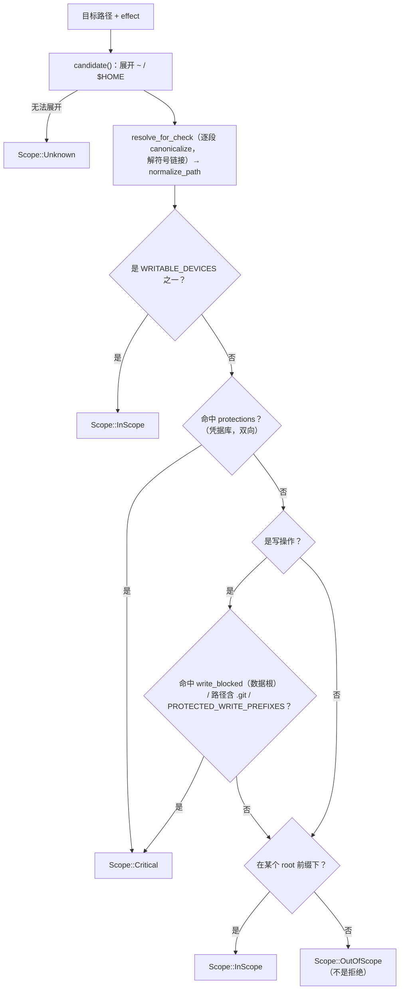
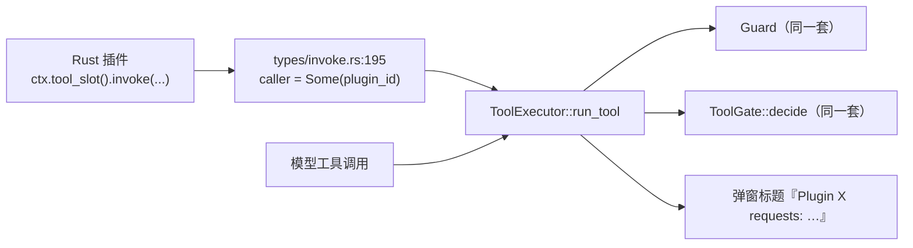
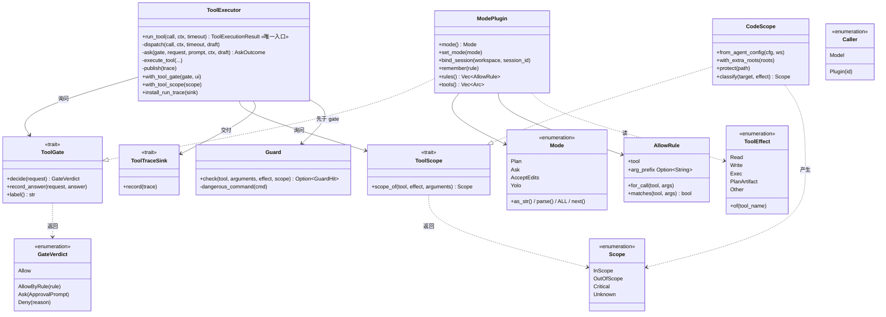

# thunder 权限结构图（0.4）

> 源码事实图。所有结论都对应到具体文件与函数。
> 唯一执行入口：`ToolExecutor::run_tool`（`thunder-agent-loop/src/tools/executor.rs:249`）
> 唯一判定入口：宿主安装的 `ToolGate::decide`（`thunder-agent-loop/src/types/gate.rs:125`）

---

## 0. 一句话总览

0.4 把"准入"从洋葱中间层搬到了**一个函数**里，把**策略**从内核搬到了**可卸载的宿主插件**里：

```
                  ┌────────────────────────────────────────────────┐
                  │  ToolExecutor::run_tool  ← 唯一的工具执行入口   │
                  │  取消 → 作用域 → 守卫 → 判定 → 弹窗 → 执行 → trace│
                  └────────────────────────────────────────────────┘
                                    ▲
        四个接缝，全部由宿主持有：    │
        guard（内核，不可绕过）      │
        ToolScope（宿主：打到哪儿）  │
        ToolGate（宿主：准不准）     │
        ToolTraceSink（宿主：收记录）│
```

- **没有洋葱，没有 tier。** 7 层中间件、`MiddlewareConfig` 的 4 个 bool、档位（`Permission`）全部删除；工具**永远全量注册**（`always_registered_test.rs`）。
- **没有 jail。** `security.rs`（1594 行）删除，越界从"硬拒"降级为"询问"（D1）。保留的只有解析器本身（`CodeScope`）与危险命令判定。
- **判定是插件。** `ModePlugin`（`thunder-agent-root/src/plugins/mode.rs`）实现 `ToolGate`，带四档 `plan`/`ask`/`acceptEdits`/`yolo` 与 `write_plan`/`exit_plan_mode`。不装它 ⇒ 除守卫外全放行。

---

## 1. 全景图：内核 / 插件 的分界



**内核与策略的分界就是这条线**：内核知道"这个调用是什么效果、打在哪个作用域、被谁拒绝"，但不知道"什么是一个工作区"（那是 A/B 契约）也不知道"用户可以接受多大的风险"（那是产品意见）。前者由 `ToolScope` 注入，后者由 `ToolGate` 注入。

---

## 2. 一个入口：`run_tool` 的十步

`run_tool`（`executor.rs:249`）**不含任何早退 `return`**：所有分支都在私有方法 `dispatch`（`executor.rs:287`）里，而 `dispatch` 拿到的是一个 `&mut TraceDraft`，它怎么返回都必须把判定填进去。于是"每次调用必然留下且只留下一条 trace"是**结构的结果，不是约定**（`trace_test.rs::every_exit_path_records_a_trace` 遍历 14 条出口）。

| # | 步骤 | 位置 | 拒绝时 |
|---|---|---|---|
| 1 | 解析效果 `effect` | `executor.rs:260`；`resolve_effect` 209 | — |
| 2 | 补 `event_sink` / `ui`（宿主未给则由 executor 兜底） | `executor.rs:262-267` | — |
| 3 | 开 trace 草稿 `TraceDraft::begin` | `executor.rs:270` | — |
| 4 | **取消检查** | `dispatch` 296 | `Decision::Cancelled` → `cancelled_refusal` |
| 5 | 解析参数 + **脱敏** | `dispatch` 301-309 | `unwrap_or(Value::Null)`，畸形参数照常走完 |
| 6 | **作用域** `ToolScope::scope_of` | `dispatch` 311；`scope_of` 176 | 无 scope ⇒ `Scope::Unknown` |
| 7 | **守卫** `Guard::check` | `dispatch` 314；`guard.rs:61` | `Decision::Deny{by: Guard}` → `guard_refusal` |
| 8 | **判定** `ToolGate::decide` | `dispatch` 341 | 无 gate ⇒ 直接 `Allow` |
| 9 | **弹窗**（gate 返回 `Ask` 时，内核执行） | `ask` 432 | 超时/无面板/取消 ⇒ 拒绝 |
| 10 | **执行** + 关 trace + 发布 | `execute_tool` 400；`finish` 738；`publish` 421 | — |

**第 10 步是唯一出口。** `publish`（`executor.rs:421`）把记录交给宿主安装的 `ToolTraceSink`；**内核自己不落盘**（A/B 契约：内核不知道 store 路径）。

> 曾经的洋葱：`PermissionGuardMiddleware → SecurityGuard → ResourceGuard → Transaction → OutputPostProcessor → ToolRegistry`。
> 现在没有任何一层住在"决定之后、执行之前"这个位置上——那正是洋葱的病根：可编排的执行顺序让"谁先谁后"变成隐式语义。

---

## 3. 四档模式矩阵

`Mode`（`mode.rs:44`）与 `ToolGate::decide` 的矩阵（`mode.rs:435`）：

| mode | Read | Write · InScope | Write · OutOfScope/Unknown | Exec | PlanArtifact |
|---|---|---|---|---|---|
| `plan` | Allow | **Deny** | **Deny** | **Ask** | Allow |
| `ask` | Allow | Ask | Ask | Ask | Allow |
| `acceptEdits` | Allow | **Allow** | **Ask** | Ask | Allow |
| `yolo` | Allow | Allow | Allow | Allow | Allow |

三条实现细节，每一条都有测试：

1. **`plan` 跳过 allow 规则。** 规则查询先于矩阵，但 `decide` 用 `if mode != Mode::Plan` 把它挡在 plan 之外（`mode.rs:454`）——"即使命中 allow 规则，plan 模式下编辑也永不自动批准"（`mode_matrix_test.rs::a_rule_does_not_leak_into_plan_mode`）。
2. **`plan` 下写类调用的拒绝文案必须给出出口**，否则模型会反复重试；文案见 §7。
3. **`yolo` 不检查规则，但守卫仍然生效**——`Guard` 在 `decide` **之前**运行（`path_scope_test.rs::a_dangerous_command_is_refused_in_every_mode`）。

`PlanArtifact` 是 plan 模式下唯一可写的效果，但**它只在名字对得上时才算数**，见 §7。

### 3.1 旧模式名的解析

`Mode::parse`（`mode.rs:91`）仍接受线上存在的旧名：

| 归一化后的输入 | 落到 |
|---|---|
| `plan` | `Plan` |
| `ask` / `default` / `manual` / `mutations` / `writes` / `always` / `all` | `Ask` |
| `acceptedits` / `accept_edits` / `shell_only` / `ask_shell` | `AcceptEdits` |
| `yolo` / `never` / `none` / `bypass` / `bypass_permissions` / `bypasspermissions` | `Yolo` |

**`plan` 不再映射到 `never`**——`policy.rs` 旧实现把 `"plan"` 解析成"免审放行"，与今天的语义正好相反，这里显式反转（`mode_matrix_test.rs::parse_accepts_the_names_that_exist_in_the_wild`）。

线上拼写是 `as_str()` 的 `plan` / `ask` / `acceptEdits` / `yolo`（`mode.rs:67`），也正是 trace 里 `mode` 字段与 `DenyBy::Gate` 通知层的标签（`label()`，`mode.rs:511`）。

---

## 4. 判定顺序 —— 这就是安全属性本身



**核心安全原则**：路径判定**只**用来把 `ask` 降级成 `allow`（in-scope 的写在 `acceptEdits` 下免问），**永远不用来把 `allow` 升级成 `deny`**。于是新增判定最多让人多被问一次，不可能让人被静默拒绝——那正是旧 jail 的全部痛点。

`scope.rs` 的模块文档把这条写成了不变式（`scope.rs:1-18`）：**作用域是一个位置，不是一个裁决。**

---

## 5. 审批弹窗：fail-closed 的交互闭环

弹窗由**内核**发起，gate 只负责说"问"（`gate.rs:9-22`）：gate 返回 `Ask(ApprovalPrompt)` 就到此为止，串行化、超时、无面板的处理全在 `ask`（`executor.rs:432`）里。**gate 无法自己弹窗，因此也无法提供"永远允许"这类脚枪。**



`AskAnswer` 的六个取值（`trace.rs:156`）也就是"答案"的全部可能：`allow_once` / `allow_always` / `denied` / `timeout` / `no_ui` / `unrecognised`。**只有前两个代表真实的人类批准**（`gate.rs:95-96`），其余四个一律是拒绝。

### 5.1 『Always allow』规则的窄化

`AllowRule`（`mode.rs:170`）与 `AllowRule::for_call`（`mode.rs:195`）——规则绝不授予"一个工具类"：

| 工具类型 | 规则形式 | `matches` 逻辑 |
|---|---|---|
| `Exec`（bash） | 命令**到第一个链接符为止**的前缀 | `strip_prefix(prefix)` 后余下部分**不得含** `; & \| \` > < \n $` |
| 其它（按 `path` 参数） | `path` 参数（文件或其下整个目录） | `path == prefix \|\| path.starts_with(prefix + "/")` |
| 其它且无 `path` 参数 | `None` → **不提供**该选项 | — |

`SHELL_CHAINING = [';', '&', '|', '`', '>', '<', '\n', '$']`（`mode.rs:184`）。

> `git status` 永远不会授权 `git status && rm -rf /`。

**两条不变式**：① `prompt.allow_always` 为假时内核**不提供** `Always allow` 选项（`executor.rs:482`），所以用户点不到一个没有安全规则的项；② 审批是"窄化 + 记忆"两件事都由 gate 负责（`record_answer`，`mode.rs:501`）——内核不再持有任何规则推导逻辑（R10：这是 gate 的责任，`ModePlugin` 是唯一实现且带测试）。

---

## 6. 软 jail：越界从"拒"降级为"问"

旧 jail 的双重身份（**知识**＝路径写到哪，**策略**＝越界就拒）被拆开：

- **知识** → `CodeScope`（`thunder-agent-pack-code/src/scope.rs`），实现 `ToolScope`，宿主可替换；
- **策略** → `ModePlugin` 的矩阵，可卸载。

### 6.1 `CodeScope` 怎么分类

`classify`（`scope.rs:160`）的顺序：



- `PROTECTED_WRITE_PREFIXES`（`scope.rs:36`）：`/etc`、`/dev`、`/proc`、`/sys`、`/boot`、`/bin`、`/sbin`、`/usr`、`/var/db`、`/System`、`/Library`、`/Applications` 等。
- `WRITABLE_DEVICES`（`scope.rs:54`）：`/dev/null`、`/dev/stdin`、`/dev/stdout`、`/dev/stderr`、`/dev/tty`。
- 数据根（`thunder_subdir("")`，即 `~/.thunder`）可读不可写：`auth.json`、`models.json`、`credentials.json` 被 `protect()`（`scope.rs:142`），凭据库**双向** off-limits。

**`bash` 一律 `Unknown`**（`scope.rs:216`）：`Exec` 与 `Other` 直接返回 `Unknown`，不做任何命令解析。这正是 `find . | xargs rm -f`、`echo x > "$LOG"` 争议消失的地方——它们**不再被静态分析**，而是变成一个"问"。代价见 §12。

### 6.2 `resolve_for_check` 被保留下来

删 jail **删的是语义，不是解析器**。`resolve_for_check`（`scope.rs:250`）与 `normalize_path`（`scope.rs:271`）原样保留：

- 逐段 `canonicalize()` 已存在的前缀，所以符号链接被解析（macOS `/var` → `/private/var`），`link/..` 会走链接的真实父目录；
- 不存在的尾部按最深存在祖先的解析结果**按字面**拼接。

这是**全仓唯一的符号链接逃逸检查**，也是"删 jail 会丢掉逃逸检查"这条风险的处置（R2）。它现在的身份是 `CodeScope` 的分类助手，而分类结果由内核的 Guard 决定怎么用。

### 6.3 守卫：危险命令按 token 判定，不按子串

`Guard::check`（`guard.rs:61`）只在两个条件下拒绝：

1. **宿主声明了 `Scope::Critical`** → `GuardHit{kind: critical_path, pattern: "critical path", detail: <目标>}`；
2. **工具是 shell 类**（`effect == Exec`，或名字是 `bash`/`shell`/`sh`/`zsh`/`powershell`，`guard.rs:97`）**且命令命中危险集合** → `GuardHit{kind: dangerous_command, …}`。

危险集合（`inspect`，`guard.rs:125`）**按 token 判定**，不是子串匹配：

| 规则 | 判定 |
|---|---|
| `mkfs*` | 首个动词以 `mkfs` 开头 |
| `dd if=` | 动词是 `dd` 且某个 operand 以 `if=` 开头 |
| `rm -rf /` | 动词是 `rm`，**同时**带 `-r`/`-R` 与 `-f` 类 flag，**且**某个 operand 是文件系统根（`is_filesystem_root`，`guard.rs:254`） |
| fork bomb | 去掉所有空白后包含 `:(){:\|:&};:`（文本匹配，非 token，见 `guard.rs:182-185` 的诚实说明） |

分词器 `segments`（`guard.rs:200`）跟踪引号与转义，`)`、`{`、`}`、`;`、`|`、`&`、`>`、`<` 都是简单命令边界。`WRAPPERS`（`guard.rs:35`）会跳过 `sudo`、`env`、`time`、`nice`、`xargs` 等前缀，`FOO=bar cmd` 形式的赋值也会跳过。

于是 `echo "never run rm -rf /"`、`rm -rf /tmp/build`、`git commit -m "rm -rf /"` **都不再被拒**——它们中间没有一个是"动词是 rm 且 operand 是根"。

**守卫不咨询 gate，也不咨询 scope 的策略部分**：scope 只作为输入（`if scope == Scope::Critical`），gate 完全看不见。这是"守卫不可被覆盖"的结构保证（`guard_test.rs::the_floor_holds_under_a_permissive_scope_and_a_permissive_mode`）。

### 6.4 拒绝文案

| 来源 | 动作 | 理由 |
|---|---|---|
| Guard · 危险命令 | `Dangerous command refused` | `Refused: this command matches '<pattern>'. The agent does not run it at any permission level or in any mode, and changing the mode will not change that.` |
| Guard · 关键路径 | `Critical path refused` | `Refused: '<detail>' is off limits — protected regardless of mode or approval.` |
| Gate | `Blocked '<tool>' — the user did not approve it` | `Error: '<tool>' was not approved. Reason: <reason>` |
| 取消 | `Tool execution cancelled before launch` | `Tool execution cancelled by user signal` |

三者的 `ground_truth` 都明确写下"什么也没发生"（`The call never ran. The workspace is unchanged.`），指引也会明确阻止"换个工具绕过去"（`executor.rs:815-899`）。

---

## 7. plan 模式

Plan 是 `ModePlugin` 的一个档位 + 两个工具，因此**可随插件一起卸载**。

### 7.1 `write_plan`

- 效果 `ToolEffect::PlanArtifact`（`mode.rs:542`）；参数 `{ content }`，整体覆盖。
- 目标 `<workspace>/.thunder/plans/<sanitized-session>.md`（`plan_path`，`mode.rs:157`）。
- `<session>` 消毒成 `[A-Za-z0-9._-]`，`""`/`"."`/`".."` 落回 `session`（`sanitize_session_id`，`mode.rs:139`）。**jail 删掉后这是真实注入点**（daemon 的 `session_id` 来自客户端），所以过滤器是唯一的防线，测试直接钉住 `../../../etc/evil` 逃不出去。
- 复用 `WriteFileTool::write_cancellable`：同一把 per-path 锁、`create_dir_all`、`sync_all` + rename。
- 返回：`Plan written to <path> (<n> bytes). Call `exit_plan_mode` to submit it for approval.`

### 7.2 `exit_plan_mode`

- 效果 `ToolEffect::Read`（它自己不写，`mode.rs:592`）；**忽略模型传来的任何参数**，harness 自己从磁盘读计划（对齐 Claude Code）。
- 计划文件缺失/空白 → `is_error`，**不弹窗**：`No plan file at <path>. Write it with `write_plan` first.`
- 否则弹 `UiRequest::Review`（`mode.rs:622`），四个选项（`mode.rs:125-128`）：

| 选项 | 落地模式 |
|---|---|
| `Yes, and auto-accept edits` | `AcceptEdits` |
| `Yes, but ask before each edit` | `Ask` |
| `Yes, fully autonomous` | `Yolo` |
| `No, keep planning` | **留在 `Plan`** |

- 批准 → `Plan approved. Mode is now <mode>. Calls are judged by it from the next one on.`（`approve`，`mode.rs:732`）——**显式告诉模型模式变了**。同一次批准还往本次 run 的 event sink 发一条 `mode_changed`（`mode`/`previous`/`source:"plan_approved"`），daemon 把 custom 事件翻成顶层 `mode_changed` 帧推给宿主——这是 daemon 自己看不见的那条变化（`ExitPlanModeTool` 持有的是共享 `Arc<ModeState>`，不是插件）。sink 可选，**没有 sink 也必须批准成功**。
- 驳回 → 再补一次 `UiRequest::Input` 追问改什么，把输入作为 tool result 返回模型（`The user's feedback: …`）；驳回**不算错误**（`is_error: false`），否则模型会当失败重试。驳回**不播报**——档位没动。
- 无答案（关闭/超时）→ `No answer (dismissed or timed out). Still in plan mode.`——**沉默不是同意**。

模式翻转靠共享 `ModeState` 里的 `set_mode` 直接生效：内核每次调用都重新问 gate，所以"下一次调用立刻生效"（`mode_matrix_test.rs::flipping_the_mode_applies_to_the_next_call`）。**会改用户会话档位的调用点走 `set_mode_announcing`**（它只在真的变了时返回旧档位，供 daemon 播报）；计划批准是唯一走 `set_mode` 的例外，因为它没有通往 daemon 的通道，只能靠 event sink 申报。

### 7.3 豁免钉在**名字**上，不是效果上

`effect` 是工具**自声明**的（`policy.rs`），任何工具都能声明 `PlanArtifact`。所以 `decide` 的豁免条件是写死的两个名字：

```rust
if request.tool == WRITE_PLAN_TOOL || request.tool == EXIT_PLAN_MODE_TOOL {
    return GateVerdict::Allow;
}
```

`plan_mode_test.rs::a_self_declared_plan_effect_is_not_an_exemption` 用一个自称 `PlanArtifact` 的 `sneaky_writer` 钉住这一半，`mode_matrix_test.rs::the_plan_tools_are_exempt_where_a_self_declared_effect_would_not_be` 钉住另一半。

### 7.4 拒绝文案就是出口

全量注册之后，模型在 plan 模式下**会看到** `write_file` 并可能去试（D3 的真实代价，R7）。所以拒绝文案必须点名出口：

```
plan mode: only read-only tools run here. 'write_file' changes something, so it is refused.
Write the plan with `write_plan`, then submit it with `exit_plan_mode` — the user's approval is
the only way out of plan mode.
```

没有这句，模型会把拒绝读成"换个方式再试"，于是陷入旧 jail 最被抱怨的重试循环。

---

## 8. 插件权限：与模型完全同一条路径

插件反向调工具（`ToolInvoker`）**没有旁路**：它拼一个 `ToolExecutionContext` 然后调用同一个 `run_tool`。



要点：

- `caller: Some(id)` → `Caller::Plugin(id)`（`policy.rs:86`）；弹窗标题据此加前缀（`executor.rs:473`），**插件无法伪装成助手发起**。
- 没有 `caller` 就是 `Caller::Model`。trace 里的 `caller` 字段是这条归因的落点。
- 协议层防伪仍在 daemon 侧：`ui_request.request_id` 由 daemon 签发，`source: host | plugin` 区分来源，plugin-sourced 答复不构成授权依据。

> TS 插件宿主（`thunder-agent-plugin`）与 `ReloadPlugins` RPC 已在 0.4 删除（零消费者）。保留 `ToolInvoker` 与 `caller` 归因。

---

## 9. trace：不可绕过，且不可关闭

`ToolTrace`（`trace.rs:32`）一次调用一条记录。字段（线上名即 Rust 名）：

| 字段 | 含义 |
|---|---|
| `schema` | `TRACE_SCHEMA = 1`（`trace.rs:28`） |
| `trace_id` / `tool_call_id` | 单次调用 id / provider 的调用 id |
| `session_id` / `task_id` | 宿主的会话与本次 run 的名字（内核只当它是配置里的 `route`，从不解释） |
| `turn` / `tool` / `caller` / `effect` | 哪一轮、哪个工具、谁发起、什么效果 |
| `mode` | gate 的 `label()`，通常就是模式名；**没有 gate 时缺省** |
| `scope` | `in_scope` / `out_of_scope` / `critical` / `unknown` |
| `arguments` | **已脱敏**后的参数 |
| `decision` | `allow` / `allow_by_rule` / `asked` / `deny{reason, by}` / `cancelled` |
| `guard` | 命中时给出 `{kind, pattern, detail}`，`kind ∈ {dangerous_command, critical_path}` |
| `answer` | `allow_once` / `allow_always` / `denied` / `timeout` / `no_ui` / `unrecognised` |
| `result` | `is_error`、`truncated`、`original_bytes`、`result_bytes`、`output_preview`、`output_digest` |
| `redactions` | 本次实际生效的规则名（如 `key:api_key`、`document:content`、`github_token`、`echoed_secret`） |
| `timing` | `queued_ms` / `decision_ms`（guard+scope+gate 合计）/ `ask_ms` / `exec_ms` / `total_ms` |
| `started_at_ms` / `finished_at_ms` | 墙钟 |

`decision.by` 的取值只有两个（`trace.rs:124`）：`guard` 与 `gate`。"谁拒的"因此永远可审计。

**出口三处**：

1. `AgentEvent::ToolTrace`（**类型化变体**，不复用 `Custom`——`Custom` 按定义对内核不透明，而宿主需要类型化访问才能持久化/过滤）；
2. `ToolTraceSink`（宿主安装的 `Arc<dyn ToolTraceSink>`，`trace.rs:443`）；
3. 内核不落盘。

`install_run_trace`（`executor.rs:129`）是**就地**安装的：插件反向调用那个 invoker 持有的是 run 开始前克隆的 executor，消费式 builder 会静默丢掉所有插件发起的调用。run 结算时 `clear_run_trace`。

### 9.1 脱敏

原则：**脱敏只作用于 trace（持久工件），不作用于模型上下文**——模型需要真相才能干活。

| 级别 | 对象 | 规则 |
|---|---|---|
| 键名 | `arguments` 的键 | 命中 `SECRET_KEYS`（`api_key`/`apikey`/`token`/`secret`/`password`/`credential`/`authorization`/`cookie`/`private_key`/`access_key`/`client_secret`，大小写不敏感子串）→ 值变 `[redacted:key]`，规则名 `key:<名字>` |
| 正文 | `content` / `preview` | 只留 `{digest, bytes, preview(200 字符)}`，规则名 `document:<名字>` |
| 形态 | 任何文本 | 正则打码：`gh[pousr]_…`、`sk-…`、`AKIA…`、JWT、PEM 私钥块、`Bearer …`、URL 内嵌凭据（保留 scheme+host） |
| 输出 | `result.output_preview` | 先按上述正则打码，再截到 2048 字符（`OUTPUT_PREVIEW_CHARS`，`executor.rs:36`），另存**全文**的 `stable_digest` |

第三条规则**不够**，测试抓到过一个真实泄漏：`api_key` 下的 `hunter2` 在 `arguments` 里被打码，却从 `output_preview` 原样回来了——因为被测的 stub 会回显自己的参数，而按键名打码看不见"工具拿这个值做了什么"。所以 `withhold`（`trace.rs:373`）把**已声明为密钥的字面量**从所有派生文本里抹掉（短于 6 字符的不抹，免得把普通词打成乱码），并推入规则名 `echoed_secret`。

`stable_digest`（`trace.rs:457`）是 FNV-1a 64 位，**跨版本稳定**，用于比对而非防伪——它只回答"两次输出是不是同一份"，不回答"这份是不是可信的"。

### 9.2 保留策略

`TraceCollector`（`thunder-agent-root/src/trace_collector.rs`）是 TUI 与 daemon 共用的唯一实现——两份"什么会被丢掉"的实现迟早会对"trace 文件是什么意思"产生分歧。

| 上限 | 值 | 超限时 |
|---|---|---|
| `MAX_EVENTS` | 5000 | 记 `dropped_events` |
| `MAX_TOOL_TRACES` | 2000 | 最老的完整记录被挤出，但**保留其 `DecisionRecord`**（`tool_call_id`/`turn`/`tool`/`caller`/`effect`/`mode`/`scope`/`decision`/`guard`/`answer`/`timing`）——价值主体是"为什么允许/拒绝" |
| `MAX_DECISION_RECORDS` | 2000 | 淘汰日志也有界（无界的"我们丢了什么"列表和 trace 本身一样是泄漏） |
| micro-delta | — | 计入 `dropped_deltas`，不保留。**计数而非静默丢弃**，读者据此判断记录的完整程度 |

落盘 `tool_traces` 是**新增字段**，`events` 形状不变（ARP 逐字段读它）。

---

## 10. 类结构总览



---

## 11. 关键设计不变量（都有测试钉住）

| # | 不变量 | 实现位置 | 测试 |
|---|---|---|---|
| 1 | `run_tool` 是**唯一**工具执行入口，没有旁路 | `executor.rs:249` | `guard_test.rs::no_entry_point_skips_the_guard` |
| 2 | 每次调用恰好一条 trace，覆盖全部出口 | `run_tool` 单出口 | `trace_test.rs::every_exit_path_records_a_trace`（14 条路径） |
| 3 | trace 不可关闭 | `publish` | `trace_test.rs::a_trace_cannot_be_disabled` |
| 4 | 守卫先于 gate 且不咨询 gate；gate 只能收紧 | `guard.rs:61`、`gate.rs:9-22` | `guard_test.rs::the_floor_holds_under_a_permissive_scope_and_a_permissive_mode` |
| 5 | 危险命令在**任何**模式都拒（含 yolo） | `Guard::check` | `path_scope_test.rs::a_dangerous_command_is_refused_in_every_mode` |
| 6 | 作用域只分类不裁决；`Critical` 是唯一例外 | `scope.rs:1-18` | `path_scope_test.rs::repository_metadata_is_off_limits_without_asking` |
| 7 | 越界写是"问"，不是"拒" | `CodeScope` + 模式矩阵 | `path_scope_test.rs::an_out_of_scope_write_is_a_question_the_user_can_answer` |
| 8 | 旧 jail 误伤的调用不再被拒 | `Guard` token 判定 | `path_scope_test.rs::the_calls_that_used_to_be_refused_are_not_any_more` |
| 9 | **不装 gate ⇒ 除守卫外全放行** | `dispatch` 352 | `gate_absent_allows_test.rs::without_a_gate_everything_the_guard_allows_runs` |
| 10 | 卸载 gate 后回到同一状态 | `Option<Arc<dyn ToolGate>>` | `gate_absent_allows_test.rs::removing_the_gate_returns_to_the_gate_absent_state` |
| 11 | 工具**永远全量注册**（无 tier） | `host.rs` 装配 | `always_registered_test.rs::the_builtins_are_registered_on_every_run` |
| 12 | 四档矩阵逐格正确 | `mode.rs:435` | `mode_matrix_test.rs::the_matrix_is_what_the_docs_say` |
| 13 | plan 下写类**即使命中规则也拒** | `mode.rs:454` | `mode_matrix_test.rs::a_rule_does_not_leak_into_plan_mode` |
| 14 | plan 豁免只认工具**名字**，不认自声明效果 | `mode.rs:445` | `plan_mode_test.rs::a_self_declared_plan_effect_is_not_an_exemption` |
| 15 | 含 `/` 的 `session_id` 逃不出 plans 目录 | `sanitize_session_id` | `plan_mode_test.rs::a_hostile_session_id_cannot_escape_the_plans_directory` |
| 16 | plan 的拒绝文案必须点名出口 | `mode.rs:486` | `plan_mode_test.rs::the_write_refusal_names_the_way_out` |
| 17 | 驳回留在 plan 且反馈回灌模型 | `exit_plan_mode` | `plan_mode_test.rs::declining_keeps_the_mode_and_carries_the_feedback_back` |
| 18 | 弹窗 fail-closed：无面板/超时/取消/意外值 → 拒绝 | `ask`、`executor.rs:432-587` | `plan_mode_test.rs::a_headless_host_stays_in_plan_mode`、`trace_test.rs` 各 `AskAnswer` 分支 |
| 19 | 弹窗串行，避免并发批叠框批准错对象 | `prompt_lock` | — |
| 20 | 『Always allow』只授予最窄规则，且重放由 `matches` 的链式字符检查挡住 | `AllowRule::for_call` / `matches` | `mode_matrix_test.rs::a_remembered_rule_allows_without_asking` |
| 21 | 秘钥键名/形态/正文在落盘前被打码，回显的密钥也被抹掉 | `redact_arguments` / `withhold` | `trace_test.rs::arguments_under_a_secret_key_are_redacted`、`…::a_secret_in_the_output_never_reaches_the_record` |
| 22 | 宿主的模式可被外部读到并设置 | daemon `SetMode`/`GetPermissionState` | `mode_protocol_test.rs::a_host_can_read_and_set_the_mode_over_the_wire` |
| 23 | 审批模式不会被静默重置（会话表 FIFO 淘汰） | `SessionModes`（`service.rs:116`） | — |
| 24 | 档位真的变了必被播报，**同值不播报** | `set_mode_announcing`（`mode.rs:392`）、daemon `emit_mode_changed` | `mode_matrix_test.rs::announcing_returns_the_previous_mode_only_when_it_changed`、`mode_protocol_test.rs::a_mode_that_does_not_change_is_not_announced` |
| 25 | 计划批准（daemon 看不见的那条）也播报，走 run 的 event sink | `approve`（`mode.rs:732`）、`MODE_CHANGED_EVENT_KIND` | `plan_mode_test.rs::an_approval_announces_the_mode_it_landed_in` |
| 26 | 驳回/无答案**不**播报（没有变化就没有事件） | `exit_plan_mode` | `plan_mode_test.rs::staying_in_plan_mode_announces_nothing` |

---

## 12. 三个值得注意的边界

### 12.1 默认仍是 `yolo`，这依然是刻意的产品决策

`Mode::default() = Yolo`（`mode.rs:63`）。审批门是 fail-closed 的：无面板宿主上每个弹窗都判为"取消＝拒绝"。若默认 `ask`，升级后所有无面板用户的每一次写文件、每一条 shell 都会被静默拒绝——"一个没人要求的安全特性，在第一天就把产品搞坏"。所以审批是 **opt-in**，`config.json` 的 `agent.defaultMode` 可以覆盖它。

**这条在 0.4 有了新的含义**：默认从"内核里的 `SessionPolicy::new(Bash, Never)`"变成了"没装 gate 时内核自己放行"。两者行为一致，但现在的默认放行是**结构性的**——见下一条。

### 12.2 不装 gate ＝ 除守卫外全放行（这是红线，不是疏忽）

两条无头/嵌入式宿主红线依赖它：

1. `thunder-agent-runtime` 不设 workspace、不装 policy、不接 `HostUi`，走 baseline；
2. `ModePlugin` 的 `PluginContext` fallback 显式是 `Yolo`——若 fallback 成 `Ask` + `NullHostUi`，所有 Rust 插件会被静默锁死。

所以：**从宿主插件列表里去掉 `ModePlugin`，行为就等于 `yolo`**（守卫仍在）。R4 的处置是两个第一方宿主**无条件**挂 `ModePlugin`。文档写清楚就够了，没人应该靠"忘了装"来获得安全。

### 12.3 软 jail 是净放宽（必须显式说明，不能默默消失）

`bash` 不再做静态目标分析，因此以下几类**不再被拦截**（`yolo` 下静默执行，`ask`/`acceptEdits` 下变成弹窗）：

- `find . | xargs rm -f`（operand 来自 stdin，旧 jail 也漏）
- `tar -x -C /etc`、`make` 派生的写
- `python3 -c "import os; os.system('cat /etc/hosts')"`
- 任何把命令拼进变量的写法

这是 D1 的既定代价：用"多问一次"换掉"静默拒绝"，而"问"在无面板宿主上等于拒绝——差别在于**用户能看见并批准**。危险命令与关键路径这两类**反而是收紧的**（token 判定 + 守卫不可被覆盖）。完整的迁移说明见 [`docs/migration-0.4.md`](migration-0.4.md)。
