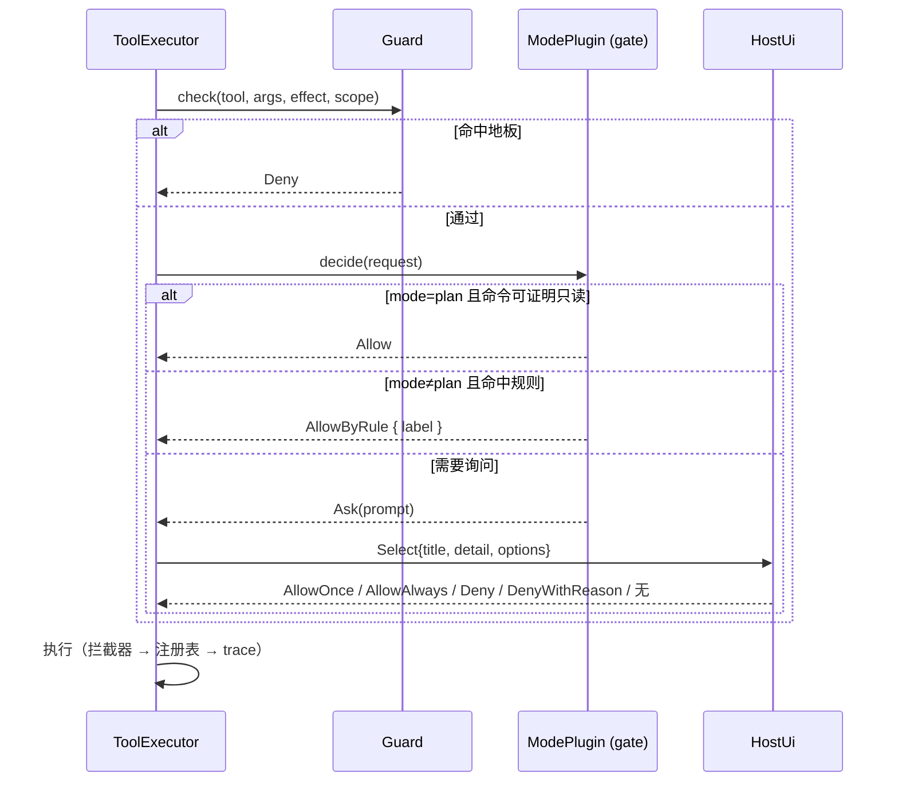

# 权限与审批

> 0.6.0 · 快照 `main@e66338b`
>
> 本文描述**一次工具调用如何被裁决**：谁先说话、谁能否决、记住的规则匹配什么、plan 模式为什么那样设计。
> 调用漏斗本身的代码在 `thunder-agent-policy/src/executor.rs`，模式在 `thunder-agent-root/src/plugins/mode.rs`。

---

## 0. 一句话

> **守卫是地板，模式是裁决，弹窗是最后一道；问不到人时拒绝，任何规则都不能放宽守卫。**

一条调用只能走一条路：

```
取消检查
  → 参数解析（原样给工具，脱敏副本进 trace）
  → 作用域分类（CodeScope）
  → 守卫 Guard::check            ← 1000 号地板，任何模式都绕不过
  → 宿主 gate.decide            ← 四档模式；规则在这里查
      ├─ Allow / AllowByRule → 执行
      ├─ Deny { reason }     → 拒绝，文案给出出口
      └─ Ask(prompt)         → 弹窗（fail-closed）
  → 拦截器 pre（priority 降序）
  → ToolRegistry::execute_tool_call（超时 / sanitize / scratchpad / 截断）
  → 拦截器 post（逆序）
  → 发布恰好一条 trace
```

没有任何入口能跳过这条漏斗：模型调用、插件反向 RPC（`ToolInvoker`）都进 `run_tool`，区别只是 `ctx.caller`。

---

## 1. 守卫：不依赖任何模式的地板

`Guard::check(tool, args, effect, scope)` 只拒绝两类：

| 命中 | 条件 | 结果 |
|---|---|---|
| `CriticalPath` | `scope == Scope::Critical`（凭据、密钥、系统目录等） | 拒绝，理由里给出目标 |
| `DangerousCommand` | 看起来是 shell 的工具 + 命令命中危险清单（`rm -rf /` 等） | 拒绝，理由里给出命中的模式 |

要点：

- **守卫先于 gate**，所以任何 gate（包括 `yolo`）都不能把它"放宽"；它只能被拒绝。
- 参数解析失败**不是**绕过守卫的路：注册表用同一份字符串，解析失败在工具之前就报错；gate 看到的是 `null` 参数，基于参数的规则不会误匹配。
- `is_shell_like` 决定是否检查命令清单：声明 `Exec` 的工具，或名字看起来像 shell 的工具。

`thunder-agent-loop` 里也有一个 `guard.rs`，那是**循环侧**的重复/错误熔断（连续相同调用、连续失败），与这里的权限守卫不是同一个东西。

---

## 2. 作用域：分类，不是裁决

`ToolScope::scope_of(tool, effect, args)` 返回 `Scope`：

| 值 | 含义 |
|---|---|
| `InScope` | 路径在工作区（或声明的额外根）内 |
| `OutOfScope` | 明确在外 |
| `Unknown` | 无法分类（工具没有路径参数、或宿主没装 scope） |
| `Critical` | 凭据/密钥/系统位置——守卫直接拒绝 |

`CodeScope`（pack-code）是参考实现。它只回答"在哪"，不回答"能不能"；后者是 gate 的事。`acceptEdits` 的"范围内写入免问"就是 `(Write, InScope)` 这一格。

---

## 3. 四档模式

`ModePlugin` 实现 `ToolGate`。矩阵（`decide`）：

| 模式 | 读 | 范围内写 | 范围外写 | shell | 其它 |
|---|---|---|---|---|---|
| `plan` | Allow | **Deny** | **Deny** | 只读命令 Allow，其余 Ask | Deny |
| `ask` | Allow | Ask | Ask | Ask | Ask |
| `acceptEdits` | Allow | **Allow** | Ask | Ask | Ask |
| `yolo` | Allow | Allow | Allow | Allow | Allow |

`Mode::default() == Ask`（secure by default）；`yolo` 是显式 opt-in。

解析（历史名兼容）：

- `plan` → `Plan`
- `ask | default | manual | mutations | writes | always | all` → `Ask`
- `acceptedits | accept_edits | shell_only | ask_shell` → `AcceptEdits`
- `yolo | never | none | bypass | bypass_permissions | bypasspermissions` → `Yolo`

> 0.3 曾把 `plan` 解析成 `never`（最宽松），0.4 起反转为最谨慎。

### 3.1 规则的查询与模式

`decide` 的顺序：

1. `write_plan` / `exit_plan_mode` **按名字**豁免（不看工具自声明的 effect——任何工具都能声明 `PlanArtifact`）。
2. **规则查询**：`mode != Plan` 时，用 `AllowRule::matches` 找第一条命中的规则 → `AllowByRule { label }`。
3. 否则按上面的矩阵。

**plan 模式永不查规则**：在更宽松模式记下的规则不能变成 plan 期间的写入口。这是有意的，Claude Code 同样如此。

### 3.2 拦截器

`InterceptorPlugin` 是另一条正交的链：`pre_execute` 按 `priority` 降序（`CRITICAL_GUARD=1000` > `SECURITY_POLICY=800` > `GOVERNANCE_MODE=500` = `NORMAL` > `OBSERVABILITY=100`），`post_execute` 逆序。`ModePlugin` 同时实现了 `ToolGate`（裁决）与 `InterceptorPlugin`（观察/记录）。

---

## 4. 弹窗：fail-closed

只有当 gate 返回 `Ask` 才渲染对话框。`ToolExecutor::ask`：

| 情形 | 结果 |
|---|---|
| 运行已取消 | 拒绝（`Timeout`），理由 "the task was cancelled" |
| 宿主没装 UI | 拒绝（`NoUi`），理由 "no user interface is attached" |
| 宿主没答（超时/关闭） | 拒绝（`Timeout`） |
| 作答 `Allow once` | 执行一次 |
| 作答 `Allow always`（且选项存在） | 执行，并把规则交给 gate 记住 |
| 作答 `Always allow`（选项不存在） | **拒绝**（`Unrecognised`）——不信任渲染层 |
| 作答 `Deny` | 拒绝 |
| 作答 `Deny with reason` | 追问一次文本，理由回灌给模型 |
| 作答不在选项内 | 拒绝（`Unrecognised`） |

细节：

- 默认审批超时 `DEFAULT_APPROVAL_TIMEOUT = 600s`（`with_approval_timeout` 可改）。
- 弹窗**串行化**（`prompt_lock`），且与取消竞速：取消的 run 不会占着锁。
- 标题在插件发起时带上前缀 `Plugin <id> requests: ...`——"模型的请求"与"插件的自作主张"不能长得一样。
- `ApprovalPrompt.detail` 是 gate 为这次调用算出的"到底要跑什么"（`describe_call`），随 `UiRequest::Select.detail` 透传到面板。

---

## 5. 记住的规则（always allow）

### 5.1 规则是什么

```rust
pub struct AllowRule {
    pub tool: String,
    /// None = 该工具的任何参数（仅对无意义参数的工具）
    pub arg_prefix: Option<String>,
}
```

`AllowRule::for_call` 决定"能不能窄化"：

| 工具效果 | 规则 |
|---|---|
| `Exec` | 命令截到第一个链接字符（`; & \| \` > < \n $`）之前；若命令**以**链接字符开头则不给规则 |
| 路径型（`write_file` / `read_file` / …） | 归一化后的路径；之后匹配该文件，或该目录之下 |
| 其它 | `None`（工具级；仅在确实没有可窄化参数时） |

没有安全规则 ⇒ 对话框**不提供** "always allow"。

### 5.2 匹配

- 规则与调用**都归一化**：命令折叠空白，路径绝对化（已知工作区时）、文本消解 `.`/`..`、去尾分隔符。所以 `a.txt`、`./a.txt`、`/ws/a.txt` 是同一个目标。
- shell 规则命中后，**前缀之后不得再出现链接字符**：`git status` 不会授权 `git status && rm -rf /`。
- 路径规则用 `under()` 判断"同文件或在目录之下"。

### 5.3 持久化

- 位置：`<数据根>/permissions.json`（默认 `~/.thunder/permissions.json`），**用户级**，跨工作区共用。
  理由：换个项目再问一遍，正是让人干脆关掉询问的原因。
- 格式：`{ "version": 1, "rules": [...] }`。版本不匹配 / 文件损坏 / 读不到 ⇒ 视为**空列表**（这个文件只会"授予"，读失败就是什么都不授予，回到起点）。
- 写入：临时文件 + rename（原子）；权限尽量设为仅所有者可读。
- 规则列表只增不减（当前没有删除 UI）。

### 5.4 plan 模式下的 "always allow"

plan 永不查规则，所以**不提供**这个选项：`allow_always = mode != Plan && AllowRule::for_call(...).is_some()`。
理由：一个能记住、却在当前模式下永远不生效的按钮，比没有这个按钮更糟。切到 `ask` / `acceptEdits` 后照常提供、照常生效。

---

## 6. plan 模式

### 6.1 两个工具

| 工具 | 行为 |
|---|---|
| `write_plan` | 原子写 `<ws>/.thunder/plans/<sanitized-session>.md`；覆盖上一份；返回路径与字节数 |
| `exit_plan_mode` | 读计划文件 → 没有/空白则 `is_error`，**不弹窗**；否则弹审批，选项：批准并自动接受编辑 / 批准但仍询问 / 不，继续计划 |

批准后：模式翻转（`plan_approved`），返回文案逐字包含选项原文、`prev` 与 `source`；同一次批准向本次 run 的 event sink 发 `mode_changed`。

### 6.2 只读命令的证明

`call_is_read_only(arguments)` 的判据是**悲观**的：

1. **一条命令**：未加引号的 `; & | \` ( ) { } > < $ \` 一律拒绝；引号内的是参数，所以 `grep "a|b" src/` 仍是读。
2. **只读动词**（短到能一次读完的名单）：`cat` / `ls` / `grep` / `rg`（除 `--pre`）/ `head` / `tail` / `sort`（除 `-o`）/ `find`（除 `-exec`/`-delete` 等）/ `git` 的只读子命令 / `git config` 的显式读取形态 / `tree`（除 `-o`）/ `uname` / `whoami` / `id` / `hostname` / `nproc` / `sw_vers` / `arch` / `groups` / `tty` / `printenv` / `seq` / `test` / `[` 等。
3. **不是路径**：`/tmp/evil/ls` 不算 `ls`。
4. **没有包装器**：`sudo` / `env` / `xargs` 会运行另一个程序，不在名单里。
5. **没有凭据操作数**：整组件匹配 `.ssh` / `.aws` / `.env` / `id_rsa` / `.pem` 等；命中就把 Allow 变成 Ask。
6. 命令前的 `NAME=value` 赋值会被剥掉（`LC_ALL=C sort f` 就是 `sort f`）；`$` 与反引号在分词阶段已被拒绝。

`awk` / `jq` / `sed` / `python -c` / `node -e` **不在**名单里：它们能执行命令或写文件，而判据读的是命令行，不是程序语义。

诚实的边界：这不是沙箱。它只决定"静默运行"还是"问一句"，且只在 plan 模式下被查询。

---

## 7. 一次决策长什么样



---

## 8. 测试钉住的行为

| 测试 | 性质 |
|---|---|
| `plan_mode_test.rs::a_write_in_plan_mode_is_refused_without_asking` | plan 下写入直接拒绝，不弹窗 |
| `plan_mode_test.rs::plan_mode_does_not_offer_always_allow` / `ask_mode_still_offers_always_allow` | 选项与模式一致（成对） |
| `plan_mode_test.rs::a_self_declared_plan_effect_is_not_an_exemption` | 豁免按名字，不按自声明 effect |
| `plan_mode_test.rs::a_hostile_session_id_cannot_escape_the_plans_directory` | 计划文件名消毒是唯一防线 |
| `mode_matrix_test.rs::a_rule_does_not_leak_into_plan_mode` | plan 跳过规则 |
| `mode_matrix_test.rs::the_plan_tools_are_exempt_where_a_self_declared_effect_would_not_be` | 同上 |
| `path_scope_test.rs::a_dangerous_command_is_refused_in_every_mode` | 守卫先于 gate，yolo 也不例外 |
| `approval_detail_test.rs` | 弹窗带 `detail`（到底要跑什么） |
| `read_only.rs` 单测 | 只读判据的正反例；10 MiB 帧与命令前缀等边界 |
| `gate_absent_allows_test.rs::without_a_gate_everything_the_guard_allows_runs` | 无 gate = 放行（headless 的显式选择） |

---

## 9. 常量

| 常量 | 值 | 位置 |
|---|---|---|
| `DEFAULT_APPROVAL_TIMEOUT` | 600 s | `policy/executor.rs` |
| 拦截器优先级 | 1000 / 800 / 500 / 500 / 100 | `policy/plugin.rs` |
| `permissions.json` 版本 | 1 | `root/plugins/permission_rules.rs` |
| 规则持久化位置 | `<数据根>/permissions.json` | 同上 |
| plan 文件 | `<ws>/.thunder/plans/<sanitized-session>.md` | `root/plugins/mode.rs` |
