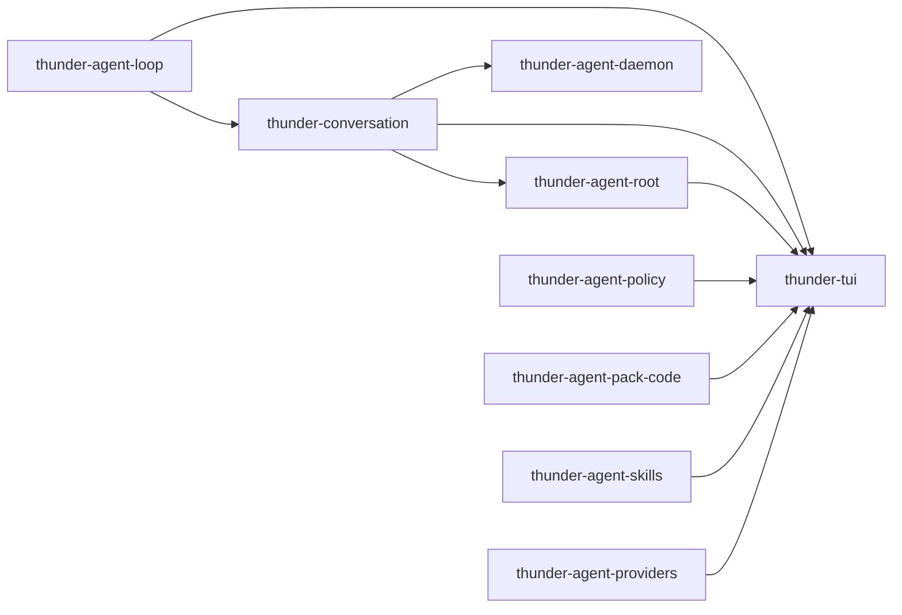

[English](README_en.md) | [简体中文](README.md)

# thunder-agent-core

工作区分组目录，**不是**一个 Cargo 包：它没有自己的 `Cargo.toml`，只容纳两个 workspace 成员——会话层与终端宿主。

## 定位

仓库按层划分：线格式（`thunder-agent-types`）→ 内核（`thunder-agent-loop`）→ 工具与治理（`thunder-agent-policy`）→ 能力包（`pack-code` / `skills` / `mcp` / `providers`）→ 宿主装配（`thunder-agent-root`）→ 宿主（`thunder-agent-daemon`、本目录下的 `tui`）。本目录放的是与宿主形态无关的两块：

| 成员 | 包名 | 层 | 二进制 |
|---|---|---|---|
| `conversation/` | `thunder-conversation` | 会话状态，直接建在内核之上 | 无（库） |
| `tui/` | `thunder-tui` | 交互式终端宿主 | `thunder-tui` |

两者互不依赖：TUI 通过 `thunder-conversation` 持久化会话，而 conversation 不知道终端的存在。

## crate 边界



- `thunder-conversation` 只依赖 `thunder-agent-loop`；被 `thunder-agent-root`（feature `conversation`，默认开启）、`thunder-agent-daemon`、`thunder-tui` 使用。
- `thunder-tui` 依赖 `types` / `policy` / `loop` / `pack-code` / `conversation` / `skills` / `mcp` / `root` / `providers`，是仓库里依赖面最宽的成员——这是宿主装配的固有成本。
- 两个成员都在根 `Cargo.toml` 的 `members` 中，使用 `version.workspace = true` 等继承字段。

## 各自职责

| 能力 | 归属 |
|---|---|
| 会话实体、存储、标题占位、轮次切分、压缩、导出 | `conversation` |
| 事件循环、按键处理、渲染、斜杠命令、OSC 7501 状态上报 | `tui` |
| 模型调用、工具实现、宿主装配 | 其他成员，本目录不重复实现 |

## 构建与运行

```bash
cargo build -p thunder-conversation -p thunder-tui
cargo test  -p thunder-conversation -p thunder-tui
cargo run   -p thunder-tui -- --workspace <dir> [--session <id>]
```

CI 口径：`cargo fmt --all -- --check`、`cargo clippy --workspace --all-targets --features thunder-agent-daemon/testing-mock -- -D warnings`、`cargo test --workspace`。

TUI 没有 mock 模式：`--mock` 会以退出码 2 拒绝执行，缺少可用模型时以退出码 1 退出。

## 文档

- [conversation](conversation/README.md)：会话模型与 `FsConversationStore` 的原子写入、持久化闸门、并发合并。
- [tui](tui/README.md)：事件/渲染循环、两种执行模式、31 条斜杠命令、状态上报。
- [tui/KEYBOARD.md](tui/KEYBOARD.md)：按键与动作对照表。
