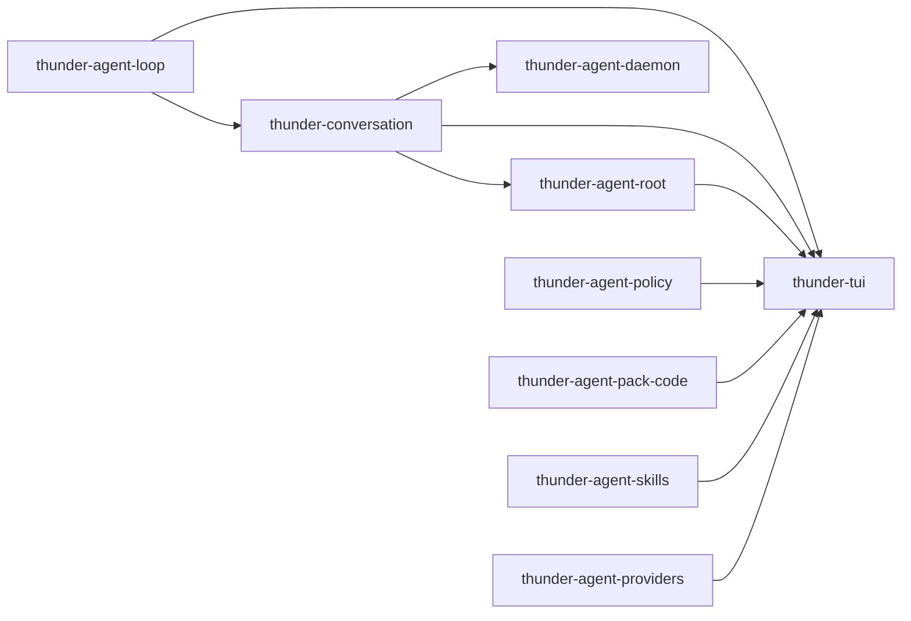

[English](README_en.md) | [简体中文](README.md)

# thunder-agent-core

A workspace grouping directory, **not** a Cargo package: it has no `Cargo.toml` of its own and only holds two workspace members — the session layer and the terminal host.

## Role

The repository is layered: wire format (`thunder-agent-types`) → kernel (`thunder-agent-loop`) → tools and governance (`thunder-agent-policy`) → capability packs (`pack-code` / `skills` / `mcp` / `providers`) → host assembly (`thunder-agent-root`) → hosts (`thunder-agent-daemon`, and `tui` in this directory). This directory holds the two pieces that are not tied to a host shape:

| Member | Package | Layer | Binary |
|---|---|---|---|
| `conversation/` | `thunder-conversation` | Session state, built directly on the kernel | none (library) |
| `tui/` | `thunder-tui` | Interactive terminal host | `thunder-tui` |

Neither depends on the other's internals: the TUI persists sessions through `thunder-conversation`, and conversation does not know a terminal exists.

## Crate boundary



- `thunder-conversation` depends only on `thunder-agent-loop`; it is used by `thunder-agent-root` (feature `conversation`, on by default), `thunder-agent-daemon` and `thunder-tui`.
- `thunder-tui` depends on `types` / `policy` / `loop` / `pack-code` / `conversation` / `skills` / `mcp` / `root` / `providers` — the widest dependency surface in the workspace, which is the inherent cost of host assembly.
- Both members are listed in the root `Cargo.toml` `members` and inherit `version.workspace = true` and friends.

## Responsibilities

| Capability | Owner |
|---|---|
| Session entity, stores, title placeholders, turn splitting, compaction, export | `conversation` |
| Event loop, key handling, rendering, slash commands, OSC 7501 status reporting | `tui` |
| Model transport, tool implementations, host assembly | Other members; nothing here re-implements them |

## Build and run

```bash
cargo build -p thunder-conversation -p thunder-tui
cargo test  -p thunder-conversation -p thunder-tui
cargo run   -p thunder-tui -- --workspace <dir> [--session <id>]
```

CI: `cargo fmt --all -- --check`, `cargo clippy --workspace --all-targets --features thunder-agent-daemon/testing-mock -- -D warnings`, `cargo test --workspace`.

The TUI has no mock mode: `--mock` is rejected with exit code 2, and a missing usable model exits with code 1.

## Documentation

- [conversation](conversation/README_en.md): session model, atomic `FsConversationStore` writes, the durability gate, concurrent index merging.
- [tui](tui/README_en.md): event/render loop, the two execution modes, all 31 slash commands, status reporting.
- [tui/KEYBOARD.md](tui/KEYBOARD_en.md): key-to-action reference.
