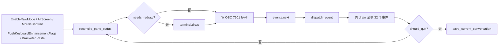
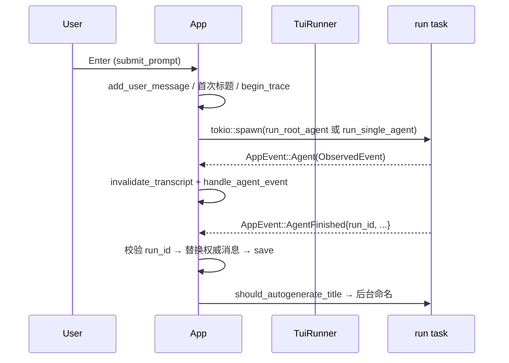

[English](README_en.md) | [简体中文](README.md)

# thunder-tui

Thunder 的交互式终端宿主：一个 ratatui/crossterm 全屏应用，把内核的事件流变成可读的对话、可点的链接、可暂停的运行。

## 定位

仓库里唯一直接面向人的前端。它同时承担两类职责：

- **宿主装配**：决定一次运行带哪些提示词段、工具包、观察者，并把用户界面（审批弹窗、提问弹窗）注入内核。
- **终端界面**：按键处理、渲染、斜杠命令、会话持久化、状态上报。

内核（循环、上下文、压缩、事件）在 `thunder-agent-loop`；工具与执行漏斗在 `thunder-agent-policy`；装配原语在 `thunder-agent-root`。本 crate 不实现模型传输、不实现工具。

## crate 边界

依赖（`Cargo.toml`）：

| 依赖 | 用途 |
|---|---|
| `thunder-agent-types` | `ToolScope`、工具定义等线类型 |
| `thunder-agent-policy` | `ToolRegistry`、`ToolExecutor`、`ToolGate`、`HostUi`、`AgentTool`、`StaticToolsFactory` |
| `thunder-agent-loop` | `AgentLoop`、`AgentConfig`、`ObservedEvent`、`ChatMessage`、`PauseGate`、`SteerQueues`、`paths` |
| `thunder-agent-pack-code` | 内置工具（read/grep/find/list/write/bash）、`CodeScope`、`autonomous_system_prompt` |
| `thunder-conversation` | `Conversation`、`FsConversationStore`、`MemoryConversationStore` |
| `thunder-agent-skills` | `SkillsPlugin`、`Skill`、`SkillHandle`、prompt 模板 |
| `thunder-agent-mcp` | MCP 客户端与工具（经 `StandardHostBuilder` 装配） |
| `thunder-agent-root` | `ThunderRoot`、`StandardHostBuilder`、`ToolPack`、`RootRunOptions`、`ModePlugin`、`StatusPlugin` |
| `thunder-agent-providers` | `ProviderRegistry`、`ModelRef`、`client_for_selection`、`naming` |
| `ratatui` / `crossterm` / `unicode-width` | 渲染与终端事件 |

没有 workspace 成员依赖 `thunder-tui`——它是终端产物，只由 `run.sh` 以 `cargo build -p thunder-tui --bin thunder-tui` 构建，产物名 `thunder-tui`。

## 启动

```
thunder-tui [--workspace <dir>] [--session <id>]
```

| 输入 | 行为 |
|---|---|
| `--workspace <dir>` | 工作区根，优先于 `THUNDER_WORKSPACE`，再退回当前目录；必须是已存在的目录，否则退出码 2 |
| `--session <id>` | 启动后加载该会话 |
| `--mock` | 已移除，显式拒绝并以退出码 2 退出 |
| `MODEL` 环境变量 | 指定模型，否则取 provider 列表里第一个可用项；都没有时退出码 1 |

启动顺序（`src/main.rs`）：初始化日志 → 载入 `ProviderRegistry::load_default()` → `App::new(model)` → 挂 `FsConversationStore::default_store_root()` 与 registry → 解析工作区 → `save_current_conversation()`（无用户轮时是 no-op）→ 可选加载 `--session` → `TuiRunner::new(50)`。

日志写到 `<配置目录>/logs/tui.log`（`$THUNDER_CONFIG_DIR` 或 `~/.thunder`），默认级别 `warn`，`RUST_LOG` 覆盖。不写 stdout：备用屏幕归渲染循环所有。

## 事件与渲染循环

`src/event.rs` 提供 `AppEvent` 与 `EventHandler`：

- 一个专用 OS 线程阻塞在 `crossterm::event::read()`，按键一落地就入队；鼠标移动事件在队列里已有未消费的移动事件时被丢弃。
- 一个 tokio 任务按 tick 速率（`TuiRunner::new(50)` → 50ms）发送 `AppEvent::Tick`。
- 事件类型：`Key` / `Mouse` / `Paste` / `Resize` / `Tick` / `Agent(ObservedEvent)` / `AgentFinished` / `UserQuestion` / `TitleGenerated` / `LoadSession` / `SessionDeleted` / `OpenPicker`。

`src/runner.rs` 的主循环：



- 渲染由 `needs_redraw` 门控，空闲终端不重绘；`Tick` 只在有动画（运行中、暂停、队列非空、临时状态行未过期）时置脏。
- 一帧处理完成后最多再同步处理 32 个排队事件，避免流式 token 每个都触发一次全量重绘。
- 退出时先发「离开」状态（`PaneStatus::leaving()`），再恢复终端；panic hook 同样恢复终端并 `tracing::error!` 留证。
- 键盘增强协议（`DISAMBIGUATE_ESCAPE_CODES`）无条件推送，避免查询支持度导致最长 2 秒的启动停顿；不支持该协议的终端用 `Ctrl+J` 换行。

一次典型运行：



## 两种执行模式

`ExecutionMode`（`src/app.rs`）只有两个值，默认 `AutoRouter`。切换：`Ctrl+P`、`/topology auto|single`，或提示词前缀 `/auto ` / `/single `（`submit_prompt` 里剥离前缀，不进入用户消息）。

两者是**能力差异，不是风格差异**：

| | `AutoRouter`（默认） | `SingleAgent` |
|---|---|---|
| 入口 | `run_root_agent` | `run_single_agent` |
| 是否构建 `ThunderRoot` | 是 | **否** |
| 装配方式 | `StandardHostBuilder::new(Arc::new(MemoryConversationStore::new())).with_skills(..).with_status_plugin(..).build(ThunderRoot…)` | 手工搭 `AgentLoop` + `ToolRegistry` + `ToolExecutor` |
| 提示词段 | conversation / memory / skills / mcp / web 等段的合并结果 | `conversation.system_prompt`，否则 `autonomous_system_prompt(Default::default())`；激活技能时仅追加其片段 |
| 工具 | 上文各插件包提供的全部工具 + `ASK_USER_PACK_ID` 提问包（`/ask on` 时） | `ReadFileTool` / `GrepTool` / `FindTool` / `ListDirTool` / `WriteFileTool` / `BashTool`（均绑定工作区）+ `mode_plugin.tools()` |
| 长期记忆注入 | 有（`MemoryPlugin`） | 无 |
| MCP 工具 | 有（`McpPlugin`） | 无 |
| 技能工具（`SkillsPlugin::tools()`） | 有 | 无 |
| `web_fetch` | 有（`WebPlugin`） | 无 |
| 指标 / 状态插件 | 由 root 装配 | 无指标插件；`StatusPlugin` 由 App 直接驱动 |
| 执行轨迹归属 | `RootRunOptions.route` = 本次 run id | `config.route` = 本次 run id |

即：`SingleAgent` 是一条降级通路，只保留「读、搜、列、写、跑命令 + 模式判定」。需要 MCP、技能工具、`web_fetch`、长期记忆或宿主提示词段的场景必须用 `AutoRouter`。

`RootRunOptions` 实际传入的字段（`run_root_agent`）：`session_id`、`custom_client`（测试注入）、`cancellation_token`、`register_builtins: true`、`thinking_level: None`、`mode`（`mode_plugin.mode()` 快照）、`mode_plugin`、`pause_gate`、`steer_queues`、`ui = TuiHostUi`、`route`、`render_capabilities: Default::default()`（终端预览不画图表）。

## 斜杠命令（31 条）

定义在 `src/commands.rs` 的 `ALL_COMMANDS`，共 31 条。`filter_commands` 按前缀匹配命令名与别名，`lookup_command` 解析单个 token，`arg_context` / `arg_cycle` 只为**第一个参数**提供固定候选值（`arg_options`，用 Tab / Shift+Tab / ↑ / ↓ 循环）。`/help` 与命令弹窗直接读这张表。

| 命令 | 别名 | 参数 | 类别 | 作用 |
|---|---|---|---|---|
| `resume` | `load_session` `switch` `sessions` | `[session_id \| #]` | Session | 列出会话或按 ID / 序号恢复 |
| `help` | `?` | — | General | 命令与快捷键参考 |
| `model` | `m` | `[provider/model]` | Config | 查看或切换模型 |
| `topology` | — | `[auto \| single]` | Config | 切换执行模式 |
| `mode` | — | `[plan \| ask \| acceptEdits \| yolo]` | Config | 查看或设置本会话的工具审批模式 |
| `think` | `thinking` | `[off \| low \| medium \| high]` | Config | 查看或设置推理强度 |
| `roots` | `root` `shared` | `[add <path> \| remove <p\|#> \| clear]` | Config | 增删附加工作区根 |
| `ask` | `ask_user` | `[on \| off]` | Config | 挂载 / 卸载 `ask_user_question` 工具 |
| `pause` | `hold` | — | General | 在下一个工具边界暂停运行 |
| `unpause` | `go` `continue` | — | General | 恢复被暂停的运行 |
| `image` | `attach` `img` | `<path> [path...]` | General | 为下一条提示附加本地图片 |
| `skills` | `skill` `sk` | `[attach \| load <name> \| show <name> \| off]` | Skills & MCP | 附加技能、查看 playbook、卸载 |
| `mcp` | `server` `tools` | `[list \| servers \| reload]` | Skills & MCP | 查看 MCP 服务器与远端工具 |
| `trace` | `traces` | `[list \| <task_id>]` | Session | 查看本会话的运行轨迹 |
| `rename` | — | `[name \| --auto]` | Session | 重命名会话，`--auto` 重新生成 |
| `prompt` | `prompts` `template` | `[list \| show <name> \| run <name> [args]]` | General | 浏览 `.thunder/prompts/` 下的提示模板 |
| `memory` | `mem` | `[list \| show <file>]` | Session | 列出注入系统提示的记忆文件 |
| `clear` | `new` `reset` | — | Session | 清空消息并开新会话 |
| `config` | `settings` `cfg` | `[key] [value]` | Config | 查看或修改运行参数 |
| `compact` | `prune` `compress` | — | Session | 压缩历史、裁剪上下文 token |
| `stats` | `cost` `tokens` `usage` | — | Session | 轮次、token 估算与工具统计 |
| `workspace` | `cwd` `dir` | `[path]` | Config | 查看或切换工作目录 |
| `export` | `save` `dump` | `[path]` | Session | 导出为 Markdown |
| `preview` | `md` `rich` | `[on \| off]` | General | 切换 Markdown 渲染与原文 |
| `links` | `urls` `files` | — | Session | 列出本会话的链接与文件路径 |
| `queue` | `queued` `pending` | `[clear \| all \| one]` | General | 查看 / 管理排队消息 |
| `metrics` | `meters` | `[on \| off]` | General | 显示或隐藏指标条 |
| `timeline` | `rail` | `[on \| off]` | General | 显示或隐藏右侧轮次导轨 |
| `details` | `verbose` | `[on \| off]` | General | 展开 / 折叠思考与工具细节 |
| `health` | `doctor` `status` | — | General | 运行环境与 agent 健康检查 |
| `quit` | `exit` `q` | — | General | 干净退出 |

第一参数候选值（`with_args`）：`topology` = `auto,single`；`mode` = `plan,ask,acceptEdits,yolo`；`think` = `off,low,medium,high`；`roots` = `add,remove,clear`；`ask` = `on,off`；`skills` = `off,load,show,scan`；`mcp` = `list,servers,reload`；`trace` = `list`；`prompt` = `list`；`memory` = `list`；`preview` / `metrics` / `timeline` / `details` = `on,off`；`queue` = `clear,all,one`。

`/config` 可写的键（`execute_slash_command` 的 `"config"` 分支）：`model`、`temperature`（`temp`）、`max_turns`（`turns`，必须 ≥ 1）、`timeout` / `timeout_ms`。

## 界面组成

`src/ui/mod.rs::draw` 的纵向布局（自上而下）：

| 行 | 内容 | 模块 |
|---|---|---|
| 1 行 | 状态徽标（IDLE / THINKING / STREAMING / `[⚙ tool]` / STOPPING / DONE / ERROR）、模型与推理级别、执行模式 | `ui/header.rs` |
| `Min(4)` | 对话流：Markdown 预览、思考块、工具调用摘要、实时增量 | `ui/chat.rs` + `ui/markdown.rs` |
| 指标条 | 工作区、模型、`think:`、上下文占用 / 窗口（≥80% 标红）、tok/s、cache、累计用量、本轮 In/Out、耗时 | `ui/metrics.rs` |
| 输入框 | `❯ ` 前缀，随内容增高，最多 `MAX_INPUT_ROWS = 6` 行后内部滚动，上下各 1 行留白 | `ui/status_bar.rs` |
| 页脚 | 4 秒内有效的临时状态消息；无消息时不占行 | `ui/status_bar.rs` |

覆盖层与侧栏：`Ctrl+B` 打开会话侧栏（`ui/sidebar.rs`），`Ctrl+H` 打开帮助弹窗（`ui/help.rs`），`Tab` 在 Input → Chat → Sidebar / 轮次导轨之间循环。导轨（`ui/timeline.rs`）是浮在右侧的轮次索引，宽度 7 列（两位数轮次）、高度 5–20 行，点击刻度跳到该轮。

指标条按重要性顺序构建（工作区 → 模型 → 推理级别 → 上下文 → 速度 → 缓存 → 累计 → 本轮 → 耗时），窄终端从末尾开始丢段并允许换行；`/metrics off` 直接让出这几行。

## Markdown 与链接

`ui/markdown.rs` 是**预览渲染器**，不是 CommonMark 实现：流式半截语法（`**bo`、未闭合围栏）退化为纯文本而不是让整条消息重排；换行自己算，保证每个 `Line` 恰好一行屏幕行，从而让滚动边界和链接坐标精确。代码块单行最多 3 行后接 `…`，表格单元格上限 40 列。

`src/links.rs` 处理模型输出里的可点目标，全部按不可信内容对待：

- 只有 `http` / `https` / `mailto` 会进浏览器；`javascript:`、`data:` 等一律丢弃。
- 本地路径只**在文件管理器中显示**，从不执行：macOS 用 `open -R`，其他平台用 `xdg-open` 打开父目录。相对路径先在 `workspace_roots()`（主工作区 + `extra_roots`）里解析成绝对路径，再交给 opener，避免以 `-` 开头的名字被当作参数。
- 命中区域由每帧渲染重建（`LinkHitbox`），随换行与滚动变化；点在同一行但没点中时给出行内起始列而不是静默。
- `Ctrl+L` / `/links` 不依赖鼠标：把会话中出现的链接与路径收集进 picker。

## 会话切换守卫

任何整体替换 `self.conversation` 的操作（加载会话、`/clear`、`Ctrl+N`）先过 `refuse_session_switch_while_running()`：`cancel_token` 存在或状态仍是运行态时拒绝，并提示先 `Ctrl+C`。`cancel_token` 比状态活得更久——它覆盖 `stop_run` 到引擎真正结算之间的那段窗口。

`run_id` 是第二道闸。每次 `begin_trace` 生成 `run_<ms>` 写入 `active_run_id`，同一个 id 作为 `RootRunOptions.route` / `config.route` 与轨迹文件名；`AgentFinished` 带回它，`handle_agent_finished`：

- id 与 `active_run_id` 相同 → 应用结果；
- id 不同或 `active_run_id` 为 `None` → 丢弃（被取代的运行 / 迟到的结算）；
- 没有 id（斜杠命令合成的完成）→ 只显示文本，不动运行状态；若此时确有运行在跑，连文本替换都不做。

`clear_run_state` 还会把未回答的提问弹窗按 `Null` 结算，避免 UI 对着死通道。

## 提问与审批

- `src/ask_user.rs`：`TuiAskUserTool` 把 `ask_user_question` 的调用变成 `AppEvent::UserQuestion`，park 在 oneshot 上直到用户作答（默认超时 `1800` 秒），再把答案作为工具结果返回；`PendingQuestion` 负责多问题队列与多选。
- `TuiHostUi` 实现 `HostUi`，让 `mode: ask` / 人工审批弹窗以交互模态出现，而不是失败关闭。
- 两种执行模式共用同一个 `ModePlugin` 实例：`/mode` 中途切换对正在跑的运行同样生效。

## 状态上报（OSC 7501）

`src/pane_status.rs` 让只有 pty 字节可看的外层面板知道本程序在做什么，不需要 socket 或握手。

| 项 | 值 |
|---|---|
| 序列 | `ESC ] 7501 ;` + body + `ESC \` |
| body | `app=thunder:state=<state>[:kind=<tool>]` |
| `state` | `idle` / `working` / `blocked` / `done` / `error` / `clear` |
| 相位映射 | Idle→`idle`；Thinking / Streaming / Tool / Compacting→`working`；AwaitingUser / Paused→`blocked`；Done→`done`；Error→`error` |
| `kind` | 工具名，仅当字符集合法（字母数字与 `_.+,/=-`）时附带；否则只丢这一对 |
| 发送时机 | 报告内容变化时；每帧 `reconcile_pane_status` 读同一个 `StatusPlugin` 快照 |
| 退出 | `leaving()` 发 `app=thunder:state=idle`；从未上报过的进程保持沉默 |

约束来自消费方解析器：不带 `id=` 键、`state` 属于闭集、单个序列不超过 4096 字节。

## 默认配置

| 项 | 默认值 | 位置 / 来源 |
|---|---|---|
| `execution_mode` | `AutoRouter` | `App::new` |
| `temperature` | `0.2` | `App::new`，`/config temperature` |
| `max_turns` | `30` | `App::new`，`/config max_turns`，作为 `AgentConfig::with_max_turns` 的初值 |
| `request_timeout_ms` | `120_000` | `App::new`，`/config timeout_ms` |
| `ask_user_enabled` | `true` | `App::new`，`/ask off` |
| `markdown_enabled` | `true` | `App::new`，`/preview off` |
| `timeline_visible` | `true` | `App::new`，`Ctrl+T` / `/timeline` |
| `details_expanded` | `false` | `App::new`，`Ctrl+O` / `/details` |
| `show_sidebar` | `false` | `App::new`，`Ctrl+B` |
| tick 速率 | `50ms` | `TuiRunner::new(50)` |
| 会话存储根 | `$THUNDER_CONFIG_DIR/conversations` 或 `~/.thunder/conversations` | `FsConversationStore::default_store_root()` |
| `pruning.max_context_tokens` | 模型的 `context_window` | `run_*_agent` 中按 `ProviderRegistry::resolve` 结果设置 |
| `prompt_cache_warm` | 模型声明了 cache 生命周期与价格时启用 | `spec.prompt_cache_warm_settings(..)` |
| 轨迹文件 | `<store_root>/<session>/traces/<task_id>.json` | `save_task_trace`（与 daemon 同布局） |

## 失败方向

| 场景 | 行为 |
|---|---|
| 无模型可用 | stderr 提示 + 退出码 1 |
| `--mock` | stderr 提示 + 退出码 2 |
| `--workspace` 缺值 / 不是已存在目录 | 退出码 2（不静默退回 cwd） |
| 无 provider 凭证 | 启动继续，仅打印警告；运行期失败按错误处理 |
| 单智能体模式拿不到客户端 | 立即以 `AgentFinished{success:false}` 说明原因，不让运行带着未配置客户端继续 |
| 运行中切换会话 / 新建 | 拒绝并提示先 `Ctrl+C` |
| 面板状态上报被解析器丢弃 | 只丢 `kind=` 或整条报告，不影响运行 |
| 日志文件打不开 | 继续运行（面板是产品，日志只是证据） |
| panic | hook 恢复终端后 `tracing::error!`，再执行默认 hook |

## 测试

`tests/` 下 22 个集成测试文件，覆盖渲染（`chrome_test`、`input_box_test`、`metrics_bar_test`、`timeline_test`）、输入与命令（`slash_commands_test`、`arg_popup_test`、`prompt_command_test`、`rename_mode_test`）、运行控制（`tui_run_control_test`、`tui_run_flow_test`、`run_lifecycle_guard_test`）、会话（`empty_session_test`、`session_footer_test`）、链接与 Markdown（`chat_links_test`、`markdown_preview_test`）、滚动与缓存（`chat_scroll_test`、`transcript_cache_test`、`transcript_order_test`）、状态上报（`pane_status_test`）等。`./test.sh` 等于 `cargo test`。

## 扩展点

- 新斜杠命令：在 `ALL_COMMANDS` 增加一条 `SlashCommand::new(..).with_args(..)`，再在 `execute_slash_command` 里匹配同名 token（别名也要出现在 match 分支里）。`/help` 与弹窗自动跟上。
- 新按键：`App::handle_key` 的全局段或对应 pane 的 `handle_*_key`；先想清楚哪个模态优先（提问 → picker → 帮助 → 全局 → pane）。
- 新面板：在 `ui/mod.rs::draw` 的布局里加约束，并把高度计算放在对应模块，让渲染与布局共用同一个函数。
- 新链接动作：`links.rs` 的 `LinkTarget` + `App::launch_link`；`link_opener` 可注入，便于测试断言整条点击路径。
- 新执行模式：`ExecutionMode` 加值会牵动 `badge` / `description` / `next`、`submit_prompt` 的分派，以及 `RootRunOptions` 的构造——这是一个真实的产品决策，不是配置项。
