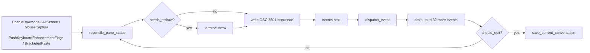
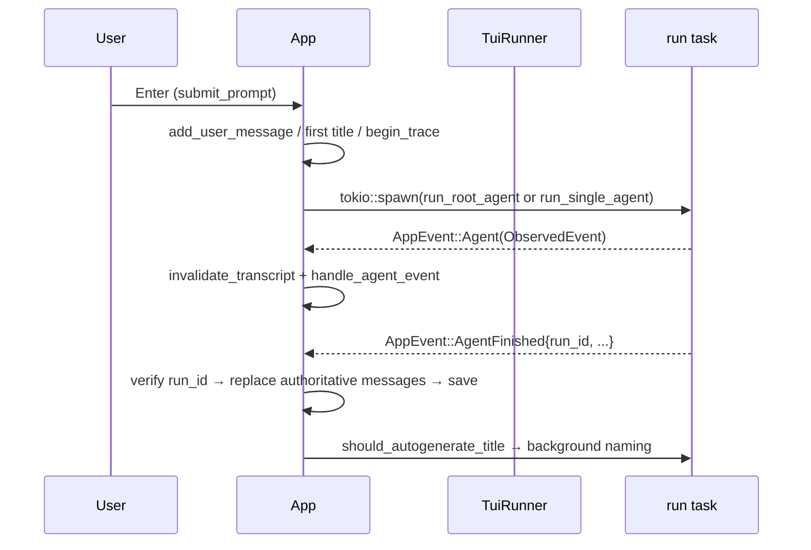

[English](README_en.md) | [简体中文](README.md)

# thunder-tui

Thunder's interactive terminal host: a full-screen ratatui/crossterm application that turns the kernel's event stream into a readable conversation, clickable links and a pausable run.

## Role

The only human-facing front end in the workspace. It carries two jobs at once:

- **Host assembly**: decide which prompt sections, tool packs and observers one run carries, and inject the user-facing surfaces (approval dialog, question modal) into the kernel.
- **Terminal UI**: key handling, rendering, slash commands, session persistence, status reporting.

The kernel (loop, context, compaction, events) lives in `thunder-agent-loop`; tools and the execution funnel in `thunder-agent-policy`; the assembly primitives in `thunder-agent-root`. This crate implements neither model transport nor tools.

## Crate boundary

Dependencies (`Cargo.toml`):

| Dependency | Purpose |
|---|---|
| `thunder-agent-types` | Wire types such as `ToolScope` and tool definitions |
| `thunder-agent-policy` | `ToolRegistry`, `ToolExecutor`, `ToolGate`, `HostUi`, `AgentTool`, `StaticToolsFactory` |
| `thunder-agent-loop` | `AgentLoop`, `AgentConfig`, `ObservedEvent`, `ChatMessage`, `PauseGate`, `SteerQueues`, `paths` |
| `thunder-agent-pack-code` | Built-in tools (read/grep/find/list/write/bash), `CodeScope`, `autonomous_system_prompt` |
| `thunder-conversation` | `Conversation`, `FsConversationStore`, `MemoryConversationStore` |
| `thunder-agent-skills` | `SkillsPlugin`, `Skill`, `SkillHandle`, prompt templates |
| `thunder-agent-mcp` | MCP client and tools (assembled through `StandardHostBuilder`) |
| `thunder-agent-root` | `ThunderRoot`, `StandardHostBuilder`, `ToolPack`, `RootRunOptions`, `ModePlugin`, `StatusPlugin` |
| `thunder-agent-providers` | `ProviderRegistry`, `ModelRef`, `client_for_selection`, `naming` |
| `ratatui` / `crossterm` / `unicode-width` | Rendering and terminal events |

No workspace member depends on `thunder-tui` — it is a terminal artifact, built by `run.sh` as `cargo build -p thunder-tui --bin thunder-tui`; the binary is named `thunder-tui`.

## Startup

```
thunder-tui [--workspace <dir>] [--session <id>]
```

| Input | Behaviour |
|---|---|
| `--workspace <dir>` | Workspace root; beats `THUNDER_WORKSPACE`, which beats the current directory. Must be an existing directory, otherwise exit code 2 |
| `--session <id>` | Load that session after startup |
| `--mock` | Removed; explicitly rejected with exit code 2 |
| `MODEL` env var | Selects the model; otherwise the first available provider entry is used. With neither, exit code 1 |

Startup order (`src/main.rs`): init logging → `ProviderRegistry::load_default()` → `App::new(model)` → attach `FsConversationStore::default_store_root()` and the registry → resolve the workspace → `save_current_conversation()` (a no-op without a user turn) → optionally load `--session` → `TuiRunner::new(50)`.

Logs go to `<config dir>/logs/tui.log` (`$THUNDER_CONFIG_DIR` or `~/.thunder`), default level `warn`, overridable with `RUST_LOG`. Never stdout: the alternate screen belongs to the render loop.

## Event and render loop

`src/event.rs` provides `AppEvent` and `EventHandler`:

- A dedicated OS thread blocks in `crossterm::event::read()`, so a keystroke is queued the moment it lands; a mouse-move event is dropped when an unconsumed move is already queued.
- A tokio task emits `AppEvent::Tick` at the tick rate (`TuiRunner::new(50)` → 50 ms).
- Event kinds: `Key` / `Mouse` / `Paste` / `Resize` / `Tick` / `Agent(ObservedEvent)` / `AgentFinished` / `UserQuestion` / `TitleGenerated` / `LoadSession` / `SessionDeleted` / `OpenPicker`.

The main loop in `src/runner.rs`:



- Drawing is gated on `needs_redraw`, so an idle terminal costs nothing; `Tick` only marks dirty while something animates (a live run, a pause, a non-empty queue, a status line still inside its display window).
- After a frame, up to 32 queued events are dispatched synchronously so streaming tokens do not each trigger a full redraw.
- On exit the "leaving" status is written first (`PaneStatus::leaving()`), then the terminal is restored; the panic hook restores it too and leaves a `tracing::error!` record.
- Keyboard enhancement (`DISAMBIGUATE_ESCAPE_CODES`) is pushed unconditionally to avoid a support query that can stall startup for up to two seconds; terminals without the protocol use `Ctrl+J` for a newline.

A typical run:



## The two execution modes

`ExecutionMode` (`src/app.rs`) has exactly two values, defaulting to `AutoRouter`. Switch with `Ctrl+P`, `/topology auto|single`, or a prompt prefix `/auto ` / `/single ` (`submit_prompt` strips the prefix; it does not enter the user message).

They are a **capability difference, not a style choice**:

| | `AutoRouter` (default) | `SingleAgent` |
|---|---|---|
| Entry | `run_root_agent` | `run_single_agent` |
| Builds a `ThunderRoot` | yes | **no** |
| Assembly | `StandardHostBuilder::new(Arc::new(MemoryConversationStore::new())).with_skills(..).with_status_plugin(..).build(ThunderRoot…)` | hand-wires `AgentLoop` + `ToolRegistry` + `ToolExecutor` |
| Prompt | the merged conversation / memory / skills / mcp / web sections | `conversation.system_prompt`, else `autonomous_system_prompt(Default::default())`; an active skill only appends its fragment |
| Tools | everything the packs above provide, plus the `ASK_USER_PACK_ID` pack when `/ask on` | `ReadFileTool` / `GrepTool` / `FindTool` / `ListDirTool` / `WriteFileTool` / `BashTool` (all bound to the workspace) + `mode_plugin.tools()` |
| Long-term memory injection | yes (`MemoryPlugin`) | no |
| MCP tools | yes (`McpPlugin`) | no |
| Skill tools (`SkillsPlugin::tools()`) | yes | no |
| `web_fetch` | yes (`WebPlugin`) | no |
| Metrics / status plugins | assembled by the root | no metrics plugin; the App drives `StatusPlugin` itself |
| Trace attribution | `RootRunOptions.route` = this run's id | `config.route` = this run's id |

In other words, `SingleAgent` is a reduced path that keeps only "read, search, list, write, run a command + mode judgement". Anything needing MCP, skill tools, `web_fetch`, long-term memory or host prompt sections requires `AutoRouter`.

`RootRunOptions` as actually passed (`run_root_agent`): `session_id`, `custom_client` (test injection), `cancellation_token`, `register_builtins: true`, `thinking_level: None`, `mode` (snapshot of `mode_plugin.mode()`), `mode_plugin`, `pause_gate`, `steer_queues`, `ui = TuiHostUi`, `route`, `render_capabilities: Default::default()` (the terminal preview draws no diagrams).

## Slash commands (31)

Defined in `ALL_COMMANDS` in `src/commands.rs` — 31 entries. `filter_commands` prefix-matches names and aliases, `lookup_command` resolves a token, and `arg_context` / `arg_cycle` give the **first argument only** a fixed candidate set (`arg_options`, cycled with Tab / Shift+Tab / ↑ / ↓). `/help` and the command popup read this table directly.

| Command | Aliases | Arguments | Category | Action |
|---|---|---|---|---|
| `resume` | `load_session` `switch` `sessions` | `[session_id \| #]` | Session | List sessions, or resume by id / index |
| `help` | `?` | — | General | Command and shortcut reference |
| `model` | `m` | `[provider/model]` | Config | Show or switch the model |
| `topology` | — | `[auto \| single]` | Config | Switch execution mode |
| `mode` | — | `[plan \| ask \| acceptEdits \| yolo]` | Config | Show or set this session's tool approval mode |
| `think` | `thinking` | `[off \| low \| medium \| high]` | Config | Show or set reasoning effort |
| `roots` | `root` `shared` | `[add <path> \| remove <p\|#> \| clear]` | Config | Add or revoke extra workspace roots |
| `ask` | `ask_user` | `[on \| off]` | Config | Mount / unmount the `ask_user_question` tool |
| `pause` | `hold` | — | General | Pause the run at the next tool boundary |
| `unpause` | `go` `continue` | — | General | Resume a paused run |
| `image` | `attach` `img` | `<path> [path...]` | General | Attach local images to the next prompt |
| `skills` | `skill` `sk` | `[attach \| load <name> \| show <name> \| off]` | Skills & MCP | Attach a skill, show a playbook, detach |
| `mcp` | `server` `tools` | `[list \| servers \| reload]` | Skills & MCP | Inspect MCP servers and remote tools |
| `trace` | `traces` | `[list \| <task_id>]` | Session | Inspect this session's run traces |
| `rename` | — | `[name \| --auto]` | Session | Rename the session; `--auto` regenerates |
| `prompt` | `prompts` `template` | `[list \| show <name> \| run <name> [args]]` | General | Browse prompt templates under `.thunder/prompts/` |
| `memory` | `mem` | `[list \| show <file>]` | Session | List the memory files injected into the system prompt |
| `clear` | `new` `reset` | — | Session | Clear messages and start a fresh session |
| `config` | `settings` `cfg` | `[key] [value]` | Config | Show or modify runtime parameters |
| `compact` | `prune` `compress` | — | Session | Compact history and prune context tokens |
| `stats` | `cost` `tokens` `usage` | — | Session | Turns, token estimates and tool stats |
| `workspace` | `cwd` `dir` | `[path]` | Config | Show or change the working directory |
| `export` | `save` `dump` | `[path]` | Session | Export to Markdown |
| `preview` | `md` `rich` | `[on \| off]` | General | Toggle rendered Markdown vs raw source |
| `links` | `urls` `files` | — | Session | List every link and file path in the session |
| `queue` | `queued` `pending` | `[clear \| all \| one]` | General | Inspect or manage queued messages |
| `metrics` | `meters` | `[on \| off]` | General | Show or hide the metrics bar |
| `timeline` | `rail` | `[on \| off]` | General | Show or hide the turn rail |
| `details` | `verbose` | `[on \| off]` | General | Expand or collapse thinking and tool output |
| `health` | `doctor` `status` | — | General | Run environment and agent health checks |
| `quit` | `exit` `q` | — | General | Exit cleanly |

First-argument candidates (`with_args`): `topology` = `auto,single`; `mode` = `plan,ask,acceptEdits,yolo`; `think` = `off,low,medium,high`; `roots` = `add,remove,clear`; `ask` = `on,off`; `skills` = `off,load,show,scan`; `mcp` = `list,servers,reload`; `trace` = `list`; `prompt` = `list`; `memory` = `list`; `preview` / `metrics` / `timeline` / `details` = `on,off`; `queue` = `clear,all,one`.

Writable `/config` keys (the `"config"` branch of `execute_slash_command`): `model`, `temperature` (`temp`), `max_turns` (`turns`, must be ≥ 1), `timeout` / `timeout_ms`.

## Screen anatomy

Vertical layout from `src/ui/mod.rs::draw`, top to bottom:

| Row | Content | Module |
|---|---|---|
| 1 row | Status badge (IDLE / THINKING / STREAMING / `[⚙ tool]` / STOPPING / DONE / ERROR), model and thinking level, execution mode | `ui/header.rs` |
| `Min(4)` | Dialogue stream: Markdown preview, thinking blocks, tool-call summaries, live deltas | `ui/chat.rs` + `ui/markdown.rs` |
| Metrics bar | Workspace, model, `think:`, context occupancy / window (red at ≥ 80%), tok/s, cache, cumulative usage, this turn's In/Out, elapsed | `ui/metrics.rs` |
| Input box | `❯ ` gutter, grows with content, scrolls internally past `MAX_INPUT_ROWS = 6`, with one blank row of padding above and below | `ui/status_bar.rs` |
| Footer | Transient status message while valid (4 s); takes no row otherwise | `ui/status_bar.rs` |

Overlays and side panes: `Ctrl+B` toggles the session sidebar (`ui/sidebar.rs`), `Ctrl+H` opens the help modal (`ui/help.rs`), and `Tab` cycles Input → Chat → Sidebar / turn rail. The rail (`ui/timeline.rs`) is a turn index floating on the right edge: 7 columns wide (two-digit turns), 5–20 rows tall, and clicking a tick jumps to that turn.

Metrics segments are built in priority order (workspace → model → thinking level → context → speed → cache → cumulative → this turn → elapsed); a narrow terminal drops from the end and may wrap. `/metrics off` returns those rows to the transcript.

## Markdown and links

`ui/markdown.rs` is a **preview renderer**, not a CommonMark implementation: a half-streamed construct (`**bo`, an unclosed fence) degrades to plain text instead of reflowing the whole message; wrapping is computed here so every `Line` is exactly one screen row, which is what makes the scroll bound and link coordinates exact. A fenced code line is capped at 3 rows before `…`, and table cells at 40 columns.

`src/links.rs` handles clickable targets in model output, all treated as untrusted:

- Only `http` / `https` / `mailto` reach a browser; `javascript:`, `data:` and the rest are dropped.
- Local paths are only **revealed**, never executed: `open -R` on macOS, `xdg-open` on the parent directory elsewhere. Relative paths are resolved to absolute against `workspace_roots()` (main workspace + `extra_roots`) before reaching the opener, so a name starting with `-` cannot be read as a flag.
- Hitboxes (`LinkHitbox`) are rebuilt by every render, so they follow wrapping and scroll. A click on the right row but the wrong column reports the line's start column instead of doing nothing.
- `Ctrl+L` / `/links` need no mouse: they collect every link and path in the session into the picker.

## Session-switch guard

Anything that replaces `self.conversation` wholesale (loading a session, `/clear`, `Ctrl+N`) first passes `refuse_session_switch_while_running()`: when `cancel_token` exists or the status is still a running state, it refuses and asks for `Ctrl+C` first. `cancel_token` outlives the status — it covers the window between `stop_run` and the engine actually settling.

`run_id` is the second guard. Every `begin_trace` mints `run_<ms>` into `active_run_id`, and the same id is used as `RootRunOptions.route` / `config.route` and as the trace filename. `AgentFinished` carries it back, and `handle_agent_finished`:

- id equals `active_run_id` → apply the result;
- a different id, or `active_run_id == None` → drop it (a superseded run / a late settle);
- no id (a slash-command completion) → display the text only, never touching run state; while a real run is active, not even the text is spliced into the transcript.

`clear_run_state` also resolves any unanswered question modal with `Null`, so the UI never waits on a dead channel.

## Questions and approvals

- `src/ask_user.rs`: `TuiAskUserTool` turns an `ask_user_question` call into `AppEvent::UserQuestion`, parks on a oneshot until the user answers (default timeout `1800` seconds), and returns the answer as the tool result; `PendingQuestion` owns the multi-question queue and multi-select state.
- `TuiHostUi` implements `HostUi`, so `mode: ask` and manual approvals appear as interactive modals instead of failing closed.
- Both execution modes share one `ModePlugin` instance: a mid-session `/mode` change applies to the run in flight too.

## Status reporting (OSC 7501)

`src/pane_status.rs` lets an outer panel that only sees pty bytes know what this program is doing — no socket, no handshake.

| Item | Value |
|---|---|
| Sequence | `ESC ] 7501 ;` + body + `ESC \` |
| Body | `app=thunder:state=<state>[:kind=<tool>]` |
| `state` | `idle` / `working` / `blocked` / `done` / `error` / `clear` |
| Phase mapping | Idle→`idle`; Thinking / Streaming / Tool / Compacting→`working`; AwaitingUser / Paused→`blocked`; Done→`done`; Error→`error` |
| `kind` | The tool name, only when its characters are legal (alphanumerics and `_.+,/=-`); otherwise just that pair is dropped |
| When | Whenever the report changes; `reconcile_pane_status` reads the same `StatusPlugin` snapshot once per frame |
| Exit | `leaving()` emits `app=thunder:state=idle`; a process that never reported stays silent |

Constraints come from the consumer's parser: no `id=` key, `state` from a closed set, one sequence no longer than 4096 bytes.

## Defaults

| Item | Default | Where |
|---|---|---|
| `execution_mode` | `AutoRouter` | `App::new` |
| `temperature` | `0.2` | `App::new`, `/config temperature` |
| `max_turns` | `30` | `App::new`, `/config max_turns`; initial `AgentConfig::with_max_turns` |
| `request_timeout_ms` | `120_000` | `App::new`, `/config timeout_ms` |
| `ask_user_enabled` | `true` | `App::new`, `/ask off` |
| `markdown_enabled` | `true` | `App::new`, `/preview off` |
| `timeline_visible` | `true` | `App::new`, `Ctrl+T` / `/timeline` |
| `details_expanded` | `false` | `App::new`, `Ctrl+O` / `/details` |
| `show_sidebar` | `false` | `App::new`, `Ctrl+B` |
| Tick rate | `50 ms` | `TuiRunner::new(50)` |
| Store root | `$THUNDER_CONFIG_DIR/conversations` or `~/.thunder/conversations` | `FsConversationStore::default_store_root()` |
| `pruning.max_context_tokens` | the model's `context_window` | set in `run_*_agent` from `ProviderRegistry::resolve` |
| `prompt_cache_warm` | enabled when the model declares a cache lifetime and pricing | `spec.prompt_cache_warm_settings(..)` |
| Trace file | `<store_root>/<session>/traces/<task_id>.json` | `save_task_trace` (same layout as the daemon) |

## Failure directions

| Scenario | Behaviour |
|---|---|
| No usable model | stderr message, exit code 1 |
| `--mock` | stderr message, exit code 2 |
| `--workspace` without a value / not an existing directory | exit code 2 (never silently falls back to cwd) |
| No provider credentials | startup continues with a warning; failures surface at run time |
| Single-agent mode cannot resolve a client | immediate `AgentFinished{success:false}` explaining why; never runs on an unconfigured client |
| Session switch / new session during a run | refused, with a "stop first (Ctrl+C)" message |
| Pane report rejected by the consumer | only the `kind=` pair or the whole report is dropped; the run is unaffected |
| Log file cannot be opened | the TUI still runs (the panel is the product, the log is evidence) |
| Panic | the hook restores the terminal, logs `tracing::error!`, then runs the default hook |

## Tests

22 integration test files under `tests/` cover rendering (`chrome_test`, `input_box_test`, `metrics_bar_test`, `timeline_test`), input and commands (`slash_commands_test`, `arg_popup_test`, `prompt_command_test`, `rename_mode_test`), run control (`tui_run_control_test`, `tui_run_flow_test`, `run_lifecycle_guard_test`), sessions (`empty_session_test`, `session_footer_test`), links and Markdown (`chat_links_test`, `markdown_preview_test`), scrolling and caching (`chat_scroll_test`, `transcript_cache_test`, `transcript_order_test`), and status reporting (`pane_status_test`). `./test.sh` is `cargo test`.

## Extension points

- New slash command: add a `SlashCommand::new(..).with_args(..)` entry to `ALL_COMMANDS`, then match the same token in `execute_slash_command` (aliases need their own match arms). `/help` and the popup follow automatically.
- New key: the global arm of `App::handle_key`, or the relevant pane's `handle_*_key`. Decide precedence first (question modal → picker → help → global → pane).
- New pane: add a constraint in `ui/mod.rs::draw` and keep its height calculation in the same module as its renderer, so layout and render share one function.
- New link action: `LinkTarget` plus `App::launch_link`; `link_opener` is injectable so a test can assert the whole click path.
- New execution mode: adding an `ExecutionMode` value touches `badge` / `description` / `next`, the dispatch in `submit_prompt`, and the construction of `RootRunOptions` — a product decision, not a config knob.
