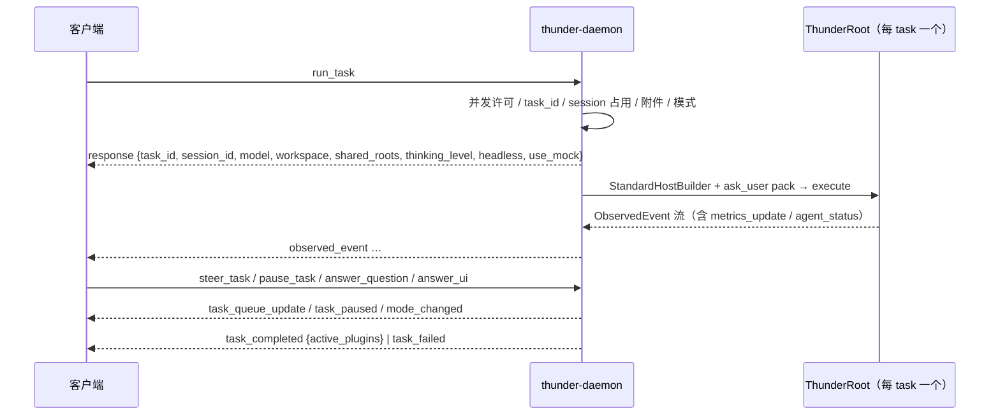

[English](README_en.md) | [简体中文](README.md)

# thunder-agent-daemon

STDIO sidecar：stdin 读 NDJSON 请求，stdout 写 NDJSON 响应与事件流，stderr 只放日志。二进制名 `thunder-daemon`。

## 定位

面向 Electron / 桌面面板 / headless 宿主的进程边界。它把「一个长驻进程 + 多个并发任务」翻译成 `thunder-agent-root` 的「一次 run 一个 `ThunderRoot`」：

- 协议层：`src/protocol.rs` 定义请求、响应与推送帧。
- 服务层：`src/service.rs` 持有会话、任务、模式、MCP 连接池、待答问题与 UI 对话框。
- 宿主实现：`src/ui.rs`（`HostUi`）、`src/ask_user.rs`（`ask_user_question` 工具包）、`src/attachments.rs`（图片准入）。

## crate 边界

| 依赖 | 用途 |
|---|---|
| `thunder-agent-root` | `ThunderRoot`、`StandardHostBuilder`、`ToolPack`、`ModePlugin`、metrics/status、`TraceCollector` |
| `thunder-agent-loop` | `AgentConfig`、`AgentEvent`、pause / steer |
| `thunder-agent-policy` | `HostUi`、`UiRequest` / `UiResponse` / `UiSource`、`AgentTool` |
| `thunder-agent-providers` | `ProviderRegistry`、`ModelDescriptor`、`RpiAiClient`、标题生成 |
| `thunder-conversation` | `FsConversationStore` |
| `thunder-agent-skills` / `thunder-agent-mcp` | 直接依赖，源码未直接引用；随基线宿主集合一同编译 |
| `thunder-agent-types` | 共享 wire 类型 |

本 crate 不被任何 workspace 成员依赖（它是可执行程序）；宿主以子进程方式拉起（见仓库根的 `daemon.sh`）。

## 进程与数据根

`src/main.rs`：

1. `tracing` 初始化到 **stderr**；stdout 完全留给协议。
2. 解析参数：`--workspace` / `-w <path>`（缺省为当前目录）、`--config-dir <path>`。
3. `DaemonService::new(workspace)`。
4. 逐行读 stdin：空行跳过；解析成功则 `handle_request`；失败则回一帧 `response { success: false, error: "Invalid JSON command: ..." }`，并尽量从原始行里救回 `id`。
5. stdin EOF → `service.shutdown()`（取消所有活动任务的 `CancellationToken`）。

数据根：`THUNDER_CONFIG_DIR`，或 `--config-dir`。后者在构造 service **之前**通过 `std::env::set_var` 写入，因此覆盖继承的环境变量；会话存储默认落在 `<root>/conversations`。



## 协议

- 编码：每行一个 JSON 对象（NDJSON）。
- 请求以 `"method"` 区分，`snake_case`；字段名按 Rust 字段（`snake_case`）直出，个别带别名的除外（`render_capabilities` 接受 `renderCapabilities`；`Attachment` 接受 `path` / `data` / `mimeType` / `mime_type`）。
- 响应/推送以 `"type"` 区分，`snake_case`。
- `PROTOCOL_VERSION = 3`。它只在请求/响应形状变化时递增，与 crate 版本无关；`ping` 同时返回两者，不做握手。

### 请求（`DaemonRequest`）

| `method` | 字段 | 作用 |
|---|---|---|
| `ping` | `id?` | 返回 `{pong: true, version, protocol: 3}` |
| `list_models` | `id?` | 重新加载 registry 后返回 `{models: [...], utility_model}` |
| `list_conversations` | `id?` | 会话列表（只列至少一轮的会话） |
| `get_conversation` | `id?`, `session_id` | 会话详情 |
| `run_task` | `id?`, `task_id`, `prompt`, `session_id?`, `model?`, `model_descriptor?`, `use_mock?`, `workspace_dir?`, `mode?`, `extra_workspace_dirs?`, `thinking_level?`, `attachments?`, `headless?`（默认 `false`）, `render_capabilities?` | 启动一次 run |
| `pause_task` | `id?`, `task_id` | 在下一个工具边界挂起 |
| `resume_task` | `id?`, `task_id` | 解除挂起 |
| `steer_task` | `id?`, `task_id`, `message`, `behavior?`, `attachments?` | 向运行中的任务插入输入；`behavior` 必须是 `steer` 或 `follow_up`（也接受 `followUp` / `followup`） |
| `clear_queue` | `id?`, `task_id` | 清空两类队列并返回其文本 |
| `answer_question` | `id?`, `question_id`, `answers?`, `cancelled?` | 回答 `ask_user_question`；`question_id` 形如 `<task_id>:qN` |
| `answer_ui` | `id?`, `request_id`, `value?`, `confirmed?`, `cancelled?` | 回答 `ui_request` 对话框 |
| `get_permission_state` | `id?`, `session_id` | 返回该会话的 `mode` 与已记住的 `rules` |
| `set_mode` | `id?`, `session_id`, `mode` | 切换会话模式；接受 `Mode::parse` 的全部拼法（含旧名） |
| `cancel_task` | `id?`, `task_id` | 取消运行中的任务 |
| `reload_integrations` | `id?` | 丢弃 MCP 连接池，下一次 run 重新读盘 |
| `get_trace` | `id?`, `session_id`, `task_id?` | 读取 trace；省略 `task_id` 时取最新一个 |
| `list_traces` | `id?`, `session_id` | 列出该会话的 trace |
| `generate_title` | `id?`, `session_id`, `force?` | 同步生成标题，返回标题或结构化错误 |
| `set_conversation_title` | `id?`, `session_id`, `title` | 手动设置标题 |
| `get_metrics` | `id?`, `session_id` | 返回该会话最新的 `MetricsSnapshot` |

### 响应与推送（`DaemonResponse`）

| `type` | 字段 | 说明 |
|---|---|---|
| `response` | `id?`, `success`, `data?`, `error?` | 所有请求的直接应答 |
| `observed_event` | `task_id`, `event` | 内核事件原样转发，含 `metrics_update` / `agent_status` 自定义帧 |
| `task_completed` | `task_id`, `session_id`, `final_content?`, `finish_reason`, `active_plugins` | 正常结束 |
| `task_failed` | `task_id`, `session_id?`, `error`, `finish_reason?` | 失败或取消；`finish_reason` 缺省表示没拿到 run 的终止原因（run 未建立，或 `join` 本身失败） |
| `user_question` | `task_id`, `session_id?`, `question_id`, `questions` | 等待用户回答，agent 阻塞在这里 |
| `task_paused` | `task_id`, `session_id?`, `reason` | 已挂起 |
| `task_queue_update` | `task_id`, `session_id?`, `steering`, `follow_up` | 队列全量快照（不是增量） |
| `mode_changed` | `session_id`, `task_id?`, `mode`, `previous?`, `source` | 任何来源的模式变化都推这一帧 |
| `ui_request` | `request_id`, `task_id?`, `session_id?`, `source`, 扁平化的 `UiRequest` | 阻塞式对话框 |
| `ui_notice` | `source`, `message`, `level` | 通知（`info` / `warning` / `error`），无 UI 的客户端直接丢弃 |
| `ui_status` | `key`, `text?` | 设置/清除状态栏条目 |

`mode_changed.source` 的线值：`user`（客户端 `set_mode`）、`plan_approved`（`exit_plan_mode` 的批准对话框）、`run_option`（`run_task` 钉住了与当前不同的模式）。

**`task_completed.active_plugins` 现在携带 `assembly.ids()`**：即该次 run 的 `Assembly` 中 section / pack / observer 的 id，按注册顺序去重。它不再表示「插件注册表里选中的插件」，而是「这次 run 实际装配了什么」。

## 服务行为

### 一个 task 一个 root

`run_task` 先做准入，再 spawn 任务运行器；`ThunderRoot` 在运行器内构造，只服务这一次 run。装配顺序：

```text
ThunderRoot::new(base_cfg)
  .with_workspace(ws)
  .with_extra_roots(shared_roots)
  .with_provider_registry(registry)
  .with_initial_session_total_tokens(prior_used_tokens)
→ StandardHostBuilder::new(store)
  .with_mcp_plugin(pooled_mcp)
  .with_metrics_plugin(shared_metrics)
  .with_status_plugin(shared_status)
  .build(root)
→ [非 headless] root.with_pack(ToolPack::new("ask_user").with_tool(AskUserQuestionTool))
```

`base_cfg` = `AgentConfig::new(model).with_unlimited_turns()`，`request_timeout_ms = 120_000`，`session_id` 写入以复用 prompt-cache 分片；上下文窗口取自 descriptor 或 registry。

### 准入与并发

- 并发上限：`THUNDER_MAX_CONCURRENT_TASKS`（缺省 8，最小 1），`try_acquire` 失败即回 `Server busy: maximum concurrent task limit reached`。
- 同一 `task_id` 重复提交 → `Task '<id>' is already running (conflict)`。
- 同一 `session_id` 同时只允许一个 run。被取消但尚未收尾的任务会让会话报 `still stopping`，而不是 `busy`——提前释放会让两个 run 同时写同一个会话存储。
- `use_mock` 在未编译 `testing-mock` 的构建里被直接拒绝，不会退回真实模型或伪装输出。

### 模型、工作区、思考等级

- 模型解析顺序：`model` → descriptor 的 `provider/id`（当请求带 descriptor 且未给 `model`）→ 会话记住的模型 → registry 中第一个可用模型 → `openai/gpt-4o`。
- `model_descriptor` 优先于 `models.json`：带 descriptor 的 run 不读盘；descriptor 不能构造 client 时报错并释放已占用的 task/session 记账。
- 工作区在首次绑定时写入会话，之后**不可改**；`extra_workspace_dirs` 按并集合并进 `shared_roots`，可在任务中途新增。
- thinking level：请求 → 会话 → descriptor 推导 → registry 默认。

### 模式

- 每个 session 一个 `ModePlugin`，由 `SessionModes` 管理（FIFO 上限 256）；新会话的初始模式取 `.thunder/config.json` 的 `agent.defaultMode`，缺省 `Mode::Ask`。
- `run_task.mode` 可以把这一次 run 钉在某个模式；`set_mode_announcing` 只在真的变化时返回旧值并推送 `mode_changed`（`run_option`）。
- `set_mode`：先回 `response`，再推送 `mode_changed`（`user`），保证「一次请求读一行」的客户端读到正确帧。
- 计划批准由工具直接翻模式，通过 run 的事件流发出 `mode_changed` 自定义事件；daemon 把它重构成同样的 `mode_changed` 帧（`source` 取自 payload，缺省 `plan_approved`）。

### 挂起、恢复、插入

- `pause_task` / `resume_task` 操作该 run 的 `PauseGate`；应答 `{task_id, paused|resumed}`。挂起时额外推 `task_paused`，并让共享 `StatusPlugin` 记 `paused`。
- `steer_task` 必须说明落点：`steer` 在当前轮工具调用之后、下一次模型请求之前进入；`follow_up` 只在本轮无事可做时进入。两者都不打断正在执行的工具。附件按该 run 的 workspace + shared roots 做路径 jail。
- 队列变化一律推送 `task_queue_update` 全量快照；内核发出 `SteerAccepted` 时也会再推一次，让客户端把消息从 pending 列表移走。
- `clear_queue` 清空两类队列并返回被丢弃的文本。

### 待答问题与对话框

- `ask_user_question`（pack id `ask_user`）：发 `user_question`，park 在 oneshot 上。等待上限 1800 秒；超时返回一条「请按明确假设继续」的工具错误而不是永久挂起；run 被取消时返回错误。
- `question_id` = `<task_id>:qN`，双键避免并发任务串答；未知或过期 id 的 `answer_question` 返回 `delivered: false` 并按惰性处理。
- `headless: true` 完全不安装该 pack：没有面板的客户端不会为每次澄清付出一次完整请求超时。
- `DaemonHostUi` 发 `ui_request` 并 park；`request_id` 由进程 id + 计数器 + 时间熵生成，服务端签发，插件无法伪造。超时、通道关闭、迟到应答都解析为 `UiResponse::Cancelled`（fail closed）。`answer_ui` 返回 `{request_id, delivered}`。
- 对话框存续期间用 `AwaitingGuard` 把会话状态置为 `awaiting_user`：这是唯一「没有任何事件在路上」的等待，状态栏不能靠事件流推断。

### 遥测、状态与 trace

- `DaemonService` 持有**共享**的 `MetricsPlugin` 与 `StatusPlugin`，注入每个 root，所以 `get_metrics` 能读到跨 run 的会话快照。
- 根的事件代理产生的 `metrics_update` / `agent_status` 帧随 `observed_event` 原样转发。
- 每个 run 一个 `TraceCollector`：流式微增量只计数，事件/工具 trace 有界保留；结束时写成 `<store>/<session>/traces/<task_id>.json`，并补上 `wall_duration_ms` 与会话累计 token。
- 会话落盘：`join` 之后重新从 store 读权威会话；`ConversationPlugin` 没记全时按 `run_result` 补齐；发生压缩（`raw_messages` 存在）时用 run 的投影替换消息并另存原始 transcript；累计 token / 轮数 / 工具调用数 / 耗时逐次累加。

### MCP 连接池与 `reload_integrations`

`mcp_plugins` 按规范化后的 workspace 路径池化 `McpPlugin`，FIFO 上限 16；被淘汰的连接 `close_all()`。这样同一项目连续 run 复用服务器进程，不同项目不会互相继承同名但配置不同的服务。`reload_integrations` 立即清空池并在后台关闭旧进程，然后回 `{reloaded: true}`。

### 标题

首轮结束后（或标题仍是占位符时）用 utility model 生成标题并持久化，失败只 `warn`；`use_mock` 的 run 不生成。`generate_title` 同步等待结果，`set_conversation_title` 手动覆盖。

## 配置与常量

| 常量 | 值 | 位置 |
|---|---|---|
| `PROTOCOL_VERSION` | `3` | `src/protocol.rs` |
| `REQUEST_TIMEOUT_MS` | `120_000` | `src/service.rs` |
| `THUNDER_MAX_CONCURRENT_TASKS` 缺省 | `8` | `src/service.rs` |
| `MAX_WORKSPACE_MCP` | `16` | `src/service.rs` |
| `MAX_SESSION_POLICIES` | `256` | `src/service.rs` |
| `DEFAULT_TIMEOUT_SECS`（ask_user） | `1800` | `src/ask_user.rs` |
| stdout 输出队列容量 | `1024`（每次最多合并 64 KiB 再 flush） | `src/service.rs` |
| `MAX_IMAGES_PER_MESSAGE` / `MAX_IMAGE_BYTES` | `10` / `5 MiB` | `thunder-agent-loop::core::images` |

环境：

| 变量 | 作用 |
|---|---|
| `RUST_LOG` | 覆盖 `EnvFilter` |
| `THUNDER_CONFIG_DIR` | 数据根；被 `--config-dir` 覆盖 |
| `THUNDER_MAX_CONCURRENT_TASKS` | 并发任务上限 |

## 失败方向

| 情况 | 结果 |
|---|---|
| 非法 JSON | `response { success: false, error }`，尽量带回 `id` |
| 并发已满 / task 重复 / session 被占 | `response { success: false }`，错误文案区分 `busy` 与 `still stopping` |
| 附件超出数量/大小、路径越界、magic bytes 不符、模型不支持图片 | 在 run 建立前拒绝，并释放 task/session 记账 |
| descriptor 无法构造 client | 同上前提下拒绝，错误前缀 ``model descriptor `<label>`:`` |
| 本构建无 `testing-mock` 却传 `use_mock: true` | 明确拒绝，提示改用真实 provider |
| 无可用凭据 | 只 `warn`；根回落到 `UnconfiguredLLMClient`，最终以 `task_failed` 收场 |
| `FinishReason::Error` / `Cancelled` | `task_failed`，带 `finish_reason`；取消不再伪装成 `task_completed` |
| `execute` 失败（run 未建立） | `task_failed`，`finish_reason` 缺省 |
| `handle.join()` 失败 | `task_failed`，`finish_reason` 缺省 |
| 未知/过期 `question_id` / `request_id` | `delivered: false`，不投递给后续对话框 |
| `steer_task` 缺 `behavior` | 直接拒绝，不猜落点 |

所有终止路径都会清理 `active_tasks` / `active_pauses` / `active_queues` / `active_sessions` / `stopping`。

## 已知问题

`src/main.rs` 的默认 `EnvFilter` 写的是目标 `thunder_daemon`：

```rust
"info,thunder_daemon=debug,thunder_agent_root=debug,thunder_agent_loop=debug,thunder_agent_providers=debug"
```

crate 实际是 `thunder-agent-daemon`，模块路径为 `thunder_agent_daemon`，因此该目标匹配不到任何东西：daemon 自身的 debug 日志仍被全局 `info` 挡掉，而另外三个 crate 的 debug 日志正常放开。设置 `RUST_LOG` 可绕过（例如 `RUST_LOG=info,thunder_agent_daemon=debug`）。

## 测试

`tests/` 3 个文件、14 个用例，全部启动真实二进制（`CARGO_BIN_EXE_thunder-daemon`）走 STDIO：

| 文件 | 用例数 | 固定什么 |
|---|---|---|
| `daemon_ipc_test.rs` | 10（6 个需 `testing-mock`） | `ping` 的 `protocol: 3`；mock run 的完整事件流；`list_models` 与 `cancel_task`；`extra_workspace_dirs` 合并；重复 `task_id` 被拒；非法 JSON 有应答；跨轮会话历史保留；并发上限（`THUNDER_MAX_CONCURRENT_TASKS=1` → `Server busy`）；绝不静默回退 mock；descriptor 无需 `models.json`；descriptor 失败后释放记账 |
| `mode_protocol_test.rs` | 2 | `get_permission_state` 默认 `ask`；`set_mode` 后推送 `mode_changed`（含 `previous` 与 `source: user`）；模式按会话隔离；旧模式名仍解析；未知模式报错并列出合法值；无变化的 `set_mode` 不推送 |
| `thunder_home_isolation_test.rs` | 2 | 注入根之外（尤其 `$HOME`）不产生任何写入；`--config-dir` 覆盖继承的 `THUNDER_CONFIG_DIR` |

运行：`cargo test -p thunder-agent-daemon --features thunder-agent-daemon/testing-mock`。

## 扩展点

- `DaemonService::with_client_factory(ClientFactory)`：在进程内注入 LLM client（测试 / 嵌入方）；生产路径始终走 provider registry。
- `testing-mock` feature：编译出 `DaemonMockClient` 并允许 `use_mock: true`；默认关闭，release 二进制不含 mock 代码路径。
- 协议扩展：新增推送帧属于附加变更——不识别它的宿主会丢弃；只有请求/响应形状变化才需要递增 `PROTOCOL_VERSION`。
