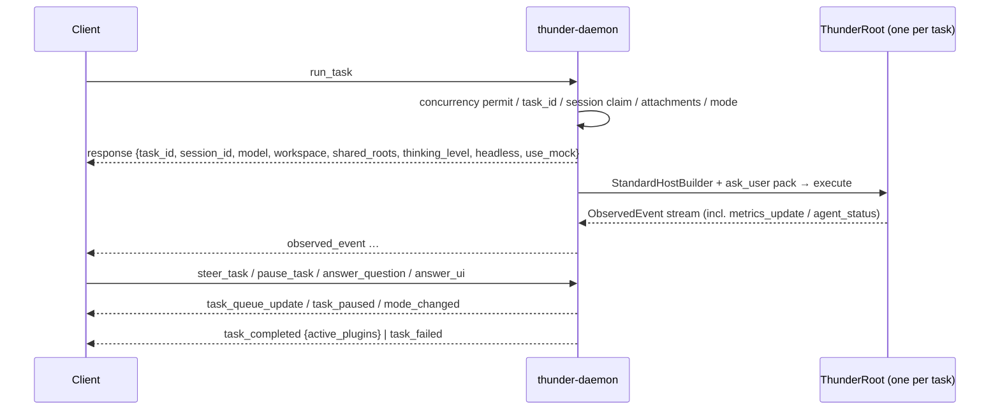

[English](README_en.md) | [简体中文](README.md)

# thunder-agent-daemon

A STDIO sidecar: NDJSON requests on stdin, NDJSON responses and event frames on stdout, logs on stderr. The binary is `thunder-daemon`.

## Role

It is the process boundary for Electron, desktop panels and headless hosts. It translates "one long-lived process with concurrent tasks" into `thunder-agent-root`'s "one `ThunderRoot` per run":

- Protocol: `src/protocol.rs` defines requests, responses and pushed frames.
- Service: `src/service.rs` owns sessions, tasks, modes, the MCP connection pool, pending questions and UI dialogs.
- Host implementations: `src/ui.rs` (`HostUi`), `src/ask_user.rs` (the `ask_user_question` tool pack), `src/attachments.rs` (image admission).

## Crate boundary

| Dependency | Purpose |
|---|---|
| `thunder-agent-root` | `ThunderRoot`, `StandardHostBuilder`, `ToolPack`, `ModePlugin`, metrics/status, `TraceCollector` |
| `thunder-agent-loop` | `AgentConfig`, `AgentEvent`, pause / steer |
| `thunder-agent-policy` | `HostUi`, `UiRequest` / `UiResponse` / `UiSource`, `AgentTool` |
| `thunder-agent-providers` | `ProviderRegistry`, `ModelDescriptor`, `RpiAiClient`, title generation |
| `thunder-conversation` | `FsConversationStore` |
| `thunder-agent-skills` / `thunder-agent-mcp` | Direct dependencies, not referenced in source; compiled alongside the baseline host set |
| `thunder-agent-types` | Shared wire types |

No workspace member depends on this crate (it is a binary); hosts launch it as a child process (see `daemon.sh` at the repo root).

## Process and data root

`src/main.rs`:

1. Initialise `tracing` on **stderr**; stdout belongs entirely to the protocol.
2. Parse `--workspace` / `-w <path>` (defaults to the current directory) and `--config-dir <path>`.
3. `DaemonService::new(workspace)`.
4. Read stdin line by line: skip empty lines; parse into `DaemonRequest` and `handle_request`; on a parse failure reply `response { success: false, error: "Invalid JSON command: ..." }`, salvaging `id` from the raw line when possible.
5. On stdin EOF, `service.shutdown()` cancels every active task's `CancellationToken`.

Data root: `THUNDER_CONFIG_DIR`, or `--config-dir`. The flag is written to the environment with `std::env::set_var` **before** the service is constructed, so it overrides an inherited variable; the conversation store lands under `<root>/conversations`.



## Protocol

- Encoding: one JSON object per line (NDJSON).
- Requests are tagged with `"method"`, `snake_case`; field names are the Rust fields (`snake_case`) except where an alias exists (`render_capabilities` also accepts `renderCapabilities`; `Attachment` accepts `path` / `data` / `mimeType` / `mime_type`).
- Responses and pushes are tagged with `"type"`, `snake_case`.
- `PROTOCOL_VERSION = 3`. It moves only when a request or response shape changes, independently of the crate version; `ping` returns both and no handshake is performed.

### Requests (`DaemonRequest`)

| `method` | Fields | Purpose |
|---|---|---|
| `ping` | `id?` | Returns `{pong: true, version, protocol: 3}` |
| `list_models` | `id?` | Reloads the registry and returns `{models: [...], utility_model}` |
| `list_conversations` | `id?` | Conversation list (only conversations with at least one turn) |
| `get_conversation` | `id?`, `session_id` | Conversation detail |
| `run_task` | `id?`, `task_id`, `prompt`, `session_id?`, `model?`, `model_descriptor?`, `use_mock?`, `workspace_dir?`, `mode?`, `extra_workspace_dirs?`, `thinking_level?`, `attachments?`, `headless?` (default `false`), `render_capabilities?` | Start one run |
| `pause_task` | `id?`, `task_id` | Park at the next tool boundary |
| `resume_task` | `id?`, `task_id` | Release the park |
| `steer_task` | `id?`, `task_id`, `message`, `behavior?`, `attachments?` | Inject input into a live task; `behavior` must be `steer` or `follow_up` (`followUp` / `followup` also accepted) |
| `clear_queue` | `id?`, `task_id` | Drop both queues and return their text |
| `answer_question` | `id?`, `question_id`, `answers?`, `cancelled?` | Answer `ask_user_question`; `question_id` is `<task_id>:qN` |
| `answer_ui` | `id?`, `request_id`, `value?`, `confirmed?`, `cancelled?` | Answer a `ui_request` dialog |
| `get_permission_state` | `id?`, `session_id` | Returns the session's `mode` and remembered `rules` |
| `set_mode` | `id?`, `session_id`, `mode` | Flip the session mode; accepts everything `Mode::parse` accepts, legacy names included |
| `cancel_task` | `id?`, `task_id` | Cancel a live task |
| `reload_integrations` | `id?` | Drop the MCP pool so the next run re-reads the workspace |
| `get_trace` | `id?`, `session_id`, `task_id?` | Read a trace; omitting `task_id` returns the latest |
| `list_traces` | `id?`, `session_id` | List the session's traces |
| `generate_title` | `id?`, `session_id`, `force?` | Synchronous title generation; returns a title or a structured error |
| `set_conversation_title` | `id?`, `session_id`, `title` | Set the title manually |
| `get_metrics` | `id?`, `session_id` | Returns the session's latest `MetricsSnapshot` |

### Responses and pushes (`DaemonResponse`)

| `type` | Fields | Meaning |
|---|---|---|
| `response` | `id?`, `success`, `data?`, `error?` | Direct answer to any request |
| `observed_event` | `task_id`, `event` | Kernel events forwarded verbatim, including the `metrics_update` / `agent_status` custom frames |
| `task_completed` | `task_id`, `session_id`, `final_content?`, `finish_reason`, `active_plugins` | Normal completion |
| `task_failed` | `task_id`, `session_id?`, `error`, `finish_reason?` | Failure or cancellation; an absent `finish_reason` means no terminal reason was available (the run never started, or `join` itself failed) |
| `user_question` | `task_id`, `session_id?`, `question_id`, `questions` | The agent is blocked on a human answer |
| `task_paused` | `task_id`, `session_id?`, `reason` | Parked |
| `task_queue_update` | `task_id`, `session_id?`, `steering`, `follow_up` | Full queue snapshot, never a delta |
| `mode_changed` | `session_id`, `task_id?`, `mode`, `previous?`, `source` | Pushed for every mode change, whatever caused it |
| `ui_request` | `request_id`, `task_id?`, `session_id?`, `source`, flattened `UiRequest` | Blocking dialog |
| `ui_notice` | `source`, `message`, `level` | Notification (`info` / `warning` / `error`); a UI-less client drops it |
| `ui_status` | `key`, `text?` | Set or clear a status-bar entry |

`mode_changed.source` wire values: `user` (client `set_mode`), `plan_approved` (`exit_plan_mode`'s approval dialog), `run_option` (`run_task` pinned a mode different from the session's).

**`task_completed.active_plugins` now carries `assembly.ids()`**: the ids of the run's sections / packs / observers, deduplicated in registration order. It no longer means "plugins selected from a registry"; it means "what this run was actually assembled from".

## Service behaviour

### One root per task

`run_task` performs admission first, then spawns a task runner; the `ThunderRoot` is built inside that runner and serves exactly one run. Assembly order:

```text
ThunderRoot::new(base_cfg)
  .with_workspace(ws)
  .with_extra_roots(shared_roots)
  .with_provider_registry(registry)
  .with_initial_session_total_tokens(prior_used_tokens)
→ StandardHostBuilder::new(store)
  .with_mcp_plugin(pooled_mcp)
  .with_metrics_plugin(shared_metrics)
  .with_status_plugin(shared_status)
  .build(root)
→ [not headless] root.with_pack(ToolPack::new("ask_user").with_tool(AskUserQuestionTool))
```

`base_cfg` is `AgentConfig::new(model).with_unlimited_turns()`, with `request_timeout_ms = 120_000` and `session_id` set so the conversation keeps one prompt-cache shard; the context window comes from the descriptor or the registry.

### Admission and concurrency

- Concurrency limit: `THUNDER_MAX_CONCURRENT_TASKS` (default 8, minimum 1). A failed `try_acquire` answers `Server busy: maximum concurrent task limit reached`.
- A duplicate `task_id` answers `Task '<id>' is already running (conflict)`.
- One run per `session_id`. A task that was cancelled but has not unwound reports `still stopping` rather than `busy`: releasing the session early would let two runs write the same conversation store.
- `use_mock` is rejected in builds without `testing-mock`; it never falls back to a real model and never fabricates output.

### Model, workspace, thinking level

- Model resolution: `model` → the descriptor's `provider/id` (when a descriptor is supplied without `model`) → the conversation's remembered model → the first available registry model → `openai/gpt-4o`.
- `model_descriptor` outranks `models.json`: such a run never reads it. A descriptor that cannot build a client is answered with an error and the claimed task/session bookkeeping is released.
- The workspace is bound on the first run and is **immutable** afterwards; `extra_workspace_dirs` merge into `shared_roots`, so a referenced repository can become writable mid-task.
- Thinking level: request → conversation → descriptor-derived → registry default.

### Modes

- One `ModePlugin` per session, held by `SessionModes` (FIFO cap 256). A new session starts in `agent.defaultMode` from `.thunder/config.json`, defaulting to `Mode::Ask`.
- `run_task.mode` pins this run's mode; `set_mode_announcing` returns the previous mode only when it actually changed, and that pushes `mode_changed` with `run_option`.
- `set_mode` answers first and then pushes `mode_changed` with `user`, so a client that reads one line per request reads the right frame.
- Plan approval flips the mode inside a tool and reports through the run's event stream as a `mode_changed` custom event; the daemon reshapes it into the same `mode_changed` frame (`source` taken from the payload, defaulting to `plan_approved`).

### Pause, resume, steer

- `pause_task` / `resume_task` operate the run's `PauseGate` and answer `{task_id, paused|resumed}`. Pausing also pushes `task_paused` and marks the shared `StatusPlugin` as `paused`.
- `steer_task` must state its placement: `steer` enters after the current turn's tool calls and before the next model request; `follow_up` enters only when the run has nothing left to do. Neither interrupts a running tool. Attachments are jailed against that run's workspace plus shared roots.
- Queue changes always push a full `task_queue_update`; the kernel's `SteerAccepted` event triggers another one so the client can drop the message from its pending list.
- `clear_queue` empties both queues and returns the discarded text.

### Questions and dialogs

- `ask_user_question` (pack id `ask_user`) emits `user_question` and parks on a oneshot. The wait is capped at 1800 s; on expiry the tool returns an error telling the model to proceed with stated assumptions instead of hanging. A cancelled run returns an error.
- `question_id` is `<task_id>:qN`; the double key stops two concurrent tasks from crossing answers. An answer for an unknown or expired id returns `delivered: false` and is otherwise inert.
- `headless: true` omits the pack entirely: a client without a panel never pays a full request timeout per clarification.
- `DaemonHostUi` emits `ui_request` and parks. `request_id` is minted server-side from process id + counter + time entropy, so a plugin cannot forge one. A timeout, a closed channel and a late answer all resolve to `UiResponse::Cancelled` (fail closed). `answer_ui` returns `{request_id, delivered}`.
- For the dialog's lifetime an `AwaitingGuard` holds the session at `awaiting_user`: it is the one wait during which nothing is on the wire, so a status bar cannot infer it from the event stream.

### Telemetry, status and traces

- `DaemonService` holds a **shared** `MetricsPlugin` and `StatusPlugin` and injects them into every root, so `get_metrics` reads a session snapshot that spans runs.
- The root's event proxy emits `metrics_update` / `agent_status` frames; the daemon forwards them unchanged inside `observed_event`.
- Each run gets a `TraceCollector`: streaming micro-deltas are only counted, events and tool traces are kept within bounds. At the end it is written to `<store>/<session>/traces/<task_id>.json`, with `wall_duration_ms` and the session's cumulative tokens filled in.
- Conversation persistence: after `join`, the authoritative conversation is re-read from the store; missing turns are backfilled from `run_result`; when compaction ran (`raw_messages` present) the run's projection replaces the messages and the raw transcript is saved separately; token / turn / tool-call / duration counters accumulate across runs.

### MCP pool and `reload_integrations`

`mcp_plugins` pools one `McpPlugin` per canonicalised workspace path, FIFO cap 16; an evicted plugin gets `close_all()`. Consecutive runs in one project therefore reuse server processes, while a same-named but differently configured server in another project never inherits them. `reload_integrations` drains the pool immediately, closes the old processes in the background and then answers `{reloaded: true}`.

### Titles

After the first turn (or whenever the title is still a placeholder) the utility model generates a title and persists it; failures only `warn`, and `use_mock` runs skip generation. `generate_title` awaits the result; `set_conversation_title` overrides it manually.

## Configuration and constants

| Constant | Value | Location |
|---|---|---|
| `PROTOCOL_VERSION` | `3` | `src/protocol.rs` |
| `REQUEST_TIMEOUT_MS` | `120_000` | `src/service.rs` |
| `THUNDER_MAX_CONCURRENT_TASKS` default | `8` | `src/service.rs` |
| `MAX_WORKSPACE_MCP` | `16` | `src/service.rs` |
| `MAX_SESSION_POLICIES` | `256` | `src/service.rs` |
| `DEFAULT_TIMEOUT_SECS` (ask_user) | `1800` | `src/ask_user.rs` |
| stdout queue capacity | `1024` (coalesced up to 64 KiB per flush) | `src/service.rs` |
| `MAX_IMAGES_PER_MESSAGE` / `MAX_IMAGE_BYTES` | `10` / `5 MiB` | `thunder-agent-loop::core::images` |

Environment:

| Variable | Effect |
|---|---|
| `RUST_LOG` | Overrides the fallback `EnvFilter` |
| `THUNDER_CONFIG_DIR` | Data root; overridden by `--config-dir` |
| `THUNDER_MAX_CONCURRENT_TASKS` | Concurrent task limit |

## Failure directions

| Situation | Result |
|---|---|
| Malformed JSON | `response { success: false, error }`, with `id` when it can be salvaged |
| Concurrency exhausted / duplicate task / session claimed | `response { success: false }`, with `busy` and `still stopping` kept distinct |
| Too many attachments, oversize image, path jail violation, bad magic bytes, model rejects images | Rejected before the run exists; task/session bookkeeping released |
| Descriptor cannot build a client | Rejected the same way, with the error prefixed ``model descriptor `<label>`:`` |
| `use_mock: true` in a build without `testing-mock` | Explicit refusal naming the real-provider path |
| No usable credentials | Only `warn`; the root falls back to `UnconfiguredLLMClient` and the run ends as `task_failed` |
| `FinishReason::Error` / `Cancelled` | `task_failed` with `finish_reason`; cancellation is no longer disguised as `task_completed` |
| `execute` fails (run never started) | `task_failed` with no `finish_reason` |
| `handle.join()` fails | `task_failed` with no `finish_reason` |
| Unknown / expired `question_id` or `request_id` | `delivered: false`; never delivered to a later dialog |
| `steer_task` without `behavior` | Refused; the daemon will not guess the placement |

Every terminal path clears `active_tasks` / `active_pauses` / `active_queues` / `active_sessions` / `stopping`.

## Known issue

The fallback `EnvFilter` in `src/main.rs` names the target `thunder_daemon`:

```rust
"info,thunder_daemon=debug,thunder_agent_root=debug,thunder_agent_loop=debug,thunder_agent_providers=debug"
```

The crate is `thunder-agent-daemon`, so its module path is `thunder_agent_daemon`; that directive matches nothing. The daemon's own debug logs therefore stay suppressed by the global `info`, while the other three crates do get debug. `RUST_LOG` bypasses it (e.g. `RUST_LOG=info,thunder_agent_daemon=debug`).

## Tests

3 files, 14 cases, all spawning the real binary (`CARGO_BIN_EXE_thunder-daemon`) over STDIO:

| File | Cases | What is pinned |
|---|---|---|
| `daemon_ipc_test.rs` | 10 (6 need `testing-mock`) | `ping` reports `protocol: 3`; a full mock event stream; `list_models` and `cancel_task`; `extra_workspace_dirs` merging; duplicate `task_id` rejection; a malformed line still gets an answer; history preserved across turns; concurrency limit (`THUNDER_MAX_CONCURRENT_TASKS=1` → `Server busy`); no silent mock fallback; a descriptor run needs no `models.json`; a failing descriptor releases its bookkeeping |
| `mode_protocol_test.rs` | 2 | `get_permission_state` defaults to `ask`; `set_mode` pushes `mode_changed` with `previous` and `source: user`; modes are per-session; legacy names still parse; an unknown mode errors and lists the valid ones; a no-op `set_mode` pushes nothing |
| `thunder_home_isolation_test.rs` | 2 | Nothing is written outside the injected root (especially `$HOME`); `--config-dir` overrides an inherited `THUNDER_CONFIG_DIR` |

Run: `cargo test -p thunder-agent-daemon --features thunder-agent-daemon/testing-mock`.

## Extension points

- `DaemonService::with_client_factory(ClientFactory)`: injects an LLM client in-process (tests / embedders); the production path always goes through the provider registry.
- `testing-mock` feature: compiles `DaemonMockClient` and enables `use_mock: true`. Off by default, so release binaries contain no mock code path.
- Protocol growth: new pushed frames are additive — a host that does not know them drops them. Only a change to a request or response shape requires bumping `PROTOCOL_VERSION`.
