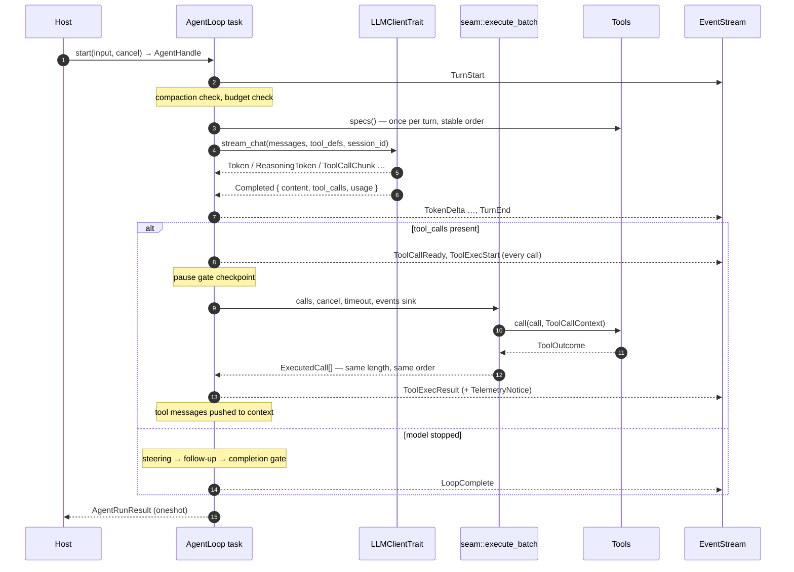

[English](ARCHITECTURE.md) | [简体中文](ARCHITECTURE_zh.md)

# Architecture — thunder-agent-loop

This file describes the kernel's internals: what runs where, which invariant each
stage protects, and the constants that decide behaviour. Usage is in
[README_en.md](README_en.md).

## Position in the stack

```
thunder-agent-types   vocabulary only (messages, events, tool defs, trace, scope, policy tags)
        ▲
thunder-agent-loop    this crate: one agent unit + kernel
        ▲
thunder-agent-policy  AgentTool, ToolExecutor funnel, ToolRegistry, gate, ui, trace, RegistryTools
        ▲
packs / hosts         pack-code, mcp, skills, providers, runtime, root, daemon, tui
```

The arrow points at the dependency. The loop depends on `thunder-agent-types`
alone; it does **not** depend on `thunder-agent-policy`, and the seam is what makes
that possible. `tests/kernel_boundary_test.rs` reads `src/seam.rs` and
`src/loop_engine/engine.rs` at test time and fails if a policy type or a registry
call appears there.

## Module map

| Path | Owns |
|---|---|
| `src/lib.rs` | Module tree and `prelude` (the supported product surface). |
| `loop_engine/engine.rs` | `AgentLoop`, `ContextInput`, `AgentRunResult`, the run task, `Emitter`, `ChannelEventSink`, `ChannelTraceSink`, transcript settling. |
| `loop_engine/handle.rs` | `AgentHandle` (events, join, cancel, pause, steer) and `RunningGuard`. |
| `loop_engine/event_stream.rs` | `EventBudget`, `EventStream`, `deliver`, `DELIVERY_DEADLINE`, `DEFAULT_MAX_EVENT_BYTES`. |
| `loop_engine/gate.rs` | `CompletionGate`, `GateRequest`, `GateVerdict`, `AcceptAllGate`. |
| `loop_engine/guard.rs` | `LoopGuard`: repetition warnings, hard repetition limit, consecutive-error circuit breaker. |
| `loop_engine/hooks.rs` | `AgentEventDispatcher`: lossy `broadcast` sidecar, capacity 128. |
| `core/context.rs` | `ContextBuffer`, `MessageEntry`, per-message token accounting (4-token envelope, 8 per tool call). |
| `core/state.rs` | `LoopStatus`, `AgentStateTracker`, `AgentStats` aggregation (avg tok/s excludes tool wait). |
| `core/pause.rs` | `PauseGate` (resumable, checked at tool boundaries). |
| `core/steer.rs` | `PendingQueue`, `QueueMode` (`OneAtATime` default), `QueueBehavior`, `SteerQueues`, `QueueSnapshot`. |
| `core/token_estimator.rs` | Allocation-free heuristic; CJK ≈ 1.5 tokens/char, ASCII ≈ 3.7 chars/token; `IMAGE_TOKEN_ESTIMATE = 1600`. |
| `core/utf8.rs` | `safe_slice_to` / `safe_slice_from` — never split a multi-byte character. |
| `core/images.rs` | MIME sniffing from magic bytes, base64 codec, `MAX_IMAGES_PER_MESSAGE = 10`, `MAX_IMAGE_BYTES = 5 MiB`. |
| `core/paths.rs` | `$THUNDER_CONFIG_DIR` resolution (env → `~/.thunder` → temp). |
| `pruning/strategy.rs` | `ContextPruner`, `PruneResult`, the single compaction strategy and the emergency floor. |
| `pruning/checkpoint.rs` | Cut-point selection, region serialization, `Summarizer`, checkpoint message format. |
| `pruning/error_detector.rs` | `is_context_overflow_error`, `extract_context_overflow_limit` (OpenAI / Anthropic / range / generic patterns). |
| `stream/client.rs` | `LLMClientTrait`, `LLMStreamChunk`, `ChatRequestOptions`, `UnconfiguredLLMClient`. |
| `cache/warmer.rs` | Warmer registry keyed by session, economics gate, replay loop. |
| `seam.rs` | `Tools`, `ToolSpec`, `Concurrency`, `ToolOutcome`, `ToolCallContext`, `ToolsFactory`, `RunContext`, `NoTools`, `execute_batch`. |
| `types/config.rs` | `AgentConfig`, `ContextPruningConfig`, `LoopGuardConfig`. |
| `types/mod.rs` | Re-exports `error`, `event`, `message`, `policy`, `scope`, `tool` from `thunder-agent-types`. |
| `tools/scratchpad.rs` | `ScratchpadManager`: oversized tool output → file + preview + manifest. |
| `tools/mod.rs` | Scratchpad plus the re-exported `thunder_agent_types::notice`. |

## One run, end to end



### Construction

`start` is the only entry point that creates a run:

1. `running.swap(true)` — a second `start` returns `AgentError::AlreadyRunning`.
2. Allocate `mpsc::channel::<ObservedEvent>(512)`, a `oneshot` for the result, and
   an `EventBudget` sized by `config.max_event_bytes`.
3. Resolve `ContextInput` (`Text`, `Messages`, `Buffer`) into a `ContextBuffer`; in
   every form `config.system_prompt` is applied last, so a transcript's stale system
   message never outranks the host's freshly assembled one.
4. Resolve tools: `ToolsFactory::for_run(RunContext { session_id, route, events, trace })`
   if a factory exists, else the fixed `Tools`, else `NoTools`. The factory wins.
5. Spawn the loop task. `RunningGuard` clears the busy flag when the task ends,
   including on panic.

The loop creates two sinks for the run: `ChannelEventSink` wraps tool business
events as `AgentEvent::Custom { kind, payload }`; `ChannelTraceSink` forwards
`ToolTrace` as `AgentEvent::ToolTrace`. Both also publish to the dispatcher
sidecar. Their sender clones live only in the run's task and in the tools the task owns, so
the channel closes when the task ends — a finished run holds no sender, which is what
makes `EventStream::recv` return `None` and what `tests/run_lifecycle_test.rs` pins.

### Turn pipeline

Each iteration of the outer loop checks, in order: `max_turns`, cancellation,
circuit breaker, hard repetition limit. Then:

1. **Snapshot** the raw transcript if a checkpoint compaction is about to fire for
   the first time (`raw_log`), so `AgentRunResult::raw_messages` can carry the
   pre-compaction history.
2. **Prune** (`ContextPruner::prune`) — no-op unless the window trigger is crossed.
3. **Budget check** `max_tokens_budget`; exceeding it ends the run as
   `BudgetExceeded`.
4. **Turn start**: `tracker.next_turn()`, `tools.specs()` and
   `seam::definitions()` computed **once** and reused by every request of the turn
   (stream retries and the warmer included), emitting `TurnStart`.
5. **Splice queued input** (steering queue, `OneAtATime` by default) as ordinary
   user messages, emitting `SteerAccepted`.
6. **Request** `ChatRequestOptions { messages, tools, model, temperature, top_p,
   max_tokens, thinking_level, cache_retention: None, session_id }`.
7. **Consume the stream** (see below).
8. **Account** the turn: TTFT excluded from decode time, provider usage preferred,
   estimated fallback from `token_estimator`, reasoning tokens part of completion,
   `tokens_per_second` derived from generation time.
9. **Warm the prompt cache** if a snapshot and pricing exist and the provider
   reported cache activity this turn.
10. **Emit `TurnEnd`**, push the assistant message.
11. **No tool calls**: drain steering, then follow-up; if still empty, ask the
    completion gate. `Pass` finishes, `Retry { feedback }` pushes the feedback as a
    user message and continues, `Fail { reason }` ends as `FinishReason::Error`.
    Exhausting `max_gate_rounds` finishes anyway, with a warning.
12. **Tool calls**: emit `ToolCallReady` + `ToolExecStart` for every call, wait at
    the pause gate, then run the whole batch through `seam::execute_batch` with
    `config.request_timeout_ms`. Results are recorded in the guard, annotated with
    repetition/truncation diagnostics, emitted as `ToolExecResult` (+ optional
    `TelemetryNotice`), and pushed as `Tool` messages.

### Stream resilience

| Failure | Response |
|---|---|
| Context overflow at request time | Up to 2 attempts per turn: take the limit from the provider error (else 60 % of the current window), lower the pruner's window, re-prune, retry. |
| Context overflow mid-stream | Same, via the stream error path. |
| Network failure before any content | Retry the connection, backoff `500 ms × 2ⁿ`, up to `max_stream_retries` (default 2). |
| Interrupted while streaming tool-call arguments | Inject a `StreamResilience` telemetry prompt asking for a complete re-issue; partial JSON is discarded. |
| Interrupted mid-content | Append the accumulated text as an assistant message plus a continuation prompt carrying the last ≤ 60 chars (UTF-8-safe), then continue. |
| Interrupted before the first token | Clean turn retry. |
| Retries exhausted | `AgentEvent::Error`, turn ends without a completion payload → `FinishReason::Error`. |

Continuation prompts are popped from the context once the turn's stream loop ends, so
the persisted transcript never contains the telemetry scaffolding.

## Event delivery

The channel is bounded by frame count (512), which bounds memory only if frames
are small — one `ToolExecResult` can be as large as the whole tool output cap. The
byte budget supplies the missing bound:

- `EventBudget::new(max_bytes)` clamps to at least 1024 bytes; `max()` is the
  largest single event that can ever be queued.
- Producers reserve `ObservedEvent::approx_bytes()` (96-byte frame + agent id +
  the growing payload fields) before enqueueing. On a successful send the permit is
  `forget()`-ed, because the consumer releases those bytes on `recv` — each event's
  bytes are returned exactly once.
- `EventStream::recv` / `try_recv` release the estimate; `close()` stops new events
  while draining the queued ones; `capacity()` reports frames, not bytes.
- `DELIVERY_DEADLINE` is 5 s. A producer that cannot get space by then drops the
  event instead of parking the run behind a host that stopped reading.

Delivery rules in `deliver`:

| Case | Behaviour |
|---|---|
| Event larger than the whole budget | Dropped immediately, counted as **structural**, warned. |
| Queue full, micro-delta (`TokenDelta`, `ReasoningDelta`, `ToolCallChunk`) | `try_send`; on failure counted as **micro**. |
| Queue full, structural event | Wait up to the deadline, then counted as **structural**. |
| Send succeeds | Permit forgotten; the consumer will release it. |

Micro-deltas are lossy **by contract**: they are rendering progress, and the settled
transcript (`AgentRunResult::messages`) plus `LoopComplete::final_content` carry the
answer regardless. A dropped structural event cannot be reconstructed by a consumer
that only reads events — that is why they wait, why every drop warns, and why hosts
must treat `EventDropCounters::structural() > 0` as "this run's record may be
incomplete". The counters are per unit, shared by every emitter and sink of every
run, and readable at any time through `AgentLoop::event_drop_counters()`.

The dispatcher sidecar (`hooks.rs`) is a separate, deliberately lossy path: a
`broadcast` channel of 128 with no backpressure at all, for subscribers that want
notifications and not a record.

## Pruning: one strategy, one floor

`ContextPruningConfig::max_concurrent_summaries` (default 2) sizes a
`Semaphore` created in `AgentLoop::new`; `with_summary_limit` replaces it so a host
running N agents can share one. The limiter is held across the summarizer's retry
pair, so a slow failure cannot double the provider pressure.

There is exactly one compaction strategy — pi-style **checkpoint compaction**:

1. **Trigger:** `estimated > max_context_tokens − reserve_tokens` (saturating
   subtraction; a reserve ≥ window means "permanently due"). Between triggers the
   request prefix is byte-identical, which is what keeps the provider cache hot.
2. **Cut point** (`find_cut_index`): walk backwards accumulating estimated tokens
   until `keep_recent_tokens` is covered; `None` if the whole history fits. The cut
   never lands on a `Tool` message (a result must stay with its call) and is snapped
   forward to the next user message when one exists.
3. **Region floor:** index 1, or 2 when index 1 already holds a checkpoint message
   (`CHECKPOINT_MESSAGE_NAME = "context_checkpoint"`, a `System` message with that
   name). The system prompt at index 0 is never touched — `pin_system_prompt` is
   declared in config but the floor already pins it.
4. **Summarize:** serialize the region to flat text (2000 chars per message, 200 per
   tool-call argument, images reduced to a placeholder line), mechanically extract
   `read-files` / `modified-files` from `path` arguments classified by
   `ToolEffect::of(name)`, and call the summarizer model once.
5. **Swap:** remove the region, place the checkpoint at index 1 (replacing the
   previous one, which makes compaction iterative: the prompt UPDATE-merges the old
   summary instead of re-deriving it).
6. **If still over the hard window** (a huge kept tail), fall through to the
   emergency trim.

The summarizer request has `tools: []`, `thinking_level: None`,
`cache_retention: Some("none")` and `session_id: None`: it will never be reused, so
it must not pay the cache-write premium or disturb the conversation's routing. It
retries once; a `length` finish or empty output is rejected, because a partial
summary must not become a checkpoint.

**Emergency trim** (`ContextPruner::emergency_trim`) is a safety net, not a
strategy: only when summarization is unavailable or failed *and* the context is over
the hard window, it drops the oldest complete turns (respecting the region floor and
the cut-point rules) until the window is satisfied. `PruneResult.emergency` records
that it ran.

**Overflow self-heal** is separate: when the provider rejects a request for context
length, the loop lowers `max_context_tokens` to the size the provider reported
(or 60 % of the current value) and re-prunes before retrying — at most twice per
turn, and only while not cancelled.

## Prompt-cache warming

Warming replays the last real request with `max_tokens = 1` before the cache entry
expires. It is disabled unless the model declares a prompt-cache lifetime *and*
prices (`PromptCacheWarmSettings`).

| Hook | Engine behaviour |
|---|---|
| Run starts with a `session_id` | `warmer::invalidate(session_id)` — cancels a warmer still refreshing the stale pre-run prefix. |
| Successful turn | If `session_id` and `prompt_cache_warm` are set and the provider reported cache reads or writes (`cached_tokens + cache_write_tokens > 0`), `warmer::schedule` with the current `WarmSnapshot`. Each schedule replaces the previous task. |
| Run settles | `warmer::mark_idle(session_id)` — economics switch from certain-continuation (1.0) to the 15 % idle estimate. |

Economics (`decide_warming`), per million-token prices:

```
warm_cost = prompt_tokens × cache_read_price
miss_cost = prompt_tokens × ((cache_write_price or input_price) − cache_read_price)
expected  = continuation_probability × miss_cost − warm_cost
warm only when expected ≥ MIN_EXPECTED_SAVINGS_USD
```

| Constant | Value |
|---|---|
| `IDLE_CONTINUATION_PROBABILITY` | `0.15` |
| `MIN_EXPECTED_SAVINGS_USD` | `0.05` |
| `MAX_IDLE_WARMING_AGE` | 30 minutes measured from the schedule (≈ the last real request) |
| refresh delay | `warming_delay(ttl)` = 90 % of TTL, but never closer than 10 s to expiry; `None` when TTL ≤ 10 s |

Each fire re-checks the economics; a late timer keeps only half the planned margin
(`(ttl − delay) / 2`) before giving up, because a late refresh is a full-price cache
write rather than a warm. `replay_safe = false` disables scheduling entirely (for
providers where `max_tokens` is part of the cache key). The registry is keyed by
`session_id` and carries a generation counter, so a replaced warmer cannot remove
its successor.

## Control primitives

| Primitive | Semantics |
|---|---|
| `CancellationToken` | Irreversible. Checked at the top of every turn, while streaming, and at the pause gate. Cancelling mid-stream lifts the partial answer into the transcript. |
| `PauseGate` | Resumable, checked **before** dispatching tools, so an in-flight tool is never interrupted. `pause()` is idempotent; `wait_if_paused` returns immediately when unpaused. |
| `SteerQueues` | `steering` drains at the next turn boundary (before the next request, and after tool results); `follow_up` drains only when the run has nothing else to do. Neither interrupts a tool. Default mode `OneAtATime`: several instructions in one turn read as one blob and the model tends to answer only the last one. |

## Lifecycle invariants

- **One run per unit.** Guarded by an atomic swap; `RunningGuard` clears it on task
  exit, panic included.
- **Handles are not owners.** Dropping an `AgentHandle` does not cancel the run; only
  `cancel()` does.
- **`join` follows the result, not the stream.** The task sends `AgentRunResult`
  through a oneshot before it exits. A host that stops reading events therefore
  cannot deadlock `join` — at worst it costs the emitter one delivery deadline per
  structural event.
- **Pairing.** Every announced tool call gets a result:
  1. `execute_batch` always returns `calls.len()` results in request order, and
     synthesizes an error result for a call it refuses to run because the run was
     already cancelled.
  2. The engine pushes exactly one `Tool` message per `ExecutedCall`.
  3. On any non-`Done` finish, `dangling_tool_calls` scans the last assistant message
     and answers every unmatched call with `CANCELLED_TOOL_RESULT`
     (`"[cancelled by user before execution — the tool did not run]"`), recording the
     message **and** emitting the matching `ToolExecResult`, because hosts rebuild
     their history from events.
- **Settling.** Terminal status maps `Done → Completed`, `Cancelled → Aborted`,
  everything else → `Failed`. The scratchpad is cleaned up when
  `scratchpad.auto_cleanup` is set. `LoopComplete` is the last frame; the result
  carries `messages` (the projected context the model actually saw) and
  `raw_messages` (present only when a checkpoint compaction fired).

## Failure matrix

| Signal | Finish reason / error |
|---|---|
| Model stopped calling tools, gate passed | `Done` |
| `max_turns` | `MaxTurnsExceeded` |
| `max_tokens_budget` | `BudgetExceeded` |
| Cancellation | `Cancelled` |
| Circuit breaker (5 consecutive tool errors) | `Error` + `AgentEvent::Error` |
| Hard repetition limit (5 identical calls) | `Error` + `AgentEvent::Error` |
| Gate verdict `Fail` | `Error` |
| No completion payload after retries | `Error` |
| Second `start` while running | `AgentError::AlreadyRunning` |
| Task died without a result | `AgentError::Terminated` |

## Tests as architecture

| Test | Invariant |
|---|---|
| `kernel_boundary_test` | `seam.rs` mentions no policy type; the loop executes only through `seam::execute_batch` and reads only `tools.specs()`. |
| `seam_contract_test` | A host-supplied `Tools` is enough to run a full loop. |
| `unit_contract_test` | The prelude carries the whole unit surface: loop, handle, seam, events, config. |
| `generic_kernel_test` | No file/shell concept is required; business tools, custom events and a gate work. |
| `run_lifecycle_test` | A finished run holds no state and the stream closes. |
| `event_budget_test` | The stream is byte-bounded; large results do not pin memory. |
| `checkpoint_compaction_test` | Compaction fires, swaps in a checkpoint, preserves the raw log. |
| `compaction_concurrency_test` | A shared limiter caps summarization requests across agents. |
| `cache_warmer_test` | Schedule / replace / idle / invalidate lifecycle and the economics gate. |
| `cancel_continuity_test` | A cancelled run leaves a transcript the next request accepts. |
| `steer_test` | Steering vs follow-up timing, and that neither interrupts a tool. |
| `pause_gate_test` | Pause parks at a tool boundary and resumes without interrupting the running tool. |
| `stream_continuation_test` / `auto_heal_test` | Breakpoint continuation and overflow recovery. |
| `system_prompt_authority_test` | `config.system_prompt` outranks a transcript system message. |
| `autonomous_termination_test` | The run ends when the model stops calling tools. |
| `context_test` / `utf8_safety_test` | Token accounting and multi-byte safety. |

## Extension points, restated

Everything a host may vary is a trait handed to `AgentLoop`: `LLMClientTrait`,
`Tools` / `ToolsFactory`, `CompletionGate`, plus the `PauseGate`, `SteerQueues` and
`Semaphore` instances it can own and share. There is no registry, no discovery and no
capability declaration inside the kernel; a pack is ordinary code that produces `Tools`.
