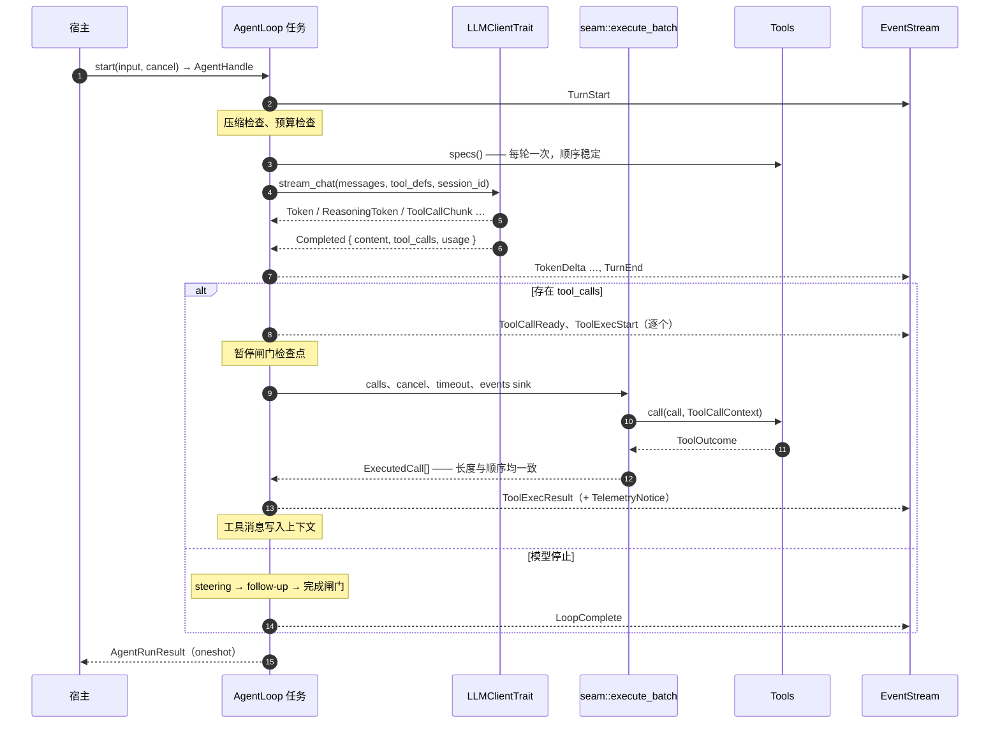

[English](ARCHITECTURE.md) | [简体中文](ARCHITECTURE_zh.md)

# 架构 — thunder-agent-loop

本文描述内核内部：各个阶段在哪里运行、保护哪条不变量、由哪些常量决定行为。用法见
[README.md](README.md)。

## 在分层中的位置

```
thunder-agent-types   线上词汇表（消息、事件、工具定义、trace、scope、policy 标签）
        ▲
thunder-agent-loop    本 crate：单 agent 单元 + 内核
        ▲
thunder-agent-policy  AgentTool、ToolExecutor 漏斗、ToolRegistry、gate、ui、trace、RegistryTools
        ▲
packs / hosts         pack-code、mcp、skills、providers、runtime、root、daemon、tui
```

箭头指向被依赖方。内核只依赖 `thunder-agent-types`，**不**依赖 `thunder-agent-policy`；做到这一点靠的是
工具缝。`tests/kernel_boundary_test.rs` 在测试期读取 `src/seam.rs` 与 `src/loop_engine/engine.rs`，
一旦出现策略类型或注册表调用即失败。

## 模块地图

| 路径 | 职责 |
|---|---|
| `src/lib.rs` | 模块树与 `prelude`（受支持的产品面）。 |
| `loop_engine/engine.rs` | `AgentLoop`、`ContextInput`、`AgentRunResult`、运行任务、`Emitter`、`ChannelEventSink`、`ChannelTraceSink`、transcript 收尾。 |
| `loop_engine/handle.rs` | `AgentHandle`（事件、join、cancel、pause、steer）与 `RunningGuard`。 |
| `loop_engine/event_stream.rs` | `EventBudget`、`EventStream`、`deliver`、`DELIVERY_DEADLINE`、`DEFAULT_MAX_EVENT_BYTES`。 |
| `loop_engine/gate.rs` | `CompletionGate`、`GateRequest`、`GateVerdict`、`AcceptAllGate`。 |
| `loop_engine/guard.rs` | `LoopGuard`：重复告警、硬重复上限、连续错误熔断。 |
| `loop_engine/hooks.rs` | `AgentEventDispatcher`：有损 `broadcast` 旁路，容量 128。 |
| `core/context.rs` | `ContextBuffer`、`MessageEntry`、逐消息 token 记账（4 token 信封，每次工具调用 8）。 |
| `core/state.rs` | `LoopStatus`、`AgentStateTracker`、`AgentStats` 聚合（平均 tok/s 不含工具等待）。 |
| `core/pause.rs` | `PauseGate`（可恢复，在工具边界检查）。 |
| `core/steer.rs` | `PendingQueue`、`QueueMode`（默认 `OneAtATime`）、`QueueBehavior`、`SteerQueues`、`QueueSnapshot`。 |
| `core/token_estimator.rs` | 零分配启发式估算：CJK ≈ 1.5 token/字符，ASCII ≈ 3.7 字符/token；`IMAGE_TOKEN_ESTIMATE = 1600`。 |
| `core/utf8.rs` | `safe_slice_to` / `safe_slice_from`——绝不切断多字节字符。 |
| `core/images.rs` | magic bytes 识别 MIME、base64 编解码、`MAX_IMAGES_PER_MESSAGE = 10`、`MAX_IMAGE_BYTES = 5 MiB`。 |
| `core/paths.rs` | `$THUNDER_CONFIG_DIR` 解析（环境变量 → `~/.thunder` → 临时目录）。 |
| `pruning/strategy.rs` | `ContextPruner`、`PruneResult`：唯一压缩策略与紧急兜底。 |
| `pruning/checkpoint.rs` | 切点选择、区域序列化、`Summarizer`、checkpoint 消息格式。 |
| `pruning/error_detector.rs` | `is_context_overflow_error`、`extract_context_overflow_limit`（OpenAI / Anthropic / 区间 / 通用模式）。 |
| `stream/client.rs` | `LLMClientTrait`、`LLMStreamChunk`、`ChatRequestOptions`、`UnconfiguredLLMClient`。 |
| `cache/warmer.rs` | 按 session 索引的预热注册表、经济学闸门、回放循环。 |
| `seam.rs` | `Tools`、`ToolSpec`、`Concurrency`、`ToolOutcome`、`ToolCallContext`、`ToolsFactory`、`RunContext`、`NoTools`、`execute_batch`。 |
| `types/config.rs` | `AgentConfig`、`ContextPruningConfig`、`LoopGuardConfig`。 |
| `types/mod.rs` | 再导出 `thunder-agent-types` 的 `error`、`event`、`message`、`policy`、`scope`、`tool`。 |
| `tools/scratchpad.rs` | `ScratchpadManager`：超长工具输出 → 文件 + 预览 + 清单。 |
| `tools/mod.rs` | scratchpad，以及再导出的 `thunder_agent_types::notice`。 |

## 一次运行的完整流转



### 构造

`start` 是唯一创建运行的入口：

1. `running.swap(true)`——第二次 `start` 返回 `AgentError::AlreadyRunning`。
2. 分配 `mpsc::channel::<ObservedEvent>(512)`、结果用 `oneshot`、按
   `config.max_event_bytes` 建 `EventBudget`。
3. 把 `ContextInput`（`Text`、`Messages`、`Buffer`）解析成 `ContextBuffer`；三种形态最后都套用
   `config.system_prompt`，因此 transcript 里残留的 system 消息永远不会压过宿主新拼装的提示词。
4. 解析工具：有工厂则 `ToolsFactory::for_run(RunContext { session_id, route, events, trace })`，
   否则用固定 `Tools`，再否则 `NoTools`。工厂优先。
5. 派生循环任务。任务结束时 `RunningGuard` 清除忙标志，panic 亦然。

内核为本次运行创建两个 sink：`ChannelEventSink` 把工具业务事件包装成
`AgentEvent::Custom { kind, payload }`；`ChannelTraceSink` 把 `ToolTrace` 转发为
`AgentEvent::ToolTrace`。两者同时投递到 broadcast 旁路。它们的 sender 克隆只存在于运行任务及其持有的
工具中，所以任务结束时通道关闭——运行结束后不残留 sender，这正是 `EventStream::recv` 返回 `None`、
也是 `tests/run_lifecycle_test.rs` 所钉住的性质。

### 轮次流水线

外层循环每轮依次检查：`max_turns`、取消、熔断、硬重复上限。之后：

1. **快照**：若 checkpoint 压缩即将首次触发，保存原始 transcript（`raw_log`），使
   `AgentRunResult::raw_messages` 能带上压缩前的历史。
2. **压缩**（`ContextPruner::prune`）——未越过窗口触发线时不做事。
3. **预算检查** `max_tokens_budget`，超限以 `BudgetExceeded` 结束。
4. **轮次开始**：`tracker.next_turn()`；`tools.specs()` 与 `seam::definitions()` **每轮只算一次**，
   该轮所有请求（含流重试与预热）共用，保证前缀字节稳定；发出 `TurnStart`。
5. **拼接排队输入**（steering 队列，默认 `OneAtATime`）为普通 user 消息，发出 `SteerAccepted`。
6. **发请求**：`ChatRequestOptions { messages, tools, model, temperature, top_p, max_tokens,
   thinking_level, cache_retention: None, session_id }`。
7. **消费流**（见下节）。
8. **结算本轮**：TTFT 不计入解码时间；优先用 provider 用量，缺失时按 `token_estimator` 估算；
   推理 token 计入 completion；`tokens_per_second` 按生成时间计算。
9. **预热 prompt cache**：存在快照与定价，且本轮 provider 报告了缓存读写时。
10. **发出 `TurnEnd`**，写入 assistant 消息。
11. **无工具调用**：先排空 steering，再排空 follow-up；仍为空则询问完成闸门。`Pass` 结束，
    `Retry { feedback }` 以 user 消息回喂并继续，`Fail { reason }` 以 `FinishReason::Error` 结束。
    用尽 `max_gate_rounds` 时照常结束，并留下一条告警。
12. **有工具调用**：为每个调用发出 `ToolCallReady` + `ToolExecStart`，在暂停闸门等待，然后整批交给
    `seam::execute_batch`，超时取 `config.request_timeout_ms`。结果计入 guard，追加重复/截断诊断，
    发出 `ToolExecResult`（可选 `TelemetryNotice`），并作为 `Tool` 消息写入上下文。

### 流式韧性

| 故障 | 处理 |
|---|---|
| 请求时上下文溢出 | 每轮最多 2 次：从 provider 错误取上限（取不到用当前窗口的 60 %），下调 pruner 窗口，重新压缩后重试。 |
| 流中途上下文溢出 | 同上，走流错误路径。 |
| 尚无内容即断网 | 重连，退避 `500 ms × 2ⁿ`，最多 `max_stream_retries`（默认 2）次。 |
| 工具参数流中断 | 注入 `StreamResilience` 遥测提示，要求模型重发完整调用；未解析的 JSON 丢弃。 |
| 正文中途中断 | 把已累积文本写成 assistant 消息，并附加携带末尾 ≤ 60 字符（UTF-8 安全）的续写提示后继续。 |
| 首个 token 之前中断 | 干净地重试整轮。 |
| 重试用尽 | `AgentEvent::Error`，本轮无完成载荷 → `FinishReason::Error`。 |

续写提示在该轮流循环结束后会从上下文中弹出，落盘的 transcript 不会包含这些遥测脚手架。

## 事件投递

通道按帧数有界（512），而一帧最大可达整个工具输出上限，所以帧数并不能界定内存。字节预算补上这一维：

- `EventBudget::new(max_bytes)` 最少按 1024 字节夹取；`max()` 是单条事件可入队的上限。
- 生产者在入队前按 `ObservedEvent::approx_bytes()`（96 字节帧 + agent id + 会增长的载荷字段）预留。
  发送成功后对 permit 调用 `forget()`，因为这些字节由消费者在 `recv` 时释放——每条事件的字节恰好归还一次。
- `EventStream::recv` / `try_recv` 释放估算值；`close()` 停止接收新事件但可继续排空；`capacity()` 报告帧数而非字节。
- `DELIVERY_DEADLINE` 为 5 秒。等不到空间的写者丢弃该事件，而不是让运行停在一个不再读取的宿主后面。

`deliver` 中的判定：

| 情形 | 行为 |
|---|---|
| 单条事件大于整个预算 | 立即丢弃，按**结构性**计数并告警。 |
| 队列已满，且是微增量（`TokenDelta`、`ReasoningDelta`、`ToolCallChunk`） | `try_send`；失败按**微增量**计数。 |
| 队列已满，结构性事件 | 最多等到截止时间，超时按**结构性**计数。 |
| 发送成功 | permit 被 forget，由消费者释放。 |

微增量**按契约**有损：它们只是渲染进度，答案本身由已结算的 transcript
（`AgentRunResult::messages`）和 `LoopComplete::final_content` 承载。而丢失一条结构性事件，只读事件的
消费者无法重建——这正是它们要等待、每次丢弃都要告警、宿主必须把
`EventDropCounters::structural() > 0` 视为「本次运行记录可能不完整」的原因。计数器按单元统计，由每次运行的
所有 emitter 与 sink 共享，可随时通过 `AgentLoop::event_drop_counters()` 读取。

旁路 dispatcher（`hooks.rs`）是另一条、刻意有损的路径：容量 128 的 `broadcast`，完全不施加背压，面向只想
被告知、不想留下记录的订阅者。

## 压缩：一种策略，一层兜底

`ContextPruningConfig::max_concurrent_summaries`（默认 2）在 `AgentLoop::new` 中决定 `Semaphore` 容量；
`with_summary_limit` 可替换它，让跑 N 个 agent 的宿主共用一个额度。该许可在摘要器的重试对期间一直持有，
因此「失败得很慢」不会把对 provider 的压力翻倍。

压缩策略只有一种——pi 风格的 **checkpoint 压缩**：

1. **触发**：`estimated > max_context_tokens − reserve_tokens`（饱和减法；reserve ≥ window 时等价于永久触发）。
   两次触发之间请求前缀字节不变，这是 provider 缓存能命中的前提。
2. **切点**（`find_cut_index`）：从尾部向前累加估算 token 直到覆盖 `keep_recent_tokens`；整段历史都装得下则返回
   `None`。切点绝不落在 `Tool` 消息上（结果必须与调用同进同出），且存在 user 消息时会向后对齐到轮次边界。
3. **区域下界**：索引 1，或索引 1 已是 checkpoint 消息时为 2（`CHECKPOINT_MESSAGE_NAME =
   "context_checkpoint"`，一条带该名字的 `System` 消息）。索引 0 的 system prompt 永不改写——
   `pin_system_prompt` 虽在配置中声明，但下界本身已经钉住它。
4. **摘要**：把区域序列化为平铺文本（每条消息 2000 字符、每个工具参数 200 字符，图片退化为一行占位），
   从 `path` 参数按 `ToolEffect::of(name)` 分类，机抽出 `read-files` / `modified-files`，然后调用一次摘要模型。
5. **替换**：删除该区域，把 checkpoint 放到索引 1（覆盖旧的 checkpoint，于是压缩是迭代式的：提示词对旧摘要
   做 UPDATE 合并，而不是重新推导）。
6. **若仍超出硬窗口**（保留尾巴过大），落入紧急裁剪。

摘要请求使用 `tools: []`、`thinking_level: None`、`cache_retention: Some("none")`、`session_id: None`：
它永不被复用，因此不应支付缓存写入溢价，也不应干扰会话的缓存路由。摘要器重试一次；`length` 结束或空输出都会被
拒绝——不完整的摘要不能变成 checkpoint。

**紧急裁剪**（`ContextPruner::emergency_trim`）是安全网而非策略：仅当摘要不可用或失败、**且**上下文已越过硬窗口
时，按切点规则与区域下界丢弃最旧的完整轮次，直到满足窗口。`PruneResult.emergency` 记录它是否运行。

**溢出自愈**是另一条路径：provider 以上下文长度拒绝请求时，内核把 `max_context_tokens` 下调到 provider 报告的
数值（或当前值的 60 %），重新压缩后重试——每轮最多两次，且仅在未取消时。

## prompt cache 预热

预热是在缓存条目过期前，以 `max_tokens = 1` 重放最后一次真实请求。除非模型同时声明了 prompt-cache 生命周期与
价格（`PromptCacheWarmSettings`），否则不启用。

| 挂钩点 | 内核行为 |
|---|---|
| 带 `session_id` 的运行开始 | `warmer::invalidate(session_id)`——取消仍在刷新运行前旧前缀的预热任务。 |
| 成功的轮次 | 若 `session_id` 与 `prompt_cache_warm` 均已设置，且 provider 报告了缓存读或写（`cached_tokens + cache_write_tokens > 0`），调用 `warmer::schedule`，快照为当前 `WarmSnapshot`。每次调度都替换上一个任务。 |
| 运行结算 | `warmer::mark_idle(session_id)`——经济学假设从「下一次请求必然到来（1.0）」切换为 15 % 的空闲延续估计。 |

经济学（`decide_warming`），价格按每百万 token：

```
warm_cost = prompt_tokens × cache_read_price
miss_cost = prompt_tokens × ((cache_write_price 或 input_price) − cache_read_price)
expected  = continuation_probability × miss_cost − warm_cost
仅当 expected ≥ MIN_EXPECTED_SAVINGS_USD 时预热
```

| 常量 | 取值 |
|---|---|
| `IDLE_CONTINUATION_PROBABILITY` | `0.15` |
| `MIN_EXPECTED_SAVINGS_USD` | `0.05` |
| `MAX_IDLE_WARMING_AGE` | 30 分钟，从调度时刻起算（≈ 最后一次真实请求） |
| 刷新间隔 | `warming_delay(ttl)` = TTL 的 90 %，但距过期至少保留 10 秒；TTL ≤ 10 秒时不调度 |

每次触发都重新评估经济学；定时器迟到时只保留一半的计划余量（`(ttl − delay) / 2`）便放弃——迟到的刷新是一次全价
缓存写入，而不是预热。`replay_safe = false` 直接禁止调度（适用于 `max_tokens` 参与缓存键的 provider）。
注册表以 `session_id` 为键并携带 generation 计数，被替换的旧任务无法删掉后继者。

## 控制原语

| 原语 | 语义 |
|---|---|
| `CancellationToken` | 不可逆。每轮开头、流式过程中、暂停闸门处检查。流中途取消会把部分回答抬升进 transcript。 |
| `PauseGate` | 可恢复，在派发工具**之前**检查，因此在途工具永不被中断。`pause()` 幂等；未暂停时 `wait_if_paused` 立即返回。 |
| `SteerQueues` | `steering` 在下一个轮次边界（下一次请求之前、工具结果之后）排空；`follow_up` 只在运行无事可做时排空。两者都不打断工具。默认 `OneAtATime`：多条指令挤进一轮会被读成一坨，模型往往只回答最后一条。 |

## 生命周期不变量

- **一个单元同时只跑一个任务。** 由原子交换保证；任务退出（含 panic）时 `RunningGuard` 清除标志。
- **Handle 不是所有者。** 丢弃 `AgentHandle` 不会取消运行，只有 `cancel()` 会。
- **`join` 跟随结果，不跟随事件流。** 任务在退出前通过 oneshot 发送 `AgentRunResult`。因此停止读取事件的宿主
  不会把 `join` 锁死——最坏代价是每个结构性事件一个投递截止时间。
- **配对。** 每个宣告过的工具调用都必须得到结果：
  1. `execute_batch` 恒定返回 `calls.len()` 条结果且顺序一致；运行已取消而拒绝执行时，它自行合成错误结果。
  2. 引擎为每个 `ExecutedCall` 恰好写入一条 `Tool` 消息。
  3. 任何非 `Done` 结束时，`dangling_tool_calls` 扫描最后一条 assistant 消息，为每个无匹配结果的调用补上
     `CANCELLED_TOOL_RESULT`（`"[cancelled by user before execution — the tool did not run]"`），既写入消息
     **也**发出对应的 `ToolExecResult`，因为宿主会从事件重建历史。
- **收尾。** 终止状态映射为 `Done → Completed`、`Cancelled → Aborted`、其余 → `Failed`。设置
  `scratchpad.auto_cleanup` 时清理 scratchpad。`LoopComplete` 是最后一帧；结果携带 `messages`
  （模型实际看到的投影上下文）与 `raw_messages`（仅当本次运行发生过 checkpoint 压缩）。

## 失败矩阵

| 信号 | 结束原因 / 错误 |
|---|---|
| 模型不再调用工具且闸门通过 | `Done` |
| `max_turns` | `MaxTurnsExceeded` |
| `max_tokens_budget` | `BudgetExceeded` |
| 取消 | `Cancelled` |
| 熔断（连续 5 次工具错误） | `Error` + `AgentEvent::Error` |
| 硬重复上限（5 次完全相同的调用） | `Error` + `AgentEvent::Error` |
| 闸门判定 `Fail` | `Error` |
| 重试后仍无完成载荷 | `Error` |
| 运行中再次 `start` | `AgentError::AlreadyRunning` |
| 任务未产出结果即退出 | `AgentError::Terminated` |

## 测试即架构

| 测试 | 不变量 |
|---|---|
| `kernel_boundary_test` | `seam.rs` 不出现任何策略类型；循环只经 `seam::execute_batch` 执行，只读 `tools.specs()`。 |
| `seam_contract_test` | 宿主自带 `Tools` 即可跑完整闭环。 |
| `unit_contract_test` | `prelude` 承载完整的单元接口：循环、handle、工具缝、事件、配置。 |
| `generic_kernel_test` | 不需要文件/shell 概念；业务工具、自定义事件与闸门可用。 |
| `run_lifecycle_test` | 运行结束后不残留状态，事件流关闭。 |
| `event_budget_test` | 事件流按字节有界；大结果不会钉住内存。 |
| `checkpoint_compaction_test` | 压缩触发、换入 checkpoint、保留原始日志。 |
| `compaction_concurrency_test` | 共享限流器限制跨 agent 的摘要请求。 |
| `cache_warmer_test` | 调度 / 替换 / 空闲 / 失效生命周期与经济学闸门。 |
| `cancel_continuity_test` | 取消后的 transcript 仍能被下一次请求接受。 |
| `steer_test` | steering 与 follow-up 的时机，且都不打断工具。 |
| `pause_gate_test` | 暂停停在工具边界，恢复时不打断正在执行的工具。 |
| `stream_continuation_test` / `auto_heal_test` | 断点续写与溢出自愈。 |
| `system_prompt_authority_test` | `config.system_prompt` 优先于 transcript 的 system 消息。 |
| `autonomous_termination_test` | 模型不再调用工具即结束。 |
| `context_test` / `utf8_safety_test` | token 记账与多字节安全。 |

## 扩展点（再述）

宿主可变的全部是交给 `AgentLoop` 的 trait：`LLMClientTrait`、`Tools` / `ToolsFactory`、
`CompletionGate`，以及它自持并共享的 `PauseGate`、`SteerQueues`、`Semaphore`。内核里没有注册表、
没有发现机制、没有能力声明；一个 pack 就是产出 `Tools` 的普通代码。
