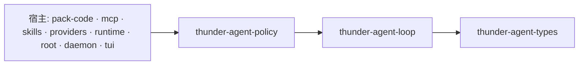

[English](README_en.md) | [简体中文](README.md)

# thunder-agent-loop

Thunder 的内核：一个 `AgentLoop` 就是一个完整的单 agent 单元——模型对话、工具执行缝、事件流、取消、
暂停、插话、上下文压缩与 prompt-cache 预热。它对审批、策略、沙箱、MCP、业务流程一无所知，这些都属于宿主。

## 定位

- **单元，不是应用。** 构造、注入模型客户端与工具、`start`、观察事件、`join`。调度器组合多个单元；
  本 crate 永不反向依赖调度器。
- **通用内核。** 不假设文件系统、shell 或编码场景。`tests/generic_kernel_test.rs` 用纯表单提交工具
  跑完了完整闭环。
- **无策略。** 工具面只有 `seam::Tools`：`specs()` 与 `call()`。一旦策略类型进入 `seam.rs`，
  `tests/kernel_boundary_test.rs` 会让构建失败。
- **有界。** 轮数、token、事件字节、工具输出、摘要并发、重复调用全部有上限，每一项都有明确的失败方向。

内部实现（轮次流水线、事件预算、压缩与预热经济学）见 [ARCHITECTURE_zh.md](ARCHITECTURE_zh.md)。

## crate 边界

内部依赖仅 `thunder-agent-types`（消息、事件、工具定义、trace、scope、policy 标签等线上词汇表），
其余为 tokio/serde/regex。

依赖它的 crate：`thunder-agent-policy`、`thunder-agent-pack-code`、`thunder-agent-mcp`、
`thunder-agent-skills`、`thunder-agent-providers`、`thunder-agent-runtime`、`thunder-agent-root`、
`thunder-agent-daemon`、`thunder-agent-core/tui`、`thunder-agent-core/conversation`。



箭头指向被依赖方：kernel 只依赖 `thunder-agent-types`。

## 嵌入一个单元

```rust
use async_trait::async_trait;
use futures_util::future::BoxFuture;
use serde_json::json;
use std::sync::Arc;
use thunder_agent_loop::prelude::*;
use tokio_util::sync::CancellationToken;

struct EchoClient;

#[async_trait]
impl LLMClientTrait for EchoClient {
    async fn stream_chat(
        &self,
        _options: ChatRequestOptions,
        _cancel: CancellationToken,
    ) -> Result<tokio::sync::mpsc::Receiver<Result<LLMStreamChunk, String>>, String> {
        let (tx, rx) = tokio::sync::mpsc::channel(4);
        tokio::spawn(async move {
            let _ = tx
                .send(Ok(LLMStreamChunk::Completed {
                    content: Some("done".into()),
                    tool_calls: Vec::new(),
                    finish_reason: "stop".into(),
                    prompt_tokens: Some(1),
                    completion_tokens: Some(1),
                    cached_tokens: None,
                    cache_write_tokens: None,
                    reasoning_tokens: None,
                }))
                .await;
        });
        Ok(rx)
    }
}

struct NoopTools;

impl Tools for NoopTools {
    fn specs(&self) -> Vec<ToolSpec> {
        vec![ToolSpec::parallel(ToolDefinition::new_function(
            "noop",
            "do nothing",
            json!({"type": "object", "properties": {}}),
        ))]
    }

    fn call<'a>(
        &'a self,
        call: &'a ToolCall,
        _ctx: ToolCallContext<'a>,
    ) -> BoxFuture<'a, ToolOutcome> {
        Box::pin(async move { ToolOutcome::success(format!("{}: ok", call.function.name)) })
    }
}

#[tokio::main]
async fn main() -> Result<(), AgentError> {
    let agent = AgentLoop::new(AgentConfig::new("gpt-4o").with_max_turns(20))
        .with_custom_client(Arc::new(EchoClient))
        .with_tools(Arc::new(NoopTools));

    let mut handle = agent.start("hello", None)?;
    let mut events = handle.take_events().expect("事件流只能取出一次");
    while let Some(observed) = events.recv().await {
        if let AgentEvent::TokenDelta { delta, .. } = &observed.event {
            print!("{delta}");
        }
    }

    let result = handle.join().await?;
    println!("{:?} {:?}", result.finish_reason, result.final_content);
    Ok(())
}
```

示例之外的硬性约定：

- `specs()` **每轮调用一次**，其顺序是 provider 请求前缀的一部分。顺序必须稳定，否则 prompt cache 失效。
- `call()` 不得 panic，必须观察 `ctx.cancel`；任何失败都转成 `ToolOutcome { is_error: true, .. }`
  回喂给模型，不会结束本次运行。
- `join()` 在结果产生时立即返回，与事件流是否被读完无关。

## 公开接口

### 构造

| 方法 | 作用 |
|---|---|
| `AgentLoop::new(config: AgentConfig)` | 生成单元 id、scratchpad、暂停闸门、插话队列，以及本单元的摘要限流器（`max_concurrent_summaries`）。 |
| `.with_id(id)` | 稳定 id：用于事件、错误与 scratchpad 路径 `base_dir/<id>/`。 |
| `.with_custom_client(Arc<dyn LLMClientTrait>)` | 模型传输。默认是 `UnconfiguredLLMClient`，首次调用即返回错误。 |
| `.with_tools(Arc<dyn Tools>)` | 固定工具集；拿不到本次运行的事件/trace sink。 |
| `.with_tools_factory(Arc<dyn ToolsFactory>)` | 每次运行重建工具，并注入 `RunContext { session_id, route, events, trace }`。优先于 `with_tools`。 |
| `.with_completion_gate(Arc<dyn CompletionGate>, max_rounds)` | 判定答案是否真的完成；`max_rounds = 0` 等于关闭。 |
| `.with_summary_limit(Arc<Semaphore>)` | 让多个 agent 共用一个摘要并发额度。 |
| `.with_pause_gate(Arc<PauseGate>)` / `.with_steer_queues(Arc<SteerQueues>)` | 接管宿主自持的控制原语。 |
| `id()` · `status()` · `is_running()` · `config()` · `scratchpad()` · `steer_queues()` · `event_drop_counters()` · `subscribe_events()` | 只读访问。`subscribe_events()` 是有损 broadcast 旁路（容量 128）。 |
| `.start(input, cancel_token) -> Result<AgentHandle, AgentError>` | 非阻塞。`input` 为 `ContextInput::{Text, Messages, Buffer}`；设置了 `config.system_prompt` 时会覆盖 transcript 里的 system 消息。 |
| `.run(input, cancel_token).await -> Result<AgentRunResult, AgentError>` | `start` + 在派生任务里排空事件流 + `join`。事件被丢弃，需要就先订阅。 |

### `AgentHandle`

| 方法 | 作用 |
|---|---|
| `take_events() -> Option<EventStream>` / `events() -> Option<&mut EventStream>` | 本次运行的可靠事件流，只能取出一次。 |
| `join(self).await -> Result<AgentRunResult, AgentError>` | 等待运行结果；任务异常终止时为 `AgentError::Terminated`。 |
| `cancel()` | 通过 `CancellationToken` 取消本单元任务，不影响兄弟单元。 |
| `pause()` / `resume()` / `is_paused()` | 协作式暂停，在下一个工具边界生效。 |
| `steer(msg)` / `follow_up(msg)` | 向进行中的运行投递输入。 |
| `steer_queues()` / `clear_queue()` | 查看两个队列 / 取回全部待投递消息（交给编辑器恢复）。 |
| `status()` · `is_running()` · `agent_id()` | 状态快照。 |

### 工具缝

| 条目 | 形状 |
|---|---|
| `ToolSpec` | `{ definition: ToolDefinition, concurrency: Concurrency }`；`ToolSpec::parallel(..)`、`ToolSpec::new(..)`。 |
| `Concurrency` | `Parallel`（默认）或 `Sequential`。批次里只要有一个 `Sequential`，**整批**按 `tool_calls` 顺序串行。 |
| `ToolOutcome` | `{ output, is_error, truncated, original_bytes, telemetry: Option<SystemNotice> }`；`success(..)`、`error(..)`。 |
| `ToolCallContext<'a>` | `{ tool_call_id, turn, route, cancel, timeout, events: Option<Arc<dyn ToolEventSink>> }`。 |
| `Tools` | `specs() -> Vec<ToolSpec>`；`call(&self, &ToolCall, ToolCallContext) -> BoxFuture<ToolOutcome>`。 |
| `ToolsFactory` | `for_run(&RunContext) -> Arc<dyn Tools>`。 |
| `RunContext` | `{ session_id, route, events: Arc<dyn ToolEventSink>, trace: Arc<dyn ToolTraceSink> }`。 |
| `NoTools` | 空规格；任何调用都得到错误结果。既无工具也无工厂时自动安装。 |
| `ExecutedCall` | `{ tool_call, result: ToolExecutionResult }`——恒定配对，顺序与请求一致。 |

`thunder-agent-policy` 提供参考实现（`RegistryTools`、`StaticToolsFactory`、`plain_tools`、`single_tool`）；
想要自己的策略就直接实现 `Tools`。

## 配置项与默认值

`AgentConfig`（`src/types/config.rs`）：

| 字段 | 默认值 | 含义 |
|---|---|---|
| `model` | `"gpt-4o"` | 请求的模型 id。 |
| `system_prompt` | `None` | 宿主为**本次**运行拼装的提示词，优先于 transcript 里的 system 消息。 |
| `temperature` / `top_p` / `max_completion_tokens` | `None` | 原样透传。 |
| `max_turns` | `Some(50)` | `None` 表示不设上限（`with_unlimited_turns()`）。 |
| `max_tokens_budget` | `None` | 上下文估算上限；超限以 `BudgetExceeded` 结束。 |
| `max_tool_output_bytes` | `64 KiB` | 由宿主的工具适配层消费，内核自身不读。 |
| `max_event_bytes` | `8 MiB`（`DEFAULT_MAX_EVENT_BYTES`） | 本次运行事件队列的字节预算。 |
| `request_timeout_ms` | `60_000` | 传给工具缝的单次调用超时。 |
| `max_stream_retries` | `2` | 每轮流式重连次数。 |
| `thinking_level` | `None` | provider 推理档位。 |
| `workspace_dir` / `extra_workspace_roots` | `None` / `[]` | 供宿主工具做路径限定。 |
| `session_id` | `None` | prompt-cache 路由键，也是预热器的身份。 |
| `prompt_cache_warm` | `None` | 预热设置（`PromptCacheWarmSettings`）。 |
| `route` | `None` | 向共享服务标识本次运行；以 `ToolCallContext::route` 抵达工具。 |
| `pruning` / `scratchpad` / `loop_guard` | 见下 | |

`ContextPruningConfig`：

| 字段 | 默认值 |
|---|---|
| `max_context_tokens` | `128_000` |
| `reserve_tokens` | `16_384`（触发条件 `estimated > max − reserve`） |
| `keep_recent_tokens` | `20_000`（永不摘要） |
| `summarizer_model` | `None`（回落到 `model`） |
| `summarizer_max_tokens` | `4096` |
| `pin_system_prompt` | `true`（声明字段；内核的 `region_floor` 无论如何都钉住索引 0） |
| `max_concurrent_summaries` | `2` |

`LoopGuardConfig`：`max_history = 10`、`repetition_threshold = 3`、
`hard_repetition_limit = 5`、`max_consecutive_errors = 5`。

`ScratchpadConfig`：`base_dir = <用户数据根>/scratchpad`（`$THUNDER_CONFIG_DIR`，见 `core::paths`）、
`threshold_bytes = 16 KiB`、`preview_bytes = 1024`、`auto_cleanup = false`。

## 事件

两条投递路径：宿主排空的可靠 `EventStream`，以及供即发即忘观察者使用的有损 `broadcast` 旁路
（`subscribe_events`，容量 128）。两者载荷相同：`ObservedEvent { agent_id, event, timestamp_ms }`。

| 事件 | 时机 |
|---|---|
| `TurnStart` / `TurnEnd` | 轮次边界；`TurnEnd` 携带 `TurnStats`。 |
| `TokenDelta` / `ReasoningDelta` / `ToolCallChunk` | 流式微增量。 |
| `ToolCallReady` / `ToolExecStart` / `ToolExecResult` | 宣告调用、开始执行、结果落地（恒定配对）。 |
| `ToolTrace` | 每次调用一条记录，由宿主的执行器 sink 产生。 |
| `TelemetryNotice` | 附着在工具结果上的结构化、面向模型的提示。 |
| `ContextCompacted` | checkpoint 压缩重写了较早的历史。 |
| `SteerAccepted` | 排队消息在轮次边界进入 transcript。 |
| `GateResult` | 完成闸门的判定（`pass` / `retry` / `fail`）。 |
| `Custom { kind, payload }` | 宿主/工具自定义事件，原样转发。 |
| `Error` / `LoopComplete` | 终止帧。 |

微增量按契约可有损：队列预算耗尽时立即丢弃并计入 `EventDropCounters::micro_deltas()`。
结构性事件最多等待 `DELIVERY_DEADLINE`（5 秒），超时按结构性丢弃计数。
`structural() > 0` 即表示「本次运行的记录可能不完整」。

## 失败方向

| 情况 | 结果 |
|---|---|
| 运行中再次 `start` | `AgentError::AlreadyRunning`——一个单元同时只跑一个任务。 |
| 循环任务 panic 或被丢弃 | `join()` → `AgentError::Terminated`（忙标志仍由 `RunningGuard` 清掉）。 |
| 未配置客户端 | 每次连接都失败；耗尽 `max_stream_retries` 后 → `AgentEvent::Error`，`FinishReason::Error`。 |
| 上下文溢出 | 先压缩再重试，每轮最多 2 次；上限取自 provider 错误，取不到则用窗口的 60 %。 |
| 流中断 | 最多重连 `max_stream_retries` 次（500 ms × 2ⁿ 退避）；正文断点续写，工具参数请求模型重发。 |
| 工具返回错误 | 作为工具结果回喂模型，不结束运行。 |
| 连续 5 次工具错误 / 5 次完全相同的调用 | 熔断或硬重复上限 → `FinishReason::Error`。 |
| 达到 `max_turns` / `max_tokens_budget` | `MaxTurnsExceeded` / `BudgetExceeded`。 |
| 被取消 | `FinishReason::Cancelled`；已宣告但未执行的工具调用补上取消结果，已生成的部分回答保留。 |
| 消费者停止读事件 | 微增量立即丢弃计数；结构性事件 5 秒后丢弃计数；运行继续。 |
| 摘要器不可用或失败 | 紧急裁剪：在硬窗口之外丢弃最旧的完整轮次。 |

## 测试

`tests/` 即行为契约：`kernel_boundary_test`（工具缝保持无策略）、`seam_contract_test`、
`unit_contract_test`、`generic_kernel_test`（不含编码概念）、`run_lifecycle_test`（运行结束后不留状态）、
`event_budget_test`、`checkpoint_compaction_test`、`compaction_concurrency_test`、`cache_warmer_test`、
`cancel_continuity_test`（取消后对话仍可继续）、`steer_test`、`pause_gate_test`、
`stream_continuation_test`、`auto_heal_test`、`system_prompt_authority_test`、
`autonomous_termination_test`、`context_test`、`utf8_safety_test`。

```bash
cargo test -p thunder-agent-loop
cargo run -p thunder-agent-loop --release --example benchmark
```

## 扩展点

| 想改什么 | 实现什么 |
|---|---|
| 模型传输 | `LLMClientTrait` |
| 工具集、审批、沙箱、trace | `Tools` / `ToolsFactory` |
| 「算完成」的判定 | `CompletionGate` |
| 人工介入暂停 | `PauseGate`（或 `AgentHandle::pause`） |
| 运行中用户输入 | `SteerQueues`（或 `AgentHandle::steer` / `follow_up`） |
| 超长输出落盘 | `ScratchpadManager::process_tool_output` |

其余一律不可插拔：内核不持有任何注册表。
