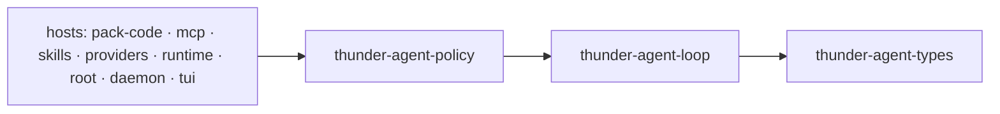

[English](README_en.md) | [简体中文](README.md)

# thunder-agent-loop

The kernel of Thunder: one `AgentLoop` is one complete single-agent unit — a model
conversation, a tool-execution seam, an event stream, cancellation, pause, steering,
compaction and prompt-cache warming. It knows nothing about approval, policies,
sandboxes, MCP or workflows; those live in the host.

## What it is

- **A unit, not an app.** Construct it, hand it a model client and tools, call
  `start`, observe events, `join`. A scheduler composes many units; this crate
  never depends on the scheduler.
- **Generic.** No filesystem, shell or coding assumption. `tests/generic_kernel_test.rs`
  runs a form-submission workflow with no file or shell tool at all.
- **Policy-free.** The only tool surface is `seam::Tools` — `specs()` and `call()`.
  `tests/kernel_boundary_test.rs` fails the build if a policy type enters `seam.rs`.
- **Bounded.** Turns, tokens, event bytes, tool output, summarization concurrency
  and repetition are all capped, with a documented failure direction for each.

Internals — turn pipeline, event budget math, compaction and warmer economics —
are in [ARCHITECTURE.md](ARCHITECTURE.md).

## Crate boundary

Internal dependency: `thunder-agent-types` only (wire vocabulary: messages, events,
tool definitions, trace, scope, policy tags). Everything else is tokio/serde/regex.

Crates that depend on it: `thunder-agent-policy`, `thunder-agent-pack-code`,
`thunder-agent-mcp`, `thunder-agent-skills`, `thunder-agent-providers`,
`thunder-agent-runtime`, `thunder-agent-root`, `thunder-agent-daemon`,
`thunder-agent-core/tui`, `thunder-agent-core/conversation`.



Arrows point at the dependency: the loop needs only `thunder-agent-types`.

## Embedding a unit

```rust
use async_trait::async_trait;
use futures_util::future::BoxFuture;
use serde_json::json;
use std::sync::Arc;
use thunder_agent_loop::prelude::*;
use tokio_util::sync::CancellationToken;

struct EchoClient;

#[async_trait]
impl LLMClientTrait for EchoClient {
    async fn stream_chat(
        &self,
        _options: ChatRequestOptions,
        _cancel: CancellationToken,
    ) -> Result<tokio::sync::mpsc::Receiver<Result<LLMStreamChunk, String>>, String> {
        let (tx, rx) = tokio::sync::mpsc::channel(4);
        tokio::spawn(async move {
            let _ = tx
                .send(Ok(LLMStreamChunk::Completed {
                    content: Some("done".into()),
                    tool_calls: Vec::new(),
                    finish_reason: "stop".into(),
                    prompt_tokens: Some(1),
                    completion_tokens: Some(1),
                    cached_tokens: None,
                    cache_write_tokens: None,
                    reasoning_tokens: None,
                }))
                .await;
        });
        Ok(rx)
    }
}

struct NoopTools;

impl Tools for NoopTools {
    fn specs(&self) -> Vec<ToolSpec> {
        vec![ToolSpec::parallel(ToolDefinition::new_function(
            "noop",
            "do nothing",
            json!({"type": "object", "properties": {}}),
        ))]
    }

    fn call<'a>(
        &'a self,
        call: &'a ToolCall,
        _ctx: ToolCallContext<'a>,
    ) -> BoxFuture<'a, ToolOutcome> {
        Box::pin(async move { ToolOutcome::success(format!("{}: ok", call.function.name)) })
    }
}

#[tokio::main]
async fn main() -> Result<(), AgentError> {
    let agent = AgentLoop::new(AgentConfig::new("gpt-4o").with_max_turns(20))
        .with_custom_client(Arc::new(EchoClient))
        .with_tools(Arc::new(NoopTools));

    let mut handle = agent.start("hello", None)?;
    let mut events = handle.take_events().expect("the stream is taken once");
    while let Some(observed) = events.recv().await {
        if let AgentEvent::TokenDelta { delta, .. } = &observed.event {
            print!("{delta}");
        }
    }

    let result = handle.join().await?;
    println!("{:?} {:?}", result.finish_reason, result.final_content);
    Ok(())
}
```

Rules that the example cannot show:

- `specs()` is called **once per turn**; its order is part of the provider request
  prefix. Return a stable order or prompt caching breaks.
- `call()` must not panic and must observe `ctx.cancel`; every failure becomes
  `ToolOutcome { is_error: true, .. }` and is fed back to the model — it does not
  end the run.
- `join()` returns the result as soon as the run has one, independently of whether
  the event stream was drained.

## Public surface

### Constructing a unit

| Method | Effect |
|---|---|
| `AgentLoop::new(config: AgentConfig)` | Generates the unit id, scratchpad, pause gate, steer queues and a per-unit summary limiter (`max_concurrent_summaries`). |
| `.with_id(id)` | Stable id used in events, errors and the scratchpad path `base_dir/<id>/`. |
| `.with_custom_client(Arc<dyn LLMClientTrait>)` | Model transport. Default is `UnconfiguredLLMClient`, which returns an error on first use. |
| `.with_tools(Arc<dyn Tools>)` | Fixed tools. They receive no run event/trace sinks. |
| `.with_tools_factory(Arc<dyn ToolsFactory>)` | Builds tools per run and hands them `RunContext { session_id, route, events, trace }`. Wins over `with_tools`. |
| `.with_completion_gate(Arc<dyn CompletionGate>, max_rounds)` | Judges a finished answer; `max_rounds = 0` disables it. |
| `.with_summary_limit(Arc<Semaphore>)` | Shares one summarization limiter across several agents. |
| `.with_pause_gate(Arc<PauseGate>)` / `.with_steer_queues(Arc<SteerQueues>)` | Adopt control primitives owned by the host. |
| `id()` · `status()` · `is_running()` · `config()` · `scratchpad()` · `steer_queues()` · `event_drop_counters()` · `subscribe_events()` | Read-only accessors. `subscribe_events()` is a lossy broadcast sidecar (capacity 128). |
| `.start(input, cancel_token) -> Result<AgentHandle, AgentError>` | Non-blocking. `input` is `ContextInput::{Text, Messages, Buffer}`; `config.system_prompt`, when set, replaces any system message in the transcript. |
| `.run(input, cancel_token).await -> Result<AgentRunResult, AgentError>` | `start` + drain the stream in a spawned task + `join`. Events are discarded; subscribe first if you need them. |

### `AgentHandle`

| Method | Effect |
|---|---|
| `take_events() -> Option<EventStream>` / `events() -> Option<&mut EventStream>` | The reliable per-run stream. Taken once. |
| `join(self).await -> Result<AgentRunResult, AgentError>` | Waits for the run's result (`AgentError::Terminated` if the task died without one). |
| `cancel()` | Cancels this unit's task via `CancellationToken`. Siblings are unaffected. |
| `pause()` / `resume()` / `is_paused()` | Cooperative pause, applied at the next tool boundary. |
| `steer(msg)` / `follow_up(msg)` | Enqueue input into the in-flight run. |
| `steer_queues()` / `clear_queue()` | Inspect both queues / take every queued message back (for editor restore). |
| `status()` · `is_running()` · `agent_id()` | State snapshot. |

### The tool seam

| Item | Shape |
|---|---|
| `ToolSpec` | `{ definition: ToolDefinition, concurrency: Concurrency }`; `ToolSpec::parallel(..)`, `ToolSpec::new(..)`. |
| `Concurrency` | `Parallel` (default) or `Sequential`. One `Sequential` tool in a batch serializes the **whole** batch in `tool_calls` order. |
| `ToolOutcome` | `{ output, is_error, truncated, original_bytes, telemetry: Option<SystemNotice> }`; `success(..)`, `error(..)`. |
| `ToolCallContext<'a>` | `{ tool_call_id, turn, route, cancel, timeout, events: Option<Arc<dyn ToolEventSink>> }`. |
| `Tools` | `specs() -> Vec<ToolSpec>`; `call(&self, &ToolCall, ToolCallContext) -> BoxFuture<ToolOutcome>`. |
| `ToolsFactory` | `for_run(&RunContext) -> Arc<dyn Tools>`. |
| `RunContext` | `{ session_id, route, events: Arc<dyn ToolEventSink>, trace: Arc<dyn ToolTraceSink> }`. |
| `NoTools` | Empty specs; every call is answered with an error outcome. Installed when neither tools nor a factory exist. |
| `ExecutedCall` | `{ tool_call, result: ToolExecutionResult }` — always paired, always in request order. |

`thunder-agent-policy` supplies the reference implementation (`RegistryTools`,
`StaticToolsFactory`, `plain_tools`, `single_tool`); a host that wants its own policy
implements `Tools` directly.

## Configuration and defaults

`AgentConfig` (`src/types/config.rs`):

| Field | Default | Meaning |
|---|---|---|
| `model` | `"gpt-4o"` | Requested model id. |
| `system_prompt` | `None` | Host-assembled prompt for **this** run; wins over a transcript system message. |
| `temperature` / `top_p` / `max_completion_tokens` | `None` | Forwarded as-is. |
| `max_turns` | `Some(50)` | `None` = unlimited (`with_unlimited_turns()`). |
| `max_tokens_budget` | `None` | Estimated context ceiling; exceeding it ends the run as `BudgetExceeded`. |
| `max_tool_output_bytes` | `64 KiB` | Consumed by the host's tool adapter, not by the loop itself. |
| `max_event_bytes` | `8 MiB` (`DEFAULT_MAX_EVENT_BYTES`) | Byte budget for the run's event queue. |
| `request_timeout_ms` | `60_000` | Per-tool-call timeout passed to the seam. |
| `max_stream_retries` | `2` | Stream reconnects per turn. |
| `thinking_level` | `None` | Provider reasoning hint. |
| `workspace_dir` / `extra_workspace_roots` | `None` / `[]` | Used by host tools (path scoping). |
| `session_id` | `None` | Prompt-cache routing key and warmer identity. |
| `prompt_cache_warm` | `None` | Warmer settings (`PromptCacheWarmSettings`). |
| `route` | `None` | Identifies the run to shared services; reaches tools as `ToolCallContext::route`. |
| `pruning` / `scratchpad` / `loop_guard` | below | |

`ContextPruningConfig`:

| Field | Default |
|---|---|
| `max_context_tokens` | `128_000` |
| `reserve_tokens` | `16_384` (trigger at `estimated > max − reserve`) |
| `keep_recent_tokens` | `20_000` (never summarized) |
| `summarizer_model` | `None` (falls back to `model`) |
| `summarizer_max_tokens` | `4096` |
| `pin_system_prompt` | `true` (declared; the kernel's `region_floor` pins index 0 regardless) |
| `max_concurrent_summaries` | `2` |

`LoopGuardConfig`: `max_history = 10`, `repetition_threshold = 3`,
`hard_repetition_limit = 5`, `max_consecutive_errors = 5`.

`ScratchpadConfig`: `base_dir = <user data root>/scratchpad` (`$THUNDER_CONFIG_DIR`,
see `core::paths`), `threshold_bytes = 16 KiB`, `preview_bytes = 1024`,
`auto_cleanup = false`.

## Events

Two delivery paths exist: the reliable per-run `EventStream` (drained by the host)
and a lossy `broadcast` sidecar (`subscribe_events`, capacity 128) for fire-and-forget
observers. Both carry the same `ObservedEvent { agent_id, event, timestamp_ms }`.

| Event | When |
|---|---|
| `TurnStart` / `TurnEnd` | Turn boundaries; `TurnEnd` carries `TurnStats`. |
| `TokenDelta` / `ReasoningDelta` / `ToolCallChunk` | Streaming micro-deltas. |
| `ToolCallReady` / `ToolExecStart` / `ToolExecResult` | Announced call, dispatch, settled result (always paired). |
| `ToolTrace` | One record per call, produced by the host's executor sink. |
| `TelemetryNotice` | Structured, model-facing note attached to a tool result. |
| `ContextCompacted` | A checkpoint compaction rewrote the older history. |
| `SteerAccepted` | A queued message entered the transcript at a turn boundary. |
| `GateResult` | Completion gate verdict (`pass` / `retry` / `fail`). |
| `Custom { kind, payload }` | Host/tool-defined event, forwarded verbatim. |
| `Error` / `LoopComplete` | Terminal frames. |

Micro-deltas are lossy by contract: if the queue budget is exhausted they are
dropped immediately and counted in `EventDropCounters::micro_deltas()`. Structural
events wait up to `DELIVERY_DEADLINE` (5 s) and then count as structural drops.
Treat `structural() > 0` as "this run's record may be incomplete".

## Failure directions

| Situation | Result |
|---|---|
| `start` while running | `AgentError::AlreadyRunning` — one run per unit. |
| Loop task panicked or dropped | `join()` → `AgentError::Terminated` (the busy flag is still cleared by `RunningGuard`). |
| No client configured | Every connection attempt fails; after `max_stream_retries` → `AgentEvent::Error`, `FinishReason::Error`. |
| Context overflow | Compaction + retry, at most 2 times per turn; limit read from the provider error, else 60 % of the window. |
| Stream interrupted | Up to `max_stream_retries` reconnects (500 ms × 2ⁿ backoff); content is continued, tool-call arguments are re-requested. |
| Tool returned an error | Fed back to the model as the tool result; a run is not ended by it. |
| 5 consecutive tool errors / 5 identical calls | Circuit breaker or hard repetition limit → `FinishReason::Error`. |
| `max_turns` / `max_tokens_budget` reached | `MaxTurnsExceeded` / `BudgetExceeded`. |
| Cancelled | `FinishReason::Cancelled`; announced-but-unrun tool calls are answered with a cancellation result, the partial answer is kept. |
| Consumer stops reading events | Micro-deltas dropped and counted; structural events dropped after 5 s and counted; the run continues. |
| Summarizer unavailable or failing | Emergency trim drops oldest complete turns while over the hard window. |

## Tests

`tests/` is the behavioural contract: `kernel_boundary_test` (seam stays policy-free),
`seam_contract_test`, `unit_contract_test`, `generic_kernel_test` (no coding concepts),
`run_lifecycle_test` (a finished run holds no state), `event_budget_test`,
`checkpoint_compaction_test`, `compaction_concurrency_test`, `cache_warmer_test`,
`cancel_continuity_test` (a cancelled run is still resumable), `steer_test`,
`pause_gate_test`, `stream_continuation_test`, `auto_heal_test`,
`system_prompt_authority_test`, `autonomous_termination_test`, `context_test`,
`utf8_safety_test`.

```bash
cargo test -p thunder-agent-loop
cargo run -p thunder-agent-loop --release --example benchmark
```

## Extension points

| Want to change | Implement |
|---|---|
| Model transport | `LLMClientTrait` |
| Tool set, approval, sandbox, traces | `Tools` / `ToolsFactory` |
| Definition of done | `CompletionGate` |
| Human-in-the-loop pause | `PauseGate` (or `AgentHandle::pause`) |
| Mid-run user input | `SteerQueues` (or `AgentHandle::steer` / `follow_up`) |
| Oversized output handling | `ScratchpadManager` (`process_tool_output`) |

Nothing else is pluggable by design: the loop has no registry of its own.
