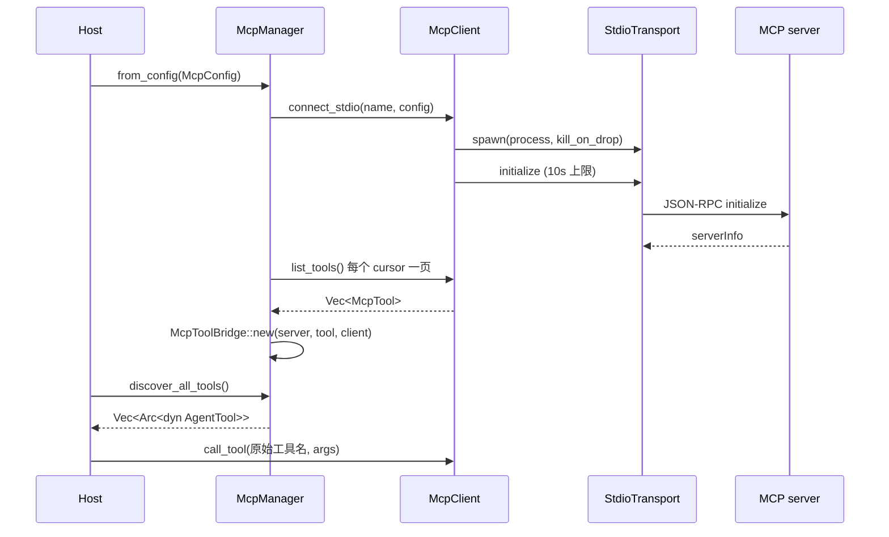

[English](README_en.md) | [简体中文](README.md)

# thunder-agent-mcp

## 定位

Model Context Protocol 的客户端、配置解析、工具桥接，以及一个可嵌入的服务端实现。它负责把外部 MCP 服务器的工具变成 `thunder-agent-policy` 的 `AgentTool` / `ToolPlugin`，让循环无需知道 MCP 的存在。

不实现 MCP 的 resources、prompts、sampling、roots；只做 `initialize` / `ping` / `tools/list` / `tools/call`。

## crate 边界

| 方向 | crate | 用到的部分 |
|---|---|---|
| 依赖 | `thunder-agent-types` | `tool::ToolDefinition`、`tool::ProgressReporter` |
| 依赖 | `thunder-agent-policy` | `AgentTool`、`ToolExecutionContext`、`plugin::{Plugin, ToolPlugin, CallToolResult, ToolContent}` |
| 依赖 | `thunder-agent-loop` | `core::paths::{thunder_subdir, real_home_dir}`（配置发现） |
| 被依赖 | `thunder-agent-root` | 可选依赖，feature `mcp` |
| 被依赖 | `thunder-agent-daemon` | 必需依赖 |
| 被依赖 | `thunder-agent-core/tui` | 必需依赖 |

## 模块

| 文件 | 内容 |
|---|---|
| `src/client.rs` | `McpClient`：协议方法（`initialize`、`list_tools`、`call_tool`、`ping`、`close`），请求 id 自增 |
| `src/transport/mod.rs` | `McpTransport` trait：`send_request`、`send_notification`、`is_alive`、`close` |
| `src/transport/stdio.rs` | `StdioTransport`：子进程、帧读取、待答表、超时 |
| `src/transport/mock.rs` | `MockTransport`：内置标准方法应答，或注入 handler |
| `src/protocol.rs` | JSON-RPC 与 MCP 线格式类型；`LATEST_PROTOCOL_VERSION = "2024-11-05"` |
| `src/config.rs` | `McpServerConfig`、`McpConfig`、配置发现 |
| `src/manager.rs` | `McpManager`：每台服务器一个 `Arc<McpClient>`，批量发现与关闭 |
| `src/tool_bridge.rs` | `McpToolBridge`：远端工具 → 本地 `AgentTool` + `ToolPlugin` |
| `src/server.rs` | `McpServer`：把本地 `ToolPlugin` 暴露给任意 MCP 客户端 |
| `src/error.rs` | `McpError` |

## 一次典型流程

`McpManager` 对每台服务器持有一个 `Arc<McpClient>`；桥接对象共享同一个 client，因此同一服务器的并发调用在同一条 stdio 连接上多路复用，靠请求 id 区分。

## 传输：JSON-RPC over stdio

`StdioTransport::spawn` 启动 `command + args`，`stdin`/`stdout`/`stderr` 全部 pipe，设置 `kill_on_drop(true)`，`Child` 句柄保存在 `Arc<Mutex<Option<Child>>>` 中而不是局部变量，因此进程生命周期等于 transport 生命周期。

内部三个任务：

| 任务 | 行为 |
|---|---|
| stdin 写 | 从 `mpsc::channel(64)` 取已序列化消息，逐条写 `\n` 并 flush；任何写失败即把 `is_alive` 置 false |
| stdout 读 | 按行读帧，解析 `JsonRpcResponse`，按 id 取出待答表中的 `oneshot::Sender` 并投递；结束或读错误时 `is_alive = false` |
| stderr 排空 | 逐行 `debug!` 记录，防止服务器因 stderr 写满阻塞 |

待答表 `PendingMap` 的 key 是 id 的字符串形式（数字 `to_string`，字符串原样）。`send_request` 用 `PendingEntry` RAII 注册：正常应答、序列化失败、stdin 已死、超时，任何退出路径都会注销条目——曾经的实现只在部分路径手工移除，超时路径会永久泄漏表项。

并发调用互不阻塞：每个 `send_request` 持有自己的 oneshot 接收端。

`pending_len()` 是诊断量：静止时为 0，只增不减说明应答在丢失（或服务器回了没人问过的 id）。`oversized_frames()` 是另一个诊断量，见下节。

## 帧上限

| 项 | 值 |
|---|---|
| `DEFAULT_MAX_FRAME_BYTES` | 4 MiB（`4 * 1024 * 1024`） |
| 覆盖方式 | `McpServerConfig::max_frame_bytes` / `with_max_frame_bytes(..)` |
| 生效位置 | `read_frame`，**读取过程中**，不是读完之后 |

超限帧的处理：

1. 一旦累计长度超过上限，后续字节继续从管道消费但不再写入缓冲区，因此 100 MB 应答不会进入堆；
2. `read_frame` 返回 `Frame::Oversized { bytes }` 而不是错误，连接保持可用，下一帧仍可正常读取；
3. 读任务把 `oversized_frames` 加一，并清空待答表——超限帧的 id 在已被丢弃的部分里，无法与任何请求匹配，与其让每个调用各自等到超时，不如立即失败；
4. 该次 `send_request` 以 `TransportError`（channel dropped）返回。

回归测试：`tests/stdio_lifecycle_test.rs::an_oversized_reply_is_discarded_and_fails_the_call`（10 MB 应答 + `max_frame_bytes = 64 KiB`，断言 5 秒内失败且 `oversized_frames() == 1`）。`transport/stdio.rs` 内另有 `frame_tests` 单元测试覆盖正常帧、恰好等于上限、超限丢弃后连接仍可用、空输入 EOF。

## 超时与生命周期

| 项 | 值 |
|---|---|
| `DEFAULT_REQUEST_TIMEOUT` | 120 s，一次请求往返的上限 |
| `McpServerConfig::timeout_ms` | 未设置 → 默认 120 s；`0` → 无上限（唯一可能永久等待的配置） |
| 连接握手 | `McpClient::connect_stdio` 对 `initialize` 施加 10 s 上限，超时返回 `TransportError` |
| 超时后状态 | 返回 `TransportError`（"did not answer request ... within Nms"）；表项已注销；transport 仍视为存活，因为慢服务器不等于死服务器 |
| 进程回收 | `close()` 置 `is_alive = false`、清空待答表（每个等待者立即以 "channel dropped" 返回）、从 `Mutex` 中取出 `Child` 并 `kill().await`（SIGKILL 并 `wait`，不留僵尸）；幂等 |
| 隐式回收 | transport 被 drop 时 `kill_on_drop(true)` 结束子进程 |

`is_alive()` 在 stdin 或 stdout 任务结束时变为 false；此后的请求直接返回 `NotConnected`。

## 配置

`McpServerConfig`：

| 字段 | 类型 | 默认 | 说明 |
|---|---|---|---|
| `command` | `String` | 必填 | 可执行文件 |
| `args` | `Vec<String>` | 空 | |
| `env` | `HashMap<String, String>` | 空 | 追加到子进程环境 |
| `disabled` | `bool` | `false` | 为 true 时 `McpManager::from_config` 跳过 |
| `cwd` | `Option<PathBuf>` | `None` | 子进程工作目录 |
| `timeout_ms` | `Option<u64>` | `None` → 120 s；`0` = 无上限 | 单次请求往返 |
| `max_frame_bytes` | `Option<usize>` | `None` → 4 MiB | 单帧上限 |

`McpConfig` 的线上形状是 `{"mcpServers": { "<name>": { .. } }}`。`parse_json` 依次尝试：标准包装（且服务器非空），然后是裸 map `{"<name>": {"command": ..}}`，都失败则返回反序列化错误。`from_file` 读取文件，文件不存在返回 `IoError`。

`find_and_load_from_workspace(workspace)` 按顺序检查，返回第一个存在且 `mcp_servers` 非空的配置：

| 顺序 | 路径 |
|---|---|
| 1 | `<workspace>/.thunder/mcp.json` |
| 2 | `<workspace>/mcp_servers.json` |
| 3 | `<workspace>/.mcp.json` |
| 4 | `<workspace>/claude_desktop_config.json` |
| 5 | 相对路径 `mcp_servers.json` |
| 6 | 相对路径 `.mcp.json` |
| 7 | `thunder_subdir("mcp.json")` |
| 8 | `~/.mcp.json` |
| 9 | `~/mcp_servers.json` |
| 10 | `~/.cursor/mcp.json` |
| 11 | `~/.claude.json` |
| 12 | `~/Library/Application Support/Claude/claude_desktop_config.json` |
| 13 | `~/.config/claude/claude_desktop_config.json` |

第 7 项跟随 thunder 自己的数据根，其余跨工具文件留在真实 home 下（`real_home_dir()`）。

## 工具桥接

`McpToolBridge`：

| 项 | 行为 |
|---|---|
| 暴露名 | `mcp_<server>_<tool>`，server 与 tool 名字中的 `-` 替换为 `_` |
| 自定义名 | `with_custom_name(..)` |
| 描述 | `[MCP:<server>] ` + 远端描述；无描述时用 `MCP tool '<tool>' from server '<server>'` |
| `input_schema` | 直接透传远端的 `inputSchema` |
| `Plugin::id` | 暴露名 |
| `ToolPlugin::execute` | 若 `ctx.cancellation_token` 已取消，直接 `Err`；否则 `client.call_tool(原始工具名, args)`，把 text/image/resource 三种内容原样映射到 `CallToolResult` |
| `AgentTool::execute` | 调用 `ToolPlugin::execute` 后取 `plain_text()`；`is_error` 为真时返回 `Err(text)` |

`McpManager` 的发现接口：`discover_all_tools()` / `discover_all_tool_plugins()`（每台服务器默认 10 s 上限）、对应的 `_timeout(Duration)` 版本、`register_client`、`get_client`、`list_servers`、`close_all`。死掉的服务器（`is_alive() == false`）直接跳过；单台服务器 `list_tools` 失败或超时只记 `warn!`，不影响其它服务器。

## 服务端

`McpServer` 用于测试与嵌入：它把本地 `ToolPlugin` 暴露给任意 MCP 客户端。

| API | 说明 |
|---|---|
| `McpServer::new(name, version)` / `Default` | 默认 `("thunder-mcp-server", "0.1.0")` |
| `register_tool(Arc<dyn ToolPlugin>)` / `with_tool` / `with_tools` | 以 `definition().function.name` 为键存入 `BTreeMap` |
| `list_tools()` | 转为 `McpTool` 列表 |
| `handle_request` / `handle_request_with_progress` | 处理单个请求，通知返回 `None` |
| `handle_raw_line` / `handle_raw_line_with_progress` | 解析一行 JSON，返回可选的应答行；解析失败回 `-32700` |
| `serve(reader, writer)` | 逐行读取，每行 `tokio::spawn` 独立处理；写任务通过无界 channel 串行输出 |

支持的方法：`initialize`（能力只声明 `tools`）、`notifications/initialized`（无应答）、`ping`、`tools/list`、`tools/call`；未知方法回 `-32601`，参数错误回 `-32602`，工具不存在回 `-32601`，工具返回 `Err` 时以一个 `isError: true` 的文本结果应答而不是 JSON-RPC 错误。

若请求的 `params._meta.progressToken` 存在且 `serve` 提供了发送端，`tools/call` 会为执行上下文装上 `McpStreamProgressReporter`，把 `notifications/progress` 写入同一输出通道。

`tools/list` 一次返回全部工具，不带 `nextCursor`。

## 失败方向

| 情况 | 结果 |
|---|---|
| 服务器启动失败 | `McpError::ProcessFailed`（含服务器名与 command） |
| 握手未在 10 s 内完成 | `McpError::TransportError` |
| 请求超时 | `McpError::TransportError`，文本含 "did not answer request" |
| 帧超限 | 读任务丢弃并清空待答表；调用方收到 `TransportError`（channel dropped） |
| transport 已关闭/进程已退出 | `McpError::NotConnected` |
| JSON-RPC `error` | `McpError::JsonRpcError { code, message, data }` |
| 应答缺 `result` | `McpError::ProtocolError` |
| 应答结构不符 | `McpError::ProtocolError`（含反序列化原因） |
| 桥接层失败 | `Err("MCP tool execution failed on server '<name>': <原因>")` |
| 配置解析失败 | `McpError::SerializationError` |

`McpManager::from_config` 不因单台服务器连接失败而失败：它 `warn!` 后继续，返回只含成功连接的 manager。

## 已知边界

以下几点均按当前代码核实：

- **图片在 `AgentTool` 路径上被降级**：`ToolPlugin` 路径保留 `Image { data, mime_type }`，但 `AgentTool::execute` 返回字符串，`protocol::CallToolResult::plain_text()` 把图片渲染为 `[Image: <mime>]`，resource 渲染为 `[Resource <uri>]: <text>`。需要图片内容的宿主必须走 `ToolPlugin`。
- **分页只覆盖 `tools/list`**：`McpClient::list_tools` 会跟随 `nextCursor`，最多 32 页，并记录已见 cursor 防止循环。除此之外没有实现任何分页方法——`resources/*`、`prompts/*`、`logging/*` 均未实现。
- **服务器发起的请求被丢弃**：stdout 读任务只把行解析为 `JsonRpcResponse`，且只按 id 投递给待答表；sampling、roots 之类的服务器→客户端请求不会被应答，未知 id 只记一条 `debug!`。
- **服务器通知不被处理**：`notifications/*` 没有分发路径，`ProgressNotificationParams` 只用于服务端发送。
- **客户端不发进度**：`call_tool` 不写 `_meta.progressToken`，因此不会收到进度通知。
- **配置发现只取第一个非空文件**：不会合并多个配置文件；被选中文件里的服务器也不会与其它文件合并。

## 测试

| 文件 | 覆盖 |
|---|---|
| `tests/mcp_test.rs` | 标准 `mcpServers` 配置解析（含 `disabled`）、`MockTransport` 上的 initialize/ping/list/call、`McpToolBridge` 作为 `AgentTool`（名字 `mcp_test_srv_mock_fetch_data`、描述前缀）与作为 `ToolPlugin`、manager 发现、挂起服务器被 10 s 发现超时跳过 |
| `tests/mcp_server_test.rs` | 服务端 `initialize` + `tools/list` + `tools/call` 生命周期、`serve` 流式收发、`notifications/progress` 流式通知 |
| `tests/stdio_lifecycle_test.rs` | 真实 shell 脚本服务器在 `spawn` 后存活并应答、配置→`McpManager`→桥接工具、静默服务器超时且待答表归零、`timeout_ms = 0` 不设上限且 `close()` 释放等待者、10 MB 应答被帧上限丢弃并立即失败且 `oversized_frames() == 1` |
| `src/transport/stdio.rs` 内 `frame_tests` | 正常帧、恰好等于上限、超限丢弃后连接仍可用、空输入 EOF |

## 扩展点

- **新传输**：实现 `McpTransport`，用 `McpClient::from_transport(name, Arc<dyn McpTransport>)` 接入；`MockTransport::with_handler` 可在测试里伪造任意应答。
- **自定义暴露名**：`McpToolBridge::with_custom_name(..)`。
- **只注册部分服务器**：直接 `McpManager::new()` + `add_stdio_server` / `register_client`，而不是 `from_config`。
- **把本 crate 当服务端**：`McpServer::with_tools(..)` 后 `serve(stdin, stdout)`，即可被 IDE / 其它 MCP 客户端拉起。
