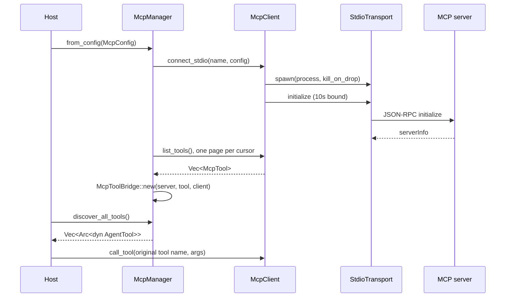

[English](README_en.md) | [简体中文](README.md)

# thunder-agent-mcp

## What it is

A Model Context Protocol client, configuration parser, tool bridge, and an embeddable server. It turns a remote MCP server's tools into `thunder-agent-policy` `AgentTool` / `ToolPlugin` values, so the loop never learns that MCP exists.

It does not implement MCP resources, prompts, sampling or roots. It speaks `initialize`, `ping`, `tools/list` and `tools/call`.

## Crate boundaries

| Direction | Crate | Used surface |
|---|---|---|
| depends on | `thunder-agent-types` | `tool::ToolDefinition`, `tool::ProgressReporter` |
| depends on | `thunder-agent-policy` | `AgentTool`, `ToolExecutionContext`, `plugin::{Plugin, ToolPlugin, CallToolResult, ToolContent}` |
| depends on | `thunder-agent-loop` | `core::paths::{thunder_subdir, real_home_dir}` (config discovery) |
| depended on by | `thunder-agent-root` | optional dependency behind feature `mcp` |
| depended on by | `thunder-agent-daemon` | required dependency |
| depended on by | `thunder-agent-core/tui` | required dependency |

## Modules

| File | Contents |
|---|---|
| `src/client.rs` | `McpClient`: protocol methods (`initialize`, `list_tools`, `call_tool`, `ping`, `close`) and an incrementing request id |
| `src/transport/mod.rs` | `McpTransport`: `send_request`, `send_notification`, `is_alive`, `close` |
| `src/transport/stdio.rs` | `StdioTransport`: child process, frame reader, pending table, timeouts |
| `src/transport/mock.rs` | `MockTransport`: canned replies for the standard methods, or an injected handler |
| `src/protocol.rs` | JSON-RPC and MCP wire types; `LATEST_PROTOCOL_VERSION = "2024-11-05"` |
| `src/config.rs` | `McpServerConfig`, `McpConfig`, discovery |
| `src/manager.rs` | `McpManager`: one `Arc<McpClient>` per server, bulk discovery and shutdown |
| `src/tool_bridge.rs` | `McpToolBridge`: remote tool → local `AgentTool` + `ToolPlugin` |
| `src/server.rs` | `McpServer`: exposes local `ToolPlugin`s to any MCP client |
| `src/error.rs` | `McpError` |

## One typical flow

`McpManager` holds one `Arc<McpClient>` per server. Bridges share that client, so concurrent calls to one server multiplex over a single stdio connection and are separated by request id.

## Transport: JSON-RPC over stdio

`StdioTransport::spawn` starts `command + args` with piped stdin/stdout/stderr and `kill_on_drop(true)`. The `Child` handle is stored in `Arc<Mutex<Option<Child>>>` rather than a local variable, so the process lives exactly as long as the transport.

Three internal tasks:

| Task | Behaviour |
|---|---|
| stdin writer | takes serialized messages from an `mpsc::channel(64)`, appends `\n`, flushes; any write failure sets `is_alive = false` |
| stdout reader | reads frames line by line, parses `JsonRpcResponse`, takes the matching `oneshot::Sender` from the pending table and delivers; sets `is_alive = false` on EOF or read error |
| stderr drain | logs each line at `debug!`, so a server cannot block on a full stderr pipe |

The pending table `PendingMap` keys on the id's string form (a number via `to_string`, a string verbatim). `send_request` registers through a `PendingEntry` RAII guard, so every exit path — a reply, a serialization failure, a dead stdin, a timeout — unregisters the entry. An earlier version removed entries by hand and leaked one per timed-out call.

Concurrent calls do not block each other: each `send_request` holds its own oneshot receiver.

`pending_len()` is a diagnostic: zero at rest, and a value that only grows means replies are being lost (or the server answers ids nobody asked for). `oversized_frames()` is the second diagnostic, below.

## Frame limit

| Item | Value |
|---|---|
| `DEFAULT_MAX_FRAME_BYTES` | 4 MiB (`4 * 1024 * 1024`) |
| Override | `McpServerConfig::max_frame_bytes` / `with_max_frame_bytes(..)` |
| Enforced in | `read_frame`, *while* reading, not after |

What happens to an oversized frame:

1. once the accumulated length passes the limit, further bytes are still consumed from the pipe but never appended, so a 100 MB reply never reaches the heap;
2. `read_frame` returns `Frame::Oversized { bytes }` instead of an error, so the connection stays usable and the next frame reads normally;
3. the reader increments `oversized_frames` and clears the pending table — the id was in the discarded part, so nothing can be matched, and failing every waiter now beats letting each sit out its timeout;
4. that `send_request` returns `TransportError` (channel dropped).

Regression test: `tests/stdio_lifecycle_test.rs::an_oversized_reply_is_discarded_and_fails_the_call` (a 10 MB reply with `max_frame_bytes = 64 KiB`; asserts failure within 5 s and `oversized_frames() == 1`). `frame_tests` inside `transport/stdio.rs` also cover a normal frame, a frame exactly at the limit, an oversized frame followed by a readable one, and EOF with no bytes.

## Timeouts and lifetime

| Item | Value |
|---|---|
| `DEFAULT_REQUEST_TIMEOUT` | 120 s per request round trip |
| `McpServerConfig::timeout_ms` | unset → the 120 s default; `0` → unbounded (the only setting that may wait forever) |
| Handshake | `McpClient::connect_stdio` bounds `initialize` at 10 s, failing with `TransportError` |
| After a timeout | `TransportError` ("did not answer request ... within Nms"); the entry is already gone; the transport stays alive because a slow server is not a dead one |
| Process reaping | `close()` sets `is_alive = false`, clears the pending table (each waiter resolves immediately as "channel dropped"), takes the `Child` out of the mutex and `kill().await`s it (SIGKILL plus `wait`, no zombie); idempotent |
| Implicit reaping | dropping the transport triggers `kill_on_drop(true)` |

`is_alive()` becomes false when either the stdin or stdout task ends; later requests return `NotConnected`.

## Configuration

`McpServerConfig`:

| Field | Type | Default | Meaning |
|---|---|---|---|
| `command` | `String` | required | executable |
| `args` | `Vec<String>` | empty | |
| `env` | `HashMap<String, String>` | empty | added to the child environment |
| `disabled` | `bool` | `false` | `McpManager::from_config` skips it when true |
| `cwd` | `Option<PathBuf>` | `None` | child working directory |
| `timeout_ms` | `Option<u64>` | `None` → 120 s; `0` = unbounded | one request round trip |
| `max_frame_bytes` | `Option<usize>` | `None` → 4 MiB | one inbound frame |

The wire shape of `McpConfig` is `{"mcpServers": { "<name>": { .. } }}`. `parse_json` tries the standard wrapper first (and requires non-empty servers), then a bare map `{"<name>": {"command": ..}}`, and only then reports a deserialization error. `from_file` reads a file and returns `IoError` when it is missing.

`find_and_load_from_workspace(workspace)` checks these in order and returns the first one that exists with a non-empty `mcp_servers`:

| Order | Path |
|---|---|
| 1 | `<workspace>/.thunder/mcp.json` |
| 2 | `<workspace>/mcp_servers.json` |
| 3 | `<workspace>/.mcp.json` |
| 4 | `<workspace>/claude_desktop_config.json` |
| 5 | relative `mcp_servers.json` |
| 6 | relative `.mcp.json` |
| 7 | `thunder_subdir("mcp.json")` |
| 8 | `~/.mcp.json` |
| 9 | `~/mcp_servers.json` |
| 10 | `~/.cursor/mcp.json` |
| 11 | `~/.claude.json` |
| 12 | `~/Library/Application Support/Claude/claude_desktop_config.json` |
| 13 | `~/.config/claude/claude_desktop_config.json` |

Entry 7 follows thunder's own data root; the cross-tool files stay under the real home (`real_home_dir()`).

## Tool bridging

`McpToolBridge`:

| Item | Behaviour |
|---|---|
| Exposed name | `mcp_<server>_<tool>`, with `-` replaced by `_` in both server and tool names |
| Custom name | `with_custom_name(..)` |
| Description | `[MCP:<server>] ` + the remote description; without one, `MCP tool '<tool>' from server '<server>'` |
| `input_schema` | passed through from the remote `inputSchema` |
| `Plugin::id` | the exposed name |
| `ToolPlugin::execute` | returns `Err` if `ctx.cancellation_token` is already cancelled; otherwise `client.call_tool(original name, args)` and maps text/image/resource content to `CallToolResult` unchanged |
| `AgentTool::execute` | runs `ToolPlugin::execute`, returns `plain_text()`, and maps `is_error` to `Err(text)` |

Manager discovery: `discover_all_tools()` / `discover_all_tool_plugins()` (10 s per server by default), the `_timeout(Duration)` variants, plus `register_client`, `get_client`, `list_servers`, `close_all`. Dead servers (`is_alive() == false`) are skipped; a failing or hanging `list_tools` only logs a `warn!` and does not affect the other servers.

## Server side

`McpServer` exists for tests and embedding: it exposes local `ToolPlugin`s to any MCP client.

| API | Notes |
|---|---|
| `McpServer::new(name, version)` / `Default` | defaults to `("thunder-mcp-server", "0.1.0")` |
| `register_tool(Arc<dyn ToolPlugin>)` / `with_tool` / `with_tools` | stored in a `BTreeMap` under `definition().function.name` |
| `list_tools()` | renders them as `McpTool` values |
| `handle_request` / `handle_request_with_progress` | handles one request; notifications return `None` |
| `handle_raw_line` / `handle_raw_line_with_progress` | parses one JSON line and returns the optional reply line; a parse failure yields `-32700` |
| `serve(reader, writer)` | reads lines and spawns one task per line; a writer task serializes output through an unbounded channel |

Supported methods: `initialize` (declares only the `tools` capability), `notifications/initialized` (no reply), `ping`, `tools/list`, `tools/call`. Unknown methods return `-32601`, bad params `-32602`, a missing tool `-32601`, and a tool's `Err` becomes a text result with `isError: true` rather than a JSON-RPC error.

When the request carries `params._meta.progressToken` and `serve` installed a sender, `tools/call` attaches an `McpStreamProgressReporter` to the execution context and writes `notifications/progress` to the same output stream.

`tools/list` returns every tool in one page and sets no `nextCursor`.

## Failure directions

| Case | Result |
|---|---|
| server fails to start | `McpError::ProcessFailed` (server name and command included) |
| handshake not done within 10 s | `McpError::TransportError` |
| request timeout | `McpError::TransportError`, text containing "did not answer request" |
| frame over the limit | the reader discards it and clears the pending table; the caller sees `TransportError` (channel dropped) |
| transport closed or process gone | `McpError::NotConnected` |
| JSON-RPC `error` | `McpError::JsonRpcError { code, message, data }` |
| reply without `result` | `McpError::ProtocolError` |
| reply of the wrong shape | `McpError::ProtocolError` with the deserialization cause |
| bridge failure | `Err("MCP tool execution failed on server '<name>': <cause>")` |
| config parse failure | `McpError::SerializationError` |

`McpManager::from_config` never fails because one server failed: it logs `warn!` and returns a manager holding the connections that succeeded.

## Known limits

Verified against the current code:

- **Images degrade on the `AgentTool` path**: the `ToolPlugin` path keeps `Image { data, mime_type }`, but `AgentTool::execute` returns a string, and `protocol::CallToolResult::plain_text()` renders an image as `[Image: <mime>]` and a resource as `[Resource <uri>]: <text>`. A host that needs the bytes must use the `ToolPlugin` path.
- **Pagination covers only `tools/list`**: `McpClient::list_tools` follows `nextCursor` for at most 32 pages and remembers seen cursors to break cycles. No other paged method exists — `resources/*`, `prompts/*` and `logging/*` are not implemented.
- **Server-initiated requests are dropped**: the stdout reader only parses `JsonRpcResponse` and only delivers by id to the pending table; a server→client request such as sampling or roots is never answered, and an unknown id only produces a `debug!` line.
- **Server notifications are not handled**: there is no dispatch path for `notifications/*`; `ProgressNotificationParams` is only used by the server side.
- **The client sends no progress**: `call_tool` never sets `_meta.progressToken`, so no progress notification is ever received.
- **Discovery takes the first non-empty file**: config files are not merged, and servers in other candidate files are never considered.

## Tests

| File | Coverage |
|---|---|
| `tests/mcp_test.rs` | standard `mcpServers` parsing (including `disabled`), initialize/ping/list/call over `MockTransport`, `McpToolBridge` as an `AgentTool` (name `mcp_test_srv_mock_fetch_data`, description prefix) and as a `ToolPlugin`, manager discovery, and a hanging server being skipped by the 10 s discovery timeout |
| `tests/mcp_server_test.rs` | server-side `initialize` + `tools/list` + `tools/call` lifecycle, `serve` streaming, and `notifications/progress` streaming |
| `tests/stdio_lifecycle_test.rs` | a real shell-script server surviving `spawn` and answering, config → `McpManager` → bridged tools, a silent server timing out with the pending table back at zero, `timeout_ms = 0` leaving the call parked until `close()` releases it, and a 10 MB reply discarded by the frame limit with `oversized_frames() == 1` |
| `frame_tests` in `src/transport/stdio.rs` | normal frame, frame exactly at the limit, oversized frame followed by a usable connection, EOF with no bytes |

## Extension points

- **New transport**: implement `McpTransport` and use `McpClient::from_transport(name, Arc<dyn McpTransport>)`; `MockTransport::with_handler` fabricates any reply in tests.
- **Custom exposed name**: `McpToolBridge::with_custom_name(..)`.
- **Register only some servers**: use `McpManager::new()` with `add_stdio_server` / `register_client` instead of `from_config`.
- **Use this crate as a server**: `McpServer::with_tools(..)` then `serve(stdin, stdout)` to be launched by an IDE or any other MCP client.
