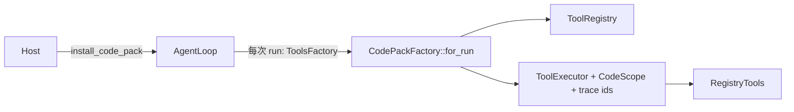

[English](README_en.md) | [简体中文](README.md)

# thunder-agent-pack-code

## 定位

可选的能力包（capability pack），把"编码宿主"需要的东西一次性装到一个通用循环上：文件/shell 工具、路径分类、原子写、变更上报、工程默认提示词。

它不是内核依赖。`thunder-agent-loop` 的 `Cargo.toml` 只依赖 `thunder-agent-types`（`thunder-agent-policy` 仅在 dev-dependencies 中出现），依赖方向是 **pack → kernel**。一个业务宿主（表单机器人、原型编辑器）可以完全不装它，循环本身不知道 shell、工作区或文件是什么。

装包之后宿主获得：

- 6 个内置工具（`bash`、`read_file`、`write_file`、`grep`、`find`、`ls`）；
- `CodeScope`：回答"这次调用落到哪里"，供内核的 mode policy 判断；
- `write_file` 自带的原子写 + 进程级按路径互斥；
- `file_change` 自定义事件（`write_file` 与 `bash` 上报）；
- 工程默认系统提示词及其按渲染能力裁剪的变体。

## crate 边界

| 方向 | crate | 用到的部分 |
|---|---|---|
| 依赖 | `thunder-agent-types` | `tool::ToolDefinition`、`tool::ToolEventSink`、`scope::{Scope, ToolScope}`、`policy::ToolEffect` |
| 依赖 | `thunder-agent-policy` | `AgentTool`、`ToolExecutionContext`、`ToolRegistry`、`ToolExecutor`、`RegistryTools`、`plugin::{Plugin, ToolPlugin, CallToolResult}` |
| 依赖 | `thunder-agent-loop` | `AgentConfig`、`AgentLoop`、`seam::{RunContext, Tools, ToolsFactory}`、`core::paths::thunder_subdir` |
| 被依赖 | `thunder-agent-root` | 必需依赖：`CodeScope::from_agent_config`、`code_plugins`、`autonomous_system_prompt`、`RenderCapabilities` |
| 被依赖 | `thunder-agent-core/tui` | 直接构造 `CodeScope`、`BashTool`，并用默认提示词 |

## 核心类型与一次典型流程

| 类型 | 作用 |
|---|---|
| `CodePackConfig` | 安装开关，见下表 |
| `install_code_pack(agent, &config) -> AgentLoop` | 安装工具 + scope + 每次 run 的工具工厂；相对路径以 `agent.config().workspace_dir` 为基准 |
| `code_plugins(Option<PathBuf>)` | 只返回 6 个 `Arc<dyn ToolPlugin>`，用于 `ToolRegistry::register_plugin` 逐插件注册 |
| `CodePackFactory` | 私有；`ToolsFactory::for_run` 每次运行新建一个 registry（容量 `max_tool_output_bytes`，超时 `request_timeout_ms`）并把 `CodeScope` 装到 executor |
| `CodeScope` | 路径分类器，实现 `ToolScope` |
| `ShellConfig` | `bash` 背后实际执行的 shell 程序 |
| `FILE_CHANGE` / `emit_write` / `emit_bash_changes` | 变更事件名与两个上报函数 |

`CodePackConfig`：

| 字段 | 默认 | 行为 |
|---|---|---|
| `register_builtins` | `true` | 注册全部 6 个工具 |
| `apply_default_prompt` | `false` | 字段存在，但 `install_code_pack` 当前不读取它；需要默认提示词的宿主自己调用 `autonomous_system_prompt(..)`（`thunder-agent-root` 与 TUI 都是这么做的） |

截断与 scratchpad 溢出**不**由本包包装：`ToolRegistry` 对每次调用统一处理，无论是否装包。

## 工具

| 名称 | 类型（模块） | 效果 | 参数 | 限额与默认值 |
|---|---|---|---|---|
| `read_file` | `ReadFileTool`（`builtin/fs.rs`） | Read | `path`、`offset`、`limit` | 单次整体读取上限 10 MiB；超过后只按行流式读取，流式输出上限 512 KiB；不给 `offset`/`limit` 的大文件直接报错 |
| `write_file` | `WriteFileTool`（`builtin/fs.rs`） | Write | `path`、`content` | 无大小上限；原子写 + 按路径互斥，见下节 |
| `grep` | `GrepTool`（`builtin/search.rs`） | Read | `pattern`、`path`、`glob`、`ignoreCase`、`literal`、`context`、`limit` | 100 条匹配 / 50 KiB / 单行 500 字符；基于 `ignore` 的并行遍历，尊重 `.gitignore` |
| `find` | `FindTool`（`builtin/fs_ext.rs`） | Read | `pattern`、`path`、`limit` | 1000 条结果 / 50 KiB |
| `ls` | `ListDirTool`（`builtin/fs_ext.rs`） | Read | `path` | 单层、1000 条；目录在前并带 `/`，文件带字节数；包含隐藏文件 |
| `bash` | `BashTool`（`builtin/bash.rs`） | Exec | `command`、`cwd`、`timeout_ms` | 默认 120000 ms；stdout/stderr 各 1 MiB 缓冲；`BashTool::new(max_buffer_bytes)` 可改 |

没有独立的 `edit` 工具：改文件走 `write_file` 全量写，原子性由写入核心保证。

每个工具同时实现 `AgentTool` 与 `ToolPlugin`（`Plugin::id()` 就是工具名），所以两条注册路径都可用；`ReadFilePlugin`、`WriteFilePlugin`、`GrepPlugin`、`FindPlugin`、`ListDirPlugin`、`BashPlugin` 是同一类型的别名。

`bash` 的进程语义：

- 程序来自 `ShellConfig`，工具名仍叫 `bash`；
- `stdin` 为 null，注入 `DEBIAN_FRONTEND=noninteractive`、`CI=true`、`TERM=dumb`、`PAGER=cat`、`GIT_TERMINAL_PROMPT=0`；
- 默认剥离名字含 `KEY`/`TOKEN`/`SECRET`/`PASSWORD`/`AUTH`/`CREDENTIAL`，或以 `AWS_`/`GITHUB_`/`OPENAI_`/`ANTHROPIC_`/`DEEPSEEK_` 开头的环境变量；`THUNDER_ENV_PASSTHROUGH=NAME1,NAME2` 可放行；
- Unix 上 `process_group(0)` 启动，超时或取消时 `kill(-pid, SIGKILL)` 结束整个进程组并 `wait` 回收；
- 非零退出码返回 `Err`，输出保留在错误文本里。

## CodeScope

`CodeScope` 只回答"落点"，不做裁决。裁决（问用户、放行、拒绝）在内核的 gate 里。

构造：

| 入口 | 行为 |
|---|---|
| `CodeScope::new(root)` | 单个根，路径规范化（存在部分解析符号链接） |
| `from_agent_config(config, workspace_root)` | 根优先级：`workspace_root` → `config.workspace_dir` → 进程 cwd；追加 `config.extra_workspace_roots`、`config.scratchpad.base_dir`，并保护 thunder 数据根 |
| `with_extra_roots(..)` / `add_root(..)` | 追加视为工作区内部的根 |
| `protect(path)` | 双向禁入（读也拒绝） |
| `protect_data_root(root)` | `auth.json`、`models.json`、`credentials.json` 双向禁入，根下其余路径可读不可写 |
| `with_thunder_data_root()` | 等价于 `protect_data_root(thunder_subdir(""))` |

`classify(target, effect)` 的判定顺序：

1. 目标来自 `path`、`file_path`、`filePath`、`target`、`destination` 五个参数键之一；`~`/`$HOME`/`${HOME}` 展开，相对路径拼工作区根；
2. 逐段解析符号链接与 `..`，按真实位置判定；
3. `/dev/null`、`/dev/stdin`、`/dev/stdout`、`/dev/stderr`、`/dev/tty` 例外，直接按根归属判定；
4. 命中 protections、写操作命中数据根、路径任一段为 `.git`、命中 `.mcp.json`/`mcp_servers.json`/`.thunder`/`.thunder/{config.json,config.local.json,mcp.json,models.json,auth.json,credentials.json}`、写操作命中 `PROTECTED_WRITE_PREFIXES`（`/etc`、`/private/etc`、`/dev`、`/proc`、`/sys`、`/boot`、`/bin`、`/sbin`、`/usr`、`/var/db`、`/private/var/db`、`/System`、`/Library`、`/Applications`）→ `Critical`；
5. 落在任一 root 内 → `InScope`，否则 `OutOfScope`。

`ToolScope::scope_of` 对 `ToolEffect::Exec` 与 `ToolEffect::Other` 一律返回 `Unknown`：shell 命令的目标运行前不可知，宁可不给自动放行（会被询问），也不猜。参数里找不到目标键同样返回 `Unknown`。

## ShellConfig

| 项 | 值 |
|---|---|
| `ShellConfig::detect()` | `$SHELL` 的文件名属于 `sh`、`bash`、`zsh`、`dash`、`ksh`、`ash` 且文件存在 → 用它；否则 `/bin/sh`；再否则交给 `PATH` 找 `sh` |
| `flag` | 固定 `-c`，`from_program` 不接受自定义 flag |
| `BashTool::with_shell(config)` | 替换执行程序，工具名与权限规则里的名字保持不变 |
| `BashTool::default()` | buffer 1 MiB + `ShellConfig::detect()` |

## 原子写与变更上报

`write_cancellable` 的顺序：

1. 取 `FILE_MUTATION_LOCKS` 中该路径的锁（key 先 canonicalize，文件不存在时 canonicalize 父目录）；
2. 在目标同目录创建 `.{filename}_{pid}_{nanos}.tmp`，`write_all`，`sync_all`，若原文件存在则复制其权限；
3. 取消令牌在 rename **之前**检查，触发则报错且目标不变；
4. `rename` 覆盖目标；`TempFileGuard` 在任何异常退出（含 future 被 drop）时删除暂存文件；
5. 释放锁条目（仅当没有排队者持有同一 mutex）。

`FILE_MUTATION_LOCKS` 是进程级的：两个 daemon 进程之间不协调。返回值明确区分"新建"与"覆盖"，失败时说明目标未被改动。

`file_change` 事件（`AgentEvent::Custom`，kind = `file_change`）：

| 来源 | payload |
|---|---|
| `write_file` | `{"path", "action": "written"|"failed", "bytes", "tool": "write_file"}` |
| `bash` | `{"path", "action": "created"|"modified"|"deleted", "tool": "bash"}` |

`bash` 在命令执行前后各取一次 `git status --porcelain` 快照，只上报新增条目；工作区不是 git 仓库（或 git 不可用）时快照为空，因此不上报。超时/取消的路径同样上报——被杀的进程也可能已经写了文件。`write_file` 的失败也会发 `failed` 事件。

## 提示词

| 项 | 说明 |
|---|---|
| `DEFAULT_AUTONOMOUS_SYSTEM_PROMPT` | 英文工程提示词：先理解后行动、一句话能说清就不写计划、plan mode 用 `write_plan`/`exit_plan_mode`、按内容选择表格/列表/围栏代码块、结尾收敛到下一步 |
| `RenderCapabilities` | 目前只有 `diagrams: bool`；`serde(default, camelCase)`，未知字段忽略，默认全 `false` |
| `autonomous_system_prompt(caps)` | `diagrams = false` 时返回常量原文；`true` 时把 mermaid 规则插在 `Skip the decoration.` 之前，其余内容完全一致 |

它假设宿主能渲染 Markdown 表格与带语言标注的围栏代码块；这两项是基线，不通过 `RenderCapabilities` 声明。`diagrams` 之所以可选，是因为 TUI 的预览渲染器把围栏块截到三行，mermaid 在那里只是三行源码。TUI 与 root 的 conversation 路径都传 `RenderCapabilities::default()`。

## 失败方向

| 情况 | 结果 |
|---|---|
| `read_file` 超过 10 MiB 且无分页参数 | `Err`，提示改用 `limit`/`offset`；分页时走流式读取 |
| 缺少必填参数、路径不存在、非目录 | `Err`，文本说明具体参数或路径 |
| `bash` 非零退出 | `Err`，包含退出码与合并后的输出 |
| `bash` 超时/取消 | `Err`；先杀进程组再 `wait`，不会留下僵尸 |
| `write_file` 失败或取消 | `Err`；目标保持原样，暂存文件被清理 |
| `CodeScope` 无法判定 | `Unknown`：不给自动放行，由 gate 询问；不构成拒绝 |
| `CodeScope` 判定 `Critical` | 内核无条件拒绝，任何模式都不询问 |

## 测试

| 文件 | 覆盖 |
|---|---|
| `tests/code_tools_test.rs` | registry/executor、`bash`（cwd、超时）、`install_code_pack` 构建、`grep`（limit/literal/ignoreCase/context/glob/长行截断）、`find`（.gitignore、limit）、`ls` 排序、`read_file` 分页与大文件拒绝/流式 |
| `tests/end_to_end_test.rs` | 脚本化模型驱动真实 `AgentLoop`：`read_file` → `write_file` → `bash ./check.sh` → 结束；另测宿主固定 shell 程序 |
| `tests/guard_test.rs` | 执行器漏斗中的 guard：无入口可绕过、最宽松的 scope + gate 下仍守底、宿主可声明禁入、取消的调用不触达工具、拒绝结果带 `GuardKind` |
| `tests/path_scope_test.rs` | 旧 jail 会拒绝的调用现在通过或询问；工作区内写落地并上报事件；额外根；越界写变成可回答的提问；危险命令在所有模式下拒绝；`.git` 无条件禁入 |
| `tests/prompt_test.rs` | 常量内容、mermaid 仅在 `diagrams = true` 时出现且位于克制段落之前、`RenderCapabilities` 默认与部分反序列化 |
| `tests/mcp_pack_test.rs` | 6 个工具以 `ToolPlugin` 形式逐个注册并执行 |

另有 `permission_layer_test.rs`、`safety_guard_test.rs`、`scratchpad_and_compaction_test.rs`，以及 `scope.rs`、`shell.rs`、`file_change.rs` 内的单元测试。

## 扩展点

- **替换整套工具装配**：实现自己的 `ToolsFactory` 并 `agent.with_tools_factory(..)`；本包的工厂只是"registry + executor + scope"的一种组合。
- **只取工具**：`code_plugins(ws)` 拿到 `ToolPlugin` 列表后按 id 过滤注册。
- **扩展路径知识**：`CodeScope::with_extra_roots` / `protect` / `protect_data_root`；或实现自己的 `ToolScope`。
- **复用写入核心**：`WriteFileTool::write` / `write_cancellable` 是公开的，需要同样原子性与锁的其它写者（例如计划文件）不必经过工具层。
- **换 shell**：`BashTool::with_shell(ShellConfig::from_program(..))`。
- **换提示词变体**：`autonomous_system_prompt(RenderCapabilities { .. })`；宿主也可以完全不用它。
