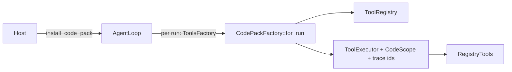

[English](README_en.md) | [简体中文](README.md)

# thunder-agent-pack-code

## What it is

An optional capability pack that installs everything a *coding* host needs onto a generic loop: file and shell tools, path classification, atomic writes, change reporting, and the engineering default prompt.

It is not a kernel dependency. `thunder-agent-loop`'s `Cargo.toml` depends only on `thunder-agent-types` (`thunder-agent-policy` appears solely under dev-dependencies), so the direction is **pack → kernel**. A business host (a form bot, a prototype editor) can install nothing from here; the loop itself has no notion of a shell, a workspace, or a file.

Installing the pack gives a host:

- six built-in tools (`bash`, `read_file`, `write_file`, `grep`, `find`, `ls`);
- `CodeScope` — the answer to "where does this call land", consumed by the kernel's mode policy;
- atomic writes plus a process-wide per-path mutex, owned by `write_file` itself;
- the `file_change` custom event, emitted by `write_file` and `bash`;
- the engineering default system prompt, and its variant for hosts that can draw diagrams.

## Crate boundaries

| Direction | Crate | Used surface |
|---|---|---|
| depends on | `thunder-agent-types` | `tool::ToolDefinition`, `tool::ToolEventSink`, `scope::{Scope, ToolScope}`, `policy::ToolEffect` |
| depends on | `thunder-agent-policy` | `AgentTool`, `ToolExecutionContext`, `ToolRegistry`, `ToolExecutor`, `RegistryTools`, `plugin::{Plugin, ToolPlugin, CallToolResult}` |
| depends on | `thunder-agent-loop` | `AgentConfig`, `AgentLoop`, `seam::{RunContext, Tools, ToolsFactory}`, `core::paths::thunder_subdir` |
| depended on by | `thunder-agent-root` | required dependency: `CodeScope::from_agent_config`, `code_plugins`, `autonomous_system_prompt`, `RenderCapabilities` |
| depended on by | `thunder-agent-core/tui` | builds `CodeScope` and `BashTool` directly, uses the default prompt |

## Core types and one installation

| Type | Role |
|---|---|
| `CodePackConfig` | Installation switches, below |
| `install_code_pack(agent, &config) -> AgentLoop` | Installs tools, scope and a per-run tool factory; relative paths resolve against `agent.config().workspace_dir` |
| `code_plugins(Option<PathBuf>)` | Returns only the six tools as `Arc<dyn ToolPlugin>` for `ToolRegistry::register_plugin` |
| `CodePackFactory` | Private; `ToolsFactory::for_run` builds a fresh registry per run (`max_tool_output_bytes`, `request_timeout_ms`) and installs `CodeScope` on the executor |
| `CodeScope` | Path classifier implementing `ToolScope` |
| `ShellConfig` | The shell program actually run behind `bash` |
| `FILE_CHANGE` / `emit_write` / `emit_bash_changes` | Event kind and the two reporters |

`CodePackConfig`:

| Field | Default | Behaviour |
|---|---|---|
| `register_builtins` | `true` | Registers all six tools |
| `apply_default_prompt` | `false` | The field exists but `install_code_pack` does not read it; a host that wants the default prompt calls `autonomous_system_prompt(..)` itself, as `thunder-agent-root` and the TUI do |

Truncation and scratchpad spill are **not** wrapped by this pack: `ToolRegistry` applies them to every call, pack or no pack.

## Tools

| Name | Type (module) | Effect | Arguments | Limits and defaults |
|---|---|---|---|---|
| `read_file` | `ReadFileTool` (`builtin/fs.rs`) | Read | `path`, `offset`, `limit` | whole-file read capped at 10 MiB; above that only a streamed line window is read, capped at 512 KiB; a large file without `offset`/`limit` is refused |
| `write_file` | `WriteFileTool` (`builtin/fs.rs`) | Write | `path`, `content` | no size cap; atomic write under a per-path lock |
| `grep` | `GrepTool` (`builtin/search.rs`) | Read | `pattern`, `path`, `glob`, `ignoreCase`, `literal`, `context`, `limit` | 100 matches / 50 KiB / 500 chars per line; parallel `ignore` walk that honours `.gitignore` |
| `find` | `FindTool` (`builtin/fs_ext.rs`) | Read | `pattern`, `path`, `limit` | 1000 results / 50 KiB |
| `ls` | `ListDirTool` (`builtin/fs_ext.rs`) | Read | `path` | single level, 1000 entries; directories first with a trailing `/`, files with byte size; hidden files included |
| `bash` | `BashTool` (`builtin/bash.rs`) | Exec | `command`, `cwd`, `timeout_ms` | timeout defaults to 120000 ms; 1 MiB buffer per stream, changeable via `BashTool::new(max_buffer_bytes)` |

There is no separate `edit` tool: file changes go through `write_file`, and atomicity is a property of its write core.

Every tool implements both `AgentTool` and `ToolPlugin` (whose `Plugin::id()` is the tool name), so both registration paths work; `ReadFilePlugin`, `WriteFilePlugin`, `GrepPlugin`, `FindPlugin`, `ListDirPlugin`, `BashPlugin` are aliases of the same types.

`bash` process semantics:

- the program comes from `ShellConfig`; the tool is still named `bash`;
- stdin is null; `DEBIAN_FRONTEND=noninteractive`, `CI=true`, `TERM=dumb`, `PAGER=cat`, `GIT_TERMINAL_PROMPT=0` are injected;
- environment variables whose names contain `KEY`/`TOKEN`/`SECRET`/`PASSWORD`/`AUTH`/`CREDENTIAL`, or start with `AWS_`/`GITHUB_`/`OPENAI_`/`ANTHROPIC_`/`DEEPSEEK_`, are removed unless listed in `THUNDER_ENV_PASSTHROUGH=NAME1,NAME2`;
- on Unix it starts with `process_group(0)`; on timeout or cancellation the whole group is killed with `kill(-pid, SIGKILL)` and reaped with `wait`;
- a non-zero exit becomes `Err` carrying the exit code and merged output.

## CodeScope

`CodeScope` answers "where does this land" and decides nothing. The decision — ask, allow, refuse — belongs to the kernel's gate.

Construction:

| Entry point | Behaviour |
|---|---|
| `CodeScope::new(root)` | one root; the path is normalized (existing prefixes are symlink-resolved) |
| `from_agent_config(config, workspace_root)` | root precedence: `workspace_root` → `config.workspace_dir` → process cwd; adds `config.extra_workspace_roots`, `config.scratchpad.base_dir`, and protects the thunder data root |
| `with_extra_roots(..)` / `add_root(..)` | adds roots treated as inside the working area |
| `protect(path)` | off limits in both directions |
| `protect_data_root(root)` | `auth.json`, `models.json`, `credentials.json` off limits; the rest of the root is readable but not writable |
| `with_thunder_data_root()` | shorthand for `protect_data_root(thunder_subdir(""))` |

`classify(target, effect)`, in order:

1. the target comes from one of `path`, `file_path`, `filePath`, `target`, `destination`; `~`/`$HOME`/`${HOME}` is expanded and a relative path is joined to the workspace root;
2. symlinks and `..` are resolved component by component, so the verdict follows the real location;
3. `/dev/null`, `/dev/stdin`, `/dev/stdout`, `/dev/stderr`, `/dev/tty` are exempt from protection checks and classified by root membership;
4. `Critical` when the resolved path hits a protection, a write hits the data root, any component is `.git`, the name is `.mcp.json`/`mcp_servers.json`/`.thunder` or is one of `config.json`/`config.local.json`/`mcp.json`/`models.json`/`auth.json`/`credentials.json` under a `.thunder` parent, or a write hits `PROTECTED_WRITE_PREFIXES` (`/etc`, `/private/etc`, `/dev`, `/proc`, `/sys`, `/boot`, `/bin`, `/sbin`, `/usr`, `/var/db`, `/private/var/db`, `/System`, `/Library`, `/Applications`);
5. otherwise `InScope` if the path is under any root, `OutOfScope` if not.

`ToolScope::scope_of` returns `Unknown` for `ToolEffect::Exec` and `ToolEffect::Other`: a shell command's targets are only known once it runs, so the call is asked about rather than guessed at. Missing target keys also yield `Unknown`.

## ShellConfig

| Item | Value |
|---|---|
| `ShellConfig::detect()` | uses `$SHELL` when its file name is one of `sh`, `bash`, `zsh`, `dash`, `ksh`, `ash` and the file exists; otherwise `/bin/sh`; otherwise `sh` from `PATH` |
| `flag` | always `-c`; `from_program` does not accept a custom flag |
| `BashTool::with_shell(config)` | swaps the program while the tool name and the permission rules written against it stay `bash` |
| `BashTool::default()` | 1 MiB buffer + `ShellConfig::detect()` |

## Atomic writes and change reporting

`write_cancellable`:

1. takes the path's mutex from `FILE_MUTATION_LOCKS` (key canonicalized; for a new file the parent is canonicalized);
2. creates `.{filename}_{pid}_{nanos}.tmp` next to the target, `write_all`, `sync_all`, copies the original permissions if the target exists;
3. checks the cancellation token **before** the rename; if it fired, the call fails and the target is untouched;
4. renames over the target; `TempFileGuard` deletes the staged file on any exit, including a dropped future;
5. releases the lock entry when no queued writer still holds the same mutex.

`FILE_MUTATION_LOCKS` is process-local: two daemons do not coordinate through it. The result text distinguishes "created" from "overwrote", and failures state that the target is unchanged.

`file_change` events (`AgentEvent::Custom`, kind `file_change`):

| Source | Payload |
|---|---|
| `write_file` | `{"path", "action": "written"|"failed", "bytes", "tool": "write_file"}` |
| `bash` | `{"path", "action": "created"|"modified"|"deleted", "tool": "bash"}` |

`bash` snapshots `git status --porcelain` before and after the command and reports only entries that appeared. When the working directory is not a git checkout (or git is unavailable) the snapshot is empty and nothing is reported. Timed-out and cancelled commands report too — a killed process may already have written files. A failed `write_file` emits `failed`.

## Prompt

| Item | Notes |
|---|---|
| `DEFAULT_AUTONOMOUS_SYSTEM_PROMPT` | English engineering prompt: understand first; skip the plan when one sentence suffices; in plan mode use `write_plan`/`exit_plan_mode`; choose tables, lists or fenced blocks by what the reader must compare; close by steering to the next decision |
| `RenderCapabilities` | only `diagrams: bool`; `serde(default, camelCase)`, unknown fields ignored, everything defaults to `false` |
| `autonomous_system_prompt(caps)` | with `diagrams = false` returns the constant verbatim; with `true` splices the mermaid rule in before `Skip the decoration.`, leaving the rest identical |

It assumes the host renders Markdown tables and language-tagged fences; those are the baseline and are not declared through `RenderCapabilities`. `diagrams` is opt-in because the TUI's preview renderer caps a fenced block at three rows, where a mermaid fence is just three lines of source. The TUI and root's conversation path both pass `RenderCapabilities::default()`.

## Failure directions

| Case | Result |
|---|---|
| `read_file` above 10 MiB without paging | `Err`, telling the caller to use `limit`/`offset`; with paging it streams a window |
| missing required argument, missing path, not a directory | `Err` naming the argument or path |
| `bash` non-zero exit | `Err` with exit code and merged output |
| `bash` timeout or cancellation | `Err`; the process group is killed and reaped, no zombie |
| `write_file` failure or cancellation | `Err`; the target is untouched and the staged file removed |
| `CodeScope` cannot answer | `Unknown`: no automatic allowance, the gate asks; never a refusal |
| `CodeScope` says `Critical` | the kernel refuses unconditionally, in every mode |

## Tests

| File | Coverage |
|---|---|
| `tests/code_tools_test.rs` | registry/executor, `bash` (cwd, timeout), `install_code_pack` construction, `grep` (limit/literal/ignoreCase/context/glob/long-line truncation), `find` (.gitignore, limit), `ls` ordering, `read_file` paging and large-file refusal/streaming |
| `tests/end_to_end_test.rs` | a scripted model drives a real `AgentLoop`: `read_file` → `write_file` → `bash ./check.sh` → stop; also pins the shell program per host |
| `tests/guard_test.rs` | the guard inside the executor funnel: no entry point skips it, it holds under the most permissive scope and gate, a host can declare a target off limits, a cancelled call never reaches a tool, refusals carry a `GuardKind` |
| `tests/path_scope_test.rs` | calls the old jail refused now run or ask; in-workspace writes land and report themselves; extra roots; an out-of-scope write becomes an answerable question; dangerous commands are refused in every mode; `.git` is off limits without asking |
| `tests/prompt_test.rs` | constant contents, mermaid only with `diagrams = true` and before the restraint paragraph, `RenderCapabilities` defaults and partial deserialization |
| `tests/mcp_pack_test.rs` | the six tools registered and executed as `ToolPlugin`s |

Also present: `permission_layer_test.rs`, `safety_guard_test.rs`, `scratchpad_and_compaction_test.rs`, plus unit tests inside `scope.rs`, `shell.rs` and `file_change.rs`.

## Extension points

- **Replace the whole tool assembly**: implement your own `ToolsFactory` and call `agent.with_tools_factory(..)`; this pack's factory is just one combination of registry, executor and scope.
- **Take only the tools**: `code_plugins(ws)` returns plugins to register selectively by id.
- **Extend path knowledge**: `CodeScope::with_extra_roots` / `protect` / `protect_data_root`, or implement your own `ToolScope`.
- **Reuse the write core**: `WriteFileTool::write` / `write_cancellable` are public, so another writer that needs the same atomicity and locking (a plan file, for instance) need not go through the tool layer.
- **Swap the shell**: `BashTool::with_shell(ShellConfig::from_program(..))`.
- **Swap the prompt variant**: `autonomous_system_prompt(RenderCapabilities { .. })`; a host may ignore it entirely.
