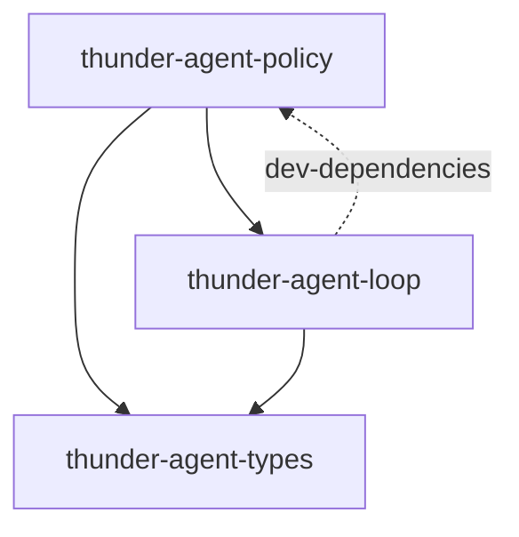

[English](README_en.md) | [简体中文](README.md)

# thunder-agent-policy

## 定位

Thunder 的执行策略层。凡是**判断**一次工具调用的代码都在这里；kernel（`thunder-agent-loop`）不回答这些问题，只提供接缝：`Tools` / `ToolsFactory`。

这一层承担四件事：

1. 注册与执行工具（`ToolRegistry`、`ToolExecutor`）；
2. 内核的不可协商底线（`guard`）与宿主策略钩子（`gate`）；
3. 面向用户的审批（`HostUi`）与人工可见的记录（`trace`）；
4. 让插件发起的调用与模型发起的调用走同一条漏斗（`invoke`、`registry_tools`）。

## crate 边界

- 直接依赖：`thunder-agent-types`、`thunder-agent-loop`（实现其 `seam::Tools` / `ToolsFactory` 接缝，复用 `core::utf8` 与 `tools::scratchpad`）、`tokio`、`tokio-util`、`futures-util`、`parking_lot`、`async-trait`、`serde`、`serde_json`、`regex`、`libc`、`tracing`。
- 依赖方向是单向的：policy → loop。loop **不**依赖 policy；`thunder-agent-loop/Cargo.toml` 里的 `thunder-agent-policy` 只出现在 `[dev-dependencies]`（测试用的 `Tools` 替身与边界断言）。
- `thunder-agent-loop/tests/kernel_boundary_test.rs` 用源码断言守住这条边界：`seam.rs` 不得出现 `ToolExecutor` / `ToolRegistry` / `crate::types::gate` 等 policy 词汇，loop 只能经 `seam::execute_batch` 执行工具，工具清单只能来自 `Tools::specs()`。
- 下游：`thunder-agent-runtime`、`thunder-agent-providers`、`thunder-agent-skills`、`thunder-agent-mcp`、`thunder-agent-pack-code`、`thunder-agent-root`、`thunder-agent-daemon`、`thunder-agent-core/tui`。

## 模块

| 模块 | 内容 |
|---|---|
| `executor` | `ToolExecutor`：唯一漏斗 `run_tool`、批量入口 `execute_all`、审批对话框 `ask`、trace 出站 `publish` |
| `registry` | `ToolRegistry`：名字有序的工具表、输出清洗/截断/scratchpad 溢出 |
| `registry_tools` | `RegistryTools` / `StaticToolsFactory`：接缝的参考实现 |
| `tool_policy` | `AgentTool` 与 `ToolExecutionContext`（含 `invoke` 子工具调用） |
| `gate` | `ToolGate`、`ToolGateRequest`、`GateVerdict`、`ApprovalPrompt`、`ApprovalAnswer`、对话框选项常量 |
| `guard` | `Guard::check`：内核无条件拒绝的底噪（危险命令、`Scope::Critical`） |
| `read_only` | `call_is_read_only` / `is_read_only`：plan mode 的"只读证明" |
| `ui` | `HostUi`、`UiRequest` / `UiResponse`、`UiSource`、`UiHandle`、`NullHostUi` |
| `plugin` | `Plugin`、`ToolPlugin`、`InterceptorPlugin`、`PreExecutionVerdict`、`priority` 常量、`ToolPluginAdapter`、`SubToolInvoker` |
| `invoke` | 插件发起的调用：`ToolInvoker`、`ExecutorToolInvoker`、`NullToolInvoker`、`ToolInvokerSlot` |
| `trace` | trace 的生产侧：脱敏、预览、摘要、`TraceInterceptor`；记录类型从 `thunder-agent-types::trace` 重导出 |
| `sanitizer` | `strip_ansi_escapes`、`is_binary_data`、`sanitize_tool_output` |
| `lib` | 全部模块的 `pub use *` 重导出 |

## 一次典型流程

模型返回一个 `ToolCall` → loop 通过 `Tools::call` 调到 `RegistryTools` → `ToolExecutor::run_tool` → `ToolRegistry::execute_tool_call` → `AgentTool::execute` → 结果回填 `ToolOutcome` 并交回 loop。整个过程恰好写出一条 `ToolTrace`。

## `ToolExecutor::run_tool`：唯一漏斗

`run_tool` 先做三件"调用方不该负责"的盖章：解析工具声明的 `effect` 写入 `ctx.effect`、补上 run 的 `ToolEventSink`、补上 `HostUi` 的 `UiHandle`；`ctx.sub_invoker` 为空时安装 `ExecutorSubToolInvoker`；`call_chain` 为空时压入本工具名。然后进入 `dispatch`，结束后由 `TraceDraft::finish` 关闭记录并 `publish`。

**唯一出口**：`run_tool` 没有提前 `return`，记录只在一个地方收尾。拒绝路径在 `dispatch` 内提前返回——从那里返回只是回到 `run_tool`，记录照样收尾。于是"每次调用恰好一条 trace"是结构性事实，不是承诺。

| # | 阶段 | 代码位置 | 优先级常量 | 结果 |
|---|---|---|---|---|
| 1 | 取消检查 | `dispatch` 开头 | — | `Decision::Cancelled`，立即拒绝 |
| 2 | 参数解析 + 记录脱敏 | `serde_json::from_str`、`redact_arguments` | — | 解析失败得到 `null`（gate 看不到可匹配参数），工具仍会在 registry 处收到解析错误 |
| 3 | 作用域 | `ToolScope::scope_of` → `Scope` | `SECURITY_POLICY` = 800 | 无 scope 时 `Scope::Unknown` |
| 4 | 内核 guard | `Guard::check(tool, args, effect, scope)` | `CRITICAL_GUARD` = 1000 | `Decision::Deny { by: Guard }`，不进入 gate，任何模式都改不了 |
| 5 | 宿主 gate | `ToolGate::decide(&request)` | `GOVERNANCE_MODE` = 500 | `Allow` / `AllowByRule` 放行，`Deny` 拒绝，`Ask` 进入下一阶段；无 gate 即放行 |
| 6 | 审批对话框 | `ToolExecutor::ask` | 内核渲染 | `AllowOnce` / `AllowAlways` 放行；`NoUi` / `Timeout` / `Denied` / `Unrecognised` 一律拒绝 |
| 7 | pre 拦截器 | 按 `priority()` **降序** | 默认 `NORMAL` = 500 | `Deny` / `Err` 立即拒绝；`AskUser` 弹窗，只有 `Allow once` 才继续（同样串行化、fail-closed） |
| 8 | 执行 | `ToolRegistry::execute_tool_call` | — | 超时、取消、未知工具、JSON 错误都变成 `is_error` 结果 |
| 9 | post 拦截器 | **逆序**（洋葱回卷） | — | 只能改 `content` 与 `is_error` |
| 10 | trace 出站 | `TraceDraft::finish` → `publish` → `ToolTraceSink` | — | 无 sink 则只在内存中收尾，不落盘 |

两点必须说清：

- 作用域（3）在 guard（4）之前计算，因为 `Guard::check` 需要 `Scope::Critical` 作为输入。优先级常量表达的是分层的身份与拦截器之间的相对顺序，不是 `dispatch` 内的字面调用顺序。
- `Guard` 同时实现 `InterceptorPlugin`（priority 1000），供仍只用拦截器管线的宿主；新漏斗直接在 `dispatch` 里调用 `Guard::check`，因此 guard 不会被"没装拦截器"绕过。

审批对话框的行为细节：

- 对话框由 kernel 渲染，gate 只返回 `ApprovalPrompt`，无法把审批伪装成普通提问；
- `prompt_lock`（`tokio::sync::Mutex`）串行化同一 executor 的所有对话框——`execute_all` 是并行批，两个重叠弹窗正是"同意错那个"的来源；等待锁与取消竞争，被取消的 run 不会扣着锁；
- `allow_always == false` 时只提供一次性选项；答案不在选项集合内也按拒绝处理；
- 插件发起的调用标题前缀 `Plugin <id> requests:`，因为"用户同意"必须知道同意的是谁；
- "Deny with reason" 会再弹一次 `UiRequest::Input`，理由原样进模型可见的拒绝文本。

## `ToolRegistry`

| 项 | 值 / 行为 |
|---|---|
| 存储 | `BTreeMap<String, Arc<dyn AgentTool>>` |
| `Default` | `new(64 * 1024, Duration::from_secs(30))` |
| 注册 | `register` 以 `definition().function.name` 为键，同名覆盖 |
| 声明顺序 | `get_definitions()` 按名字序遍历 |
| 输出上限 | `max_output_bytes`；超出时保留头 40% + 尾 40%，中间标注 `[... Output truncated: N bytes omitted (total: M bytes) ...]` |
| 默认超时 | `default_timeout`，可被 `execute_tool_call` 的 `custom_timeout` 覆盖 |
| 溢出 | 配了 `ScratchpadManager` 且输出超过其 `threshold_bytes`（默认 16 KiB）时，全文落盘并返回句柄；落盘失败则退回内存截断 |
| 输出清洗 | 成功与失败路径都过 `sanitize_tool_output`：二进制整体替换为 `[Binary data omitted: N bytes]`，其余去 ANSI |

为什么必须是 `BTreeMap`：工具声明会序列化进每一次 LLM 请求，稳定且确定的顺序让请求前缀逐字节一致——这是 provider 端 prompt cache 命中的硬前提。`HashMap` 会在每个实例间打乱顺序。

`execute_tool_call` 也负责：未知工具返回带可用工具列表的错误；空参数串视为 `{}`；用 `tokio::select!` 竞争取消与 `tokio::time::timeout`。它**不**做任何判断——guard / gate / 审批都已在上游。

## 策略钩子：`ToolGate` 与审批

| 类型 | 作用 |
|---|---|
| `ToolGateRequest<'a> { tool, arguments, effect, scope, caller, tool_call_id }` | 呈现给 gate 的一次调用，字段借用，避免每次调用 clone |
| `GateVerdict` | `Allow` / `AllowByRule { rule }` / `Ask(ApprovalPrompt)` / `Deny { reason }` |
| `ApprovalPrompt { title, detail, allow_always }` | gate 想要问的问题；`detail` 是"到底要跑什么"，缺了它就是盲签 |
| `ApprovalAnswer` | `AllowOnce` / `AllowAlways` / `Deny` / `DenyWithReason { reason }`，只会回传给**问出这个问题的** gate |
| `ToolGate::decide(&request) -> GateVerdict` | 同步、不可失败；需要 await 或需要问人的事都属于 kernel，返回 `Ask` 即可 |
| `ToolGate::record_answer(&request, &answer)` | 默认空实现；只有会设 `allow_always` 的 gate 才需要记住规则 |
| `ToolGate::label() -> &str` | trace 与状态栏上的标签（通常是模式名），kernel 只存不解释 |

选项常量在 `gate.rs`：`ALLOW_ONCE = "Allow once"`、`ALLOW_ALWAYS = "Always allow"`、`DENY = "Deny"`、`DENY_WITH_REASON = "Deny with reason"`。它们属于 kernel，因为对话框属于 kernel：gate 只决定*是否*问，kernel 决定用户*能答什么*。

gate 只能收紧：它在 guard 已放行的调用上选择 allow / ask / deny，永远不能放宽 guard。

## `HostUi`

宿主拥有的用户交互面。一次交互的数据形态，不是可渲染对象：

| `UiRequest` | 回答 |
|---|---|
| `Select { title, detail?, options, timeout_ms? }` | `UiResponse::Value` |
| `Confirm { title, message, timeout_ms? }` | `UiResponse::Confirmed` |
| `Input { title, placeholder?, timeout_ms? }` | `UiResponse::Value` |
| `Review { title, path, content, options, timeout_ms? }` | `UiResponse::Value` |
| `Editor { title, prefill?, timeout_ms? }` | `UiResponse::Value` |

`HostUi` 只有三个必须实现的方法：`request`、`notify`、`set_status`；`select` / `select_with_detail` / `select_from_plugin` / `select_owned` / `confirm` / `input` 都是默认包装。

约束与默认值：

- **fail closed**：任何无法回答的情况（无 UI、超时、通道关闭）都解析为 `UiResponse::Cancelled`，调用方把它当拒绝即可；
- 实现方自己负责超时；未设置或为 0 时用 `DEFAULT_UI_TIMEOUT`（60 s）；
- `UiSource::Host` 是保留通道（审批等宿主发起交互），实现必须与 `UiSource::Plugin` 区别渲染，否则插件可以伪装审批提示；
- `NullHostUi` 恒答 `Cancelled`，通知与状态写入丢弃——"没有 UI"与"用户取消"因此不可区分，正是调用方依赖的 fail-closed 性质；
- kernel 侧的审批等待上限是 `DEFAULT_APPROVAL_TIMEOUT`（600 s），通过 `with_approval_timeout` 覆盖。

## 插件形态：`ToolPlugin` 与 `InterceptorPlugin`

`Plugin` 是共同的身份契约：`id()` 必填，`name()` 默认 `id()`，`version()` 默认 `"0.1.0"`，`description()` 默认空。

- **`ToolPlugin`（能力）**：`definition() -> ToolDefinition`、`effect()`（默认按名字推断）、`execute(args, ctx) -> Result<CallToolResult, String>`。输入输出对齐 MCP：`CallToolResult { content: Vec<ToolContent>, is_error: Option<bool> }`，`ToolContent` 有 `Text` / `Image` / `Resource`。`register_plugin` 用 `ToolPluginAdapter` 自动桥接到 `AgentTool`，不破坏 `ToolRegistry`。
- **`InterceptorPlugin`（治理）**：`priority()`（默认 `NORMAL`）、`pre_execute(tool, args, ctx) -> Result<PreExecutionVerdict, String>`、`post_execute(tool, args, &mut CallToolResult, ctx)`。pre 按优先级降序执行，post 逆序回卷。`PreExecutionVerdict` 是 `Allow` / `Deny { reason }` / `AskUser { prompt }`。

| 优先级常量 | 值 | 用途 |
|---|---|---|
| `CRITICAL_GUARD` | 1000 | 内核安全底线（危险命令），永远最先 |
| `SECURITY_POLICY` | 800 | 安全策略与路径沙箱（即 scope 这一层） |
| `GOVERNANCE_MODE` | 500 | 执行模式与人工确认（plan/ask/yolo） |
| `NORMAL` | 500 | 通用拦截器的默认值，与模式同层 |
| `OBSERVABILITY` | 100 | 遥测与结构化 trace（洋葱最外层） |

`SubToolInvoker` 让工具安全地调用别的工具；`ToolExecutionContext::invoke` 在调用前强制 3 条规则：`depth < max_depth`（默认 3）、`call_chain` 环检测、取消/`caller`/route 继承。默认安装的实现是 `ExecutorSubToolInvoker`，它转手就走 `run_tool`。

`invoke` 模块另给插件一条入口：`ExecutorToolInvoker` 把插件调用包装成 `ToolCall` 并走 `run_tool`，`caller` 设为插件 id，审批对话框因此能指名道姓；`NullToolInvoker` 拒绝一切（表示"该宿主没有工具管线"，是特性不是桩）。

## `read_only`：plan mode 的证明

`call_is_read_only(arguments)` 从 `command` / `cmd` / `script`（与 guard 共用 `COMMAND_KEYS`）取出命令行，`is_read_only(command)` 判断它能否被证明"什么都不改"。

证明条件：

- **单条命令**：出现 `;` `&` `|` `` ` `` `>` `<` `(` `)` `{` `}` 或换行即视为第二条命令或写入，直接否决；引号内的 `|` 是参数，所以 `grep "a|b" src/` 仍是读；`$` 被拒（替换是不可见的命令）。
- **只读动词**：`READ_VERBS` 白名单（`cat` `grep` `ls` `stat` `wc` `diff` … 共 45 项），必须不能写文件、起进程或联网；`sort -o`、`find -delete`、`git branch -D` 各有独立分支。
- **动词而非路径**：`/tmp/evil/ls` 不算 `ls`，只有裸词匹配；代价是 `/bin/ls` 会走询问（假阴性允许的方向）。
- **无包装器**：`sudo` / `env` / `xargs` 不在白名单，因为它们运行的是另一个动词。
- **不读凭据**：`SECRET_COMPONENTS`（`.ssh` `.aws` `.env` `id_rsa` …）与 `SECRET_SUFFIXES`（`.key` `.pem` …）按整段路径组件匹配，`cat ~/.ssh/id_rsa` 因此要询问。

它是命令行解析，不是沙箱；读不懂的一律返回 `false`。唯一消费者是 `thunder-agent-root/src/plugins/mode.rs` 的 plan mode gate：`ToolEffect::Read` 直接放行；`ToolEffect::Exec` 且 `call_is_read_only(request.arguments)` 时也放行（问 `ls` 是噪音）；无法证明只读的 `Exec` 走询问；其余效果（写入）直接拒绝。`Guard` 与它问的是同一个问题的两个方向：guard 找"必须拒绝"，它找"可以静默放行"。

## Trace 的出站

记录类型（`ToolTrace`、`Decision`、`DenyBy`、`GuardHit`、`GuardKind`、`AskAnswer`、`TraceResult`、`TraceTiming`、`TRACE_SCHEMA`、`ToolTraceSink`）定义在 `thunder-agent-types::trace`，本 crate 重导出。

生产侧在这里：

- `redact_arguments(&mut Value) -> Redactions`：三遍脱敏——键名命中 `SECRET_KEYS`（`api_key` `token` `password` `authorization` …）整体替换为 `[redacted:key]` 并记下原值；`content` / `preview` 文档键改写为 `{ digest, bytes, preview }`；其余字符串按 `SECRET_PATTERNS`（GitHub token、`sk-`、AKIA、JWT、私钥块、Bearer、URL 内嵌凭据）做文本脱敏。
- `withhold(text, secrets)`：把参数里声明为秘密的值从**派生文本**（输出预览、错误消息）里再抹一遍；短于 6 字符的值不处理，避免吃掉普通词。
- `preview_text` / `redact_preview`：预览上限由 executor 的 `OUTPUT_PREVIEW_CHARS`（2048）决定。
- `stable_digest`：FNV-1a 64 位十六进制。稳定是唯一要求（跨版本可比），**不**用于真实性校验。
- `TraceInterceptor`：priority `OBSERVABILITY`（100）的拦截器适配器，供只走拦截器管线的宿主；主漏斗由 `TraceDraft` 直接产出完整记录。

`ToolTraceSink::record(&ToolTrace)` 单向：kernel 不知道存储路径，选择路径属于宿主策略，所以它只发不写。

## `registry_tools`：接缝的参考实现

`RegistryTools` 实现 `thunder-agent-loop::seam::Tools`：

- `specs()`：`ToolRegistry::get_definitions()` 的每一项配上该工具的 `concurrency()`（`Parallel` 默认，`Sequential` 表示整批按 `tool_calls` 顺序跑），组装为 `ToolSpec`。
- `call()`：把 seam 的 `ToolCallContext` 转成 `ToolExecutionContext`（`tool_call_id`、`turn`、`cancel`、`route`、`events`）后调用 `run_tool`；结果转 `ToolOutcome` 时，若 `original_bytes == 0 && !is_error` 则补成 `output.len()`。

**trace 槽的世代守卫**：`RegistryTools` 用 `trace_generation: Option<u64>` 记住本 run 安装的槽位。

- `RegistryTools::new(registry, executor)`：不拥有槽位（测试、一次性工具）；
- `RegistryTools::for_run(registry, executor, generation)`：拥有槽位 `generation`；
- `Drop`：仅当 `trace_generation` 为 `Some` 时调用 `executor.clear_run_trace(generation)`。多个 run 共享同一个 executor，`clear_run_trace` 只在槽位仍属于该 `generation` 时才清空，所以先结束的 run 不会清掉仍在飞行中的另一个 run 的 sink。

这不是内存问题：宿主的 event proxy 要等 run 的事件通道关闭才报告 run 已排空；槽位里残留的 sink 会永远握住一个 sender，导致每个 run 的尾部都挂住。

`StaticToolsFactory::for_run(&RunContext)` 是正常路径：从 `run.trace` 取 sink，`executor.install_run_trace(sink)` 得到世代号，返回 `RegistryTools::for_run(...)`。

`plain_tools(tools, max_output_bytes, timeout)` / `single_tool(...)` 是给测试与一次性场景的便捷构造：建表、`ToolExecutor::new`、返回 `Arc<dyn Tools>`（不拥有槽位）。

## 失败方向

所有模糊处一律拒绝，拒绝原因直接写给模型看；guard、审批、取消的拒绝还附带 `SystemNotice` 遥测：

| 情况 | 行为 |
|---|---|
| 无 gate | 除 guard 外一律放行（headless 宿主的既定契约） |
| 无 scope | `Scope::Unknown`，不获得自动放行 |
| 无 UI / 超时 / 关闭弹窗 | 拒绝（`AskAnswer::NoUi` / `Timeout`） |
| 答案不在选项集合 | 拒绝（`AskAnswer::Unrecognised`） |
| 取消 | 立即拒绝，工具不启动 |
| guard 命中 | 任意模式、任意审批都无法通过；拒绝文本明确告知"改模式也没用" |
| 拦截器返回 `Err` 或 `Deny` | 拒绝，`DenyBy::Gate` |
| 参数 JSON 解析失败 | gate 看到 `null` 参数；registry 向模型返回解析错误 |
| 未知工具 | registry 返回错误并列出可用工具 |
| 输出过大 | 先尝试 scratchpad 落盘，失败则头尾截断 |

## 测试

- 31 个内联单元测试（`executor` 1、`gate` 2、`guard` 11、`read_only` 3、`sanitizer` 3、`trace` 5、`ui` 6）。
- 端到端行为在消费者 crate 的集成测试中验证：`thunder-agent-root/tests/gate_absent_allows_test.rs`（无 gate 即放行、卸载 gate）、`thunder-agent-root/tests/plan_mode_test.rs`（真实 `ModePlugin` + `ToolExecutor::run_tool`）、`thunder-agent-pack-code/tests/path_scope_test.rs`（路径 scope）、`thunder-agent-loop/tests/kernel_boundary_test.rs`（依赖边界）。

## 扩展点

| 想做的事 | 实现 |
|---|---|
| 增加一个工具 | `AgentTool`，或 `ToolPlugin` + `ToolRegistry::register_plugin` |
| 增加一条策略/模式 | `ToolGate`，用 `with_tool_gate` 安装 |
| 增加一个审计/改写层 | `InterceptorPlugin`，用 `with_interceptor` / `add_interceptor` 安装，按 `priority()` 排序 |
| 换 UI | `HostUi`，用 `with_host_ui` 安装 |
| 告诉 kernel 调用落在哪里 | `ToolScope`，用 `with_tool_scope` 安装 |
| 落盘 trace | `ToolTraceSink`，经 `RunContext.trace` / `StaticToolsFactory` 注入 |
| 让插件调用工具 | `ToolInvoker`（通常用 `ExecutorToolInvoker`） |
| 子工具调用 | `SubToolInvoker` |
