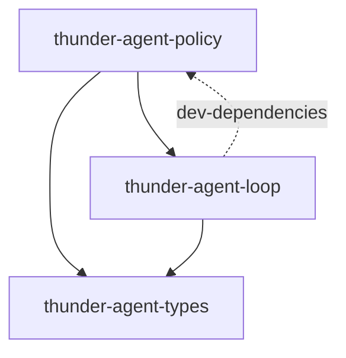

[English](README_en.md) | [简体中文](README.md)

# thunder-agent-policy

## Purpose

Thunder's execution policy layer. Everything that *judges* a tool call lives here; the kernel (`thunder-agent-loop`) answers none of these questions and only offers the seam: `Tools` / `ToolsFactory`.

Four responsibilities:

1. Registering and executing tools (`ToolRegistry`, `ToolExecutor`);
2. The kernel's non-negotiable floor (`guard`) and the host's policy hook (`gate`);
3. User-facing approval (`HostUi`) and the human-readable record (`trace`);
4. Routing plugin-initiated calls through the same funnel as model-initiated ones (`invoke`, `registry_tools`).

## Crate boundary

- Direct dependencies: `thunder-agent-types`, `thunder-agent-loop` (it implements the loop's `seam::Tools` / `ToolsFactory`, and reuses `core::utf8` and `tools::scratchpad`), plus `tokio`, `tokio-util`, `futures-util`, `parking_lot`, `async-trait`, `serde`, `serde_json`, `regex`, `libc`, `tracing`.
- The direction is one-way: policy → loop. The loop does **not** depend on policy; `thunder-agent-policy` appears in `thunder-agent-loop/Cargo.toml` only under `[dev-dependencies]` (a `Tools` double and boundary assertions for tests).
- `thunder-agent-loop/tests/kernel_boundary_test.rs` guards that boundary against the source: `seam.rs` must not contain `ToolExecutor` / `ToolRegistry` / `crate::types::gate`; the loop may execute only through `seam::execute_batch`; tool lists may come only from `Tools::specs()`.
- Downstream: `thunder-agent-runtime`, `thunder-agent-providers`, `thunder-agent-skills`, `thunder-agent-mcp`, `thunder-agent-pack-code`, `thunder-agent-root`, `thunder-agent-daemon`, `thunder-agent-core/tui`.

## Modules

| Module | Contents |
|---|---|
| `executor` | `ToolExecutor`: the single funnel `run_tool`, the batch entry `execute_all`, the approval dialog `ask`, trace publication `publish` |
| `registry` | `ToolRegistry`: name-ordered tool table, output sanitising/truncation/scratchpad spill |
| `registry_tools` | `RegistryTools` / `StaticToolsFactory`: the reference seam implementation |
| `tool_policy` | `AgentTool` and `ToolExecutionContext` (including `invoke` for sub-tool calls) |
| `gate` | `ToolGate`, `ToolGateRequest`, `GateVerdict`, `ApprovalPrompt`, `ApprovalAnswer`, dialog option constants |
| `guard` | `Guard::check`: the kernel's unconditional refusals (dangerous commands, `Scope::Critical`) |
| `read_only` | `call_is_read_only` / `is_read_only`: plan mode's read-only proof |
| `ui` | `HostUi`, `UiRequest` / `UiResponse`, `UiSource`, `UiHandle`, `NullHostUi` |
| `plugin` | `Plugin`, `ToolPlugin`, `InterceptorPlugin`, `PreExecutionVerdict`, `priority` constants, `ToolPluginAdapter`, `SubToolInvoker` |
| `invoke` | Plugin-initiated calls: `ToolInvoker`, `ExecutorToolInvoker`, `NullToolInvoker`, `ToolInvokerSlot` |
| `trace` | The producing side of traces: redaction, previews, digests, `TraceInterceptor`; record types are re-exported from `thunder-agent-types::trace` |
| `sanitizer` | `strip_ansi_escapes`, `is_binary_data`, `sanitize_tool_output` |
| `lib` | `pub use *` re-exports of every module |

## A typical flow

The model returns a `ToolCall` → the loop calls `Tools::call`, reaching `RegistryTools` → `ToolExecutor::run_tool` → `ToolRegistry::execute_tool_call` → `AgentTool::execute` → the result becomes a `ToolOutcome` and returns to the loop. Exactly one `ToolTrace` is written along the way.

## `ToolExecutor::run_tool`: the single funnel

Before dispatching, `run_tool` stamps three things the caller must not be responsible for: the tool's declared `effect` into `ctx.effect`, the run's `ToolEventSink`, and a `UiHandle` around the host `HostUi`. It installs an `ExecutorSubToolInvoker` when `ctx.sub_invoker` is empty, and pushes its own name onto `call_chain` when that is empty. Then `dispatch` runs, and `TraceDraft::finish` closes the record and `publish`es it.

**One exit.** `run_tool` contains no early `return`, and the record is closed in exactly one place. Refusal paths return early *inside* `dispatch`; returning there only hands control back to `run_tool`, which still closes the record. "Every call leaves exactly one trace" is therefore structural, not a promise.

| # | Stage | Where | Priority constant | Outcome |
|---|---|---|---|---|
| 1 | Cancellation | top of `dispatch` | — | `Decision::Cancelled`, refused immediately |
| 2 | Argument parsing + record redaction | `serde_json::from_str`, `redact_arguments` | — | Unparseable arguments become `null` (so a rule keyed on an argument cannot match); the registry still reports the parse error to the model |
| 3 | Scope | `ToolScope::scope_of` → `Scope` | `SECURITY_POLICY` = 800 | `Scope::Unknown` when no scope is installed |
| 4 | Kernel guard | `Guard::check(tool, args, effect, scope)` | `CRITICAL_GUARD` = 1000 | `Decision::Deny { by: Guard }`; the gate never sees the call, and no mode can override it |
| 5 | Host gate | `ToolGate::decide(&request)` | `GOVERNANCE_MODE` = 500 | `Allow` / `AllowByRule` proceed, `Deny` refuses, `Ask` moves to the next stage; no gate means allow |
| 6 | Approval dialog | `ToolExecutor::ask` | rendered by the kernel | `AllowOnce` / `AllowAlways` proceed; `NoUi` / `Timeout` / `Denied` / `Unrecognised` all refuse |
| 7 | Pre-interceptors | descending `priority()` | default `NORMAL` = 500 | `Deny` / `Err` refuse immediately; `AskUser` raises a dialog and continues only on `Allow once` (serialised and fail-closed as well) |
| 8 | Execution | `ToolRegistry::execute_tool_call` | — | Timeouts, cancellation, unknown tools and bad JSON all become `is_error` results |
| 9 | Post-interceptors | reverse order (onion unwind) | — | May only change `content` and `is_error` |
| 10 | Trace publication | `TraceDraft::finish` → `publish` → `ToolTraceSink` | — | With no sink the record is finished in memory and not persisted |

Two things need saying plainly:

- Scope (3) is computed before the guard (4), because `Guard::check` takes `Scope::Critical` as an input. The priority constants express the identity of the layers and the relative order of interceptors, not the literal call order inside `dispatch`.
- `Guard` also implements `InterceptorPlugin` (priority 1000) for hosts that still use only the interceptor pipeline. The new funnel calls `Guard::check` directly in `dispatch`, so a guard cannot be bypassed by "not installing interceptors".

Approval dialog details:

- The kernel renders the dialog; a gate only returns an `ApprovalPrompt`, so it cannot disguise an approval as an ordinary question.
- `prompt_lock` (a `tokio::sync::Mutex`) serialises every dialog on one executor — `execute_all` is a parallel batch, and two overlapping prompts are how the wrong one gets approved. Waiting for the lock races cancellation, so a cancelled run does not hold the rest of the batch hostage.
- With `allow_always == false` only one-shot answers are offered; an answer outside the offered set is refused.
- A plugin-initiated call is titled `Plugin <id> requests:`, because a user agreeing must know who is asking.
- "Deny with reason" raises a second `UiRequest::Input`; the reason goes into the model-visible refusal verbatim.

## `ToolRegistry`

| Item | Value / behaviour |
|---|---|
| Storage | `BTreeMap<String, Arc<dyn AgentTool>>` |
| `Default` | `new(64 * 1024, Duration::from_secs(30))` |
| Registration | `register` keys on `definition().function.name`; same name replaces |
| Declaration order | `get_definitions()` iterates in name order |
| Output cap | `max_output_bytes`; beyond it the head 40% and tail 40% are kept, with `[... Output truncated: N bytes omitted (total: M bytes) ...]` in between |
| Default timeout | `default_timeout`, overridable per call via `execute_tool_call`'s `custom_timeout` |
| Spill | With a `ScratchpadManager` and output above its `threshold_bytes` (16 KiB by default), the full text is persisted and a handle returned; a persistence failure falls back to in-memory truncation |
| Sanitising | Both success and error paths run `sanitize_tool_output`: binary content becomes `[Binary data omitted: N bytes]`, everything else loses ANSI escapes |

Why `BTreeMap`: tool definitions are serialised into every LLM request, and a stable, deterministic order keeps the request prefix byte-identical across turns — a hard prerequisite for provider-side prompt caching. A `HashMap` would randomise the order per instance.

`execute_tool_call` also handles: unknown tools (an error listing the available names), an empty argument string (treated as `{}`), and cancellation raced against `tokio::time::timeout`. It makes **no** decisions — guard, gate and approval have all run upstream.

## Policy hooks: `ToolGate` and approval

| Type | Role |
|---|---|
| `ToolGateRequest<'a> { tool, arguments, effect, scope, caller, tool_call_id }` | One call as presented to a gate; borrowed so per-call cloning buys nothing |
| `GateVerdict` | `Allow` / `AllowByRule { rule }` / `Ask(ApprovalPrompt)` / `Deny { reason }` |
| `ApprovalPrompt { title, detail, allow_always }` | The question a gate wants asked; `detail` is what will actually run — without it the dialog asks for a blind yes |
| `ApprovalAnswer` | `AllowOnce` / `AllowAlways` / `Deny` / `DenyWithReason { reason }`, handed back only to the gate that asked |
| `ToolGate::decide(&request) -> GateVerdict` | Synchronous and infallible; anything needing `await` or a human belongs to the kernel, so return `Ask` |
| `ToolGate::record_answer(&request, &answer)` | Empty by default; only a gate that sets `allow_always` needs to remember a rule |
| `ToolGate::label() -> &str` | A label for traces and status bars (usually the mode name); the kernel stores it and never interprets it |

The option constants live in `gate.rs`: `ALLOW_ONCE = "Allow once"`, `ALLOW_ALWAYS = "Always allow"`, `DENY = "Deny"`, `DENY_WITH_REASON = "Deny with reason"`. They belong to the kernel because the dialog does: a gate decides *whether* to ask, the kernel decides what the user *may answer*.

A gate may only tighten: it chooses allow, ask or deny for a call the guard already permitted, and can never loosen the guard.

## `HostUi`

The host-owned interaction surface. Requests are data, not renderable objects:

| `UiRequest` | Reply |
|---|---|
| `Select { title, detail?, options, timeout_ms? }` | `UiResponse::Value` |
| `Confirm { title, message, timeout_ms? }` | `UiResponse::Confirmed` |
| `Input { title, placeholder?, timeout_ms? }` | `UiResponse::Value` |
| `Review { title, path, content, options, timeout_ms? }` | `UiResponse::Value` |
| `Editor { title, prefill?, timeout_ms? }` | `UiResponse::Value` |

`HostUi` has three required methods — `request`, `notify`, `set_status`; `select` / `select_with_detail` / `select_from_plugin` / `select_owned` / `confirm` / `input` are default wrappers.

Constraints and defaults:

- **Fail closed.** Anything the host cannot answer (no UI, timeout, closed channel) resolves to `UiResponse::Cancelled`, which callers treat as a refusal.
- Implementations own the timeout; unset or zero means `DEFAULT_UI_TIMEOUT` (60 s).
- `UiSource::Host` is the reserved channel for host-initiated interactions such as approval. Implementations must render it distinctly from `UiSource::Plugin`, or a plugin can impersonate an approval prompt.
- `NullHostUi` always answers `Cancelled` and drops notifications and status writes — so "no UI" and "user cancelled" are indistinguishable, which is exactly the fail-closed property callers rely on.
- The kernel's own wait for an approval is `DEFAULT_APPROVAL_TIMEOUT` (600 s), overridable with `with_approval_timeout`.

## Plugin shapes: `ToolPlugin` and `InterceptorPlugin`

`Plugin` is the shared identity contract: `id()` is required; `name()` defaults to `id()`, `version()` to `"0.1.0"`, `description()` to empty.

- **`ToolPlugin` (capability):** `definition() -> ToolDefinition`, `effect()` (name-based by default), `execute(args, ctx) -> Result<CallToolResult, String>`. Input and output align with MCP: `CallToolResult { content: Vec<ToolContent>, is_error: Option<bool> }`, with `ToolContent` variants `Text` / `Image` / `Resource`. `register_plugin` bridges one into an `AgentTool` via `ToolPluginAdapter` without changing `ToolRegistry`.
- **`InterceptorPlugin` (governance):** `priority()` (default `NORMAL`), `pre_execute(tool, args, ctx) -> Result<PreExecutionVerdict, String>`, `post_execute(tool, args, &mut CallToolResult, ctx)`. Pre runs in descending priority, post unwinds in reverse. `PreExecutionVerdict` is `Allow` / `Deny { reason }` / `AskUser { prompt }`.

| Priority constant | Value | Use |
|---|---|---|
| `CRITICAL_GUARD` | 1000 | Kernel security floor (dangerous commands), always first |
| `SECURITY_POLICY` | 800 | Security policy and path sandboxing (the scope layer) |
| `GOVERNANCE_MODE` | 500 | Execution modes and human-in-the-loop approvals (plan/ask/yolo) |
| `NORMAL` | 500 | Default for general interceptors, same layer as modes |
| `OBSERVABILITY` | 100 | Telemetry and structured tracing (outermost in the onion) |

`SubToolInvoker` lets a tool call another tool safely; `ToolExecutionContext::invoke` enforces three rules before dispatching: `depth < max_depth` (default 3), cycle detection over `call_chain`, and inheritance of cancellation, `caller` and route. The default implementation is `ExecutorSubToolInvoker`, which routes straight back into `run_tool`.

The `invoke` module gives plugins their own entry: `ExecutorToolInvoker` wraps a plugin's request as a `ToolCall` and runs it through `run_tool` with `caller` set to the plugin id, so an approval dialog can name who is asking. `NullToolInvoker` refuses everything — "this host has no tool pipeline", a feature rather than a stub.

## `read_only`: plan mode's proof

`call_is_read_only(arguments)` pulls the command line out of `command` / `cmd` / `script` (the guard's `COMMAND_KEYS`), and `is_read_only(command)` decides whether it can be proven to change nothing.

What counts as proof:

- **One command.** A separator or redirect — `;` `&` `|` `` ` `` `>` `<` `(` `)` `{` `}` or a newline — is a second command nobody looked at, or a file being written, and is refused. A `|` inside quotes is an argument, so `grep "a|b" src/` stays a read. `$` is refused because a substitution is a command that cannot be seen.
- **A read-only verb.** The `READ_VERBS` allowlist (`cat` `grep` `ls` `stat` `wc` `diff` … 45 entries), each of which must be unable to write a file, run another program or reach the network. Verbs that write through a flag get their own arm (`sort -o`, `find -delete`, `git branch -D`).
- **A verb, not a path.** `/tmp/evil/ls` is not `ls`; only a bare word matches. The cost is that `/bin/ls` asks — the direction a false negative is allowed to fail in.
- **No wrapper.** `sudo` / `env` / `xargs` are not on the list, because they run another verb.
- **No credential read.** `SECRET_COMPONENTS` (`.ssh` `.aws` `.env` `id_rsa` …) and `SECRET_SUFFIXES` (`.key` `.pem` …) match whole path components, so `cat ~/.ssh/id_rsa` asks.

This reads a command line; it is not a sandbox. Anything it cannot parse returns `false`. Its only consumer is the plan-mode gate in `thunder-agent-root/src/plugins/mode.rs`: `ToolEffect::Read` is allowed outright; `ToolEffect::Exec` is allowed when `call_is_read_only(request.arguments)` holds (asking about `ls` is noise); an `Exec` it cannot prove read-only asks; every other effect (writes) is denied. `Guard` asks the same question in the opposite direction — guard finds "must refuse", this finds "may run silently".

## Trace egress

The record types (`ToolTrace`, `Decision`, `DenyBy`, `GuardHit`, `GuardKind`, `AskAnswer`, `TraceResult`, `TraceTiming`, `TRACE_SCHEMA`, `ToolTraceSink`) are defined in `thunder-agent-types::trace` and re-exported here.

The producing side lives here:

- `redact_arguments(&mut Value) -> Redactions` runs three passes: a key matching `SECRET_KEYS` (`api_key` `token` `password` `authorization` …) is replaced wholesale with `[redacted:key]` and its original value remembered; `content` / `preview` document keys become `{ digest, bytes, preview }`; every remaining string is scrubbed by `SECRET_PATTERNS` (GitHub tokens, `sk-`, AKIA, JWTs, private-key blocks, Bearer tokens, credentials embedded in URLs).
- `withhold(text, secrets)` scrubs values declared secret from everything *derived* (output previews, error messages). Values shorter than 6 characters are skipped so ordinary words survive.
- `preview_text` / `redact_preview` produce previews; the executor caps them at `OUTPUT_PREVIEW_CHARS` (2048).
- `stable_digest` is FNV-1a, 64-bit, hex. Stability across releases is the entire requirement (dedupe, "did this change?"); it is **not** for authenticity.
- `TraceInterceptor` is an interceptor adapter at `OBSERVABILITY` (100) for hosts that only use the interceptor pipeline; the main funnel produces complete records directly through `TraceDraft`.

`ToolTraceSink::record(&ToolTrace)` is one-directional: the kernel does not know where a store lives, and choosing a path is host policy, so it emits and a host keeps.

## `registry_tools`: the reference seam implementation

`RegistryTools` implements `thunder-agent-loop::seam::Tools`:

- `specs()`: each entry from `ToolRegistry::get_definitions()` paired with that tool's `concurrency()` (`Parallel` by default; `Sequential` makes the whole batch run in `tool_calls` order), assembled into `ToolSpec`.
- `call()`: converts the seam's `ToolCallContext` into a `ToolExecutionContext` (`tool_call_id`, `turn`, `cancel`, `route`, `events`) and calls `run_tool`; when the result becomes a `ToolOutcome`, a zero `original_bytes` on a non-error result is filled in from `output.len()`.

**The trace-slot generation guard.** `RegistryTools` remembers the slot it installed as `trace_generation: Option<u64>`.

- `RegistryTools::new(registry, executor)` owns no slot (tests, one-shot tools);
- `RegistryTools::for_run(registry, executor, generation)` owns slot `generation`;
- `Drop` calls `executor.clear_run_trace(generation)` only when `trace_generation` is `Some`. Concurrent runs share one executor, and `clear_run_trace` clears the slot only if it still belongs to that `generation`, so the run that finishes first cannot clear the sink of a run still in flight.

This is not about memory. A host's event proxy waits for the run's event channel to close before reporting the run drained; a sink left in the shared slot kept a sender alive forever, so every run's tail hung.

`StaticToolsFactory::for_run(&RunContext)` is the normal path: take the sink from `run.trace`, `executor.install_run_trace(sink)` for a generation, and return `RegistryTools::for_run(...)`.

`plain_tools(tools, max_output_bytes, timeout)` / `single_tool(...)` are convenience constructors for tests and one-shot scenarios: build the registry, `ToolExecutor::new`, return `Arc<dyn Tools>` (owning no slot).

## Failure direction

Every ambiguous case refuses, and the reason is written for the model to read; guard, approval and cancellation refusals additionally carry a `SystemNotice`:

| Situation | Behaviour |
|---|---|
| No gate | Everything the guard allows runs (the headless contract) |
| No scope | `Scope::Unknown`; no automatic allowance |
| No UI / timeout / dismissed dialog | Refused (`AskAnswer::NoUi` / `Timeout`) |
| Answer outside the offered set | Refused (`AskAnswer::Unrecognised`) |
| Cancellation | Refused immediately; the tool never starts |
| Guard hit | No mode or approval can reach it; the refusal text states that changing the mode will not help |
| Interceptor returns `Err` or `Deny` | Refused, `DenyBy::Gate` |
| Unparseable argument JSON | The gate sees `null` arguments; the registry returns the parse error to the model |
| Unknown tool | The registry errors and lists the available tools |
| Oversized output | Scratchpad spill first, head/tail truncation as fallback |

## Tests

- 31 inline unit tests (`executor` 1, `gate` 2, `guard` 11, `read_only` 3, `sanitizer` 3, `trace` 5, `ui` 6).
- End-to-end behaviour is verified in consumer integration tests: `thunder-agent-root/tests/gate_absent_allows_test.rs` (no gate means allow; uninstalling one), `thunder-agent-root/tests/plan_mode_test.rs` (a real `ModePlugin` driving `ToolExecutor::run_tool`), `thunder-agent-pack-code/tests/path_scope_test.rs` (path scope), and `thunder-agent-loop/tests/kernel_boundary_test.rs` (the dependency boundary).

## Extension points

| Goal | Implement |
|---|---|
| Add a tool | `AgentTool`, or `ToolPlugin` + `ToolRegistry::register_plugin` |
| Add a policy or mode | `ToolGate`, installed with `with_tool_gate` |
| Add an audit/rewrite layer | `InterceptorPlugin`, installed with `with_interceptor` / `add_interceptor`, ordered by `priority()` |
| Replace the UI | `HostUi`, installed with `with_host_ui` |
| Tell the kernel where a call lands | `ToolScope`, installed with `with_tool_scope` |
| Persist traces | `ToolTraceSink`, injected via `RunContext.trace` / `StaticToolsFactory` |
| Let a plugin call tools | `ToolInvoker` (usually `ExecutorToolInvoker`) |
| Sub-tool calls | `SubToolInvoker` |
