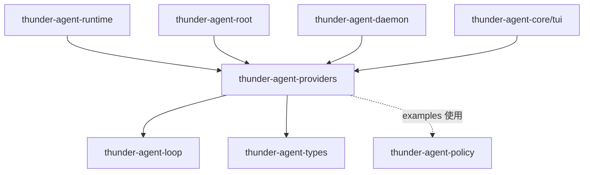
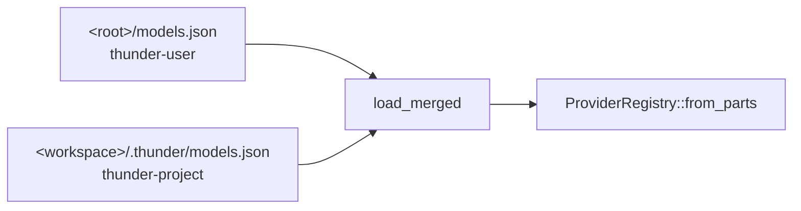

[English](README_en.md) | [简体中文](README.md)

# thunder-agent-providers

## 定位

模型目录 + 配置解析 + 流式传输。这个 crate 回答三个问题：有哪些模型可用、某个模型能不能在本进程里跑、怎么把它流出来。

它**不含** agent loop、工具执行策略、会话存储与任何产品逻辑。上层拿到的是 `Arc<dyn LLMClientTrait>`，与 loop 的其它客户端实现等价。

- 目录：`models.json` / `auth.json` → `ModelSpec`。
- 传输：`RpiAiClient` 用 `rpi-ai` 直接在进程内发 HTTP，没有 sidecar、没有 Node 进程。
- 附带：思考等级探测、单次补全（`one_shot_text`）、会话标题生成（`naming`）。

## crate 边界



- 内部依赖：`thunder-agent-loop`（`LLMClientTrait`、`ChatRequestOptions`、`core::paths`、`cache::warmer::PromptCacheWarmSettings`）、`thunder-agent-types`（`ToolDefinition`）、`thunder-agent-policy`（`src/` 不使用，仅 `examples/production_path.rs` 用到）。外部流式栈：`rpi-ai`（`providers` feature）。
- 下游：`thunder-agent-runtime`、`thunder-agent-root`、`thunder-agent-daemon`、`thunder-agent-core/tui`。

## 模块

| 模块 | 内容 |
|---|---|
| `api` | `ProviderApi`（5 种方言）、`ModelRef`、`normalize_openai_base` |
| `auth` | `AuthFile`、`resolve_provider_key`、`resolve_env_value`、`env_api_key` |
| `catalog` | `ProviderRegistry`、`ModelSpec`、`resolve_thinking_levels`、`ModelMetadataCache`、`DEFAULT_SAFE_CONTEXT_WINDOW` |
| `client` | `RpiAiClient`：`LLMClientTrait` 实现，请求/响应映射 |
| `config` | `ModelsFile` / `ProviderFileConfig` / `ModelFileConfig` / `CompatConfig` 及回写 |
| `convert` | `ModelDescriptor` → `rpi_ai::Model`、`supports_api`、`ConversionNotes` |
| `model` | `ModelDescriptor`（线上协议）、`ModelCost`、`ModelPromptCache` |
| `naming` | 标题生成与清洗（`generate_title`、`clamp_title`） |
| `oneshot` | `one_shot_text`：给定 `ModelSpec` 的一次性补全 |
| `probe` | 思考等级主动探测（OpenAI / Anthropic / Google） |
| `source` | `ConfigSource` 配置链、`load_merged` |

## 核心类型

| 类型 | 关键字段 | 说明 |
|---|---|---|
| `ProviderRegistry` | `utility_model: Option<String>`、`models: Vec<ModelSpec>` | 一次解析后的模型表；纯数据，`resolve` 不做 I/O |
| `ModelSpec` | `provider`、`id`、`api: ProviderApi`、`base_url`、`api_key`、`available`、`context_window`、`max_tokens`、`thinking_levels`、`compat`、`cost`、`prompt_cache` | 目录项；`selection_id()` = `provider/id` |
| `ModelDescriptor` | camelCase 线上字段：`provider`、`id`、`api`、`baseUrl`、`apiKey`、`headers`、`reasoning`、`input`、`contextWindow`、`maxTokens`、`thinkingLevelMap`、`compat`、`cost`、`promptCache` | 宿主与 `thunder-runtime` 之间的线协议，字段名不可改 |
| `ModelRef` | `provider`、`model` | `parse("a/b")`；无斜杠时回落 `provider = "openai"` |
| `ProviderApi` | `OpenAiCompletions`（默认）、`OpenAiResponses`、`AnthropicMessages`、`GoogleGenerateContent`、`Ollama` | 接受别名（如 `anthropic`、`gemini`、`responses`） |
| `RpiAiClient` | `provider`、`model`、`timeout` | 每个模型一个实例，`stream_chat` 每次调用新建 channel |
| `ModelMetadataCache` | `context_windows: HashMap<String, usize>` | 运行时学到的上下文窗口 |

## 一次典型流程

```
ProviderRegistry::load_default()        // 只读配置链，绝不联网
  └─ resolve("provider/model")          // → &ModelSpec
       └─ client_for(&spec, timeout_ms) // 可用性 + 方言 + 建 client
            └─ loop: stream_chat(options, cancel_token)
                 └─ Receiver<Result<LLMStreamChunk, String>>
```

`client_for` 的三道门，按顺序：

| 检查 | 失败 | 原因 |
|---|---|---|
| `!spec.available` | `ProviderError::Auth` | 缺 API key 或 base URL |
| `!convert::supports_api(&descriptor.api)` | `ProviderError::Config` | 本 build 不支持该方言 |
| `RpiAiClient::from_descriptor(..)` 失败 | `ProviderError::Transport` | 建 HTTP/provider 失败，错误里带模型名 |

构造成功后若 `ConversionNotes` 非空，只打 `tracing::warn!`，不中断。`client_for_selection(selection, timeout_ms)` 是这两步的合并版；`has_available_model()` 判断目录里是否有任一 `available`。

## 配置链



- `<root>` = `THUNDER_CONFIG_DIR`，否则 `~/.thunder`（`thunder_agent_loop::core::paths::thunder_config_dir`）。
- `ConfigSource::default_chain(workspace)` = `[thunder_user, thunder_project]`；`workspace` 为 `None` 时项目层是相对路径 `.thunder`。
- **读**：按链序合并，`entry(id).or_insert(..)` —— 每个 provider 键由第一个定义它的文件整体胜出；`auth.json` 条目同样先到先得。因此 user 文件优先于 project 文件。
- **写**：`primary_write_path_in_chain` 取第一个已存在的文件（否则第一个 source），`owner_path_in_chain` 取第一个定义了目标 provider 的文件。写必须落在读会优先看到的位置，否则会被遮蔽。
- `ModelsFile::default_paths()` 是历史搜索顺序（project 在前），源码注释明确它**不是**读序也**不是**写序。

### `models.json` 字段

`ModelsFile` 用 camelCase，根键 `utilityModel`（兼容 `utility_model` / `tool_model` / `fast_model` / `naming_model` 等别名）与 `providers`。

| Provider 级 | 类型 | 说明 |
|---|---|---|
| `baseUrl` | string | 模型级可覆盖 |
| `api` | string | 缺省 `openai-completions` |
| `apiKey` | string | 支持 `${VAR}` / `$VAR` 展开 |
| `headers` | map | 透传到请求头 |
| `models` | array | 为空时走内置表（仅 provider id 为 `openai` / `deepseek`，见下） |
| `compat` | object | 见下 |
| `thinkingLevels` / `defaultThinkingLevel` / `thinkingLevelMap` | | provider 级默认，模型级覆盖 |

| 模型级 | 类型 | 默认 |
|---|---|---|
| `id` | string | 必填 |
| `name` | string | 缺省为 `id` |
| `api` | string | 继承 provider |
| `baseUrl` | string | 继承 provider |
| `reasoning` | bool | `false` |
| `input` | `["text"]` / `["text","image"]` | 空 → 转换时归一为 `text` |
| `contextWindow` | usize | `128_000`（配置 → 元数据缓存 → `DEFAULT_SAFE_CONTEXT_WINDOW`） |
| `maxTokens` | usize | `16_384` |
| `thinkingLevels` / `defaultThinkingLevel` | | provider 级 → `thinkingLevelMap` 推导 → 启发式 |
| `thinkingLevelsProbed` | bool | `false`；探测成功回写为 `true` |
| `cost` | `{input,output,cacheRead,cacheWrite}`（每百万 token） | 无 |
| `promptCache` | `{short,long}` 秒 | 无 |

`compat`（`CompatConfig`）字段：`supportsDeveloperRole`、`supportsReasoningEffort`、`maxTokensField`（默认 `"max_tokens"`）、`supportsLongCacheRetention`、`supportsCacheControlOnTools`、`cacheControlFormat`、`sendSessionAffinityHeaders`、`sessionAffinityFormat`、`supportsMidConvoSystemMessages`、`supportsMidConvoToolChanges`、`supportsExplicitPromptCacheMode`、`forceAdaptiveThinking`。模型级逐字段覆盖 provider 级（`merge_compat`）。

`available` 只表示**凭据与地址**是否齐备：`api_key` 非空且 `base_url` 非空。方言是否可流由 `client_for` 另行拒绝。

### 密钥解析（`resolve_provider_key`）

1. `models.json` 里的 `apiKey`：`${VAR}` / `$VAR` 展开；环境变量为空时回退读 shell rc（`.zshrc`、`.zshenv`、`.zprofile`、`.bash_profile`、`.bashrc`、`.profile`），因为 macOS GUI 进程不继承交互 shell 环境。
2. `auth.json` 的 `<provider>` 条目：字符串，或对象的 `key` / `apiKey` / `access`。
3. 环境变量：`THUNDER_API_KEY`（任意 provider 优先），随后是 `OPENAI_API_KEY`、`ANTHROPIC_API_KEY`、`GEMINI_API_KEY` / `GOOGLE_API_KEY`、`DEEPSEEK_API_KEY`、`OPENROUTER_API_KEY`。

### 没有 models 时

- provider 的 `models` 为空且 id 为 `openai` 或 `deepseek` → `builtin_models` 内置表（openai：`gpt-4o`、`gpt-4o-mini`；deepseek：`deepseek-flash`、`deepseek-v4-pro`、`deepseek-chat`、`deepseek-reasoner`）。缺省 base URL 分别为 `https://api.openai.com/v1`、`https://api.deepseek.com`。
- 整个注册表为空 → `fallback_openai_catalog`：`openai/gpt-4o`、`openai/gpt-4o-mini`，`api = openai-completions`。

## 方言：哪些真的能流

`ProviderApi::as_pi_api_str` 给出线上 api 字符串，`convert::supports_api` 决定能不能跑：

| `ProviderApi` | 线上 api 字符串 | 可流式 |
|---|---|---|
| `OpenAiCompletions` | `openai-completions` | 是 |
| `OpenAiResponses` | `openai-responses` | 是 |
| `AnthropicMessages` | `anthropic-messages` | 是 |
| `GoogleGenerateContent` | `google-generative-ai` | 否 |
| `Ollama` | `openai-completions` | 是（走 OpenAI 兼容端点） |

`SUPPORTED_APIS` 恰好是前三项。`rpi-ai` 的 `Api` 枚举里还有 `google-generative-ai`、`bedrock-converse-stream`、`google-vertex`、`mistral-conversations` —— 有名字但没有 provider 实现，所以 `supports_api` 故意比 `Api` 窄，它是"能不能跑"的唯一事实来源。拒绝时统一用 `unsupported_api_message` 的措辞。

## 流式映射（`RpiAiClient::stream_chat`）

请求侧：

| `ChatRequestOptions` | 处理 |
|---|---|
| `messages` | 多个 `System` 以 `\n\n` 合并为一个 system prompt；user 的 `parts` 非空时发 blocks（含图片），否则纯文本 |
| `tools` | 转成 `rpi_ai::Tool` |
| `model` | **忽略**：模型在构造 client 时已固定，避免第二个事实来源 |
| `temperature` / `max_tokens` | 直接映射 |
| `top_p` | 写进 `model.sampling_params["top_p"]`（OpenAI 形状的 provider 会并进请求体；Anthropic provider 不读这张表） |
| `thinking_level` | `level_from_str` |
| `cache_retention` | `none` / `long` / 其它与缺省 → `short` |
| `session_id` | 透传为 `SimpleStreamOptions::session_id` |
| `cancel_token` | 桥接到 rpi-ai 自己的 token |

响应侧（channel 深度 64）：

| rpi-ai 事件 | 产出 |
|---|---|
| `TextDelta` | `LLMStreamChunk::Token` |
| `ThinkingDelta` | `LLMStreamChunk::ReasoningToken` |
| 工具调用增量 | 丢弃（约定是终止事件里整块给） |
| `Done` | `Completed { content, tool_calls, finish_reason, usage }` |
| `Error` | `Err(..)` |
| 流结束但没有终止事件 | `Err("rpi-ai stream ended without a terminal event (N chars of text received)")` |

`Completed` 的字段口径：`prompt_tokens = input + cache_read + cache_write`（rpi-ai 的 `input` 不含缓存桶）、`cached_tokens = cache_read`、`cache_write_tokens = cache_write`、`completion_tokens = output`、`reasoning_tokens = reasoning`。`finish_reason`：`ToolUse` / `Deferred` → `tool_calls`，`Length` → `length`，其余 → `stop`。

`ChatMessage::Assistant` 既无文本也无工具调用时整条跳过（否则会序列化成空 content 数组，部分 provider 直接拒绝）。工具参数是 JSON 字符串：空串 → `{}`，解析失败保留为字符串（provider 视为"无参数"，好过丢掉这次调用）。

## `ModelDescriptor` → `rpi_ai::Model`（`convert`）

`model_from_descriptor` 先做方言门禁，再映射。三处需要取舍，结果都写进 `ConversionNotes`：

| 字段 | 处理 | 记入 notes |
|---|---|---|
| `cost.tiers` | 逐条解析，失败的单条丢弃而不是整个模型失败 | `dropped_cost_tiers` |
| `compat` | 必须落进与 api 匹配的**具体**变体（`AnthropicMessagesCompat` / `OpenaiCompletionsCompat` / `OpenaiResponsesCompat`）；解析失败保留 `Other` | `compat_unparsed` |
| `prompt_cache` | `rpi_ai::Model` 没有对应字段 | `dropped_prompt_cache` |

`input` 为空时归一为 `[Text]`；`thinking_level_map` 里无法识别的键被过滤。

## prompt-cache 预热参数的推导

`ModelSpec::prompt_cache_warm_settings(thinking_level) -> Option<PromptCacheWarmSettings>`：

| 输入 | 结果 |
|---|---|
| `prompt_cache.short` 缺失 | `None`（不预热；`long` 单独存在也不够） |
| `ttl_secs` | `prompt_cache.short` |
| 价格 | `cost.input` / `cost.cache_read` / `cost.cache_write`，`cost` 缺失则为 `None` |
| `replay_safe` | `!reasoning \|\| !anthropic \|\| compat.forceAdaptiveThinking` |

`replay_safe` 的含义：Anthropic 的 thinking budget 由 `max_tokens` 推导，重放一 token 的请求会改变缓存键，所以只有自适应思考（或关闭思考）的模型才允许预热。`cost` 缺失或全零时，loop 的 `decide_warming` 会以 `"cache economics unavailable"` 停止预热。

## 元数据缓存

- 文件：`default_metadata_cache_path()` = `<root>/models_metadata.json`。
- 结构：`{ "contextWindows": { "<selection_id 或 model id>": <usize> } }`。
- 解析优先级（`resolve_context_window`）：`models.json` 显式 `contextWindow` → 缓存里的 `selection_id` → 缓存里的裸 `id` → `128_000`。
- 写入：`update_model_context_window` / `update_model_context_window_at(cache_path, ..)`，同时更新内存里的 `ModelSpec.context_window`。路径由调用方给出，便于宿主/测试自带数据根。
- 它在 `from_parts` 里被**读**，所以缓存对下一次加载立即生效。

## 思考等级与探测

`resolve_thinking_levels` 的优先级：显式 `thinkingLevels` → 已知推理模型（`reasoning` / `supportsReasoningEffort`，或 id 命中 `reasoner`、`r1`、`o1*`、`o3*`、`thinking`、`sonnet-3-7`、`claude-3-7`）→ `["off"]`。默认等级：reasoner/r1 → `high`；否则 `medium`（若在列表里）；否则列表首项；非推理 → `off`。

`ProviderRegistry::load_default` 是**纯读**，不探测：它跑在列出模型、生成标题、每次运行解析 client 的热路径上。探测是显式的一次性动作：

| 入口 | 行为 |
|---|---|
| `probe_unprobed_models` | 跳过 `thinking_levels_probed`，跳过非推理候选与不可用模型，逐个探测 |
| `probe_and_persist_unprobed_models` | 同上；成功后把 `thinkingLevels` / `defaultThinkingLevel` / `thinkingLevelsProbed: true` 写回定义该 provider 的 `models.json` |

探测实现（`probe.rs`，每个请求 5s 超时）：OpenAI 形状先发 `reasoning_effort: "__probe__"` 逼出 400，从错误体解析允许的枚举；失败则试 `low`，成功即假定 `off/low/medium/high`。Anthropic 发 `thinking.budget_tokens = 1024` 且 `max_tokens = 1025`。Google 由 id 是否含 `thinking` 推断。`Ollama` 返回 `None`（不探测）。

## 失败方向

| 现象 | 结果 |
|---|---|
| 缺 key / base URL | `available == false`；`client_for` 返回 `Auth`。`list_available` 只返回可用模型，仅当无任何可用模型时才退化为返回全部 |
| 方言不支持 | `client_for` 返回 `Config`，消息含模型名与 `SUPPORTED_APIS` |
| 配置文件语法错误 | `ModelsFile::parse_json` / `load_path` → `ProviderError::Config`（`ProviderRegistry::load_default` 原样上抛）；`ModelsFile::load_default` 吞掉错误返回空表 |
| 认证失败 / 网络 | 运行期以 `Err(String)` 出现在 chunk 流里 |
| 流被截断 | `Err(String)`；本 crate **不做重试** |
| 选择串不存在 | `client_for_selection` → `ProviderError::NotFound` |

错误分类与重试都在 `thunder-agent-loop`：`pruning::is_context_overflow_error` 对错误字符串做子串匹配（`context length`、`prompt is too long` 等）来决定压缩重试，`max_stream_retries` 决定断流重试。因此 provider 原样保留上游错误文本，是这条链路能工作的前提。

## 测试

- `tests/providers_test.rs`：配置解析、模型可用性、`ModelRef`、`normalize_openai_base`、思考等级优先级、`compat`/`cost`/`promptCache` 透传、预热参数推导（含 `decide_warming` 的 economics 分支）。
- `tests/metadata_cache_test.rs`：上下文窗口的三级回退与 `update_model_context_window_at` 的持久化。
- `src/probe.rs`、`src/model.rs`、`src/config.rs`、`src/source.rs` 内有单元测试（错误体解析、camelCase 线协议、配置优先级）。
- `RpiAiClient::with_provider` 是测试接缝：换成 `faux` provider 后无需网络即可测流式映射。
- `examples/production_path.rs`：`cargo run -p thunder-agent-providers --example production_path [selection]`，跑通 registry → `client_for` → 真实 `AgentLoop` → 真实 provider 的一轮工具调用。

## 扩展点

- **加一个能流的方言**：先让 `rpi-ai` 有实现，再同时改 `convert::supports_api` / `SUPPORTED_APIS` / `api_enum` 与 `RpiAiClient::with_model` 的 match；漏一处会被 `client_for` 或 `from_descriptor` 拒绝，不会静默降级。
- **加一个 provider 形状的默认值**：`builtin_models` 的 `defs` 表。
- **新 compat 标志**：`CompatConfig` 加字段 + `merge_compat` 加一行覆盖 +（若 rpi-ai 读取）`convert::compat` 的类型化变体。
- **新的后台 LLM 用途**：`one_shot_text`（原始文本）或仿 `naming` 写一个带专用错误类型的模块，宿主自己负责持久化。
