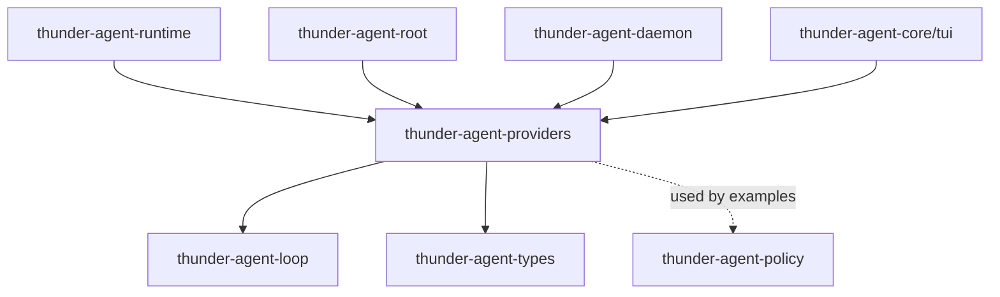
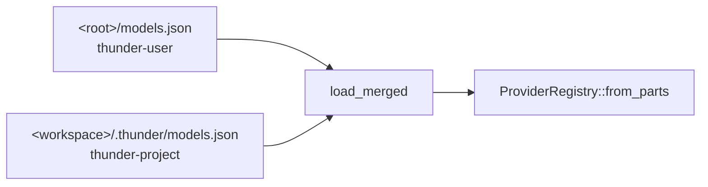

[English](README_en.md) | [简体中文](README.md)

# thunder-agent-providers

## Purpose

Model catalog, configuration resolution, and streaming transport. This crate answers three questions: which models exist, whether a given model can run in this process, and how to stream it.

It contains **no** agent loop, no tool-execution policy, no session storage, and no product logic. Callers receive an `Arc<dyn LLMClientTrait>` that is interchangeable with any other client implementation the loop accepts.

- Catalog: `models.json` / `auth.json` → `ModelSpec`.
- Transport: `RpiAiClient` issues HTTP in-process through `rpi-ai` — no sidecar, no Node.
- Extras: thinking-level probing, one-shot completions (`one_shot_text`), conversation titles (`naming`).

## Crate boundary



- Internal dependencies: `thunder-agent-loop` (`LLMClientTrait`, `ChatRequestOptions`, `core::paths`, `cache::warmer::PromptCacheWarmSettings`), `thunder-agent-types` (`ToolDefinition`), `thunder-agent-policy` (unused by `src/`; only `examples/production_path.rs` uses it). External streaming stack: `rpi-ai` with the `providers` feature.
- Downstream: `thunder-agent-runtime`, `thunder-agent-root`, `thunder-agent-daemon`, `thunder-agent-core/tui`.

## Modules

| Module | Contents |
|---|---|
| `api` | `ProviderApi` (five dialects), `ModelRef`, `normalize_openai_base` |
| `auth` | `AuthFile`, `resolve_provider_key`, `resolve_env_value`, `env_api_key` |
| `catalog` | `ProviderRegistry`, `ModelSpec`, `resolve_thinking_levels`, `ModelMetadataCache`, `DEFAULT_SAFE_CONTEXT_WINDOW` |
| `client` | `RpiAiClient`: the `LLMClientTrait` implementation, request/response mapping |
| `config` | `ModelsFile` / `ProviderFileConfig` / `ModelFileConfig` / `CompatConfig` and write-back |
| `convert` | `ModelDescriptor` → `rpi_ai::Model`, `supports_api`, `ConversionNotes` |
| `model` | `ModelDescriptor` (the wire contract), `ModelCost`, `ModelPromptCache` |
| `naming` | Title generation and cleanup (`generate_title`, `clamp_title`) |
| `oneshot` | `one_shot_text`: a single completion from a resolved `ModelSpec` |
| `probe` | Active thinking-level probing (OpenAI / Anthropic / Google) |
| `source` | `ConfigSource` chain, `load_merged` |

## Core types

| Type | Key fields | Notes |
|---|---|---|
| `ProviderRegistry` | `utility_model: Option<String>`, `models: Vec<ModelSpec>` | The parsed model table; plain data, `resolve` does no I/O |
| `ModelSpec` | `provider`, `id`, `api: ProviderApi`, `base_url`, `api_key`, `available`, `context_window`, `max_tokens`, `thinking_levels`, `compat`, `cost`, `prompt_cache` | One catalog entry; `selection_id()` = `provider/id` |
| `ModelDescriptor` | camelCase wire fields: `provider`, `id`, `api`, `baseUrl`, `apiKey`, `headers`, `reasoning`, `input`, `contextWindow`, `maxTokens`, `thinkingLevelMap`, `compat`, `cost`, `promptCache` | The protocol between a host and `thunder-runtime`; field names must not change |
| `ModelRef` | `provider`, `model` | `parse("a/b")`; with no slash it falls back to `provider = "openai"` |
| `ProviderApi` | `OpenAiCompletions` (default), `OpenAiResponses`, `AnthropicMessages`, `GoogleGenerateContent`, `Ollama` | Aliases accepted (`anthropic`, `gemini`, `responses`, …) |
| `RpiAiClient` | `provider`, `model`, `timeout` | One instance per model; `stream_chat` creates a fresh channel per call |
| `ModelMetadataCache` | `context_windows: HashMap<String, usize>` | Context windows learned at runtime |

## A typical flow

```
ProviderRegistry::load_default()        // read-only config chain; never touches the network
  └─ resolve("provider/model")          // → &ModelSpec
       └─ client_for(&spec, timeout_ms) // availability → dialect → client
            └─ loop: stream_chat(options, cancel_token)
                 └─ Receiver<Result<LLMStreamChunk, String>>
```

`client_for` has three gates, in order:

| Check | Failure | Why |
|---|---|---|
| `!spec.available` | `ProviderError::Auth` | missing API key or base URL |
| `!convert::supports_api(&descriptor.api)` | `ProviderError::Config` | this build cannot stream the dialect |
| `RpiAiClient::from_descriptor(..)` fails | `ProviderError::Transport` | HTTP/provider construction failed; the message names the model |

After a successful build, non-empty `ConversionNotes` only produce a `tracing::warn!`; nothing is aborted. `client_for_selection(selection, timeout_ms)` combines the two steps; `has_available_model()` reports whether any catalog entry has `available`.

## Configuration chain



- `<root>` = `THUNDER_CONFIG_DIR`, else `~/.thunder` (`thunder_agent_loop::core::paths::thunder_config_dir`).
- `ConfigSource::default_chain(workspace)` = `[thunder_user, thunder_project]`; with `workspace == None` the project layer is the relative path `.thunder`.
- **Read**: sources merge in chain order via `entry(id).or_insert(..)` — the whole provider object comes from the first file that defines it; `auth.json` entries are first-wins too. The user file therefore wins over the project file.
- **Write**: `primary_write_path_in_chain` picks the first existing file (else the first source); `owner_path_in_chain` picks the first file that defines the target provider. Writes must land where the merged read will see them first, or they get shadowed.
- `ModelsFile::default_paths()` is the legacy *search* order (project first). Its own doc comment states it is neither the read order nor the write order.

### `models.json` fields

`ModelsFile` is camelCase, with root keys `utilityModel` (aliases `utility_model`, `tool_model`, `fast_model`, `naming_model`, …) and `providers`.

| Provider level | Type | Notes |
|---|---|---|
| `baseUrl` | string | overridable per model |
| `api` | string | defaults to `openai-completions` |
| `apiKey` | string | supports `${VAR}` / `$VAR` expansion |
| `headers` | map | passed through to requests |
| `models` | array | empty → built-in table (only for provider ids `openai` / `deepseek`; see below) |
| `compat` | object | see below |
| `thinkingLevels` / `defaultThinkingLevel` / `thinkingLevelMap` | | provider defaults; per-model override |

| Model level | Type | Default |
|---|---|---|
| `id` | string | required |
| `name` | string | `id` |
| `api` | string | inherited |
| `baseUrl` | string | inherited |
| `reasoning` | bool | `false` |
| `input` | `["text"]` / `["text","image"]` | empty → normalized to `text` during conversion |
| `contextWindow` | usize | `128_000` (configured → metadata cache → `DEFAULT_SAFE_CONTEXT_WINDOW`) |
| `maxTokens` | usize | `16_384` |
| `thinkingLevels` / `defaultThinkingLevel` | | provider value → derived from `thinkingLevelMap` → heuristics |
| `thinkingLevelsProbed` | bool | `false`; set to `true` after a successful probe |
| `cost` | `{input,output,cacheRead,cacheWrite}` per million tokens | none |
| `promptCache` | `{short,long}` in seconds | none |

`compat` (`CompatConfig`) fields: `supportsDeveloperRole`, `supportsReasoningEffort`, `maxTokensField` (default `"max_tokens"`), `supportsLongCacheRetention`, `supportsCacheControlOnTools`, `cacheControlFormat`, `sendSessionAffinityHeaders`, `sessionAffinityFormat`, `supportsMidConvoSystemMessages`, `supportsMidConvoToolChanges`, `supportsExplicitPromptCacheMode`, `forceAdaptiveThinking`. Model-level values override provider-level ones field by field (`merge_compat`).

`available` speaks **only** about credentials and address: non-empty `api_key` and non-empty `base_url`. Whether the dialect can stream is decided later, by `client_for`.

### Key resolution (`resolve_provider_key`)

1. `apiKey` in `models.json`: expand `${VAR}` / `$VAR`; when the variable is empty, fall back to reading shell rc files (`.zshrc`, `.zshenv`, `.zprofile`, `.bash_profile`, `.bashrc`, `.profile`) because macOS GUI processes do not inherit an interactive shell environment.
2. The `<provider>` entry in `auth.json`: a string, or an object with `key` / `apiKey` / `access`.
3. Environment: `THUNDER_API_KEY` (any provider, highest priority), then `OPENAI_API_KEY`, `ANTHROPIC_API_KEY`, `GEMINI_API_KEY` / `GOOGLE_API_KEY`, `DEEPSEEK_API_KEY`, `OPENROUTER_API_KEY`.

### When no models are declared

- A provider with an empty `models` array whose id is `openai` or `deepseek` gets the built-in table from `builtin_models` (openai: `gpt-4o`, `gpt-4o-mini`; deepseek: `deepseek-flash`, `deepseek-v4-pro`, `deepseek-chat`, `deepseek-reasoner`). Missing base URLs default to `https://api.openai.com/v1` and `https://api.deepseek.com`.
- An entirely empty registry falls back to `fallback_openai_catalog`: `openai/gpt-4o`, `openai/gpt-4o-mini`, `api = openai-completions`.

## Dialects: what actually streams

`ProviderApi::as_pi_api_str` yields the wire api string; `convert::supports_api` decides whether it can run:

| `ProviderApi` | Wire api string | Streams |
|---|---|---|
| `OpenAiCompletions` | `openai-completions` | yes |
| `OpenAiResponses` | `openai-responses` | yes |
| `AnthropicMessages` | `anthropic-messages` | yes |
| `GoogleGenerateContent` | `google-generative-ai` | no |
| `Ollama` | `openai-completions` | yes (over an OpenAI-compatible endpoint) |

`SUPPORTED_APIS` is exactly the first three. `rpi-ai`'s `Api` enum also lists `google-generative-ai`, `bedrock-converse-stream`, `google-vertex` and `mistral-conversations` — names with no provider implementation behind them. `supports_api` is deliberately narrower than `Api`, and it is the single source of truth for "can this run". Rejections all use the `unsupported_api_message` wording.

## Stream mapping (`RpiAiClient::stream_chat`)

Request side:

| `ChatRequestOptions` | Handling |
|---|---|
| `messages` | multiple `System` messages merge into one system prompt joined by `\n\n`; a user message with non-empty `parts` sends blocks (images included), otherwise plain text |
| `tools` | converted to `rpi_ai::Tool` |
| `model` | **ignored**: the model is pinned at client construction, so honouring it would create a second source of truth |
| `temperature` / `max_tokens` | mapped directly |
| `top_p` | written into `model.sampling_params["top_p"]` (OpenAI-shaped providers merge it into the body; the Anthropic provider ignores that map) |
| `thinking_level` | via `level_from_str` |
| `cache_retention` | `none` / `long`; anything else or absent → `short` |
| `session_id` | passed as `SimpleStreamOptions::session_id` |
| `cancel_token` | bridged onto rpi-ai's own token |

Response side (channel depth 64):

| rpi-ai event | Emitted |
|---|---|
| `TextDelta` | `LLMStreamChunk::Token` |
| `ThinkingDelta` | `LLMStreamChunk::ReasoningToken` |
| tool-call deltas | dropped (the contract is one whole call on the terminal event) |
| `Done` | `Completed { content, tool_calls, finish_reason, usage }` |
| `Error` | `Err(..)` |
| stream ends without a terminal event | `Err("rpi-ai stream ended without a terminal event (N chars of text received)")` |

`Completed` accounting: `prompt_tokens = input + cache_read + cache_write` (rpi-ai's `input` excludes the cache buckets), `cached_tokens = cache_read`, `cache_write_tokens = cache_write`, `completion_tokens = output`, `reasoning_tokens = reasoning`. `finish_reason`: `ToolUse` / `Deferred` → `tool_calls`, `Length` → `length`, everything else → `stop`.

An `Assistant` message with neither text nor tool calls is skipped entirely (it would serialize as an empty content array, which some providers reject). Tool arguments arrive as a JSON string: empty → `{}`; malformed JSON is kept as a string (providers read a non-object as "no arguments", a better failure mode than losing the call).

## `ModelDescriptor` → `rpi_ai::Model` (`convert`)

`model_from_descriptor` applies the dialect gate, then maps. Three fields need a decision, and each result is recorded in `ConversionNotes`:

| Field | Handling | Recorded |
|---|---|---|
| `cost.tiers` | parsed one by one; a bad tier is dropped rather than failing the model | `dropped_cost_tiers` |
| `compat` | must land in the **typed** variant matching the api (`AnthropicMessagesCompat` / `OpenaiCompletionsCompat` / `OpenaiResponsesCompat`); unparseable JSON keeps `Other` | `compat_unparsed` |
| `prompt_cache` | no counterpart in `rpi_ai::Model` | `dropped_prompt_cache` |

Empty `input` is normalized to `[Text]`; unrecognized keys in `thinking_level_map` are filtered out.

## Deriving prompt-cache warm settings

`ModelSpec::prompt_cache_warm_settings(thinking_level) -> Option<PromptCacheWarmSettings>`:

| Input | Result |
|---|---|
| `prompt_cache.short` missing | `None` (no warming; `long` alone is not enough) |
| `ttl_secs` | `prompt_cache.short` |
| prices | `cost.input` / `cost.cache_read` / `cost.cache_write`, or `None` when `cost` is absent |
| `replay_safe` | `!reasoning \|\| !anthropic \|\| compat.forceAdaptiveThinking` |

`replay_safe` exists because Anthropic derives its thinking budget from `max_tokens`, so replaying a one-token request changes the cache key: only adaptive-thinking (or thinking-off) models may warm. With `cost` absent or all zeros, the loop's `decide_warming` stops with `"cache economics unavailable"`.

## Metadata cache

- File: `default_metadata_cache_path()` = `<root>/models_metadata.json`.
- Shape: `{ "contextWindows": { "<selection_id or model id>": <usize> } }`.
- Resolution order (`resolve_context_window`): explicit `contextWindow` in `models.json` → cached `selection_id` → cached bare `id` → `128_000`.
- Written by `update_model_context_window` / `update_model_context_window_at(cache_path, ..)`, which also updates the in-memory `ModelSpec.context_window`. The path is supplied by the caller so a host or test can bring its own data root.
- It is **read** inside `from_parts`, so a cache write takes effect on the next load.

## Thinking levels and probing

`resolve_thinking_levels` priority: explicit `thinkingLevels` → known reasoning model (`reasoning` / `supportsReasoningEffort`, or an id containing `reasoner`, `r1`, `o1*`, `o3*`, `thinking`, `sonnet-3-7`, `claude-3-7`) → `["off"]`. Default level: reasoner/r1 → `high`; else `medium` when present; else the first entry; non-reasoning → `off`.

`ProviderRegistry::load_default` is a **pure read** and never probes: it runs on hot paths (listing models, generating titles, resolving a client per run). Probing is an explicit one-shot action:

| Entry point | Behaviour |
|---|---|
| `probe_unprobed_models` | skips `thinking_levels_probed`, non-reasoning candidates, and unavailable models; probes the rest |
| `probe_and_persist_unprobed_models` | same, then writes `thinkingLevels` / `defaultThinkingLevel` / `thinkingLevelsProbed: true` back into the `models.json` that defines the provider |

Probe implementation (`probe.rs`, 5s timeout per request): OpenAI-shaped APIs first send `reasoning_effort: "__probe__"` to force a 400 and parse the allowed enum out of the error body; otherwise they try `low`, and success implies `off/low/medium/high`. Anthropic sends `thinking.budget_tokens = 1024` with `max_tokens = 1025`. Google infers from whether the id contains `thinking`. `Ollama` returns `None` (no probe).

## Failure directions

| Symptom | Result |
|---|---|
| Missing key / base URL | `available == false`; `client_for` returns `Auth`. `list_available` returns available models only, falling back to all models when none are available |
| Unsupported dialect | `client_for` returns `Config` naming the model and `SUPPORTED_APIS` |
| Config syntax error | `ModelsFile::parse_json` / `load_path` → `ProviderError::Config` (propagated by `ProviderRegistry::load_default`); `ModelsFile::load_default` swallows it and returns an empty file |
| Auth failure / network | surfaces as `Err(String)` inside the chunk stream |
| Truncated stream | `Err(String)`; this crate performs **no retries** |
| Unknown selection | `client_for_selection` → `ProviderError::NotFound` |

Error classification and retries belong to `thunder-agent-loop`: `pruning::is_context_overflow_error` substring-matches the error string (`context length`, `prompt is too long`, …) to decide compaction retries, and `max_stream_retries` governs stream retries. Preserving the upstream error text verbatim is what makes that chain work.

## Tests

- `tests/providers_test.rs`: config parsing, model availability, `ModelRef`, `normalize_openai_base`, thinking-level precedence, `compat`/`cost`/`promptCache` passthrough, warm-settings derivation (including the `decide_warming` economics branch).
- `tests/metadata_cache_test.rs`: the three-level context-window fallback and persistence through `update_model_context_window_at`.
- Unit tests inside `src/probe.rs`, `src/model.rs`, `src/config.rs`, `src/source.rs` (error-body parsing, camelCase wire shape, config precedence).
- `RpiAiClient::with_provider` is a test seam: swap in a `faux` provider and the stream mapping is testable without network.
- `examples/production_path.rs`: `cargo run -p thunder-agent-providers --example production_path [selection]` exercises registry → `client_for` → a real `AgentLoop` → a real provider, tool round trip included.

## Extension points

- **Add a streamable dialect**: implement it in `rpi-ai` first, then change `convert::supports_api` / `SUPPORTED_APIS` / `api_enum` and the match in `RpiAiClient::with_model` together. Missing one place causes an explicit rejection, never a silent downgrade.
- **Add a provider-shaped default**: the `defs` table in `builtin_models`.
- **Add a compat flag**: a field on `CompatConfig`, a line in `merge_compat`, and (if rpi-ai reads it) the typed variant in `convert::compat`.
- **Add a background LLM use**: `one_shot_text` for raw text, or a module shaped like `naming` when a dedicated error type is needed; persistence stays with the host.
