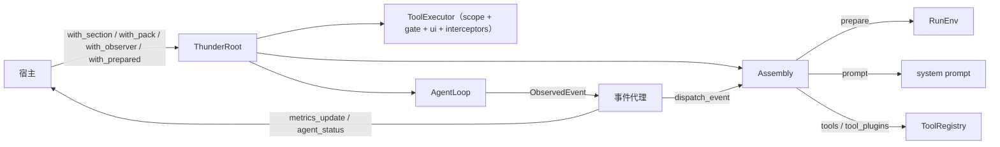

[English](README_en.md) | [简体中文](README.md)

# thunder-agent-root

宿主组装层：把「一次 run 由哪些东西组成」写成显式列表，再把它们接到内核上执行。

## 定位

`thunder-agent-loop` 只负责循环、上下文与事件；它不知道有哪些工具、prompt 里该有什么、谁在旁听。`thunder-agent-root` 是回答这些问题的唯一位置：

- 用 `Assembly` 描述一次 run 的 prompt 段、工具包、观察者、每 run 初始化钩子。
- 把 `AgentConfig`、`AgentLoop`、`ToolRegistry`、`ToolExecutor` 拼成一条可执行的流水线（`src/host.rs`）。
- 提供宿主交互面（`HostUi`）、模式闸门（`ModePlugin`）、遥测（`MetricsPlugin`）与执行状态（`StatusPlugin`）的挂载点。
- 提供 `.thunder/config.json` 的分层读取（`src/thunder_config.rs`）、`AGENTS.md` 发现（`src/instructions.rs`）、trace 保留（`src/trace_collector.rs`）等宿主侧能力。

本 crate 不实现模型传输，也不实现工具本身：前者来自 `thunder-agent-providers`，后者来自 `thunder-agent-pack-code` / `thunder-agent-skills` / `thunder-agent-mcp`。

## crate 边界

内部依赖（`Cargo.toml`）：

| 依赖 | 必需性 | 用途 |
|---|---|---|
| `thunder-agent-types` | 必需 | `ToolScope` 等纯 wire 类型 |
| `thunder-agent-policy` | 必需 | `AgentTool`、`ToolRegistry`、`ToolExecutor`、`ToolGate`、`HostUi`、`ToolPlugin` |
| `thunder-agent-loop` | 必需 | `AgentLoop`、`AgentConfig`、`AgentEvent`、pause/steer |
| `thunder-agent-pack-code` | 必需 | `CodeScope`、内置编码工具、`RenderCapabilities`、默认系统 prompt |
| `thunder-agent-providers` | 必需 | `ProviderRegistry`、`ModelRef`、`client_for` |
| `thunder-conversation` | feature `conversation` | 会话存储与 `ConversationPlugin` |
| `thunder-agent-skills` | feature `skills` | `SkillsPlugin` |
| `thunder-agent-mcp` | feature `mcp` | `McpPlugin` |

`default = ["conversation", "skills", "mcp"]`。

依赖本 crate 的成员：`thunder-agent-daemon`、`thunder-agent-core/tui`。

## 组装模型（`src/assembly.rs`）

四张列表，而不是一个万能 trait：

| 类型 | 作用 | 关键成员 |
|---|---|---|
| `RunEnv` | 一次 run 的标识与环境 | `session_id`、`workspace`、`route`、`prompt`、`ui: Arc<dyn HostUi>`、`cancellation`；`RunEnv::new(session_id)` |
| `PromptSection` | 一段 system prompt 文本 | `id()`、`order()`（默认 `100`）、`render() -> Option<String>` |
| `ToolPack` | 一组工具 / 工具插件 | `id`、`tools: Vec<Arc<dyn AgentTool>>`、`tool_plugins: Vec<Arc<dyn ToolPlugin>>`；`new` / `with_tool` / `with_tools` / `with_tool_plugin` |
| `Observer` | 旁听 run 的事件 | `id()`、`on_event(&AgentEvent, &RunEnv) -> BoxFuture<'_, ()>`、`on_finish(&AgentRunResult, &RunEnv)` |
| `Prepared` | 每 run 初始化 | `id()`、`prepare(&RunEnv) -> BoxFuture<'_, Result<(), String>>` |
| `Assembly` | 上述四张列表的容器 | `with_section` / `with_pack` / `with_observer` / `with_prepared`、`without_disabled`、`prepare`、`prompt`、`ids`、`has_pack`、`tools`、`tool_plugins`、`dispatch_event`、`dispatch_finish` |

几条由实现决定的行为：

- `Observer` 是异步的，且每次回调都带 `&RunEnv`。同一个观察者实例可以服务并发 run，不需要记住「上次绑定的是哪个 session」。
- `Assembly::prompt(base)`：`base` 始终在最前；sections 按 `order()` 升序（稳定排序，同序保持注册顺序）；`render()` 返回 `None` 或纯空白时跳过；段间补 `\n\n`。
- `Assembly::ids()` 按 sections → packs → observers 的注册顺序去重（`Prepared` 不计入）。宿主用它声明「这次 run 实际带了什么」。
- `Assembly::prepare` 按注册顺序执行，任一 `Prepared` 返回 `Err` 即终止。
- `without_disabled(&HashSet<String>)` 按 id 过滤全部四张列表。`ThunderRoot::execute` 自身对 `plugins.disabled` 的处理发生在工具 / 工具插件粒度（`loader::matches_plugin_id`，含 `read`↔`read_file` 等别名）。

`Assembly` 的字段是私有的；构造只能走 `Assembly::new()` 或 `Default`，再链式追加。

## 一次 run 的流程（`src/host.rs`）



`ThunderRoot::execute` 的顺序（`src/host.rs`）：

1. 读取工作区的 `ThunderConfig`。
2. 解析 `session_id`（缺省 `sess_<millis>_<seq>`）与 `route`（缺省 `run_<session>_<seq>`）。
3. 解析模式插件：复用 `RootRunOptions::mode_plugin`，否则按 `options.mode` 新建；`set_mode` 后 `bind_session(workspace, session_id)`；解析 UI（`options.ui` 否则 `host_ui`）。
4. 克隆 `Assembly`，无条件装上 mode 的 section 与 `ToolPack::new(ModePlugin::ID)`（`write_plan` / `exit_plan_mode`）。
5. metrics：复用 `with_metrics_plugin` 的实例，否则每 run 新建并临时注册；`configure_session` 写入模型名、thinking level、上下文窗口与初始 token 估计。status 同样处理。
6. 构造 `PluginContext`（session、cancellation、mode、ui、route、mode_plugin、metrics/status、prompt、工具槽）与 `RunEnv`。
7. `mode_plugin.prepare(&env)`，再 `assembly.prepare(&env)`。失败即 `PluginError::InitFailed`。
8. 拼 base prompt：`config.system_prompt` 或 `autonomous_system_prompt(render_capabilities)`，追加 `AGENTS.md`/`CLAUDE.md` 等上下文文件、`agent.systemPromptFile`、工作区说明；最后 `assembly.prompt(base)`。
9. 解析 client：有 `custom_client` 用它；否则按 `ProviderRegistry::resolve_ref(active_model)` 注入上下文窗口并 `client_for` 建流式 client。
10. `CodeScope::from_agent_config` → `AgentLoop::new(config).with_id("root_<session>").with_summary_limit(共享 Semaphore)`。
11. `PluginLoader::load_plugins_with_mcp`：`register_builtins` 时装载 `thunder_agent_pack_code::code_plugins(ws)`；若 assembly 已含 `mcp` pack，则不再单独 spawn 声明式 MCP 服务器。
12. `ToolRegistry::new(max_tool_output_bytes, request_timeout_ms).with_scratchpad(..)`，按 `plugins.disabled` 过滤后注册 assembly 的 tools 与 tool_plugins，再注册 loader 的 tool plugins。
13. 安装判定器：`ToolExecutor` = registry + `CodeScope` + `ModePlugin`（`ToolGate`）+ `HostUi` + trace ids + interceptors（loader 的 + mode interceptor），交给 `StaticToolsFactory`。
14. 把 `ExecutorToolInvoker` 写进 `ctx.tools`：插件发起的工具调用与模型发起的走同一条判定管线。
15. 转发 `pause_gate` / `steer_queues`，`agent.start(input, Some(cancel))`，返回 `RootRunHandle`。

## `ThunderRoot`

| 方法 | 说明 |
|---|---|
| `new(AgentConfig)` | 记录 config；`pruning.max_concurrent_summaries.max(1)` 变成一个跨 run 共享的 `Semaphore`；scratch 根为 `std::env::temp_dir()/thunder_root_scratch`，有 Tokio runtime 时顺带清理 7 天未动的目录 |
| `with_host_ui(Arc<dyn HostUi>)` | 默认 UI；未设置时是 `NullHostUi`（所有 dialog 视为取消） |
| `with_workspace(PathBuf)` | 同时写 `config.workspace_dir` 与 `workspace_root` |
| `with_extra_roots(Vec<PathBuf>)` | 额外可读写根（引用的仓库） |
| `with_scratch_root(PathBuf)` | 覆盖 scratch 根 |
| `with_providers()`（async） | 按 `ConfigSource::default_chain(workspace)` 加载 registry；失败静默保留空 registry |
| `with_provider_registry(ProviderRegistry)` | 显式注入 registry |
| `set_model(ModelRef)` / `active_model()` / `provider_registry()` | 模型选择；`set_model` 同步 `config.model` 为 `selection_id()` |
| `with_section(Arc<dyn PromptSection>)` | 追加 prompt 段 |
| `with_pack(ToolPack)` | 追加工具包 |
| `with_observer(Arc<dyn Observer>)` | 追加观察者 |
| `with_prepared(Arc<dyn Prepared>)` | 追加每 run 钩子 |
| `with_metrics_plugin(MetricsPlugin)` | 挂共享遥测；同时注册为 `Prepared` + `Observer` |
| `with_status_plugin(StatusPlugin)` | 挂共享执行状态；同时注册为 `Prepared` + `Observer` |
| `with_initial_session_total_tokens(usize)` | 续接会话的累计计费 token |
| `component_ids()` | `assembly.ids()`（不含每 run 才安装的 mode） |
| `execute(input, options) -> Result<RootRunHandle, PluginError>` | 见上一节 |
| `run(input, options) -> Result<RootRunResult, PluginError>` | `execute` + 后台抽干事件流 + `join` |

`RootRunHandle`：

| 字段 / 方法 | 说明 |
|---|---|
| `agent_id` | 内核给这次 run 的 id（`root_<session>`） |
| `handle: AgentHandle` | 内核句柄 |
| `assembly: Assembly` | 本次 run 实际使用的组件集合 |
| `ctx: PluginContext` | session、ui、mode、route、工具调用槽 |
| `env: RunEnv` | 交给每个 section / observer 的 run 身份 |
| `take_events() -> Option<mpsc::Receiver<ObservedEvent>>` | 安装事件代理（容量 512） |
| `metrics_snapshot()` / `status_snapshot()` | 当前会话快照 |
| `join() -> Result<RootRunResult, AgentError>` | 等内核结束 → 等代理排空 → `dispatch_finish` → 汇总 metrics |

`RootRunResult`：`agent_id`、`final_content`、`run_result: AgentRunResult`、`metrics: Option<MetricsSnapshot>`。

### `take_events` 的事件代理

代理在独立 task 中运行：

- 对每个事件先 `assembly.dispatch_event(&event, &env)`，再原样转发给调用方。
- 对 `TurnStart` / `TokenDelta` / `ReasoningDelta` / `ToolExecStart` / `ToolExecResult` / `ContextCompacted` / `TurnEnd` / `LoopComplete`，在转发后追加一帧 `AgentEvent::Custom { kind: "metrics_update" }`。`TokenDelta` / `ReasoningDelta` 用 `try_send`（流式事件不阻塞）。
- `agent_status` 帧只在 `AgentStatusSnapshot::seq` 变化时追加；代理同时 `select!` 状态插件的 change 信号，因此「宿主报告 `awaiting_user`」这种没有内核事件、且期间完全静默的状态也能送达。
- 内核流关闭且全部事件派发完毕后，向 `join` 的 `dispatch_drained` 发信号。这正是 `join` 必须等它的原因：`ConversationPlugin` 在 `TurnEnd` 写会话，提前返回会让宿主对同一存储的读改写与之竞争。

## `RootRunOptions`（`Default` 见括号）

| 字段 | 类型 | 默认 / 说明 |
|---|---|---|
| `session_id` | `Option<String>` | `None` → 自动 `sess_<millis>_<seq>`（避免无名 run 共用同一会话槽） |
| `custom_client` | `Option<Arc<dyn LLMClientTrait>>` | `None` → 按 registry 解析 |
| `cancellation_token` | `Option<CancellationToken>` | `None` → 新建 |
| `register_builtins` | `bool` | `true`：装载 pack-code 的内置工具插件 |
| `thinking_level` | `Option<String>` | `None` → `config.thinking_level` |
| `mode` | `Mode` | `Mode::Ask`（`plan` / `ask` / `acceptEdits` / `yolo`） |
| `mode_plugin` | `Option<Arc<ModePlugin>>` | `None` → 每 run 新建；会话级传入可保留「always allow」规则与模式切换 |
| `pause_gate` | `Option<Arc<PauseGate>>` | 转发给内核，在工具边界挂起 |
| `steer_queues` | `Option<Arc<SteerQueues>>` | 转发给内核，在轮次边界插入用户输入 |
| `ui` | `Option<Arc<dyn HostUi>>` | `None` → root 的 `host_ui` |
| `route` | `Option<String>` | `None` → `run_<session>_<seq>`；并发 run 的鉴权键 |
| `render_capabilities` | `RenderCapabilities` | `Default`（`diagrams = false`）；决定默认 prompt 是否允许 mermaid |

## 标准宿主集合：`StandardHostBuilder`

`StandardHostBuilder::new(store)` → 可选覆盖（`with_metrics_plugin` / `with_status_plugin` / `with_skills` / `with_mcp_plugin`）→ `build(root)`。

| 组件 | id | 注册为 | 工具 |
|---|---|---|---|
| conversation | `conversation` | `Prepared` + `PromptSection` + `Observer` | — |
| metrics | `metrics` | `Prepared` + `Observer` | — |
| agent_status | `agent_status` | `Prepared` + `Observer` | — |
| memory | `memory` | `Prepared` + `PromptSection` + `ToolPack` | `memory_write` |
| web | `web` | `Prepared` + `ToolPack` | `web_fetch`、`web_search` |
| skills | `skills` | `Prepared` + `PromptSection` + `ToolPack` | `load_skill`、`list_skills` |
| mcp | `mcp` | `Prepared` + `PromptSection` + `ToolPack` | 服务器发现的远程工具 |

约束：

- `with_workspace` / `with_extra_roots` / `with_provider_registry` 必须在 `build` **之前**调用：`build` 时会从 root 取当前 `ProviderRegistry` 构造 `WebPlugin`（`web_fetch` 的摘要用其 utility model）。
- `build` 不安装 mode。mode 的 section 与 pack 由 `ThunderRoot::execute` 每次无条件安装，闸门因此没有「未安装」的配置分支。
- 宿主自有能力在 `build` 之后追加：

```rust
let root = StandardHostBuilder::new(store).build(root);
let root = root.with_pack(ToolPack::new("my_host").with_tools(host_tools));
```

### compile-shape 示例

```rust
use std::sync::Arc;

use thunder_agent_loop::prelude::*;
use thunder_agent_policy::AgentTool;
use thunder_agent_providers::prelude::ProviderRegistry;
use thunder_agent_root::assembly::ToolPack;
use thunder_agent_root::prelude::*;

#[tokio::main]
async fn main() -> Result<(), Box<dyn std::error::Error>> {
    let cfg = AgentConfig::new("gpt-4o").with_unlimited_turns();
    let store = Arc::new(thunder_conversation::prelude::MemoryConversationStore::new());

    // build() 会读取 root 当前的 workspace / provider registry。
    let root = ThunderRoot::new(cfg)
        .with_workspace(std::env::current_dir()?)
        .with_provider_registry(ProviderRegistry::load_default().await.unwrap_or_default());
    let root = StandardHostBuilder::new(store).build(root);

    // 宿主自有工具包：id 同时出现在 component_ids() 与 plugins.disabled 的匹配里。
    let host_tools: Vec<Arc<dyn AgentTool>> = my_host_tools(); // 由宿主实现
    let root = root.with_pack(ToolPack::new("my_host").with_tools(host_tools));

    println!("{:?}", root.component_ids());

    let mut handle = root
        .execute("描述当前目录的结构", RootRunOptions::default())
        .await?;

    // 事件代理由 take_events 安装；不抽干它，observer 就看不到任何事件。
    if let Some(mut events) = handle.take_events() {
        tokio::spawn(async move { while events.recv().await.is_some() {} });
    }
    let result = handle.join().await?;
    println!("{:?}", result.final_content);
    Ok(())
}
```

## 内置组件

| 组件 | 文件 | 一句话 |
|---|---|---|
| memory | `src/plugins/memory.rs` | 把 `THUNDER.md`、`THUNDER.local.md`、`memory/*.md` 渲染进 prompt（总预算 256 KiB、import 深度 5、单次写入 64 KiB），并提供 `memory_write`（默认追加 `THUNDER.md`，拒绝越界路径） |
| skills | `src/plugins/skills.rs` | 把技能目录渲染成 prompt 清单，提供 `load_skill` / `list_skills`；`prepare` 从默认路径与工作区扫描并缓存默认集合 |
| web | `src/plugins/web/mod.rs` | `web_fetch` / `web_search`；后端由 `web.*` 配置与 DeepSeek 凭据决定，抓取结果走进程级 `FetchCache` |
| mcp | `src/plugins/mcp.rs` | 连接 `.thunder/mcp.json`（优先）/ `mcp_servers.json` / `.mcp.json` 与 `plugins.mcpServers`，把发现的远程工具挂成 pack；无服务器时 section 返回 `None` |
| conversation | `src/plugins/conversation.rs` | `prepare` 加载/初始化会话并补写用户 turn；`on_event` 在 `TurnEnd` 把一轮（文本 + reasoning + 调用 + 结果）整体落盘并检查点保存；`on_finish` 补写没有 `TurnEnd` 的最后一轮 |
| metrics | `src/plugins/metrics.rs` | 每会话的 token 速率、缓存命中、上下文占用、累计 token、耗时；快照以 `metrics_update` 帧外发 |
| status | `src/plugins/status.rs` | 当前 phase（`idle` / `thinking` / `streaming` / `tool` / `awaiting_user` / `paused` / `compacting` / `done` / `error`）+ 当前工具 + turn；`seq` 变化才发 `agent_status` |
| mode | `src/plugins/mode.rs` | 四种模式的判定矩阵（`ToolGate`）+ `write_plan` / `exit_plan_mode`（按名字豁免）+ 计划批准后的模式切换；同时是 `InterceptorPlugin` |
| permission_rules | `src/plugins/permission_rules.rs` | 会话「always allow」规则的序列化与持久化 |

其它宿主侧模块：

- `src/loader.rs`：`PluginLoader::load_plugins_with_mcp` 装载 pack-code 内置工具插件，并在没有 mcp pack 时单独 spawn 声明式 MCP 服务器；`matches_plugin_id` 处理 `read`/`write`/`ls` 别名。
- `src/instructions.rs`：按 `AGENTS.override.md` → `AGENTS.md` → `AGENTS.MD` → `CLAUDE.md` → `CLAUDE.MD` 的优先级发现上下文文件，`THUNDER_NO_GLOBAL_INSTRUCTIONS` 可关闭全局扫描。
- `src/trace_collector.rs`：有界 trace 保留（`MAX_EVENTS = 5000`、`MAX_TOOL_TRACES = 2000`、`MAX_DECISION_RECORDS = 2000`），流式微增量只计数不保存。
- `src/error.rs`：`PluginError`（`InitFailed` / `ExecutionFailed` / `NotFound` / `RegistrationConflict` / `Serialization`）。

## 配置

`.thunder/config.json` 按层合并（后者覆盖前者，且只覆盖**实际声明**的字段）：

1. `~/.thunder/config.json`
2. `<ws>/.thunder/config.json`
3. `<ws>/.thunder/config.local.json`

| 字段 | 作用 |
|---|---|
| `version` | schema 版本（当前 1） |
| `agent.systemPromptFile` | 追加到 base prompt 的文件；相对 `<ws>/.thunder/`，绝对路径或 `..` 被拒绝 |
| `agent.maxTurns` | 循环轮数上限；`apply_to` 应用 |
| `agent.thinkingLevel` | 默认 thinking level；`apply_to` 应用 |
| `agent.memory.enabled` | 记忆总开关，默认 `true` |
| `agent.memory.files` | 额外记忆文件（相对 `<ws>/.thunder/`） |
| `agent.defaultMode` | 新会话的默认模式；由**宿主**（如 daemon）读取并传入 `RootRunOptions::mode`，`ThunderRoot` 自身不看这个字段 |
| `plugins.builtin` | 内置工具插件白名单；缺省表示全部启用 |
| `plugins.disabled` | 按 id 禁用（支持 `read`↔`read_file`、`write`↔`write_file`、`ls`↔`list_dir`） |
| `plugins.mcpServers`（别名 `mcp_servers`） | 声明式 MCP 服务器 |
| `web.search` / `web.fetch` / `web.deepseek` | web 工具后端与凭据 |

解析坏 JSON 只记 `warn` 并跳过该层，不会中断 run。

## 失败方向

| 情况 | 结果 |
|---|---|
| 任一 `Prepared::prepare` 返回 `Err` | `execute` 返回 `PluginError::InitFailed`，不产生 run |
| `agent.start` 失败 | `PluginError::ExecutionFailed` |
| registry 里解析不到 `active_model` | `warn`，`AgentLoop` 使用 `UnconfiguredLLMClient`（`custom_client` 为 `None` 时） |
| 宿主没有 panel（`NullHostUi`） | 每个 dialog 都解析为 cancelled，调用方按「拒绝」处理 |
| `system_prompt_file` 越界 / 不可读 | `warn` 并跳过，不影响其余 prompt |
| 配置层损坏 | 跳过该层 |
| 事件代理的接收端被丢弃 | 代理退出，不再派发 |

## 测试

`tests/` 共 19 个文件。要点：

| 文件 | 固定的行为 |
|---|---|
| `root_execution_test.rs` | 假 client 下 `execute` 端到端产出结果 |
| `always_registered_test.rs` | 每次 run 都注册内置工具 |
| `host_parity_test.rs` | `StandardHostBuilder` 基线集合包含 conversation / skills / web / mcp |
| `host_ui_test.rs` | 插件 dialog 到达 run 的 `HostUi`；无面板时取消而非挂起；per-run UI 覆盖 root 默认；两个 run 的 route 不同 |
| `agent_status_stream_test.rs` | 状态帧随 `seq` 发布，宿主报告的等待在无事件时也能送达 |
| `conversation_turn_test.rs` | 一轮在 `TurnEnd` 整体写入、每轮一条；缺 `TurnEnd` 时由 `on_finish` 补写且不重复写最终文本 |
| `mode_matrix_test.rs` | 模式判定矩阵、规则不泄漏进 plan、plan 拒绝文案指明出口 |
| `plan_mode_test.rs` / `plan_mode_root_test.rs` | plan 模式只放行只读 + 计划工具；root 尊重传入的 mode |
| `gate_absent_allows_test.rs` | 无 gate 时 guard 允许的全部放行 |
| `memory_write_tool_test.rs` | 默认追加、建 topic 文件、拒绝越界、无 workspace 拒绝、overwrite |
| `thunder_config_memory_test.rs` | memory 基线、记忆文件进 prompt、import 越界、`systemPromptFile` 追加、`render_capabilities` 影响 diagram 规则、分层 merge、坏配置不中断 |
| `agents_md_context_test.rs` | 工作区 `AGENTS.md` 进入 prompt |
| `declarative_config_test.rs` | `plugins.builtin` / `plugins.disabled` 过滤与工作区配置加载 |
| `web_fetch_tool_test.rs` / `web_search_tool_test.rs` | 工具定义、参数错误在联网前报错；真实网络用例为 `#[ignore]` |
| `web_deepseek_live_test.rs` | 真实 DeepSeek 请求，全部 `#[ignore]` |
| `skills_and_mcp_plugins_test.rs` | skills 与 mcp 工具的端到端执行 |
| `mcp_pack_parity_test.rs` | pack 提供的工具与真实 MCP 服务器对同一任务的解法一致 |

## 扩展点

- **prompt 文本**：实现 `PromptSection`，`render()` 按需返回 `None`；`id()` 就是 `plugins.disabled` 匹配的名字，`order()` 决定相对位置。
- **工具**：`ToolPack::with_tool` 加单个 `AgentTool`，`with_tools` 加一批，`with_tool_plugin` 加 `ToolPlugin`（可一次注册一族工具）。要复用统一判定，插件内部必须通过 `ctx.tool_slot()` / `PluginContext.tools` 调用，而不是直接拿 registry。
- **事件旁听**：实现 `Observer`。需要 per-run 状态就读 `RunEnv`，不要把状态存在观察者自身。
- **每 run 初始化**：实现 `Prepared`，失败即中止 run。
- **共享能力**：`with_metrics_plugin` / `with_status_plugin` 让同一实例跨 run 复用；两者都同时是 `Prepared` 与 `Observer`。
- **整机基线**：新宿主优先用 `StandardHostBuilder` 起步，再 `with_pack` 追加自有能力，避免各宿主自行挑选能力导致漂移。
