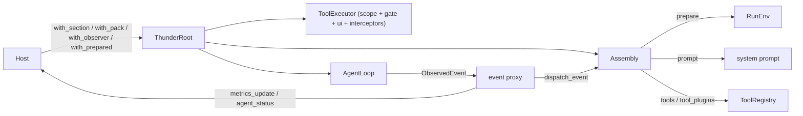

[English](README_en.md) | [简体中文](README.md)

# thunder-agent-root

The host assembly layer: it states what a run is made of as explicit lists, then wires them to the kernel.

## Role

`thunder-agent-loop` owns the loop, the context and the event stream; it knows nothing about which tools exist, what belongs in the system prompt, or who is watching. `thunder-agent-root` is the only place that answers those questions:

- `Assembly` describes a run's prompt sections, tool packs, observers and per-run setup hooks.
- `src/host.rs` assembles `AgentConfig`, `AgentLoop`, `ToolRegistry` and `ToolExecutor` into one executable pipeline.
- It provides the mount points for the host interaction surface (`HostUi`), the mode gate (`ModePlugin`), telemetry (`MetricsPlugin`) and execution status (`StatusPlugin`).
- It carries the host-side utilities: layered `.thunder/config.json` (`src/thunder_config.rs`), `AGENTS.md` discovery (`src/instructions.rs`), bounded trace retention (`src/trace_collector.rs`).

This crate implements neither model transport nor tools: the former comes from `thunder-agent-providers`, the latter from `thunder-agent-pack-code` / `thunder-agent-skills` / `thunder-agent-mcp`.

## Crate boundary

Internal dependencies (`Cargo.toml`):

| Dependency | Required | Purpose |
|---|---|---|
| `thunder-agent-types` | yes | Wire types such as `ToolScope` |
| `thunder-agent-policy` | yes | `AgentTool`, `ToolRegistry`, `ToolExecutor`, `ToolGate`, `HostUi`, `ToolPlugin` |
| `thunder-agent-loop` | yes | `AgentLoop`, `AgentConfig`, `AgentEvent`, pause/steer |
| `thunder-agent-pack-code` | yes | `CodeScope`, built-in coding tools, `RenderCapabilities`, default system prompt |
| `thunder-agent-providers` | yes | `ProviderRegistry`, `ModelRef`, `client_for` |
| `thunder-conversation` | feature `conversation` | Conversation store and `ConversationPlugin` |
| `thunder-agent-skills` | feature `skills` | `SkillsPlugin` |
| `thunder-agent-mcp` | feature `mcp` | `McpPlugin` |

`default = ["conversation", "skills", "mcp"]`.

Workspace members that depend on this crate: `thunder-agent-daemon`, `thunder-agent-core/tui`.

## Assembly model (`src/assembly.rs`)

Four lists instead of one catch-all trait:

| Type | Purpose | Key members |
|---|---|---|
| `RunEnv` | Identity and environment of one run | `session_id`, `workspace`, `route`, `prompt`, `ui: Arc<dyn HostUi>`, `cancellation`; `RunEnv::new(session_id)` |
| `PromptSection` | One block of system-prompt text | `id()`, `order()` (default `100`), `render() -> Option<String>` |
| `ToolPack` | One unit of tool provision | `id`, `tools: Vec<Arc<dyn AgentTool>>`, `tool_plugins: Vec<Arc<dyn ToolPlugin>>`; `new` / `with_tool` / `with_tools` / `with_tool_plugin` |
| `Observer` | Watches a run's events | `id()`, `on_event(&AgentEvent, &RunEnv) -> BoxFuture<'_, ()>`, `on_finish(&AgentRunResult, &RunEnv)` |
| `Prepared` | Per-run setup | `id()`, `prepare(&RunEnv) -> BoxFuture<'_, Result<(), String>>` |
| `Assembly` | Container for those four lists | `with_section` / `with_pack` / `with_observer` / `with_prepared`, `without_disabled`, `prepare`, `prompt`, `ids`, `has_pack`, `tools`, `tool_plugins`, `dispatch_event`, `dispatch_finish` |

Behaviour fixed by the implementation:

- `Observer` is async and every callback carries `&RunEnv`. One instance can serve concurrent runs without remembering which session it was bound to last.
- `Assembly::prompt(base)`: `base` always comes first; sections are sorted by `order()` ascending (stable, so equal orders keep registration order); a `None` or whitespace-only `render()` is skipped; blocks are separated by `\n\n`.
- `Assembly::ids()` deduplicates in registration order: sections, then packs, then observers (`Prepared` is not included). Hosts use it to declare what a run actually carried.
- `Assembly::prepare` runs in registration order and stops at the first `Err`.
- `without_disabled(&HashSet<String>)` filters all four lists by id. `ThunderRoot::execute` applies `plugins.disabled` at tool / tool-plugin granularity instead (`loader::matches_plugin_id`, including `read`↔`read_file`-style aliases).

`Assembly`'s fields are private; construct it with `Assembly::new()` or `Default` and append with the builder methods.

## Anatomy of one run (`src/host.rs`)



`ThunderRoot::execute` proceeds as follows (`src/host.rs`):

1. Load `ThunderConfig` for the workspace.
2. Resolve `session_id` (default `sess_<millis>_<seq>`) and `route` (default `run_<session>_<seq>`).
3. Resolve the mode plugin: reuse `RootRunOptions::mode_plugin`, otherwise create one for `options.mode`; `set_mode`, then `bind_session(workspace, session_id)`. Resolve the UI (`options.ui`, else `host_ui`).
4. Clone the `Assembly` and unconditionally add the mode section plus `ToolPack::new(ModePlugin::ID)` (`write_plan` / `exit_plan_mode`).
5. Metrics: reuse the `with_metrics_plugin` instance, otherwise create one per run and register it temporarily; `configure_session` records model, thinking level, context window and initial token estimate. Status is handled the same way.
6. Build `PluginContext` (session, cancellation, mode, ui, route, mode_plugin, metrics/status, prompt, tool slot) and `RunEnv`.
7. `mode_plugin.prepare(&env)`, then `assembly.prepare(&env)`. A failure becomes `PluginError::InitFailed`.
8. Compose the base prompt: `config.system_prompt` or `autonomous_system_prompt(render_capabilities)`, then append `AGENTS.md`/`CLAUDE.md`-style context files, `agent.systemPromptFile` and the workspace block; finish with `assembly.prompt(base)`.
9. Resolve the client: use `custom_client` when present; otherwise resolve `active_model` through `ProviderRegistry::resolve_ref`, inject its context window and build a streaming client with `client_for`.
10. `CodeScope::from_agent_config` → `AgentLoop::new(config).with_id("root_<session>").with_summary_limit(shared Semaphore)`.
11. `PluginLoader::load_plugins_with_mcp`: with `register_builtins`, load `thunder_agent_pack_code::code_plugins(ws)`; when the assembly already contains the `mcp` pack, declarative MCP servers are not spawned a second time.
12. `ToolRegistry::new(max_tool_output_bytes, request_timeout_ms).with_scratchpad(..)`; register the assembly's tools and tool plugins (filtered by `plugins.disabled`), then the loader's tool plugins.
13. Install the judge: `ToolExecutor` = registry + `CodeScope` + `ModePlugin` (`ToolGate`) + `HostUi` + trace ids + interceptors (loader's plus the mode interceptor), handed to `StaticToolsFactory`.
14. Put an `ExecutorToolInvoker` into `ctx.tools`, so a plugin-initiated tool call is judged by the same pipeline as a model-initiated one.
15. Forward `pause_gate` / `steer_queues`, call `agent.start(input, Some(cancel))` and return a `RootRunHandle`.

## `ThunderRoot`

| Method | Description |
|---|---|
| `new(AgentConfig)` | Stores the config; `pruning.max_concurrent_summaries.max(1)` becomes a `Semaphore` shared across runs; the scratch root is `std::env::temp_dir()/thunder_root_scratch`, and stale directories (7 days) are cleaned opportunistically when a Tokio runtime exists |
| `with_host_ui(Arc<dyn HostUi>)` | Default UI; unset means `NullHostUi` (every dialog resolves as cancelled) |
| `with_workspace(PathBuf)` | Sets both `config.workspace_dir` and `workspace_root` |
| `with_extra_roots(Vec<PathBuf>)` | Extra read/write roots (referenced repositories) |
| `with_scratch_root(PathBuf)` | Overrides the scratch root |
| `with_providers()` (async) | Loads the registry from `ConfigSource::default_chain(workspace)`; failures are silent and leave an empty registry |
| `with_provider_registry(ProviderRegistry)` | Injects a registry explicitly |
| `set_model(ModelRef)` / `active_model()` / `provider_registry()` | Model selection; `set_model` also writes `selection_id()` into `config.model` |
| `with_section(Arc<dyn PromptSection>)` | Appends a prompt section |
| `with_pack(ToolPack)` | Appends a tool pack |
| `with_observer(Arc<dyn Observer>)` | Appends an observer |
| `with_prepared(Arc<dyn Prepared>)` | Appends a per-run hook |
| `with_metrics_plugin(MetricsPlugin)` | Shares telemetry across runs; registers it as both `Prepared` and `Observer` |
| `with_status_plugin(StatusPlugin)` | Shares execution status; registers it as both `Prepared` and `Observer` |
| `with_initial_session_total_tokens(usize)` | Seeds the cumulative billed tokens of a continued session |
| `component_ids()` | `assembly.ids()` (without the per-run mode) |
| `execute(input, options) -> Result<RootRunHandle, PluginError>` | See above |
| `run(input, options) -> Result<RootRunResult, PluginError>` | `execute` + background event drain + `join` |

`RootRunHandle`:

| Field / method | Description |
|---|---|
| `agent_id` | Kernel id for this run (`root_<session>`) |
| `handle: AgentHandle` | Kernel handle |
| `assembly: Assembly` | The components this run actually used |
| `ctx: PluginContext` | Session, ui, mode, route, tool-call slot |
| `env: RunEnv` | Run identity handed to every section / observer |
| `take_events() -> Option<mpsc::Receiver<ObservedEvent>>` | Installs the event proxy (capacity 512) |
| `metrics_snapshot()` / `status_snapshot()` | Current session snapshots |
| `join() -> Result<RootRunResult, AgentError>` | Awaits the kernel, waits for the proxy to drain, calls `dispatch_finish`, then collects metrics |

`RootRunResult`: `agent_id`, `final_content`, `run_result: AgentRunResult`, `metrics: Option<MetricsSnapshot>`.

### The event proxy behind `take_events`

The proxy runs in its own task:

- Every event is first dispatched with `assembly.dispatch_event(&event, &env)`, then forwarded unchanged.
- For `TurnStart` / `TokenDelta` / `ReasoningDelta` / `ToolExecStart` / `ToolExecResult` / `ContextCompacted` / `TurnEnd` / `LoopComplete` it appends an `AgentEvent::Custom { kind: "metrics_update" }` frame after forwarding. `TokenDelta` / `ReasoningDelta` use `try_send`, so streaming never blocks.
- An `agent_status` frame is appended only when `AgentStatusSnapshot::seq` moved. The proxy also `select!`s on the status plugin's change signal, so a host-reported `awaiting_user` — which has no kernel event and during which nothing else is emitted at all — still reaches the consumer.
- When the kernel stream closes and every event has been dispatched, it signals `dispatch_drained`, which `join` awaits. That is required because `ConversationPlugin` writes the conversation on `TurnEnd`; returning earlier would let a host's read-modify-write race that write.

## `RootRunOptions` (defaults in parentheses)

| Field | Type | Default / meaning |
|---|---|---|
| `session_id` | `Option<String>` | `None` → generated `sess_<millis>_<seq>` (unnamed runs must not share one conversation slot) |
| `custom_client` | `Option<Arc<dyn LLMClientTrait>>` | `None` → resolved through the registry |
| `cancellation_token` | `Option<CancellationToken>` | `None` → a fresh token |
| `register_builtins` | `bool` | `true`: load pack-code's built-in tool plugins |
| `thinking_level` | `Option<String>` | `None` → `config.thinking_level` |
| `mode` | `Mode` | `Mode::Ask` (`plan` / `ask` / `acceptEdits` / `yolo`) |
| `mode_plugin` | `Option<Arc<ModePlugin>>` | `None` → per run; pass a session-scoped one to keep "always allow" rules and mode switches |
| `pause_gate` | `Option<Arc<PauseGate>>` | Forwarded to the kernel; parks at tool boundaries |
| `steer_queues` | `Option<Arc<SteerQueues>>` | Forwarded to the kernel; splices user input at turn boundaries |
| `ui` | `Option<Arc<dyn HostUi>>` | `None` → the root's `host_ui` |
| `route` | `Option<String>` | `None` → `run_<session>_<seq>`; the authorization key of concurrent runs |
| `render_capabilities` | `RenderCapabilities` | `Default` (`diagrams = false`); decides whether the default prompt may ask for mermaid |

## The baseline host: `StandardHostBuilder`

`StandardHostBuilder::new(store)` → optional overrides (`with_metrics_plugin` / `with_status_plugin` / `with_skills` / `with_mcp_plugin`) → `build(root)`.

| Component | id | Registered as | Tools |
|---|---|---|---|
| conversation | `conversation` | `Prepared` + `PromptSection` + `Observer` | — |
| metrics | `metrics` | `Prepared` + `Observer` | — |
| agent_status | `agent_status` | `Prepared` + `Observer` | — |
| memory | `memory` | `Prepared` + `PromptSection` + `ToolPack` | `memory_write` |
| web | `web` | `Prepared` + `ToolPack` | `web_fetch`, `web_search` |
| skills | `skills` | `Prepared` + `PromptSection` + `ToolPack` | `load_skill`, `list_skills` |
| mcp | `mcp` | `Prepared` + `PromptSection` + `ToolPack` | tools discovered from servers |

Constraints:

- `with_workspace` / `with_extra_roots` / `with_provider_registry` must run **before** `build`: `build` reads the current `ProviderRegistry` to construct `WebPlugin` (whose utility model summarises `web_fetch` output).
- `build` does not install mode. The mode section and pack are added unconditionally by `ThunderRoot::execute`, so there is no configuration in which the gate is missing.
- Host-specific capabilities are appended after `build`:

```rust
let root = StandardHostBuilder::new(store).build(root);
let root = root.with_pack(ToolPack::new("my_host").with_tools(host_tools));
```

### Compile-shape example

```rust
use std::sync::Arc;

use thunder_agent_loop::prelude::*;
use thunder_agent_policy::AgentTool;
use thunder_agent_providers::prelude::ProviderRegistry;
use thunder_agent_root::assembly::ToolPack;
use thunder_agent_root::prelude::*;

#[tokio::main]
async fn main() -> Result<(), Box<dyn std::error::Error>> {
    let cfg = AgentConfig::new("gpt-4o").with_unlimited_turns();
    let store = Arc::new(thunder_conversation::prelude::MemoryConversationStore::new());

    // build() reads the root's current workspace / provider registry.
    let root = ThunderRoot::new(cfg)
        .with_workspace(std::env::current_dir()?)
        .with_provider_registry(ProviderRegistry::load_default().await.unwrap_or_default());
    let root = StandardHostBuilder::new(store).build(root);

    // A host-owned pack: its id shows up in component_ids() and is matched by plugins.disabled.
    let host_tools: Vec<Arc<dyn AgentTool>> = my_host_tools(); // implemented by the host
    let root = root.with_pack(ToolPack::new("my_host").with_tools(host_tools));

    println!("{:?}", root.component_ids());

    let mut handle = root
        .execute("Describe the layout of this directory", RootRunOptions::default())
        .await?;

    // take_events installs the proxy; without draining it, no observer sees anything.
    if let Some(mut events) = handle.take_events() {
        tokio::spawn(async move { while events.recv().await.is_some() {} });
    }
    let result = handle.join().await?;
    println!("{:?}", result.final_content);
    Ok(())
}
```

## Built-in components

| Component | File | One line |
|---|---|---|
| memory | `src/plugins/memory.rs` | Renders `THUNDER.md`, `THUNDER.local.md` and `memory/*.md` into the prompt (256 KiB total, import depth 5, 64 KiB per write) and contributes `memory_write` (appends to `THUNDER.md` by default, refuses paths outside the jail) |
| skills | `src/plugins/skills.rs` | Renders the skill catalogue into the prompt and provides `load_skill` / `list_skills`; `prepare` scans default paths and the workspace, with a cached default set |
| web | `src/plugins/web/mod.rs` | `web_fetch` / `web_search`; backends come from `web.*` config and DeepSeek credentials, fetches share a process-wide `FetchCache` |
| mcp | `src/plugins/mcp.rs` | Connects `.thunder/mcp.json` (preferred) / `mcp_servers.json` / `.mcp.json` plus `plugins.mcpServers` and mounts discovered remote tools as a pack; the section renders `None` when no server is connected |
| conversation | `src/plugins/conversation.rs` | `prepare` loads or initialises the conversation and seeds the user turn; `on_event` writes a whole turn (text + reasoning + calls + results) on `TurnEnd` and checkpoints the store; `on_finish` flushes a last turn that never saw `TurnEnd` |
| metrics | `src/plugins/metrics.rs` | Per-session token rates, cache hits, context occupancy, cumulative tokens, timings; snapshots leave as `metrics_update` frames |
| status | `src/plugins/status.rs` | Current phase (`idle` / `thinking` / `streaming` / `tool` / `awaiting_user` / `paused` / `compacting` / `done` / `error`), current tool and turn; emits `agent_status` only when `seq` moves |
| mode | `src/plugins/mode.rs` | The four-mode decision matrix (`ToolGate`) plus `write_plan` / `exit_plan_mode` (exempt by name) and the post-approval mode switch; also an `InterceptorPlugin` |
| permission_rules | `src/plugins/permission_rules.rs` | Serialisation and persistence of session "always allow" rules |

Other host-side modules:

- `src/loader.rs`: `PluginLoader::load_plugins_with_mcp` loads pack-code's built-in tool plugins and, when no mcp pack is active, spawns declarative MCP servers itself; `matches_plugin_id` handles the `read`/`write`/`ls` aliases.
- `src/instructions.rs`: discovers context files in the order `AGENTS.override.md` → `AGENTS.md` → `AGENTS.MD` → `CLAUDE.md` → `CLAUDE.MD`; `THUNDER_NO_GLOBAL_INSTRUCTIONS` disables the global scan.
- `src/trace_collector.rs`: bounded trace retention (`MAX_EVENTS = 5000`, `MAX_TOOL_TRACES = 2000`, `MAX_DECISION_RECORDS = 2000`); streaming micro-deltas are counted, not kept.
- `src/error.rs`: `PluginError` (`InitFailed` / `ExecutionFailed` / `NotFound` / `RegistrationConflict` / `Serialization`).

## Configuration

`.thunder/config.json` is merged in layers (later layers win, and only fields a file **actually declares** are overridden):

1. `~/.thunder/config.json`
2. `<ws>/.thunder/config.json`
3. `<ws>/.thunder/config.local.json`

| Field | Effect |
|---|---|
| `version` | Schema version (currently 1) |
| `agent.systemPromptFile` | Appended to the base prompt; relative to `<ws>/.thunder/`; absolute paths and `..` are rejected |
| `agent.maxTurns` | Loop turn ceiling; applied by `apply_to` |
| `agent.thinkingLevel` | Default thinking level; applied by `apply_to` |
| `agent.memory.enabled` | Master switch for memory, default `true` |
| `agent.memory.files` | Extra memory files, relative to `<ws>/.thunder/` |
| `agent.defaultMode` | Default mode for new sessions; read by the **host** (e.g. the daemon) and passed as `RootRunOptions::mode`. `ThunderRoot` itself does not consult it |
| `plugins.builtin` | Whitelist of built-in tool plugins; absent means all enabled |
| `plugins.disabled` | Disable by id (supports `read`↔`read_file`, `write`↔`write_file`, `ls`↔`list_dir`) |
| `plugins.mcpServers` (alias `mcp_servers`) | Declarative MCP servers |
| `web.search` / `web.fetch` / `web.deepseek` | Web tool backends and credentials |

Malformed JSON logs a `warn` and skips that layer; it never aborts a run.

## Failure directions

| Situation | Result |
|---|---|
| Any `Prepared::prepare` returns `Err` | `execute` returns `PluginError::InitFailed`; no run starts |
| `agent.start` fails | `PluginError::ExecutionFailed` |
| `active_model` is not in the registry | `warn`; `AgentLoop` falls back to `UnconfiguredLLMClient` when `custom_client` is `None` |
| No panel installed (`NullHostUi`) | Every dialog resolves as cancelled; callers treat it as denied |
| `system_prompt_file` escapes or is unreadable | `warn` and skip; the rest of the prompt is unaffected |
| A config layer is malformed | That layer is skipped |
| The proxy's receiver is dropped | The proxy exits and stops dispatching |

## Tests

19 files under `tests/`. Highlights:

| File | Behaviour pinned |
|---|---|
| `root_execution_test.rs` | End-to-end `execute` with a fake client |
| `always_registered_test.rs` | Built-in tools are registered on every run |
| `host_parity_test.rs` | The `StandardHostBuilder` baseline contains conversation / skills / web / mcp |
| `host_ui_test.rs` | A plugin dialog reaches the run's `HostUi`; no panel means cancelled, not hung; per-run UI overrides the root default; two runs get distinct routes |
| `agent_status_stream_test.rs` | Status frames follow `seq`; a host-reported wait arrives even with no events flowing |
| `conversation_turn_test.rs` | A turn is written whole at `TurnEnd`, one entry per turn; a turn without `TurnEnd` is flushed by `on_finish` without writing the final text twice |
| `mode_matrix_test.rs` | The decision matrix, rules never leaking into plan mode, and plan refusals naming the way out |
| `plan_mode_test.rs` / `plan_mode_root_test.rs` | Plan mode allows only read-only tools plus the plan tools; the root honours the mode it was given |
| `gate_absent_allows_test.rs` | Without a gate, everything the guard allows runs |
| `memory_write_tool_test.rs` | Append by default, topic files, jail refusals, no-workspace refusal, overwrite |
| `thunder_config_memory_test.rs` | Memory in the baseline, memory files in the prompt, import jail, `systemPromptFile` append, `render_capabilities` gating the diagram rule, layered merge, malformed config tolerated |
| `agents_md_context_test.rs` | Workspace `AGENTS.md` reaches the prompt |
| `declarative_config_test.rs` | `plugins.builtin` / `plugins.disabled` filtering and workspace config loading |
| `web_fetch_tool_test.rs` / `web_search_tool_test.rs` | Tool definitions and argument errors before any network call; live cases are `#[ignore]` |
| `web_deepseek_live_test.rs` | Real DeepSeek requests, all `#[ignore]` |
| `skills_and_mcp_plugins_test.rs` | End-to-end execution of skills and mcp tools |
| `mcp_pack_parity_test.rs` | A pack-provided tool and a real MCP server solve the same task the same way |

## Extension points

- **Prompt text**: implement `PromptSection`; return `None` from `render()` when the run does not warrant it. `id()` is what `plugins.disabled` matches; `order()` sets relative position.
- **Tools**: `ToolPack::with_tool` for one `AgentTool`, `with_tools` for a batch, `with_tool_plugin` for a `ToolPlugin` (a family of tools). To reuse the shared judge, plugin code must call through `ctx.tool_slot()` / `PluginContext.tools`, never a raw registry.
- **Event watching**: implement `Observer`. Derive per-run state from `RunEnv`; do not store it on the observer itself.
- **Per-run setup**: implement `Prepared`; returning `Err` aborts the run.
- **Shared capabilities**: `with_metrics_plugin` / `with_status_plugin` reuse one instance across runs; both double as `Prepared` and `Observer`.
- **Whole-host baseline**: start from `StandardHostBuilder` and append host capabilities with `with_pack`, so hosts do not drift apart by hand-picking subsets.
