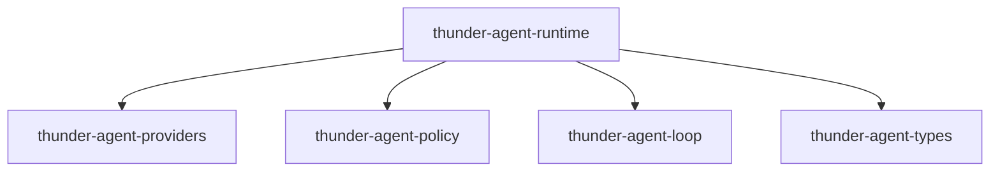
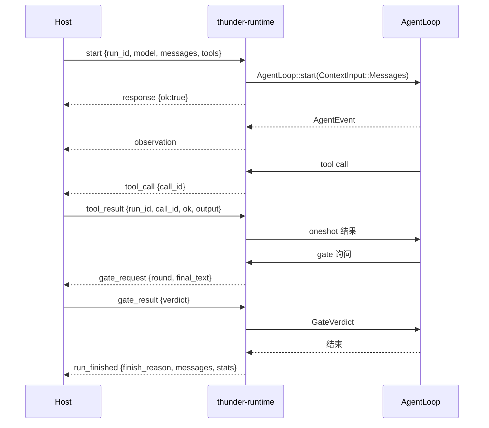

[English](README_en.md) | [简体中文](README.md)

# thunder-agent-runtime

## 定位

`thunder-runtime`：一个 stdio JSONL 的无头 agent 运行时。二进制名 `thunder-runtime`，包名 `thunder-agent-runtime`。

它只做一件事：把 `thunder-agent-loop` 包在一条行分隔的 JSON 协议后面，让**宿主**决定模型、工具与"这次回答能不能结束"。工具由宿主执行，runtime 只负责转发调用与等待答案；每次运行的完整 transcript 在结束时交回宿主。

它刻意不含：会话存储、provider 注册表、工作区策略、审批 UI、扩展宿主。宿主说什么就是什么。

**它是 chat-style runtime**：`start` 请求带着消息列表（`messages`）和可选的 `system_prompt` 进来，运行过程中通过 `observation` 流式输出，遇到工具就发 `tool_call` 等宿主回 `tool_result`，结束时 `run_finished` 把整份 `messages` 交回。runtime 不记得上一次运行，宿主负责保存并决定下一次带哪些消息。

- stdout 只写协议帧，日志一律走 stderr。
- `--config-dir <path>` 指定本进程的 Thunder 数据根（等价于设置 `THUNDER_CONFIG_DIR`）；显式参数优先于继承来的环境变量。缺路径参数时打印错误并以退出码 2 结束。

## crate 边界

- 内部依赖：`thunder-agent-loop`（`AgentLoop`、`AgentConfig`、`ContextInput`、`AgentEvent`、`FinishReason`、`AgentStats`、`loop_engine::gate`）、`thunder-agent-policy`（`AgentTool`、`ToolExecutionContext`、`ToolRegistry`、`ToolExecutor`、`RegistryTools`）、`thunder-agent-providers`（`ModelDescriptor`、`RpiAiClient`）、`thunder-agent-types`（`ToolEffect`、`ToolDefinition`）。
- 工作区内没有 crate 依赖它：它是一个独立可执行程序（`[[bin]] name = "thunder-runtime"`），由工作区外的宿主按进程启动。
- 与 `thunder-agent-daemon` 的分工：daemon 拥有会话库与产品策略；runtime 什么都没有，只有 loop 和协议。

## 模块

| 文件 | 内容 |
|---|---|
| `main.rs` | 参数处理、stdin 逐行解析、`Runtime::handle` 分派、EOF 时 `shutdown` |
| `protocol.rs` | `RuntimeRequest`、`RuntimeEvent`、`RemoteToolSpec`、`GateSpec`、`PROTOCOL_VERSION` |
| `session.rs` | `Runtime`：run 生命周期、run 表、stdout 写线程 |
| `remote.rs` | `RemoteTool`、`RemoteGate`、`PendingTools`、`PendingGates`、`parse_effect` |

## 协议

一行一个 JSON 对象，两个方向都是。请求用 `method` 标记（snake_case），事件用 `type` 标记（snake_case）。

### 请求

| `method` | 字段 | 说明 |
|---|---|---|
| `ping` | `id?` | 存活检查；`response` 里带回 `version`（当前 `"2"`） |
| `start` | `id?`、`run_id`、`model`、`system_prompt?`、`messages[]`、`tools[]`、`max_turns?`、`temperature?`、`thinking_level?`、`request_timeout_ms`、`session_id?`、`gate?` | 启动一次运行；事件都带同一个 `run_id` |
| `tool_result` | `id?`、`run_id`、`call_id`、`ok`（默认 `false`）、`output` | 回答一个 `tool_call` |
| `gate_result` | `id?`、`run_id`、`verdict`、`feedback?` | 回答一个 `gate_request`；`verdict` ∈ `pass` / `retry` / `fail` |
| `cancel` | `id?`、`run_id` | 取消一次运行 |

`start` 的默认值：

| 字段 | 默认 | 作用 |
|---|---|---|
| `request_timeout_ms` | `60_000` | 单次请求超时，同时作为工具默认超时 |
| `gate` | 无 | 不安装完成门 |
| `gate.max_rounds` | `3`（`GateSpec`） | 门最多把运行打回几次 |
| `messages` | `[]` | 从空上下文开始 |
| `tools` | `[]` | **不安装任何工具** |

`model` 是 `thunder_agent_providers::ModelDescriptor`：camelCase 的 pi-ai 形状（`provider`、`id`、`api`、`baseUrl`、`apiKey`、`contextWindow`、`maxTokens`、`compat`…）。宿主自带模型描述，runtime 不读 `models.json`。

`tools` 的每一项是 `RemoteToolSpec`：

| 字段 | 说明 |
|---|---|
| `name`、`description`、`parameters` | 直接成为 `ToolDefinition`（`parameters` 缺省为 `{"type":"object","properties":{}}`） |
| `effect?` | `read` / `write` / `exec` / `plan_artifact`；其它或省略 → `ToolEffect::Other`（按"会改状态"处理） |

线路上同时接受 camelCase 别名：`runId`、`callId`、`systemPrompt`、`maxTurns`、`thinkingLevel`、`requestTimeoutMs`、`sessionId`、`maxRounds`。

### 事件

| `type` | 字段 | 何时 |
|---|---|---|
| `response` | `id?`、`ok`、`version?`、`error?` | 对带直接答案的请求的回复 |
| `observation` | `run_id`、`event` | loop 的事件原样转发（`AgentEvent`：`turn_start`、`token_delta`、`reasoning_delta`、`tool_call_ready`、`tool_exec_start`、`tool_exec_result`、`tool_trace`、`turn_end`、`context_compacted`、`error`、`custom`、`gate_result`、`loop_complete` …） |
| `tool_call` | `run_id`、`call_id`、`name`、`arguments` | loop 需要宿主执行工具 |
| `gate_request` | `run_id`、`round`、`final_text` | loop 想结束，等宿主裁决 |
| `run_finished` | `run_id`、`finish_reason`、`final_content?`、`messages`、`stats` | 运行结束；`messages` 是完整 transcript |
| `error` | `run_id?`、`message` | 运行失败，或不属于任何运行的协议错误 |

`finish_reason` 取 `thunder_agent_loop::FinishReason`：`Done` / `MaxTurnsExceeded` / `BudgetExceeded` / `Cancelled` / `Error`。

## 一次运行的流程

`Runtime::start_run` 的构造顺序：

1. 拒绝重复的 `run_id`（`response.ok = false`）。
2. `AgentConfig::new(model.id)`，再填入 `system_prompt`、`max_turns`、`temperature`、`thinking_level`、`request_timeout_ms`、`session_id`。未填的字段保持 `AgentConfig` 默认值（例如 `max_turns` 默认 `50`、`max_tool_output_bytes` 默认 64 KiB、`prompt_cache_warm` 默认关闭）。
3. `RpiAiClient::from_descriptor(&model, request_timeout_ms)`；方言不受支持或构造失败时直接回 `response.ok = false`，错误里带模型名。
4. `ToolRegistry::new(max_tool_output_bytes, request_timeout_ms)`，为每个 `RemoteToolSpec` 注册一个 `RemoteTool`；再接 `ToolExecutor` 与 `RegistryTools`，交给 `agent.with_tools(..)`。
5. 有 `gate` 时 `with_completion_gate(RemoteGate, max_rounds)`。
6. 每个 run 一个 `CancellationToken` 存进 `runs` 表；`agent.start(ContextInput::Messages(messages), Some(token))`。
7. 先回 `response {ok:true}`，再起两个任务：一个把 loop 事件转成 `observation`，一个 `join` 运行并在结束时发 `run_finished` 或 `error`。

stdout 由**单个写线程**持有：所有帧经一个无界 channel 汇聚，逐行写出并 flush，因此帧不会在一行中间交错。`shutdown`（stdin EOF）先取消所有运行，再通过 `watch` 通知写线程把已排队的帧排空后退出。

## 为什么默认不安装任何工具

runtime 自己没有任何内置工具：没有 shell、没有文件读写、没有搜索。注册表初始为空，只有宿主在 `start.tools` 里声明的工具才会出现。

原因在协议本身：runtime 无法执行宿主的业务动作——读宿主的数据库、点宿主页面上的按钮、调用宿主的内部 API。它能做的只有把调用原样转发出去。于是"没有声明工具"就等于"这次运行没有工具"，而不是"runtime 偷偷给一套默认工具"。`start` 的默认值测试（`start_defaults_are_conservative`）把这条钉住：`tools` 为空时，loop 拿到的工具清单也是空的。

同理，runtime 不安装工具策略：`ToolExecutor` 上没有 `with_tool_scope` / `with_tool_gate`，漏斗里只有宿主声明过的 `RemoteTool`。源码的措辞是"a registry with no gate and no scope is exactly 'everything the guard allows runs'"。

## `RemoteTool` / `RemoteGate`

| 类型 | pending 键 | 发出 | 等待 |
|---|---|---|---|
| `PendingTools` | `(run_id, call_id)` | `tool_call` | `oneshot::Sender<(bool, String)>` |
| `PendingGates` | `run_id` | `gate_request` | `oneshot::Sender<GateVerdict>` |

`(run_id, call_id)` 而不是只有 `call_id`：宿主在每一帧里都会写 `run_id`，只按调用 id 索引会让发往 A 运行的答案落到 B 运行的调用上，宿主复用 id 时直接冲突。

`RemoteTool::execute` 的路径：

1. 以 `(run_id, ctx.tool_call_id)` 登记 `oneshot`。
2. 发 `tool_call`；发送失败（写线程已关闭）→ 移除登记，返回 `Err("the host is gone; tool call could not be delivered")`。
3. `tokio::select!`（`biased`）：取消 token 先触发 → 移除登记并返回 `Err("run cancelled while the host was executing the tool")`；否则等答案：`ok=true` → `Ok(output)`，`ok=false` → `Err(output)`，发送端被丢弃 → `Err("the host dropped the tool call without answering")`。

取消优先是刻意的：宿主永不回答也不能把任务拖过一次运行的生命周期，并且登记项不会泄漏。

`RemoteGate::verify`：登记 `run_id`，发 `gate_request`；宿主已消失或运行被取消时一律返回 `GateVerdict::Pass`——只有 pass 能让循环无副作用地退出，`retry` 会在拆栈途中制造一次虚假重试。正常路径把 `verdict` 映射为 `Pass` / `Retry { feedback }` / `Fail { reason }`（`fail` 时 `feedback` 缺省为 `"rejected by host"`）。

## 失败方向

| 现象 | 结果 |
|---|---|
| stdin 某行不是合法 JSON | 能解析出 `id` 时回 `response {ok:false}`，否则发无 `run_id` 的 `error` 帧；进程继续 |
| `run_id` 重复 | `response {ok:false, error:"run \`..\` already exists"}` |
| `cancel` 未知运行 | `response {ok:false, error:"no such run \`..\`"}` |
| `tool_result` 找不到 pending 项 | `response {ok:false, error:"no pending tool call ..."}`；运行内那个调用继续等待，只有取消运行（或写线程消失）才会解开 |
| `gate_result` 的 `verdict` 不认识 | `response {ok:false, error:"unknown verdict \`..\`"}` |
| 模型方言不受支持 / 建 client 失败 | `response {ok:false}`，带 `model \`id\`` 与具体原因 |
| loop 启动失败 | `response {ok:false}`，并清理该 run |
| 运行期错误 | `error` 帧，带 `run_id` |
| stdout 写失败 | 帧被丢弃（写线程是唯一出口，没有第二条路） |

## 测试

单元测试在 crate 内（没有 `tests/` 目录）：

- `session.rs`：一帧恰好一行、以换行结束；`run_finished` 带完整 transcript 与 `finish_reason`。
- `remote.rs`：取消会解开等待中的工具调用且不留 pending 项；`tool_result` 按 `(run_id, call_id)` 命中；取消时 gate 返回 `Pass` 且不泄漏槽位；`effect` 字符串映射（`WRITE` 大小写不敏感、未知值 → `Other`）；`tool_result` 最小帧反序列化；`start` 默认值（`max_turns` 无、`request_timeout_ms = 60_000`、无 gate、无工具）。

## 扩展点

- **加请求/事件**：`protocol.rs` 加变体，`Runtime::handle` 加分支；线格式有不兼容变化时递增 `PROTOCOL_VERSION`。
- **新的宿主侧能力**：不需要改 runtime——把它声明成 `RemoteToolSpec`。只有"需要 runtime 自己解释"的东西才值得加协议字段。
- **可控的完成判定**：`start.gate` + 宿主回 `gate_result`；`max_rounds` 决定打回次数。不传 `gate` 就完全没有门。
- **工具需要被并行/只读判定**：用 `effect` 声明；省略会被当成会改状态的工具。
