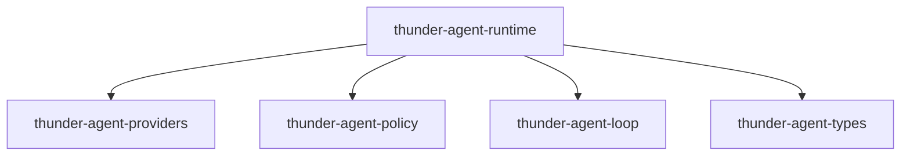
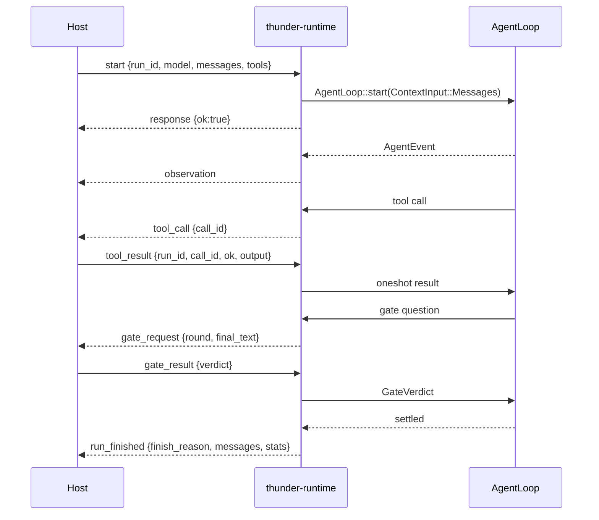

[English](README_en.md) | [简体中文](README.md)

# thunder-agent-runtime

## Purpose

`thunder-runtime`: a headless agent runtime behind a stdio JSONL protocol. Binary `thunder-runtime`, package `thunder-agent-runtime`.

It does one thing: wrap `thunder-agent-loop` behind a line-delimited JSON protocol so the **host** decides the model, the tools, and whether an answer may finish. Tools are executed by the host; the runtime only forwards the call and waits for the answer. The full transcript of every run goes back to the host when the run settles.

Deliberately absent: session storage, provider registry, workspace policy, approval UI, extension host. Whatever the host says goes.

**It is a chat-style runtime**: a `start` request arrives with a message list (`messages`) and an optional `system_prompt`; progress streams out as `observation` frames; a tool becomes a `tool_call` that waits for the host's `tool_result`; and `run_finished` returns the whole `messages` transcript. The runtime remembers nothing between runs — the host keeps the transcript and decides what to send next time.

- stdout carries protocol frames only; logs go to stderr.
- `--config-dir <path>` names this process's Thunder data root (equivalent to setting `THUNDER_CONFIG_DIR`); the explicit flag wins over an inherited environment variable. A missing value prints an error and exits with code 2.

## Crate boundary

- Internal dependencies: `thunder-agent-loop` (`AgentLoop`, `AgentConfig`, `ContextInput`, `AgentEvent`, `FinishReason`, `AgentStats`, `loop_engine::gate`), `thunder-agent-policy` (`AgentTool`, `ToolExecutionContext`, `ToolRegistry`, `ToolExecutor`, `RegistryTools`), `thunder-agent-providers` (`ModelDescriptor`, `RpiAiClient`), `thunder-agent-types` (`ToolEffect`, `ToolDefinition`).
- No crate in the workspace depends on it: it is a standalone executable (`[[bin]] name = "thunder-runtime"`), launched as a process by hosts outside the workspace.
- Division of labour with `thunder-agent-daemon`: the daemon owns the conversation store and product policy; the runtime owns nothing but the loop and the protocol.

## Modules

| File | Contents |
|---|---|
| `main.rs` | argument handling, line-by-line stdin parsing, dispatch into `Runtime::handle`, `shutdown` on EOF |
| `protocol.rs` | `RuntimeRequest`, `RuntimeEvent`, `RemoteToolSpec`, `GateSpec`, `PROTOCOL_VERSION` |
| `session.rs` | `Runtime`: run lifecycle, run table, stdout writer |
| `remote.rs` | `RemoteTool`, `RemoteGate`, `PendingTools`, `PendingGates`, `parse_effect` |

## Protocol

One JSON object per line, in both directions. Requests are tagged by `method` (snake_case); events by `type` (snake_case).

### Requests

| `method` | Fields | Meaning |
|---|---|---|
| `ping` | `id?` | liveness check; the `response` carries `version` (currently `"2"`) |
| `start` | `id?`, `run_id`, `model`, `system_prompt?`, `messages[]`, `tools[]`, `max_turns?`, `temperature?`, `thinking_level?`, `request_timeout_ms`, `session_id?`, `gate?` | start one run; every event of that run carries the same `run_id` |
| `tool_result` | `id?`, `run_id`, `call_id`, `ok` (default `false`), `output` | answer a `tool_call` |
| `gate_result` | `id?`, `run_id`, `verdict`, `feedback?` | answer a `gate_request`; `verdict` ∈ `pass` / `retry` / `fail` |
| `cancel` | `id?`, `run_id` | cancel a run |

`start` defaults:

| Field | Default | Effect |
|---|---|---|
| `request_timeout_ms` | `60_000` | per-request timeout; also the tool default timeout |
| `gate` | none | no completion gate installed |
| `gate.max_rounds` | `3` (`GateSpec`) | how many times the gate may send the run back |
| `messages` | `[]` | start from an empty context |
| `tools` | `[]` | **no tools installed** |

`model` is a `thunder_agent_providers::ModelDescriptor`: the camelCase pi-ai shape (`provider`, `id`, `api`, `baseUrl`, `apiKey`, `contextWindow`, `maxTokens`, `compat`, …). The host brings the model description; the runtime never reads `models.json`.

Each `tools` entry is a `RemoteToolSpec`:

| Field | Meaning |
|---|---|
| `name`, `description`, `parameters` | become the `ToolDefinition` directly (`parameters` defaults to `{"type":"object","properties":{}}`) |
| `effect?` | `read` / `write` / `exec` / `plan_artifact`; anything else or absent → `ToolEffect::Other` (treated as state-changing) |

camelCase aliases are accepted on the wire: `runId`, `callId`, `systemPrompt`, `maxTurns`, `thinkingLevel`, `requestTimeoutMs`, `sessionId`, `maxRounds`.

### Events

| `type` | Fields | When |
|---|---|---|
| `response` | `id?`, `ok`, `version?`, `error?` | reply to a request that has a direct answer |
| `observation` | `run_id`, `event` | a loop event forwarded verbatim (`AgentEvent`: `turn_start`, `token_delta`, `reasoning_delta`, `tool_call_ready`, `tool_exec_start`, `tool_exec_result`, `tool_trace`, `turn_end`, `context_compacted`, `error`, `custom`, `gate_result`, `loop_complete`, …) |
| `tool_call` | `run_id`, `call_id`, `name`, `arguments` | the loop needs the host to execute a tool |
| `gate_request` | `run_id`, `round`, `final_text` | the loop wants to stop and waits for the host's verdict |
| `run_finished` | `run_id`, `finish_reason`, `final_content?`, `messages`, `stats` | the run settled; `messages` is the full transcript |
| `error` | `run_id?`, `message` | a run failed, or a protocol error belonging to no run |

`finish_reason` is `thunder_agent_loop::FinishReason`: `Done` / `MaxTurnsExceeded` / `BudgetExceeded` / `Cancelled` / `Error`.

## Lifecycle of one run

`Runtime::start_run` builds, in order:

1. Rejects a duplicate `run_id` (`response.ok = false`).
2. `AgentConfig::new(model.id)`, then fills `system_prompt`, `max_turns`, `temperature`, `thinking_level`, `request_timeout_ms`, `session_id`. Unset fields keep `AgentConfig` defaults (e.g. `max_turns` defaults to `50`, `max_tool_output_bytes` to 64 KiB, `prompt_cache_warm` is off).
3. `RpiAiClient::from_descriptor(&model, request_timeout_ms)`; an unsupported dialect or a construction failure replies `response.ok = false` with the model name in the error.
4. `ToolRegistry::new(max_tool_output_bytes, request_timeout_ms)`, one `RemoteTool` per `RemoteToolSpec`, then `ToolExecutor` + `RegistryTools` handed to `agent.with_tools(..)`.
5. With a `gate`, `with_completion_gate(RemoteGate, max_rounds)`.
6. One `CancellationToken` per run, stored in the `runs` table; `agent.start(ContextInput::Messages(messages), Some(token))`.
7. Reply `response {ok:true}`, then spawn two tasks: one turns loop events into `observation` frames, one `join`s the run and emits `run_finished` or `error`.

stdout is owned by a **single writer task**: every frame funnels through one unbounded channel and is written and flushed line by line, so frames never interleave mid-line. `shutdown` (stdin EOF) cancels every run, then signals the writer through a `watch` channel to drain what is already queued and exit.

## Why no tools are installed by default

The runtime ships no built-in tools: no shell, no file access, no search. The registry starts empty, and only tools declared in `start.tools` exist.

The reason is the protocol itself: the runtime cannot perform the host's business actions — read the host's database, click a button in the host's UI, call the host's internal API. All it can do is forward the call. So "no tools declared" means "this run has no tools", not "the runtime quietly provides a default set". The `start` defaults test (`start_defaults_are_conservative`) pins this: with an empty `tools`, the loop's tool list is empty too.

Symmetrically, the runtime installs no tool policy: the `ToolExecutor` is never given `with_tool_scope` / `with_tool_gate`, so the funnel contains only the host-declared `RemoteTool`s. The source puts it as "a registry with no gate and no scope is exactly 'everything the guard allows runs'".

## `RemoteTool` / `RemoteGate`

| Type | Pending key | Emits | Waits on |
|---|---|---|---|
| `PendingTools` | `(run_id, call_id)` | `tool_call` | `oneshot::Sender<(bool, String)>` |
| `PendingGates` | `run_id` | `gate_request` | `oneshot::Sender<GateVerdict>` |

Keying on `(run_id, call_id)` rather than `call_id` alone: the host names the run in every frame, and call-id-only keys would let an answer addressed to one run resolve a call in another (and collide outright when a host reuses ids).

`RemoteTool::execute`:

1. Register a `oneshot` under `(run_id, ctx.tool_call_id)`.
2. Send `tool_call`; if the send fails (writer gone) → remove the entry and return `Err("the host is gone; tool call could not be delivered")`.
3. `tokio::select!` with `biased`: a cancelled token first → remove the entry and return `Err("run cancelled while the host was executing the tool")`; otherwise await the answer: `ok=true` → `Ok(output)`, `ok=false` → `Err(output)`, sender dropped → `Err("the host dropped the tool call without answering")`.

Cancellation-first is deliberate: a host that never answers must not hold the task past the run it belongs to, and the pending entry must not leak.

`RemoteGate::verify`: register the `run_id`, send `gate_request`; a vanished host or a cancelled run always yields `GateVerdict::Pass` — only pass lets the loop unwind without side effects, while `retry` would manufacture a spurious retry during teardown. The normal path maps `verdict` to `Pass` / `Retry { feedback }` / `Fail { reason }` (`fail` defaults `feedback` to `"rejected by host"`).

## Failure directions

| Symptom | Result |
|---|---|
| A stdin line is not valid JSON | if an `id` can be extracted, reply `response {ok:false}`; otherwise emit an `error` frame with no `run_id`. The process keeps going |
| Duplicate `run_id` | `response {ok:false, error:"run \`..\` already exists"}` |
| `cancel` for an unknown run | `response {ok:false, error:"no such run \`..\`"}` |
| `tool_result` with no pending entry | `response {ok:false, error:"no pending tool call ..."}`; that call inside the run keeps waiting — only cancelling the run (or losing the writer) unblocks it |
| Unrecognized `gate_result.verdict` | `response {ok:false, error:"unknown verdict \`..\`"}` |
| Unsupported model dialect / client construction failure | `response {ok:false}` naming `model \`id\`` and the cause |
| Loop fails to start | `response {ok:false}`, and the run is cleaned up |
| Runtime error mid-run | an `error` frame carrying `run_id` |
| stdout write failure | the frame is dropped (the writer is the only exit; there is no second path) |

## Tests

Unit tests live inside the crate (no `tests/` directory):

- `session.rs`: one frame is exactly one newline-terminated line; `run_finished` carries the transcript and `finish_reason`.
- `remote.rs`: cancellation unblocks a waiting tool call and leaves no pending entry; `tool_result` matches by `(run_id, call_id)`; a cancelled gate returns `Pass` and leaks no slot; `effect` mapping (`WRITE` is case-insensitive, unknown values → `Other`); a minimal `tool_result` frame deserializes; `start` defaults (`max_turns` absent, `request_timeout_ms = 60_000`, no gate, no tools).

## Extension points

- **Add a request or event**: add the variant in `protocol.rs` and a branch in `Runtime::handle`; bump `PROTOCOL_VERSION` on an incompatible wire change.
- **A new host-side capability**: no runtime change — declare it as a `RemoteToolSpec`. Only things the runtime itself must interpret deserve protocol fields.
- **Host-controlled completion**: `start.gate` plus a `gate_result` reply; `max_rounds` bounds the retries. Without `gate` there is no gate at all.
- **Read-only / parallel judgement for a tool**: declare `effect`; omitting it makes the tool state-changing.
