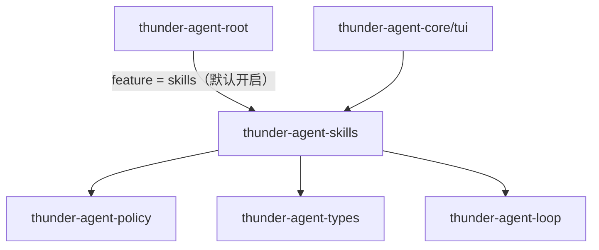
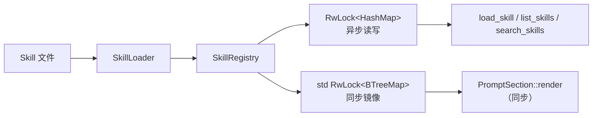

[English](README_en.md) | [简体中文](README.md)

# thunder-agent-skills

## 定位

Skill 的发现、解析、注册与工具暴露。一个 skill 是"一段按需加载的指令集"：目录扫描时只读取元数据（名字、描述、标签、触发词），完整 playbook 留在 `prompt_instructions` 里，等模型显式调用 `load_skill` 才进入上下文。

- 发现的来源：文件系统（默认搜索路径 + 宿主显式给出的路径）。
- 解析的格式：带 YAML frontmatter 的 Markdown、纯 Markdown、JSON、YAML。
- 对外形态：`SkillRegistry`（名字索引）+ 三个 `AgentTool`。
- 不含：prompt 拼装、会话状态、按运行切换 skill 的产品策略。

## crate 边界



- 内部依赖：`thunder-agent-policy`（`AgentTool`、`ToolExecutionContext`）、`thunder-agent-types`（`ToolDefinition`）、`thunder-agent-loop`（`core::paths::thunder_config_dir` / `real_home_dir`）。另有 `serde_yaml`、`glob`、`regex`、`tokio`、`tracing`。
- 下游：`thunder-agent-root`（`SkillsPlugin`，`Cargo.toml` 的 `skills` feature，默认开启）、`thunder-agent-core/tui`（`/skills` 命令与目录渲染）。

## 模块

| 模块 | 内容 |
|---|---|
| `types` | `Skill`、`SkillSummary`、`SkillHandle` |
| `parser` | `SkillParser`：`parse_markdown` / `parse_json` / `parse_yaml` |
| `loader` | `SkillLoader`：单文件、目录递归、多路径、默认搜索路径 |
| `registry` | `SkillRegistry`：注册表、排序列举、匹配、catalog 渲染 |
| `tools` | `LoadSkillTool` / `ListSkillsTool` / `SearchSkillsTool`、`create_skill_tools` |
| `error` | `SkillError` |

## 核心类型

| 类型 | 关键字段 | 说明 |
|---|---|---|
| `Skill` | `name`、`description`、`version`、`author`、`tags`、`triggers`、`prompt_instructions`、`parameters`、`location`、`metadata` | 唯一标识是 `name`；`location` 是来源文件 |
| `SkillSummary` | `name`、`description`、`tags`、`triggers`、`location` | 不含正文，用于索引/目录 |
| `SkillHandle` | `name`、`description`、`location` | 会话里"已挂上"的轻量句柄；`system_prompt_fragment()` 只给紧凑片段（名字 + 描述 + 提示可用 `load_skill`），不含正文 |
| `SkillRegistry` | 私有：`skills: RwLock<HashMap>` + 同步镜像 `BTreeMap` | 名字唯一；后注册者覆盖前者 |

## 解析（`SkillParser`）

`SkillLoader::load_file` 按扩展名分派：`.json` → `parse_json`，`.yaml` / `.yml` → `parse_yaml`，其余一律 `parse_markdown`。

`parse_markdown` 依次尝试三种形状：

1. **YAML frontmatter**：文首 `---`，到下一个 `\n---` 为止是 frontmatter，其余是正文。可解析 `name`、`description`、`version`、`author`、`tags`、`triggers`、`metadata`。`tags` / `triggers` 既接受 YAML 序列，也接受换行/`- ` 列表形式的字符串；序列里的数字转成字符串。缺 `name` 时用文件名（去扩展名），再缺则 `unnamed_skill`；缺 `description` 时取正文第一行。
2. **XML 片段**：正文同时含 `<skill>` 与 `</skill>` 时，抽取 `<name>`、`<description>`、`<instructions>`（缺失项分别回落文件名、`Skill instructions for {name}`、整篇内容）。
3. **纯 Markdown**：文首连续的 `# ` 行作名字、`> ` 行作描述，遇到第一个其它非空行即进入正文；名字回落文件名，描述回落 `Skill instructions for {name}`。

JSON / YAML 格式直接反序列化整个 `Skill`（字段名 snake_case，例如 `prompt_instructions`）；文件里没写 `location` 时补上真实路径。

## 发现（`SkillLoader`）

| 入口 | 行为 |
|---|---|
| `load_file(path)` | 文件不存在 → `SkillError::NotFound`；读失败 → `IoError` |
| `load_dir(dir)` | 目录不存在 → `NotFound`；用显式栈做迭代式深度遍历；跳过 `.git` 与 `target` 目录；只考虑 `md` / `markdown` / `json` / `yaml` / `yml`；**跳过 `README*`**；单个文件解析失败只 `warn!` 并继续 |
| `load_search_paths(paths)` | 路径可为文件或目录；按名字去重，**先出现者胜** |
| `default_search_paths()` | 组合下表的默认路径 |
| `scan_default_and_report()` | 扫描默认路径，返回 `(skills, 人类可读报告)` |

默认搜索顺序（`default_search_paths_from(thunder_home, real_home, global_disabled)`）：

| # | 路径 | 归属 |
|---|---|---|
| 1 | `.agents/skills` | 当前工作目录 |
| 2 | `.pi/skills` | 当前工作目录 |
| 3 | `skills` | 当前工作目录 |
| 4 | `$HOME/.agents/skills` | 用户级（`THUNDER_SKILLS_NO_GLOBAL` 可关） |
| 5 | `<root>/skills` | Thunder 自己的数据根（同上） |
| 6 | `$HOME/.pi/agent/skills` | 用户级（同上） |
| 7 | `$HOME/.pi/skills` | 用户级（同上） |

`<root>` = `THUNDER_CONFIG_DIR`，否则 `~/.thunder`。Thunder 自己的目录跟随数据根，`.agents` / `.pi` 始终按真实 `$HOME` 解析。`THUNDER_SKILLS_NO_GLOBAL=1`（或 `true`）丢弃第 4–7 项，让一次运行不继承跨工作区的用户 skill。

## 注册表（`SkillRegistry`）



两份存储：

- `skills: Arc<tokio::sync::RwLock<HashMap<String, Skill>>>`：异步主表。
- `snapshot: Arc<std::sync::RwLock<BTreeMap<String, Skill>>>`：只在 `register` / `register_sync` / `unregister` 时同步写入，供**不能 await** 的同步读取（prompt 组装）使用。`try_read` 在注册恰好持有写锁时会静默返回空表，把整个 catalog 从 prompt 里抹掉并破坏缓存前缀，所以需要镜像而不是重试。

| 方法 | 顺序 | 用途 |
|---|---|---|
| `list()` | 按 `name` 升序 | 异步列举 |
| `list_sync()` | 按 `name` 升序（`BTreeMap` 天然有序） | 同步列举，供 prompt 段落 |
| `list_summaries()` | **未排序**（直接遍历 HashMap） | 需要稳定顺序时改用 `list()` 再 `summary()` |
| `build_xml_catalog()` | 按 `name` 升序 | `<available_skills>` XML 目录 |
| `match_prompt(query)` | 按得分降序 | 触发词匹配 |
| `register` / `register_sync` / `unregister` / `get` / `contains` / `len` / `is_empty` | | 注册与查询 |

**为什么顺序重要**：catalog 会进入 system prompt。`HashMap` 的迭代顺序在同一进程的两次运行、以及不同进程之间都可能不同；顺序一抖，prompt 前缀就变，provider 的 prompt cache 全部失效。所以凡是"进 prompt"的列举（`list`、`list_sync`、`build_xml_catalog`）都按名字排序。

匹配打分（`Skill::match_score`）：名字被查询包含 +10；每个触发词被包含 +5；每个标签被包含 +3；描述包含整条查询 +2。`matches_query` 只看名字、触发词（双向包含）与标签。

其余渲染入口：`build_prompt_contribution(&[Skill])`（含完整 instructions）、`render_catalog_markdown()`、`format_skills_catalog_markdown(&[Skill])`、`render_skill_markdown(name)`。

## 暴露的工具

`create_skill_tools(registry)` 返回三个 `Arc<dyn AgentTool>`：

| 工具 | 参数 | 行为 |
|---|---|---|
| `load_skill` | `skill_name`（也接受 `name`） | 从注册表取 `Skill`，返回 `# Skill:` + 描述/标签/触发词/来源 + `## Instructions:` + 完整 `prompt_instructions`；名字不存在 → `Err("... was not found in registry.")` |
| `list_skills` | 可选 `tag_filter` | 列出全部（或标签精确匹配、大小写不敏感）的名字与描述、标签、触发词 |
| `search_skills` | `query` | 空查询 → 全量列举；否则 `match_prompt` 排序结果 |

## catalog 在 prompt 里的位置

拼装发生在宿主（`thunder-agent-root/src/plugins/skills.rs` 的 `SkillsPlugin`，不在本 crate），形态是 `PromptSection` + `Prepared`：

- `impl PromptSection::id() == "skills"`，`order()` 用默认值 `100`；`render()` 同步读取 `list_sync()`，输出：

```
Available specialized skills in registry:
- **<name>**: <description 首行，超过 100 字符截断并加 …>

You can use the `load_skill` tool to inspect full instructions for any of the above skills.
```

  没有 skill 时返回 `None`，该段落不出现。
- `impl Prepared::prepare()` 在每次运行前补齐注册表：默认搜索路径（宿主侧缓存 120 秒）、工作区的 `.agents/skills`、`.pi/skills`、`skills`，以及宿主显式添加的搜索路径。

因此 prompt 里只有**索引**；正文只在 `load_skill` 的返回值里出现。

## 已知限制

- **`README.md` 不会被当作 skill 发现**。`load_dir` 明确跳过 `readme.md`、`readme.markdown`、`readme_*`、`readme.*`（大小写不敏感）：这是为了避免把 skill 目录的说明文档误收成 skill。代价是，如果一个 skill 只以 `README.md` 文件存在，目录扫描看不见它；`load_file` 仍会解析它，但名字会取文件名主干 `README`。当前行为就是这样，本文档只记录，不做修改。
- 同名 skill 静默覆盖：注册表以 `name` 为键，后注册者替换前者；`load_search_paths` 则在路径层面先到先得。两种去重语义不同，跨路径同名时需要自己确认最终生效的是哪一份。
- 目录遍历依赖 `read_dir` 的返回顺序与显式栈，同一目录内的多个文件不保证固定的解析顺序；需要稳定顺序的消费方应使用 `list()` / `list_sync()`。

## 失败方向

| 现象 | 结果 |
|---|---|
| 文件/目录不存在 | `SkillError::NotFound` |
| 读文件失败 | `SkillError::IoError` |
| frontmatter 不是合法 YAML | `SkillError::InvalidFrontmatter` |
| JSON / YAML 文件结构不符 | `SkillError::ParseError` |
| 目录里某个文件坏了 | `warn!` + 跳过；`load_dir` 仍返回其余 skill |
| 工具参数缺失 | `load_skill` → `Err("Missing required parameter 'skill_name'")` |
| 工具名查不到 | `load_skill` → `Err("Skill '<name>' was not found in registry.")` |

## 测试

`tests/skills_test.rs` 覆盖：

- frontmatter 解析（`name` / `description` / `version` / `author` / `tags` / `triggers`）与正文；
- 纯 Markdown（`# 名字` + `> 描述`）；
- JSON skill；
- 注册表计数与 `match_prompt` 排序；
- 目录递归扫描（`.md` 与嵌套 `.json`）；
- 三个工具的实际执行结果；
- `THUNDER_SKILLS_NO_GLOBAL` 对默认路径的影响（直接断言路径列表，避免跨测试污染进程环境）。

## 扩展点

- **加一种文件格式**：`load_dir` 的白名单 + `load_file` 的分派 + `SkillParser` 上新解析函数。
- **改 catalog 形态**：`build_xml_catalog` / `build_prompt_contribution` / `format_skills_catalog_markdown`（本 crate）或宿主的 `PromptSection::render`（决定段落位置与截断）。
- **新增工具**：实现 `AgentTool` 并在 `create_skill_tools` 里追加，注册表可 clone。
- **换搜索路径**：宿主 `with_search_path(..)`；本 crate 侧只改 `default_search_paths_from`。
