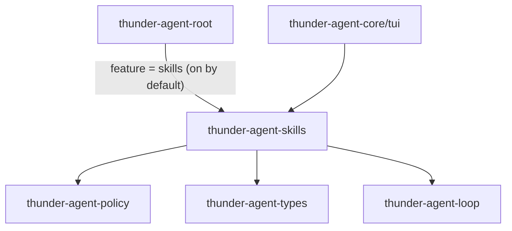
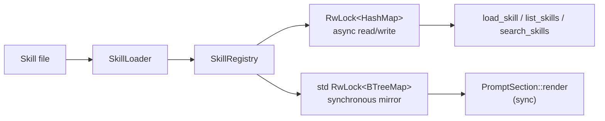

[English](README_en.md) | [简体中文](README.md)

# thunder-agent-skills

## Purpose

Skill discovery, parsing, registration, and tool exposure. A skill is an instruction set loaded on demand: directory scans read only metadata (name, description, tags, triggers), while the full playbook stays in `prompt_instructions` until the model explicitly calls `load_skill`.

- Discovery: the filesystem (default search paths plus whatever a host passes explicitly).
- Parsing: Markdown with YAML frontmatter, plain Markdown, JSON, YAML.
- Public shape: a `SkillRegistry` (name index) plus three `AgentTool`s.
- Not included: prompt assembly, session state, or any product policy for selecting skills per run.

## Crate boundary



- Internal dependencies: `thunder-agent-policy` (`AgentTool`, `ToolExecutionContext`), `thunder-agent-types` (`ToolDefinition`), `thunder-agent-loop` (`core::paths::thunder_config_dir` / `real_home_dir`). Also `serde_yaml`, `glob`, `regex`, `tokio`, `tracing`.
- Downstream: `thunder-agent-root` (`SkillsPlugin`, gated by the `skills` feature which is on by default) and `thunder-agent-core/tui` (the `/skills` command and catalog rendering).

## Modules

| Module | Contents |
|---|---|
| `types` | `Skill`, `SkillSummary`, `SkillHandle` |
| `parser` | `SkillParser`: `parse_markdown` / `parse_json` / `parse_yaml` |
| `loader` | `SkillLoader`: single file, recursive directory, multiple paths, default search paths |
| `registry` | `SkillRegistry`: registration, ordered listing, matching, catalog rendering |
| `tools` | `LoadSkillTool` / `ListSkillsTool` / `SearchSkillsTool`, `create_skill_tools` |
| `error` | `SkillError` |

## Core types

| Type | Key fields | Notes |
|---|---|---|
| `Skill` | `name`, `description`, `version`, `author`, `tags`, `triggers`, `prompt_instructions`, `parameters`, `location`, `metadata` | `name` is the identity; `location` is the source file |
| `SkillSummary` | `name`, `description`, `tags`, `triggers`, `location` | no body; for indexes and catalogs |
| `SkillHandle` | `name`, `description`, `location` | the lightweight handle a session keeps; `system_prompt_fragment()` emits a compact fragment (name + description + a pointer to `load_skill`), never the body |
| `SkillRegistry` | private: `skills: RwLock<HashMap>` plus a synchronous `BTreeMap` mirror | names are unique; a later registration replaces an earlier one |

## Parsing (`SkillParser`)

`SkillLoader::load_file` dispatches on extension: `.json` → `parse_json`, `.yaml` / `.yml` → `parse_yaml`, everything else → `parse_markdown`.

`parse_markdown` tries three shapes in order:

1. **YAML frontmatter**: a leading `---` up to the next `\n---` is the frontmatter, the rest is the body. Recognized keys: `name`, `description`, `version`, `author`, `tags`, `triggers`, `metadata`. `tags` / `triggers` accept either a YAML sequence or a newline/`- ` string list; numbers inside a sequence become strings. A missing `name` falls back to the file stem, then to `unnamed_skill`; a missing `description` falls back to the first body line.
2. **XML fragment**: when the body contains both `<skill>` and `</skill>`, `<name>`, `<description>` and `<instructions>` are extracted (missing pieces fall back to the file stem, `Skill instructions for {name}` and the whole content).
3. **Plain Markdown**: leading `# ` lines give the name and `> ` lines the description; the first other non-empty line starts the body. Name falls back to the file stem, description to `Skill instructions for {name}`.

JSON / YAML skills deserialize a whole `Skill` (snake_case fields such as `prompt_instructions`); when `location` is absent from the file, the real path is filled in.

## Discovery (`SkillLoader`)

| Entry point | Behaviour |
|---|---|
| `load_file(path)` | missing file → `SkillError::NotFound`; read failure → `IoError` |
| `load_dir(dir)` | missing directory → `NotFound`; iterative depth-first walk over an explicit stack; skips `.git` and `target`; considers only `md` / `markdown` / `json` / `yaml` / `yml`; **skips `README*`**; a file that fails to parse only logs `warn!` and is skipped |
| `load_search_paths(paths)` | each path may be a file or a directory; de-duplicated by name, **first occurrence wins** |
| `default_search_paths()` | the default list below |
| `scan_default_and_report()` | scans the defaults and returns `(skills, human-readable report)` |

Default search order (`default_search_paths_from(thunder_home, real_home, global_disabled)`):

| # | Path | Scope |
|---|---|---|
| 1 | `.agents/skills` | current working directory |
| 2 | `.pi/skills` | current working directory |
| 3 | `skills` | current working directory |
| 4 | `$HOME/.agents/skills` | user level (dropped by `THUNDER_SKILLS_NO_GLOBAL`) |
| 5 | `<root>/skills` | Thunder's own data root (same toggle) |
| 6 | `$HOME/.pi/agent/skills` | user level (same toggle) |
| 7 | `$HOME/.pi/skills` | user level (same toggle) |

`<root>` = `THUNDER_CONFIG_DIR`, else `~/.thunder`. Thunder's own directory follows the data root; `.agents` / `.pi` always resolve against the real `$HOME`. `THUNDER_SKILLS_NO_GLOBAL=1` (or `true`) drops entries 4–7 so a run does not inherit cross-workspace user skills.

## Registry (`SkillRegistry`)



Two stores:

- `skills: Arc<tokio::sync::RwLock<HashMap<String, Skill>>>`: the async master table.
- `snapshot: Arc<std::sync::RwLock<BTreeMap<String, Skill>>>`: written only by `register` / `register_sync` / `unregister`, for synchronous readers that cannot await (prompt assembly). A `try_read` on the async lock would silently return an empty catalog whenever a registration held the write lock — dropping every skill from the prompt and breaking its cache prefix — so a mirror is used instead of a retry.

| Method | Order | Use |
|---|---|---|
| `list()` | ascending `name` | async listing |
| `list_sync()` | ascending `name` (a `BTreeMap` is ordered) | synchronous listing for prompt sections |
| `list_summaries()` | **unordered** (iterates the HashMap) | use `list()` then `summary()` when order matters |
| `build_xml_catalog()` | ascending `name` | `<available_skills>` XML catalog |
| `match_prompt(query)` | descending score | trigger matching |
| `register` / `register_sync` / `unregister` / `get` / `contains` / `len` / `is_empty` | | registration and lookup |

**Why order matters**: the catalog goes into the system prompt. `HashMap` iteration order varies between runs of the same process and between processes; when it shifts, the prompt prefix shifts with it and the provider's prompt cache misses entirely. Every listing that feeds the prompt (`list`, `list_sync`, `build_xml_catalog`) therefore sorts by name.

Match scoring (`Skill::match_score`): name contained in the query +10; each contained trigger +5; each contained tag +3; the whole query contained in the description +2. `matches_query` looks only at the name, triggers (containment either way) and tags.

Other rendering entry points: `build_prompt_contribution(&[Skill])` (full instructions), `render_catalog_markdown()`, `format_skills_catalog_markdown(&[Skill])`, `render_skill_markdown(name)`.

## Exposed tools

`create_skill_tools(registry)` returns three `Arc<dyn AgentTool>`:

| Tool | Parameters | Behaviour |
|---|---|---|
| `load_skill` | `skill_name` (also accepts `name`) | fetches the `Skill` and returns `# Skill:` plus description/tags/triggers/source, then `## Instructions:` and the full `prompt_instructions`; an unknown name → `Err("... was not found in registry.")` |
| `list_skills` | optional `tag_filter` | lists every skill (or those with an exactly matching tag, case-insensitive) with description, tags and triggers |
| `search_skills` | `query` | empty query → full listing; otherwise `match_prompt` order |

## Where the catalog enters the prompt

Assembly happens in the host (`SkillsPlugin` in `thunder-agent-root/src/plugins/skills.rs`, outside this crate), as a `PromptSection` plus `Prepared`:

- `PromptSection::id()` is `"skills"` and `order()` uses the default `100`; `render()` reads `list_sync()` synchronously and emits:

```
Available specialized skills in registry:
- **<name>**: <first description line, truncated to 100 chars with …>

You can use the `load_skill` tool to inspect full instructions for any of the above skills.
```

  With no skills it returns `None` and the section does not appear.
- `Prepared::prepare()` tops the registry up before each run: the default search paths (cached host-side for 120 seconds), the workspace's `.agents/skills`, `.pi/skills`, `skills`, and any search paths the host added explicitly.

The prompt thus contains the **index** only; the body appears solely in `load_skill`'s result.

## Known limitations

- **`README.md` is never discovered as a skill.** `load_dir` explicitly skips `readme.md`, `readme.markdown`, `readme_*` and `readme.*` (case-insensitive) so a skill directory's own documentation is not mistaken for a skill. The cost: a skill that exists only as `README.md` is invisible to directory scans. `load_file` would still parse it, but the name becomes the file stem, `README`. This is the current behaviour and is recorded here rather than changed.
- Same-name skills are silently replaced: the registry keys on `name` and a later registration wins, while `load_search_paths` de-duplicates first-wins across paths. The two de-duplication semantics differ; when two paths define one name, determine which copy actually survives.
- Directory traversal depends on `read_dir` order and the explicit stack, so several files in one directory have no guaranteed parse order; consumers that need determinism should use `list()` / `list_sync()`.

## Failure directions

| Symptom | Result |
|---|---|
| File or directory missing | `SkillError::NotFound` |
| File read failure | `SkillError::IoError` |
| Frontmatter is not valid YAML | `SkillError::InvalidFrontmatter` |
| JSON / YAML shape mismatch | `SkillError::ParseError` |
| One bad file in a directory | `warn!` and skip; `load_dir` still returns the rest |
| Tool argument missing | `load_skill` → `Err("Missing required parameter 'skill_name'")` |
| Unknown skill name | `load_skill` → `Err("Skill '<name>' was not found in registry.")` |

## Tests

`tests/skills_test.rs` covers:

- frontmatter parsing (`name` / `description` / `version` / `author` / `tags` / `triggers`) and the body;
- plain Markdown (`# name` + `> description`);
- a JSON skill;
- registry counts and `match_prompt` ranking;
- recursive directory scanning (`.md` plus a nested `.json`);
- the three tools against a real registry;
- the effect of `THUNDER_SKILLS_NO_GLOBAL` on default paths (asserted against the path list directly, avoiding cross-test process-environment pollution).

## Extension points

- **Add a file format**: extend the `load_dir` allow-list, the `load_file` dispatch, and add a `SkillParser` function.
- **Change the catalog shape**: `build_xml_catalog` / `build_prompt_contribution` / `format_skills_catalog_markdown` (this crate), or the host's `PromptSection::render` (which decides placement and truncation).
- **Add a tool**: implement `AgentTool` and append it in `create_skill_tools`; the registry is cloneable.
- **Change search paths**: `with_search_path(..)` on the host; inside this crate only `default_search_paths_from`.
